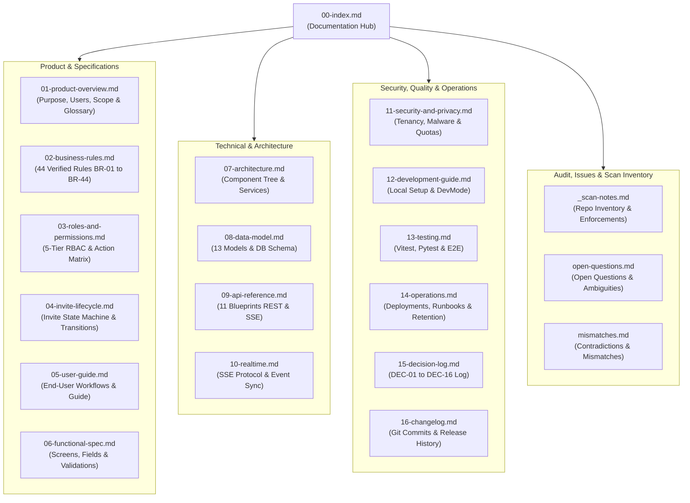

Status: Verified | Last scanned: 2026-10-13 | Audience: All (Product, Engineering, QA, Designers, End Users)

# 00 — Sticky Mind Grid Documentation Index

Welcome to the verified system documentation for **Sticky Mind Grid**, a full-stack real-time Kanban board and task collaboration platform (`package.json:L1-L4`, `backend/app/__init__.py:L16-L99`).

---

## 1. System Overview

**Sticky Mind Grid** organizes work around **Boards** (`backend/app/models/board.py:L7-L68`), where each Board acts as an independent **tenant boundary**:
- **Hierarchy:** Boards contain JSON-configured **Columns** (`Board.columns`, `backend/app/models/board.py:L23`), which contain **Cards / Tasks** (`Task`, `backend/app/models/task.py:L7-L98`).
- **Per-Board Membership & Invitations:** Users are invited to individual boards by email (`POST /api/boards/<board_id>/members`, `backend/app/routes/board_routes.py:L190-L202`) via a dual-model invitation system (`BoardInvitation` + `BoardMember`, `backend/app/services/board_service.py:L388-L629`).
- **Role-Based Access Control (RBAC):** Five hierarchical roles govern permissions per board (`ROLE_HIERARCHY` in `backend/app/utils/decorators.py:L10-L17` and `src/hooks/useBoardPermissions.ts:L164-L222`):
  - **Owner (`5`)** → **Admin (`4`)** → **Editor (`3`, legacy alias: `member`)** → **Commenter (`2`)** → **Viewer (`1`)**
- **Real-Time Collaboration:** Board mutations and direct messages stream to connected clients over Server-Sent Events (SSE) (`GET /api/boards/<board_id>/events` and `GET /api/messages/stream`, `backend/app/routes/board_routes.py:L70-L119`, `backend/app/utils/event_broadcaster.py:L9-L117`, `src/hooks/useBoardRealtime.ts:L130-L341`).
- **Core Capabilities:**
  - **Multi-View Board Workspace:** Kanban Drag-and-Drop (`src/components/kanban/KanbanBoard.tsx`), List View (`src/components/kanban/TaskListView.tsx`), Calendar View (`src/components/kanban/CalendarView.tsx`), Analytics Overview (`src/components/kanban/BoardOverview.tsx`), and Project Hub / Documents View (`src/components/kanban/DocumentsView.tsx`).
  - **Task Modal & Detail Workspace (`src/components/task/TaskDetailWorkspace.tsx`, `src/components/kanban/TaskModal.tsx`):** Status, priority (`low`, `medium`, `high`, `urgent`), progress (`0–100%` or checklist-locked), single assignee (`editor`+ role required), followers, due date, tags, optimistic-concurrency markdown description (`lastKnownUpdatedAt`), checklist subtasks, file attachments (with magic-byte and malware scanning in `backend/app/services/file_service.py:L63-L109`), threaded comments with `@mentions` (`backend/app/services/comment_service.py:L18-L120`), and per-task activity feed.
  - **30-Day Soft Delete & Trash:** Soft delete with 30-day lazy retention for both Tasks (`Task.is_deleted`, `backend/app/services/task_service.py:L17-L44`) and Boards (`Board.is_deleted`, `backend/app/services/board_service.py:L14-L43`).
  - **Cross-Board Task Move:** Atomic transfer of tasks between boards where the user holds `editor`+ access (`POST /api/tasks/<task_id>/move`, `backend/app/services/task_service.py:L313-L398`).
  - **Immutable Activity Audit Log & Data Export:** Append-only `activities` table (`backend/app/routes/activity_routes.py:L51-L55`) and full JSON export at both the Board level (`GET /api/boards/<board_id>/export`, `backend/app/services/board_service.py:L1104-L1163`) and Account level (`GET /api/users/me/export`, `backend/app/services/user_service.py:L122-L180`).

---

## 2. Documentation Map

### 2.1 Mermaid Diagram

### 2.2 Text Version of the Documentation Map

- **`docs/00-index.md` (Documentation Hub)** anchors the complete documentation suite:
  1. **Product & Specifications**:
     - `docs/01-product-overview.md`: Product purpose, target personas, scope, and canonical glossary.
     - `docs/02-business-rules.md`: Complete register of 44 verified business rules (`BR-01` to `BR-44`).
     - `docs/03-roles-and-permissions.md`: 5-tier RBAC hierarchy (`Owner`, `Admin`, `Editor`, `Commenter`, `Viewer`) and complete permission matrices.
     - `docs/04-invite-lifecycle.md`: Invite and membership state machine, transitions, triggers, and expiry rules.
     - `docs/05-user-guide.md`: Step-by-step end-user guide covering boards, cards, collaboration, and exports.
     - `docs/06-functional-spec.md`: Screen-by-screen functional specification of fields, states, validations, and UI error handling.
  2. **Technical & Architecture**:
     - `docs/07-architecture.md`: Component hierarchy, context providers, custom hooks, and backend service layering.
     - `docs/08-data-model.md`: Complete database schema, 13 SQLAlchemy models, and JSON schema definitions.
     - `docs/09-api-reference.md`: Comprehensive REST and SSE API endpoint reference across all 11 Flask blueprints.
     - `docs/10-realtime.md`: Real-time SSE collaboration protocol, event channels, and conflict resolution.
  3. **Security, Quality & Operations**:
     - `docs/11-security-and-privacy.md`: Tenancy boundaries, malware scanning, storage quotas, and PII protection.
     - `docs/12-development-guide.md`: Contributor workflow, conventions, environment configuration, and DevMode.
     - `docs/13-testing.md`: Test strategy, test suites (Vitest, Pytest, Playwright), and rule verification matrix.
     - `docs/14-operations.md`: Deployment topology, environment variables, lazy background cleanup, and runbooks.
     - `docs/15-decision-log.md`: Architectural decision records (`DEC-01` through `DEC-16`).
     - `docs/16-changelog.md`: Chronological release and feature changelog derived from Git history.
  4. **Audit, Findings & Archive**:
     - `docs/_scan-notes.md`: Ground-truth repository inventory, blueprint index, and enforcement mapping.
     - `docs/open-questions.md`: Unresolved edge cases, missing server-side checks, and unhandled events.
     - `docs/mismatches.md`: Cross-document contradictions and code-versus-documentation discrepancies.
     - `docs/_archive/`: Storage directory for historical agent scratch files.

---

## 3. Document Directory (01 to 16)

> [!NOTE]
> **Audit Summary:** All 16 primary documents (`01` through `16`) are present and verified. **Missing documents: None.**

| Document | Status | One-Line Description |
|---|---|---|
| [`docs/01-product-overview.md`](file:///c:/Users/ramos/sticky-mind-grid/docs/01-product-overview.md) | Verified | High-level system purpose, target personas, scope boundaries, system architecture flow, non-goals, and canonical glossary. |
| [`docs/02-business-rules.md`](file:///c:/Users/ramos/sticky-mind-grid/docs/02-business-rules.md) | Verified | Comprehensive register of 44 numbered business rules (`BR-01`–`BR-44`) with server/SSE/UI enforcement locations and test coverage. |
| [`docs/03-roles-and-permissions.md`](file:///c:/Users/ramos/sticky-mind-grid/docs/03-roles-and-permissions.md) | Verified | 5-role RBAC hierarchy definition, full role-by-action permission matrix, and documented UI vs. Server enforcement gaps. |
| [`docs/04-invite-lifecycle.md`](file:///c:/Users/ramos/sticky-mind-grid/docs/04-invite-lifecycle.md) | Verified | Lifecycle state machine, transitions, 7-day expiration, resend/revoke flows, signup auto-linking, and spam protection limits. |
| [`docs/05-user-guide.md`](file:///c:/Users/ramos/sticky-mind-grid/docs/05-user-guide.md) | Verified | End-user instructions for boards, multi-view workspaces, task collaboration, cross-board moves, trash recovery, and data export. |
| [`docs/06-functional-spec.md`](file:///c:/Users/ramos/sticky-mind-grid/docs/06-functional-spec.md) | Verified | Screen-by-screen functional specification of inputs, validation rules, error handling, empty states, and role-based view controls. |
| [`docs/07-architecture.md`](file:///c:/Users/ramos/sticky-mind-grid/docs/07-architecture.md) | Verified | Technical architecture covering React frontend component tree, custom hooks, API integration, and Flask service layer. |
| [`docs/08-data-model.md`](file:///c:/Users/ramos/sticky-mind-grid/docs/08-data-model.md) | Verified | Database schema definition covering all 13 SQLAlchemy models, relationships, JSON column payloads, and migration history. |
| [`docs/09-api-reference.md`](file:///c:/Users/ramos/sticky-mind-grid/docs/09-api-reference.md) | Verified | Complete REST and SSE API endpoint documentation across all 11 Flask blueprints with request/response payloads and status codes. |
| [`docs/10-realtime.md`](file:///c:/Users/ramos/sticky-mind-grid/docs/10-realtime.md) | Verified | Server-Sent Events (SSE) streaming architecture, event type catalog, client subscription lifecycle, and disconnect handling. |
| [`docs/11-security-and-privacy.md`](file:///c:/Users/ramos/sticky-mind-grid/docs/11-security-and-privacy.md) | Verified | Tenancy isolation, JWT authentication, magic-byte/malware upload scanning, storage quotas, and PII email redaction rules. |
| [`docs/12-development-guide.md`](file:///c:/Users/ramos/sticky-mind-grid/docs/12-development-guide.md) | Verified | Local development setup, coding standards, branch conventions, and Developer Mode testing suite (`Ctrl+Alt+D`). |
| [`docs/13-testing.md`](file:///c:/Users/ramos/sticky-mind-grid/docs/13-testing.md) | Verified | Automated test architecture (Vitest, Pytest, Playwright), database isolation rules, execution commands, and rule coverage matrix. |
| [`docs/14-operations.md`](file:///c:/Users/ramos/sticky-mind-grid/docs/14-operations.md) | Verified | Deployment architecture (Vercel/Render), environment configuration, lazy trash retention purging, and operational runbooks. |
| [`docs/15-decision-log.md`](file:///c:/Users/ramos/sticky-mind-grid/docs/15-decision-log.md) | Verified | Historical record of 16 verified architectural and engineering decisions (`DEC-01`–`DEC-16`) based on commit history. |
| [`docs/16-changelog.md`](file:///c:/Users/ramos/sticky-mind-grid/docs/16-changelog.md) | Verified | Feature-grouped chronological release history and notable changes spanning all repository Git commits (`95d05da` to `aa07742`). |

### 3.1 Audit Artifacts & Legacy Documentation

| Document | Status | Description |
|---|---|---|
| [`docs/_scan-notes.md`](file:///c:/Users/ramos/sticky-mind-grid/docs/_scan-notes.md) | Verified | Ground-truth repository inventory, Blueprint index, and layer-by-layer enforcement map. |
| [`docs/open-questions.md`](file:///c:/Users/ramos/sticky-mind-grid/docs/open-questions.md) | Verified | Consolidated register of open questions, UI-only rules lacking server enforcement, and unhandled events. |
| [`docs/mismatches.md`](file:///c:/Users/ramos/sticky-mind-grid/docs/mismatches.md) | Verified | Comprehensive register of cross-document contradictions and code-versus-legacy-documentation mismatches. |
| [`docs/ARCHITECTURE.md`](file:///c:/Users/ramos/sticky-mind-grid/docs/ARCHITECTURE.md) | Existing (Legacy) | Legacy architecture reference; consult `docs/mismatches.md` for superseded claims. |
| [`docs/PROJECT_STATUS.md`](file:///c:/Users/ramos/sticky-mind-grid/docs/PROJECT_STATUS.md) | Existing (Legacy) | Legacy status checklist; contains superseded "Not Implemented" items (see `docs/mismatches.md`). |
| [`docs/ROADMAP.md`](file:///c:/Users/ramos/sticky-mind-grid/docs/ROADMAP.md) | Existing (Legacy) | Legacy engineering roadmap document. |

---

## 4. Quick Codebase Entry Points

| Layer | Entry Point File | Citation |
|---|---|---|
| **Frontend Application Root & Router** | `src/main.tsx`, `src/App.tsx` | `src/main.tsx:L1-L10`, `src/App.tsx:L31-L82` |
| **API Configuration & Authenticated Fetch** | `src/config/api.ts`, `src/services/apiUtils.ts` | `src/config/api.ts:L1-L47`, `src/services/apiUtils.ts:L1-L58` |
| **Frontend RBAC Hook** | `src/hooks/useBoardPermissions.ts` | `src/hooks/useBoardPermissions.ts:L1-L105` |
| **Frontend Board & Task State Hooks** | `src/hooks/useBoards.ts`, `src/hooks/useTasks.ts` | `src/hooks/useBoards.ts:L1-L195`, `src/hooks/useTasks.ts:L1-L398` |
| **Frontend Real-Time SSE Hook** | `src/hooks/useBoardRealtime.ts` | `src/hooks/useBoardRealtime.ts:L1-L315` |
| **Backend Flask App Factory & Schema Sync** | `backend/app/__init__.py`, `backend/run.py` | `backend/app/__init__.py:L16-L246`, `backend/run.py:L1-L15` |
| **Backend Configuration & Quotas** | `backend/config.py` | `backend/config.py:L12-L87` |
| **Backend RBAC Decorators** | `backend/app/utils/decorators.py` | `backend/app/utils/decorators.py:L15-L185` |
| **Backend SSE EventBroadcaster** | `backend/app/utils/event_broadcaster.py` | `backend/app/utils/event_broadcaster.py:L9-L64` |
| **Playwright E2E Configuration** | `playwright.config.ts`, `e2e/run.mjs` | `playwright.config.ts:L1-L40`, `e2e/run.mjs:L1-L115` |
