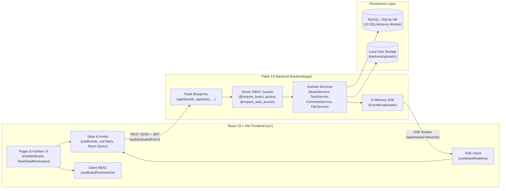

# 01 — Product Overview: Sticky Mind Grid

**Status:** Verified | **Last scanned:** 2026-10-13 | **Audience:** Everyone

---

## 1. Purpose

**Sticky Mind Grid** is a full-stack, real-time collaborative Kanban board and task management application (`AGENTS.md#L3-L6`, `src/App.tsx#L31-L71`, `backend/app/__init__.py#L14-L91`). It organizes work into multi-user **Boards** that contain workflow **Columns** and **Cards** (represented in code as `Task` records, `backend/app/models/task.py#L10-L32`, `src/types/task.ts#L27-L63`).

Each **Board** acts as an independent security and tenancy boundary: users are invited per board by email (`backend/app/services/board_service.py#L373-L480`), assigned one of five hierarchical roles (`Owner`, `Admin`, `Editor`, `Commenter`, `Viewer`, `backend/app/utils/decorators.py#L10-L17`), and receive live updates over Server-Sent Events (SSE) (`backend/app/routes/board_routes.py#L70-L119`, `src/hooks/useBoardRealtime.ts#L130-L341`).

---

## 2. Target Users

Based on the role hierarchy (`backend/app/utils/decorators.py#L10-L17`, `src/hooks/useBoardPermissions.ts#L164-L222`), built-in board starter templates (`src/components/boards/BoardModal.tsx#L41-L97`), and workspace views (`src/App.tsx#L41-L60`), the system serves:

- **Board Owners & Project Leads (`Owner`, `Admin`):** Create and configure boards, define workflow columns and Work-In-Progress (WIP) limits (`backend/app/services/board_service.py#L166-L274`), manage team invitations and member roles (`backend/app/services/board_service.py#L373-L1053`), audit full board activity history (`backend/app/routes/activity_routes.py#L25-L28`), purge trashed items (`backend/app/routes/task_routes.py#L39-L47, L201-L216`), and export board data (`backend/app/routes/board_routes.py#L174-L182`).
- **Individual Contributors (`Editor` / legacy `Member`):** Create, edit, assign, reorder, and move cards across columns or between boards (`backend/app/routes/task_routes.py#L58-L199`), manage checklists and attachments (`src/components/task/TaskChecklist.tsx#L1-L191`, `src/components/task/TaskAttachments.tsx#L1-L233`), and collaborate on project notes (`backend/app/routes/note_routes.py#L15-L42`).
- **External Reviewers & Stakeholders (`Commenter`, `Viewer`):** Inspect board progress in read-only mode (`src/components/kanban/KanbanBoard.tsx#L187-L188, L688-L706`), follow specific cards for updates (`backend/app/routes/task_routes.py#L88-L98`), download attachments (`backend/app/services/file_service.py#L382-L459`), and—for Commenters—participate in card discussions with `@mentions` (`backend/app/routes/comment_routes.py#L15-L30`).

---

## 3. System Scope & High-Level Architecture

### 3.1 Core Capabilities in Scope

1. **Authentication & Account Management:** Local email/password registration and login (`backend/app/routes/auth_routes.py#L137-L193`), OAuth sign-in flow for Google, GitHub, and Microsoft (`backend/app/routes/auth_routes.py#L54-L135`), 24-hour JWT sessions (`backend/config.py#L41`), user preferences (`backend/app/routes/user_routes.py#L16-L81`), JSON account export (`backend/app/routes/user_routes.py#L83-L123`), and account deletion with automatic board ownership succession (`backend/app/services/user_service.py#L14-L86`).
2. **Board Tenancy & Role-Based Access Control (RBAC):** Per-board membership with 5 roles (`owner`, `admin`, `editor` [alias `member`], `commenter`, `viewer`) enforced on both the server (`backend/app/utils/decorators.py#L10-L94`) and client (`src/hooks/useBoardPermissions.ts#L1-L226`).
3. **Email-Based Invitation Lifecycle:** Inviting registered or unregistered emails (`backend/app/services/board_service.py#L373-L480`), 7-day invitation expiration (`backend/app/models/board_invitation.py#L32-L41`), auto-linking pending invites on registration (`backend/app/routes/auth_routes.py#L12-L52`), accept/decline/resend/revoke flows, and inviter spam reporting (`backend/app/services/board_service.py#L482-L809`).
4. **Multi-View Board Workspace:** Five board views inside `KanbanBoard` (`src/components/kanban/KanbanBoard.tsx#L938-L995`):
   - **Kanban Board View:** Drag-and-drop columns and cards (`@dnd-kit`, `src/components/kanban/KanbanColumn.tsx#L1-L273`, `src/components/kanban/TaskCard.tsx#L1-L645`).
   - **List View:** Tabular task view (`src/components/kanban/TaskListView.tsx#L1-L235`).
   - **Calendar View:** Month, Week, and Day scheduling (`src/components/kanban/CalendarView.tsx#L1-L580`).
   - **Project Hub / Documents View:** Board sticky notes and task asset gallery (`src/components/kanban/DocumentsView.tsx#L1-L429`).
   - **Overview Analytics View:** Completion metrics and column breakdowns (`src/components/kanban/BoardOverview.tsx#L1-L235`).
5. **Rich Card / Task Detail Workspace:** Right-hand Notion-style drawer and standalone route (`/boards/:boardId/tasks/:taskId`, `src/pages/TaskDetailPage.tsx#L1-L320`, `src/components/task/TaskDetailWorkspace.tsx#L1-L457`) supporting status, priority (`low`, `medium`, `high`, `urgent`), progress (`0–100%`), single assignee, due date, tags, checklists, description with concurrent edit conflict detection (`HTTP 409`, `backend/app/services/task_service.py#L240-L242`), file attachments, comments with `@mentions`, card followers, and per-card activity history.
6. **Cross-Board Card Moves:** Moving cards between boards where the actor holds at least `editor` access, with automatic column status normalization, assignee eligibility re-validation, and tenant-redacted audit logs (`backend/app/routes/task_routes.py#L129-L146`, `backend/app/services/task_service.py#L301-L327`).
7. **Soft Delete & 30-Day Trash Retention:** Soft-deleting cards (`Task.is_deleted`, `backend/app/services/task_service.py#L510-L547`) and boards (`Board.is_deleted`, `backend/app/services/board_service.py#L297-L313`) with a 30-day recovery window before lazy permanent purge (`backend/app/services/task_service.py#L47-L64`, `backend/app/services/board_service.py#L15-L24, L316-L336`).
8. **Real-Time Collaboration & Notifications:** Per-board SSE streams (`GET /api/boards/<board_id>/events`, `backend/app/routes/board_routes.py#L70-L119`), immediate `force_disconnect` when a member is removed (`backend/app/utils/event_broadcaster.py#L82-L117`), in-app notifications (`backend/app/services/notification_service.py#L19-L69`), and direct/group messaging (`backend/app/routes/message_routes.py#L7-L190`).

### 3.2 Architecture Diagram

#### Text Version of Architecture Flow
1. **Client Layer (`src/`):** User interactions in `KanbanBoard` (`src/components/kanban/KanbanBoard.tsx`) and `TaskDetailWorkspace` (`src/components/task/TaskDetailWorkspace.tsx`) are gated for UX by `useBoardPermissions` (`src/hooks/useBoardPermissions.ts`). State hooks (`useBoards`, `useTasks`, and React Query) send REST requests with a `Bearer <JWT>` header via `authenticatedFetch` (`src/services/apiUtils.ts#L81-L91`).
2. **Server API & RBAC Layer (`backend/app/routes/`, `backend/app/utils/decorators.py`):** Flask Blueprints receive requests and enforce authentication (`@jwt_required()`) and board-level tenancy (`@require_board_access`, `@require_task_access`, `get_effective_role`).
3. **Service & Persistence Layer (`backend/app/services/`, `backend/app/models/`):** Domain services (`BoardService`, `TaskService`, `CommentService`, `FileService`, etc.) validate business rules, write mutations and `Activity` audit records in the same database transaction (`SQLAlchemy`), and store uploaded files in `backend/uploads/`.
4. **Real-Time Layer (`backend/app/utils/event_broadcaster.py`):** After committing to the database, services publish events to the in-memory `EventBroadcaster`, which pushes SSE frames over `GET /api/boards/<board_id>/events` to connected `useBoardRealtime` clients.

---

## 4. Non-Goals & Out-of-Scope Items (Verified from Code)

The following capabilities are **not implemented** in the current codebase:

- **Outbound SMTP / Transactional Emails:** Invitations, `@mentions`, and task assignments create in-app `Notification` database rows (`backend/app/services/board_service.py#L446-L456`, `backend/app/services/comment_service.py#L66-L74`), but no email-sending library (such as Flask-Mail, SendGrid, or SMTP client) exists in `backend/requirements.txt#L1-L13` or `backend/app/`.
- **Email Ownership Verification Token Flow:** While accepting an invitation strictly checks that the logged-in user's account email matches `BoardInvitation.email` (`backend/app/services/board_service.py#L500-L511`), the `User` model has no `email_verified` field or verification link endpoint (`backend/app/models/user.py#L11-L18`, `backend/app/routes/auth_routes.py#L137-L162`).
- **Multi-User Card Assignees:** A card has a single `assigned_to` foreign key (`backend/app/models/task.py#L22`, `src/types/task.ts#L38`), not a many-to-many assignee list.
- **External Cloud Object Storage (S3/GCS):** Uploaded attachments and banners are stored on the local filesystem inside `backend/uploads/` (`backend/app/services/file_service.py#L29-L30`).
- **Multi-Process SSE Broker (Redis Pub/Sub):** `EventBroadcaster` uses process-local Python `threading.Lock()` and `queue.Queue` instances in memory (`backend/app/utils/event_broadcaster.py#L7-L20`).
- **Background Cron / Worker Daemon:** 30-day trash purges and 7-day invite expirations run lazily during API read calls rather than via a background job queue (`backend/app/services/task_service.py#L50-L63`, `backend/app/services/board_service.py#L15-L24, L49-L56`).
- **Workspace Management CRUD UI/API:** Although `Board.workspace_id` exists as a nullable string column (`backend/app/models/board.py#L21`), there is no `Workspace` table, model, or API endpoint; each `Board` is the active tenant boundary.

---

## 5. Glossary

| Term | Code Identifier(s) | Definition in Sticky Mind Grid | Source |
|---|---|---|---|
| **Board** | `Board` (`boards` table) | The primary container for columns, cards, members, notes, and activity logs. Acts as the security and tenant boundary. Supports soft deletion (`is_deleted`, `deleted_at`). | `backend/app/models/board.py#L10-L45`, `src/types/board.ts#L12-L37` |
| **Tenant** | `board_id` (and placeholder `workspace_id`) | Isolation boundary for data access. Every permission check (`get_effective_role`), task query, comment `@mention`, and file access verification is scoped to a `board_id`. | `backend/app/utils/decorators.py#L19-L40`, `backend/app/services/file_service.py#L399-L418` |
| **Column** | `Board.columns` (`Column[]` JSON) | A workflow stage stored as a JSON object (`{id, title, emoji, color, wipLimit}`) inside the `Board.columns` array rather than a separate database table. Every board requires at least 1 non-archive column. | `backend/app/models/board.py#L19`, `src/types/task.ts#L125-L131`, `backend/app/services/board_service.py#L189-L191` |
| **Archive Column** | `status === 'archive'` | A special virtual/column status value (`'archive'`) used to hide archived cards from active board counts (`taskCount`) without moving them to Trash. | `backend/app/models/board.py#L75`, `src/components/task/TaskHeader.tsx#L144-L163` |
| **WIP Limit** | `Column.wipLimit` | Optional positive integer on a column (`wipLimit`). Enforced as a positive integer on the server (`BoardService._validate_columns_wip_limits`) and rendered as a soft visual warning badge on the client when reached or exceeded. | `backend/app/services/board_service.py#L166-L177`, `src/components/kanban/KanbanColumn.tsx#L53-L56, L160-L175` |
| **Card / Task** | `Task` (`tasks` table) | A unit of work belonging to one `Board` (`board_id`) and placed in a `Column` via its `status` field and float `position`. The UI labels tasks as "tasks" or "cards" interchangeably. | `backend/app/models/task.py#L10-L64`, `src/types/task.ts#L27-L63` |
| **Role** | `BoardRole`, `ROLE_HIERARCHY` | A member's permission level on a specific board: `owner` (5), `admin` (4), `editor` (3), `member` (3, legacy alias for `editor`), `commenter` (2), or `viewer` (1). | `backend/app/utils/decorators.py#L10-L17`, `src/types/board.ts#L3` |
| **Invite / Invitation** | `BoardInvitation` (`board_invitations` table) & pending `BoardMember` | An email-bound request (`status`: `pending`, `accepted`, `declined`, `expired`, `revoked`) sent by an `Owner` or `Admin` inviting a user to join a board with a specific role. Expires 7 days after creation or last resend. | `backend/app/models/board_invitation.py#L8-L41`, `backend/app/services/board_service.py#L373-L809` |
| **Assignee** | `Task.assigned_to` (`User`) | The single accepted board member (`Owner`, `Admin`, or `Editor`/`Member`) responsible for a card. `Commenter` and `Viewer` roles cannot be assigned to cards. | `backend/app/models/task.py#L22`, `backend/app/routes/task_routes.py#L72-L76, L148-L155` |
| **Follower** | `Task.followers` (`string[]` JSON) | List of user IDs subscribed to a card's updates. Card creators, assignees, and commenters are automatically added as followers; any board member (`Viewer`+) can manually follow or unfollow a card. | `backend/app/models/task.py#L28, L54-L62`, `backend/app/services/task_service.py#L71-L98, L210-L224`, `backend/app/services/comment_service.py#L84-L87` |
| **Trash** | `Task.is_deleted` / `Board.is_deleted` | Soft-deleted state for cards (`GET /api/boards/<id>/trash`) and boards (`GET /api/boards/trash`). Items in Trash retain `deleted_at` timestamps and are automatically permanently purged after 30 days. | `backend/app/services/task_service.py#L47-L64, L510-L648`, `backend/app/services/board_service.py#L15-L24, L297-L356` |
| **Mention (`@mention`)** | `Comment.mentions` (`string[]` JSON) | An `@<email>`, `@<full_name>`, or `@<first_name>` token in a card comment that notifies the matched user, strictly scoped to accepted members of that card's board. | `backend/app/services/comment_service.py#L18-L49`, `src/components/kanban/TaskComments.tsx#L32-L40` |
| **Attachment** | `Task.attachments` (`Attachment[]` JSON) | File metadata (`{id, name, url, type, size, uploadedAt, uploaderId}`) stored on a `Task` whose binary payload resides in `backend/uploads/` and is served via permission-checked `/api/files/<filename>`. | `src/types/task.ts#L4-L12`, `backend/app/services/file_service.py#L294-L472` |
| **Activity** | `Activity` (`activities` table) | An immutable audit log record (`create`, `move`, `update`, `delete`) recording board, card, member, comment, and note mutations, including optional `before_value` and `after_value` snapshots. | `backend/app/models/activity.py#L8-L87`, `backend/app/routes/activity_routes.py#L8-L55` |
| **Former Member** | `'Former member'` (display fallback) | Anonymized attribution label returned by `Task.to_dict()`, `Comment.to_dict()`, and `Activity.to_dict()` when the original author has left the board, been removed, or deleted their user account. | `backend/app/models/task.py#L68-L88`, `backend/app/models/comment.py#L34-L58`, `backend/app/models/activity.py#L50-L73` |
| **Note** | `Note` (`notes` table) | A board-scoped sticky document (`title`, `content`, `color`) displayed in the Project Hub (`DocumentsView`). | `backend/app/models/note.py#L8-L43`, `src/components/kanban/DocumentsView.tsx#L1-L429` |
| **Scratchpad** | `PersonalScratchpadModal` (`localStorage`) | A private, browser-local note pad (`localStorage` key `smg_personal_scratchpad_v1`) accessible from the sidebar; not synced to the backend. | `src/components/documents/PersonalScratchpadModal.tsx#L1-L165` |
