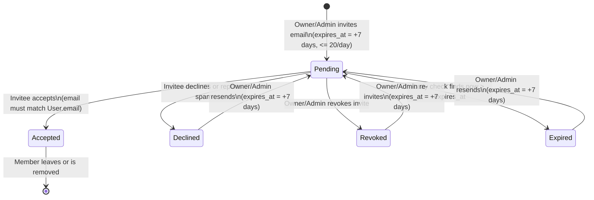
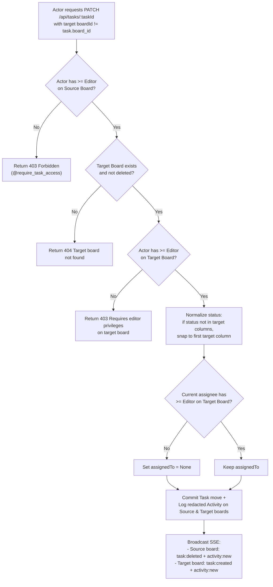

# 02 — Business Rules Register

**Status:** Verified | **Last scanned:** 2026-10-13 | **Audience:** Product, QA, developers

---

## 1. Overview

This document registers every business rule verified in the Sticky Mind Grid codebase (`backend/` and `src/`). Each rule has a unique identifier (`BR-01` through `BR-42`), a factual statement of the behavior, the exact file and line range where it is enforced (Server, Real-Time SSE, or UI-only), and the automated tests (`pytest`, `Vitest`, or `Playwright`) that verify it.

---

## 2. Business Rules Register

### 2.1 Role Hierarchy, Ownership & Last-Owner Guard (`BR-01` – `BR-08`)

| ID | Business Rule Statement | Where Enforced (Layer, File & Lines) | Test Coverage |
|---|---|---|---|
| **BR-01** | **5-Tier Role Hierarchy:** Board permissions follow a strict numeric hierarchy: `owner` (5) > `admin` (4) > `editor` (3, with legacy alias `member` = 3) > `commenter` (2) > `viewer` (1). Users without an `'accepted'` `BoardMember` row (including `'pending'`, `'declined'`, `'revoked'`, or `'expired'` invitees) resolve to level `0` (no access), except a legacy `Board.owner_id` who always resolves to `5` (`owner`). | **Server:** `backend/app/utils/decorators.py#L10-L40` (`ROLE_HIERARCHY`, `get_effective_role`) **UI:** `src/hooks/useBoardPermissions.ts#L123-L181` | **Pytest:** `backend/tests/test_rbac.py#L203-L216` (`test_owner_without_membership_row_can_view_tasks`), `backend/tests/test_rbac.py#L267-L352` (`test_five_roles_setup_and_permissions`) **Vitest:** `src/test/hooks/useBoardPermissions.test.tsx#L48-L391` |
| **BR-02** | **Last-Owner Guard (Leave & Removal):** A board must always have at least one Owner (`BoardService.count_owners(board_id) >= 1`). If a board has only 1 Owner (`count_owners <= 1`), that sole Owner is blocked from leaving the board or being removed (`HTTP 400`). An Owner may leave only if at least one other accepted Owner exists on the board. | **Server:** `backend/app/services/board_service.py#L231-L241` (`count_owners`), `backend/app/services/board_service.py#L840-L842` (`remove_member`) **UI:** `src/hooks/useBoardPermissions.ts#L144-L153, L196` (`canLeaveBoard`), `src/components/board/BoardMembers.tsx#L220-L225, L464-L489` | **Pytest:** `backend/tests/test_rbac.py#L437-L469` (`test_sole_owner_protection_and_transfer`), `backend/tests/test_invitations.py#L93-L119` (`test_voluntary_leave_and_owner_guard`) **Vitest:** `src/test/hooks/useBoardPermissions.test.tsx#L72-L145`, `src/test/components/BoardCard.test.tsx#L43-L97` **E2E:** `e2e/members.spec.ts#L33-L36` |
| **BR-03** | **Last-Owner Guard (Demotion):** The sole Owner of a board (`count_owners(board_id) <= 1`) cannot be demoted to a lower role (`HTTP 400`). Ownership must first be transferred or another member promoted to `owner`. | **Server:** `backend/app/services/board_service.py#L988-L990` (`update_member_role`) **UI:** `src/components/board/BoardMembers.tsx#L209` (`canModifyMember`) | **Pytest:** `backend/tests/test_rbac.py#L437-L469` (`test_sole_owner_protection_and_transfer`) |
| **BR-04** | **Explicit Ownership Transfer:** Only a current `owner` can call `POST /api/boards/<board_id>/transfer-ownership` to promote an accepted board member to `owner` and update `Board.owner_id`. | **Server:** `backend/app/routes/board_routes.py#L184-L196` (`@require_board_access('owner')`), `backend/app/services/board_service.py#L1056-L1101` (`transfer_ownership`) **UI:** `src/components/boards/BoardModal.tsx#L371-L393, L716-L765` | **Pytest:** `backend/tests/test_rbac.py#L437-L469` (`test_sole_owner_protection_and_transfer`) |
| **BR-05** | **UI Confirmation for Owner Promotion:** Promoting a member to `Owner` in the Members dialog requires the actor to type the exact board name in a confirmation dialog before the role update API call is sent. | **UI-Only:** `src/components/board/BoardMembers.tsx#L127-L162` (`requestRoleChange`, `confirmOwnerPromotion`) | **Vitest:** `src/test/components/BoardMembers.test.tsx#L132-L251` **E2E:** `e2e/members.spec.ts#L79-L111` |
| **BR-06** | **Admin Role Ceiling:** An `admin` can invite, modify, or remove `editor`, `member`, `commenter`, and `viewer` roles, but is strictly prohibited (`HTTP 400`) from: (a) inviting anyone as `admin` or `owner`, (b) promoting anyone to `admin` or `owner`, (c) changing the role of an existing `admin` or `owner`, or (d) removing/revoking an `admin` or `owner`. | **Server:** `backend/app/services/board_service.py#L369, L381-L382` (`add_member`), `L707` (`resend_invitation`), `L771` (`revoke_invitation`), `L835-L837` (`remove_member`), `L981-L985` (`update_member_role`) **UI:** `src/hooks/useBoardPermissions.ts#L201` (`canGrantAdminOwner`), `src/components/board/BoardMembers.tsx#L206-L208, L219, L404-L413`, `src/components/board/InviteMemberDialog.tsx#L85-L107` | **Pytest:** `backend/tests/test_rbac.py#L354-L435` (`test_admin_role_restrictions`), `backend/tests/test_invitations.py#L121-L134` (`test_invite_rejects_escalated_roles`) **Vitest:** `src/test/hooks/useBoardPermissions.test.tsx#L147-L204` |
| **BR-07** | **Account Deletion Ownership Succession:** When a user deletes their account (`DELETE /api/users/me`), for every board they own: (1) if another accepted `admin` exists, the oldest `admin` (by `BoardMember.created_at ASC`) is promoted to `owner`; (2) else if any other accepted member (`editor`/`member`/`commenter`/`viewer`) exists, the oldest accepted member is promoted to `owner`; (3) else if no other accepted members exist on the board, the board is permanently deleted. | **Server:** `backend/app/services/user_service.py#L14-L60` (`UserService.delete_account`) | **Pytest:** `backend/tests/test_privacy_and_tenancy.py#L85-L148` (`test_account_deletion_auto_promotes_oldest_admin`, `test_account_deletion_no_admin_promotes_oldest_member`, `test_account_deletion_sole_owner_removes_board`) |
| **BR-08** | **Mid-Session Role Downgrade & Forced SSE Disconnect:** Role changes take effect on the very next HTTP request because `get_effective_role` queries the database per request (`decorators.py#L34-L36`) and broadcasts `member:role_updated` over SSE (`board_service.py#L1045`). Removing a member or declining/reporting an invite calls `broadcaster.disconnect_user(board_id, user_id)`, pushing `force_disconnect` and a `None` sentinel to close their active SSE HTTP stream. | **Server & Real-Time:** `backend/app/utils/decorators.py#L19-L40`, `backend/app/utils/event_broadcaster.py#L82-L117` (`disconnect_user`), `backend/app/services/board_service.py#L620, L672, L926, L1045` **UI:** `src/hooks/useBoardRealtime.ts#L221-L246` | **Pytest:** `backend/tests/test_realtime_conflicts.py#L209-L355` (`test_mid_session_role_downgrade_blocks_mutations_immediately`, `test_member_removed_while_connected_receives_force_disconnect`) |

---

### 2.2 Invite Lifecycle, Expiry & Email Binding (`BR-09` – `BR-16`)

| ID | Business Rule Statement | Where Enforced (Layer, File & Lines) | Test Coverage |
|---|---|---|---|
| **BR-09** | **No Direct Owner Invitations:** Users cannot be invited directly with the `'owner'` role (`ALLOWED_INVITE_ROLES = ('admin', 'editor', 'commenter', 'viewer', 'member')`). Attempting to invite as `'owner'` or an unknown role returns `HTTP 400`. | **Server:** `backend/app/services/board_service.py#L369, L374-L375` (`BoardService.add_member`) **UI:** `src/components/board/InviteMemberDialog.tsx#L85-L107` | **Pytest:** `backend/tests/test_invitations.py#L121-L134` (`test_invite_rejects_escalated_roles`) |
| **BR-10** | **7-Day Invitation Expiry & Resend Extension:** Every `BoardInvitation` defaults to `expires_at = datetime.utcnow() + timedelta(days=7)` (`board_invitation.py#L32`). Pending invitations past `expires_at` automatically transition to `status = 'expired'` when queried or accepted (`HTTP 400`). An `owner` or `admin` can resend a pending/expired/declined invitation, which resets `status = 'pending'` and extends `expires_at` to `now + 7 days`. | **Server:** `backend/app/models/board_invitation.py#L32-L41`, `backend/app/services/board_service.py#L49-L56` (`get_user_invitations`), `L514-L517` (`accept_invitation`), `L676-L749` (`resend_invitation`), `backend/app/routes/auth_routes.py#L24-L26` | **Pytest:** `backend/tests/test_invitations.py#L207-L252` (`test_invite_7_day_expiry_and_resend`) |
| **BR-11** | **Invitation Deduplication:** Inviting an email address that already has an active member on the board fails with `HTTP 400` (`'User is already an active member of this board'`). Inviting an email that already has a `BoardInvitation` row on that board updates the existing record's `role`, resets `status = 'pending'`, and refreshes `expires_at = now + 7 days` instead of creating a duplicate row. | **Server:** `backend/app/services/board_service.py#L403-L428` (`BoardService.add_member`) | **Pytest:** `backend/tests/test_invitations.py#L279-L307` (`test_duplicate_invite_updates_existing_record`) |
| **BR-12** | **Daily Invitation Rate Limit (Spam Guard):** An inviter (`inviter_id`) can send at most **20 invitations** across all boards within a rolling 24-hour window (`BoardInvitation.created_at >= now - 24h`). A 21st invitation returns `HTTP 400` (`'Rate limit exceeded: maximum 20 invitations per 24 hours'`). | **Server:** `backend/app/services/board_service.py#L391-L398` (`BoardService.add_member`) | **Pytest:** `backend/tests/test_invitations.py#L338-L362` (`test_spam_protection_daily_invitation_rate_limit`) |
| **BR-13** | **Email-Bound Invitation Acceptance & Auto-Attachment on Signup:** Invitations can be sent to unregistered emails (`BoardInvitation.email`). When a user registers locally (`POST /api/auth/register`) or via OAuth (`POST /api/auth/oauth*`), `attach_pending_invitations(user)` matches non-expired `pending` `BoardInvitation` rows by `user.email.strip().lower()` and creates pending `BoardMember` and `Notification` rows. When accepting (`POST /api/boards/<id>/invitations/accept`), if `BoardInvitation.email != user.email.strip().lower()`, the server rejects the request with `HTTP 403` (`'Email mismatch: this invitation was sent to a different email address'`). *(Note: Local signup does not require an email verification link; see `docs/open-questions.md`.)* | **Server:** `backend/app/routes/auth_routes.py#L12-L52, L86, L156` (`attach_pending_invitations`), `backend/app/routes/board_routes.py#L32-L40`, `backend/app/services/board_service.py#L500-L511` (`accept_invitation`) | **Pytest:** `backend/tests/test_invitations.py#L150-L205` (`test_invite_unregistered_email_and_auto_attach_on_signup`), `backend/tests/test_invitations.py#L254-L277` (`test_accept_with_mismatched_email_rejected_http_403`) |
| **BR-14** | **Pending Invitee Zero-Access & Metadata Redaction:** While an invitation is `pending`, `get_effective_role` returns `0` (`HTTP 403` on board view, task list, task mutations, trash, activity log, and SSE stream). Furthermore, `BoardInvitation.to_dict()` and `BoardService.get_user_invitations()` only expose `{id, name, emoji, color, ownerName}` for the board—never leaking the board's `description`, columns, tasks, or member list prior to acceptance. | **Server:** `backend/app/utils/decorators.py#L34-L38`, `backend/app/models/board_invitation.py#L64-L72`, `backend/app/services/board_service.py#L72-L78, L104-L110` **UI:** `src/pages/BoardsOverview.tsx#L445-L535` | **Pytest:** `backend/tests/test_rbac.py#L139-L201` (`test_pending_invitee_cannot_*`), `backend/tests/test_invitations.py#L365-L415` (`test_pending_invite_tenancy_redacts_description_and_report_blocks_inviter`) **Vitest:** `src/test/pages/BoardsOverview.test.tsx#L110-L127` |
| **BR-15** | **Decline, Revoke & Inviter Spam Reporting:** (a) An invitee can decline (`POST /api/boards/<id>/invitations/decline`), setting `status = 'declined'` and notifying the board owner (`invite_declined`). (b) An `owner` or `admin` can revoke a pending invite (`POST|DELETE /api/boards/<id>/invitations/<inv_id>/revoke`), setting `status = 'revoked'`, `revoked_at = utcnow()`, and deleting any pending `BoardMember` row. (c) An invitee can report an invite (`POST /api/boards/<id>/invitations/report`), which declines that invite **and** bulk-declines all other pending `BoardInvitation` and `BoardMember` rows sent by the same `inviter_id` to that invitee. | **Server:** `backend/app/services/board_service.py#L575-L623` (`decline_invitation`), `L626-L673` (`report_invitation`), `L752-L809` (`revoke_invitation`) **UI:** `src/pages/BoardsOverview.tsx#L102-L137`, `src/components/board/BoardMembers.tsx#L254-L266` | **Pytest:** `backend/tests/test_invitations.py#L52-L91` (`test_decline_invitation`), `L309-L336` (`test_admin_revoke_pending_invite`), `L365-L415` (`test_pending_invite_tenancy_redacts_description_and_report_blocks_inviter`) **Vitest:** `src/test/pages/BoardsOverview.test.tsx#L150-L163` |
| **BR-16** | **Member Directory Email Redaction for Commenters & Viewers:** When `GET /api/boards/<board_id>/members` is called by a `commenter` or `viewer` (`actor_level <= ROLE_HIERARCHY['commenter']`), member email addresses are stripped from `BoardMember.to_dict(redact_user=True)` and unregistered pending invitees are masked with `fullName: 'Invited Guest'` and `email: None`. Additionally, `Board.to_dict()` `membersPreview` never includes email addresses for any role. | **Server:** `backend/app/services/board_service.py#L1104-L1144` (`get_board_members`), `backend/app/models/board_member.py#L34-L56`, `backend/app/models/board.py#L107-L116` **UI:** `src/components/board/BoardMembers.tsx#L305-L318, L354` | **Pytest:** `backend/tests/test_privacy_and_tenancy.py#L47-L83` (`test_user_profile_leakage_redaction_for_viewers`), `backend/tests/test_rbac.py#L285-L295`, `backend/tests/test_boards.py#L251-L313` **Vitest:** `src/test/components/BoardCard.test.tsx#L234-L280` |

#### Invite Lifecycle Diagram & Text Flow

**Text Version of Invite Lifecycle (`backend/app/services/board_service.py#L373-L809`):**
1. **Creation (`Pending`):** An `Owner` or `Admin` calls `POST /api/boards/<board_id>/members`. If the inviter has sent fewer than 20 invites in the last 24 hours and the target is not already an accepted member, a `BoardInvitation` is created (or updated) with `status='pending'` and `expires_at = utcnow() + 7 days`. If a `User` with that email already exists (or later signs up via `attach_pending_invitations`), a `BoardMember(status='pending')` row and a `board_invite` notification are created.
2. **Transitions from `Pending`:**
   - **To `Accepted`:** The invited user (whose `User.email` matches `BoardInvitation.email`) calls `POST /api/boards/<board_id>/invitations/accept` before `expires_at`. Both `BoardInvitation.status` and `BoardMember.status` become `'accepted'`.
   - **To `Declined`:** The invitee calls `/invitations/decline` or `/invitations/report`. `status` becomes `'declined'` (and `/report` also declines all other pending invites from the same inviter).
   - **To `Revoked`:** An `Owner` or `Admin` calls `/invitations/<id>/revoke`, setting `status='revoked'` and deleting the pending `BoardMember` row.
   - **To `Expired`:** When `datetime.utcnow() > expires_at`, `BoardService.get_user_invitations()`, `accept_invitation()`, or `attach_pending_invitations()` marks `status='expired'`.
3. **Re-activation (`Expired` / `Declined` / `Revoked` -> `Pending`):** An `Owner` or `Admin` resends or re-invites, resetting `status='pending'` and extending `expires_at` by 7 days.

---

### 2.3 Columns, WIP Limits & Board Settings (`BR-17` – `BR-20`)

| ID | Business Rule Statement | Where Enforced (Layer, File & Lines) | Test Coverage |
|---|---|---|---|
| **BR-17** | **Minimum 1 Non-Archive Workflow Column:** Every board must have at least 1 workflow column whose `id` is not `'archive'` (`len(workflow_cols) >= 1`). Creating or updating a board with 0 non-archive columns fails with `HTTP 400` (`'Board must have at least one column'`). | **Server:** `backend/app/services/board_service.py#L189-L191` (`create_board`), `L262-L264` (`update_board`) **UI:** `src/components/boards/BoardModal.tsx#L30, L320-L323` (`MIN_COLUMNS = 1`) | **Pytest:** `backend/tests/test_boards.py#L118-L161` (`test_create_board_minimum_columns`) **Vitest:** `src/test/components/BoardModal.test.tsx#L115-L151` |
| **BR-18** | **Non-Empty Column Deletion Guard:** A column cannot be deleted from a board while any active (non-soft-deleted) task on that board has `Task.status == column.id`. The server rejects the update with `HTTP 400` (`'Cannot delete a column that still contains active cards. Move or delete its cards first.'`). | **Server:** `backend/app/services/board_service.py#L268-L274` (`BoardService.update_board`) **UI:** `src/components/boards/BoardModal.tsx#L325-L331` (`handleDeleteColumn`) | **Pytest:** `backend/tests/test_rbac.py#L471-L504` (`test_delete_column_rules`), `backend/tests/test_boards.py#L376-L432` (`test_board_column_wip_limits_and_delete_protection`) |
| **BR-19** | **Column WIP Limit Validation & Soft Visual Warning:** A column's `wipLimit` must be `None`/`null` or a positive integer (`>= 1`, not `bool`). Values `<= 0` or non-integers fail on the server with `HTTP 400`. In the UI, `wipLimit` is a **soft limit**: reaching `tasks.length === wipLimit` shows an amber badge, and exceeding `tasks.length > wipLimit` highlights the column border in red without blocking card creation or drag-and-drop. | **Server:** `backend/app/services/board_service.py#L166-L177` (`_validate_columns_wip_limits`) **UI:** `src/components/kanban/KanbanColumn.tsx#L53-L56, L160-L175`, `src/components/boards/BoardModal.tsx#L343-L352` | **Pytest:** `backend/tests/test_boards.py#L376-L432` (`test_board_column_wip_limits_and_delete_protection`) **Vitest:** `src/test/components/KanbanColumn.test.tsx#L21-L88`, `src/test/components/BoardModal.test.tsx#L234-L253` |
| **BR-20** | **Board Hero Banner URL Allowlist & Magic-Byte Validation:** Board `heroImageUrl` only accepts: (1) local `/api/files/<filename>` paths, (2) `data:image/...` base64 strings (which the server converts to `/api/files/<uuid>` after validating image magic bytes and a 5 MB limit), or (3) HTTPS URLs from `images.unsplash.com` or `plus.unsplash.com`. Any other external URL is rejected with `HTTP 400` to prevent third-party tracking pixels. | **Server:** `backend/app/services/board_service.py#L132-L163` (`ALLOWED_BANNER_HOSTS`, `validate_hero_image_url`), `backend/app/services/file_service.py#L63-L78, L254-L291, L325-L335` **UI:** `src/components/boards/BoardModal.tsx#L99-L115, L259-L305` | **Pytest:** `backend/tests/test_boards.py#L164-L248` (`test_board_banner_url_validation`, `test_board_banner_upload_limits_and_permission_check`) **Vitest:** `src/test/components/BoardModal.test.tsx#L153-L232` |

---

### 2.4 Soft Delete & 30-Day Trash Purge (`BR-21` – `BR-24`)

| ID | Business Rule Statement | Where Enforced (Layer, File & Lines) | Test Coverage |
|---|---|---|---|
| **BR-21** | **Card Soft Delete & Restore (`Editor`+):** Deleting a card via `DELETE /api/tasks/<task_id>` sets `Task.is_deleted = True` and `Task.deleted_at = datetime.utcnow()` rather than removing the database row. Any user with `editor`+ role on the board can view soft-deleted cards (`GET /api/boards/<board_id>/trash`) and restore them (`PATCH|PUT /api/tasks/<task_id>/restore`, which resets `is_deleted = False` and `deleted_at = None`). | **Server:** `backend/app/routes/task_routes.py#L29-L37, L173-L199`, `backend/app/services/task_service.py#L47-L64, L510-L581` **UI:** `src/components/kanban/TrashModal.tsx#L1-L215` | **Pytest:** `backend/tests/test_rbac.py#L526-L581` (`test_task_modal_trash_and_purge_permissions`), `backend/tests/test_tasks.py#L58-L70` **E2E:** `e2e/trash.spec.ts#L33-L53`, `e2e/kanban.spec.ts#L103-L109` |
| **BR-22** | **Card Permanent Purge & Empty Trash (`Admin`+ Only):** Permanently deleting an individual card (`DELETE /api/tasks/<task_id>/permanent`) or emptying a board's trash (`DELETE /api/boards/<board_id>/trash`) requires `admin` or `owner` role (`HTTP 403` for `editor`, `commenter`, `viewer`). Permanent deletion also deletes unreferenced physical attachment files from `backend/uploads/` via `FileService.cleanup_task_attachments(task)`. | **Server:** `backend/app/routes/task_routes.py#L39-L47, L201-L216`, `backend/app/services/task_service.py#L584-L648`, `backend/app/services/file_service.py#L210-L251` **UI:** `src/hooks/useBoardPermissions.ts#L213` (`canPurgeTask`), `src/components/kanban/TrashModal.tsx#L94, L184-L195` | **Pytest:** `backend/tests/test_rbac.py#L526-L581` (`test_task_modal_trash_and_purge_permissions`), `backend/tests/test_privacy_and_tenancy.py#L455-L476` (`test_section_g_malware_scan_quotas_and_file_retention`) **Vitest:** `src/test/hooks/useBoardPermissions.test.tsx#L180, L239` |
| **BR-23** | **30-Day Lazy Auto-Purge for Soft-Deleted Cards:** Whenever `TaskService.get_deleted_tasks(board_id)` (`GET /api/boards/<board_id>/trash`) is called, any task on that board with `is_deleted == True` and `deleted_at < datetime.utcnow() - timedelta(days=30)` has its physical attachments cleaned up (`FileService.cleanup_task_attachments`) and is permanently deleted from the database before the trash list is returned. | **Server:** `backend/app/services/task_service.py#L47-L64` (`TaskService.get_deleted_tasks`) | **Pytest:** `backend/tests/test_rbac.py#L1043-L1067` (`test_soft_delete_30_day_purge_rule`) |
| **BR-24** | **Board Soft Delete, Name Confirmation, Restore & 30-Day Auto-Purge (`Owner` Only):** Only a board `owner` can delete or restore a board (`@require_board_access('owner')`). In the UI (`BoardsOverview.tsx`), the owner must type the exact board name to confirm deletion, which calls `DELETE /api/boards/<board_id>?soft=true` (`Board.is_deleted = True`, `Board.deleted_at = utcnow()`). Soft-deleted boards can be restored via `POST /api/boards/<board_id>/restore` within 30 days, or permanently deleted via `DELETE /api/boards/<board_id>` (without `soft=true`). Soft-deleted boards with `deleted_at < utcnow() - 30 days` are lazily hard-deleted during `BoardService.get_user_boards()` and `BoardService.get_trashed_boards()`. | **Server:** `backend/app/routes/board_routes.py#L17-L22, L149-L171`, `backend/app/services/board_service.py#L15-L24, L297-L366` **UI:** `src/pages/BoardsOverview.tsx#L397-L443, L680-L735, L765-L795`, `src/hooks/useBoards.ts#L226-L315` | **Pytest:** `backend/tests/test_boards.py#L93-L115` (`test_delete_board_cascades_tasks_and_members`), `backend/tests/test_boards.py#L316-L373` (`test_soft_delete_board_grace_period_and_restore`), `backend/tests/test_rbac.py#L27-L53` **Vitest:** `src/test/pages/BoardsOverview.test.tsx#L300-L368` **E2E:** `e2e/boards.spec.ts#L47-L60` |

---

### 2.5 Assignee Eligibility, Cross-Board Moves & Concurrent Edits (`BR-25` – `BR-30`)

| ID | Business Rule Statement | Where Enforced (Layer, File & Lines) | Test Coverage |
|---|---|---|---|
| **BR-25** | **Assignee Eligibility (`Editor`+ Required):** A card can only be assigned (`assignedTo` / `assigneeId`) to a user who holds an active `owner`, `admin`, `editor`, or `member` role (`get_effective_role(board_id, assignee_id) >= ROLE_HIERARCHY['editor']`) on that card's board. Assigning a card to a `commenter`, `viewer`, pending invitee, or non-member is rejected with `HTTP 400` (`'Assignee must have at least Editor permissions on this board'`). | **Server:** `backend/app/routes/task_routes.py#L72-L76` (`create_task`), `backend/app/routes/task_routes.py#L148-L155` (`update_task`) **UI:** `src/components/task/TaskProperties.tsx#L97-L102`, `src/components/kanban/TaskModal.tsx#L120-L125` | **Pytest:** `backend/tests/test_rbac.py#L772-L861` (`test_assignee_eligibility_and_auto_unassign`) **Vitest:** `src/test/components/TaskModal.test.tsx#L192-L243` |
| **BR-26** | **Automatic Unassignment on Role Demotion, Member Removal, or Account Deletion:** Whenever an existing card assignee: (1) is demoted to `commenter` or `viewer` (`BoardService.update_member_role`), (2) leaves or is removed from the board (`BoardService.remove_member`), or (3) deletes their account (`UserService.delete_account`), all active cards assigned to that user on the affected board(s) are automatically unassigned (`Task.assigned_to = None`), with an `Activity` audit entry and `task:updated` SSE broadcast emitted for each card. | **Server:** `backend/app/services/board_service.py#L911-L920` (`remove_member`), `backend/app/services/board_service.py#L1023-L1041` (`update_member_role`), `backend/app/services/user_service.py#L66-L68` (`delete_account`) | **Pytest:** `backend/tests/test_rbac.py#L772-L861` (`test_assignee_eligibility_and_auto_unassign`), `backend/tests/test_privacy_and_tenancy.py#L150-L195` (`test_authored_content_preserved_as_former_member`) |
| **BR-27** | **Cross-Board Move Dual-Board Permission Check:** Moving a card to another board (`PATCH|PUT /api/tasks/<task_id>` with `boardId != task.board_id`) requires the actor to hold at least `editor` (`level >= 3`) on **both** the source board (`@require_task_access('editor')`) and the target board (`get_effective_role(target_board_id, user_id) >= ROLE_HIERARCHY['editor']`). Otherwise the server returns `HTTP 403`. | **Server:** `backend/app/routes/task_routes.py#L121, L129-L133` (`update_task`) **UI:** `src/components/kanban/TaskCard.tsx#L170-L175`, `src/components/task/TaskHeader.tsx#L137-L142` | **Pytest:** `backend/tests/test_rbac.py#L226-L265` (`test_member_cannot_move_task_into_foreign_board`), `backend/tests/test_rbac.py#L583-L629` (`test_task_modal_move_to_another_board_permissions`) |
| **BR-28** | **Cross-Board Move Status Normalization, Assignee Stripping & Tenant-Redacted Audit Logs:** When a card moves across boards: (1) if the card's `status` does not match any column ID on the target board, `status` snaps to the target board's first column (or `'todo'`); (2) if the card's current `assigned_to` user does not hold `editor`+ on the target board, `assigned_to` is cleared to `None`; (3) two separate `Activity` rows are logged—`'Card "{title}" moved to another board'` on the source board and `'Card "{title}" moved from another board'` on the target board—never exposing the other board's name across tenant boundaries; and (4) SSE broadcasts `task:deleted` on the source board and `task:created` on the target board. | **Server & Real-Time:** `backend/app/routes/task_routes.py#L135-L146`, `backend/app/services/task_service.py#L301-L327, L419-L428` (`TaskService.update_task`) | **Pytest:** `backend/tests/test_rbac.py#L962-L1005` (`test_cross_board_move_tenancy_and_assignee_rules`) |
| **BR-29** | **Optimistic Concurrency Control on Task Description (`HTTP 409 Conflict`):** When updating a task's `description`, if the request payload includes `baseDescription` and `forceOverwrite` is not `True`, `TaskService.update_task` compares `baseDescription` against the current database `task.description`. If they differ, it raises `TaskConflictError`, and the route returns `HTTP 409 Conflict` with `{conflict: True, currentTask: task.to_dict()}` so the client can choose "Keep Mine (Overwrite)" (`forceOverwrite: true`) or "Load Latest Version". | **Server:** `backend/app/services/task_service.py#L18-L22, L240-L242`, `backend/app/routes/task_routes.py#L159-L164` **UI:** `src/components/task/TaskDetailWorkspace.tsx#L97-L139, L222-L289`, `src/hooks/useTasks.ts#L76-L86` | **Pytest:** `backend/tests/test_realtime_conflicts.py#L134-L207` (`test_concurrent_description_edit_conflict_and_force_overwrite`) |
| **BR-30** | **Concurrent Card Drag Last-Write-Wins & Dual Move Audit:** When two users concurrently drag the same card (`PATCH /api/tasks/reorder` or `PATCH /api/tasks/<id>`) and include `fromStatus` in the payload, the database state reflects the last write while `TaskService` records both move transitions in the `activities` table by comparing the target `status` against `fromStatus` (or `old_status`). | **Server:** `backend/app/services/task_service.py#L283-L285, L328-L343` (`update_task`), `L454-L482` (`reorder_tasks`) | **Pytest:** `backend/tests/test_realtime_conflicts.py#L9-L132` (`test_concurrent_card_drag_last_write_wins_and_logs_both_moves`, `test_concurrent_same_column_target_drag_logs_both_moves_with_from_status`) |

#### Cross-Board Card Move Flow Diagram & Text Version

**Text Version of Cross-Board Card Move (`backend/app/routes/task_routes.py#L120-L146`, `backend/app/services/task_service.py#L301-L327, L419-L428`):**
1. **Source Board Check:** `@require_task_access('editor')` verifies the actor holds `editor` (level 3) or higher on the card's current board.
2. **Target Board Check:** `update_task` loads the target board via `BoardService.get_board_by_id(target_board_id)` (`404` if missing/deleted) and verifies `get_effective_role(target_board_id, user_id) >= ROLE_HIERARCHY['editor']` (`403` if insufficient).
3. **Column Status Normalization:** If the requested or current `status` is not a valid column `id` in `target_board.columns`, `data['status']` is set to `target_board.columns[0]['id']` (or `'todo'`).
4. **Assignee Re-Validation:** If the card has an `assignee_id` and `get_effective_role(target_board_id, assignee_id) < ROLE_HIERARCHY['editor']`, `data['assignedTo']` is set to `None`.
5. **Redacted Audit & Dual SSE Broadcast:** `TaskService.update_task` writes two `Activity` rows (`'Card "{title}" moved to another board'` on the source board and `'Card "{title}" moved from another board'` on the target board) and broadcasts `task:deleted` to the source board channel and `task:created` to the target board channel.

---

### 2.6 Comments, `@Mentions`, Card Followers & Notifications (`BR-31` – `BR-35`)

| ID | Business Rule Statement | Where Enforced (Layer, File & Lines) | Test Coverage |
|---|---|---|---|
| **BR-31** | **Board-Scoped `@Mentions`:** `@mentions` in card comments (`@<email>`, `@<full_name>`, or `@<first_name>`) are matched strictly against accepted `BoardMember` records of the card's board (excluding the comment author). Non-members and `pending`/`declined`/`revoked` invitees are never matched on the server and are excluded from the `@` autocomplete list in the UI. | **Server:** `backend/app/services/comment_service.py#L18-L49` (`_find_mentioned_board_members`) **UI:** `src/components/kanban/TaskComments.tsx#L32-L40` (`mentionableMembers`) | **Pytest:** `backend/tests/test_privacy_and_tenancy.py#L262-L377` (`test_section_f_mentions_followers_mute_and_comment_audit`) **Vitest:** `src/test/components/TaskComments.test.tsx#L92-L123` |
| **BR-32** | **Comment Edit Ownership & Original Content Preservation:** Only the original author of a comment (`str(comment.user_id) == str(user_id)`) who still holds at least `commenter` role on the board can edit that comment (`PATCH|PUT /api/comments/<comment_id>`). Even board `owner` and `admin` roles cannot edit another user's comment (`HTTP 403`). On the first edit, the initial text is preserved in `Comment.original_content`, `Comment.is_edited` is set to `True`, and `before_value`/`after_value` are recorded in `Activity`. | **Server:** `backend/app/services/comment_service.py#L195-L271` (`CommentService.update_comment`), `backend/app/models/comment.py#L16-L17` **UI:** `src/components/kanban/TaskComments.tsx#L255-L259, L290-L300` | **Pytest:** `backend/tests/test_rbac.py#L864-L935` (`test_comment_matrix_edit_and_delete_permissions`), `backend/tests/test_privacy_and_tenancy.py#L335-L377` |
| **BR-33** | **Comment Deletion Rules & Audit Snapshot:** A comment can be deleted (`DELETE /api/comments/<comment_id>`) by its author (`str(comment.user_id) == str(user_id)`) or by a board `admin` or `owner` (`get_effective_role >= ROLE_HIERARCHY['admin']`). Before hard-deleting the `Comment` row, `CommentService.delete_comment` stores `comment.original_content or comment.content` in `Activity.before_value` and `comment.content` in `Activity.after_value`. | **Server:** `backend/app/services/comment_service.py#L143-L192` (`CommentService.delete_comment`) **UI:** `src/components/kanban/TaskComments.tsx#L301-L311` | **Pytest:** `backend/tests/test_rbac.py#L864-L935` (`test_comment_matrix_edit_and_delete_permissions`), `backend/tests/test_privacy_and_tenancy.py#L360-L377` |
| **BR-34** | **Card Followers Auto-Enrollment & Notifications:** When a card is created, `created_by` and `assigned_to` are automatically added to `Task.followers` (`task.py#L54-L62`, `task_service.py#L129-L135`). When a user posts a comment on a card, that user is automatically added to `Task.followers` (`comment_service.py#L84-L87`). Any board member (`viewer`+) can manually toggle following via `POST|PATCH|PUT /api/tasks/<task_id>/follow`. Card followers (plus `assigned_to` and `created_by`, excluding the actor) receive `task_move` notifications when the card changes columns and `task_comment` notifications when a comment is posted. | **Server:** `backend/app/models/task.py#L54-L62`, `backend/app/routes/task_routes.py#L88-L98`, `backend/app/services/task_service.py#L71-L98, L129-L135, L210-L224`, `backend/app/services/comment_service.py#L77-L101` **UI:** `src/components/task/TaskHeader.tsx#L248-L266`, `src/components/kanban/TaskCard.tsx#L334-L356` | **Pytest:** `backend/tests/test_privacy_and_tenancy.py#L262-L334` (`test_section_f_mentions_followers_mute_and_comment_audit`) **Vitest:** `src/test/components/TaskHeader.test.tsx#L97-L151` |
| **BR-35** | **Notification Gating (Active Board Access, Board Mute & User Preferences):** `NotificationService.should_notify(user_id, notif_type, board_id)` suppresses in-app notifications if: (1) `board_id` is present and `get_effective_role(board_id, user_id) < ROLE_HIERARCHY['viewer']` (for non-invite notifications), (2) the user's `BoardMember.is_muted` is `True` on that board (`PATCH /api/boards/<id>/mute`), or (3) the user disabled the corresponding `UserPreference` toggle (`notify_mentions`, `notify_assignments`, `notify_invites`, `notify_comments`). | **Server:** `backend/app/services/notification_service.py#L19-L47` (`should_notify`), `backend/app/services/board_service.py#L932-L956` (`set_board_mute`) | **Pytest:** `backend/tests/test_privacy_and_tenancy.py#L315-L334` (`test_section_f_mentions_followers_mute_and_comment_audit`), `backend/tests/test_user_preferences.py#L47-L82` (`test_notification_suppression_by_preferences`) |

---

### 2.7 Attachments, File Security & Storage Quotas (`BR-36` – `BR-38`)

| ID | Business Rule Statement | Where Enforced (Layer, File & Lines) | Test Coverage |
|---|---|---|---|
| **BR-36** | **File Upload Allowlist, Size Limits & Malware Signature Scanning:** `FileService.save_file` validates: (1) filename extension against `ALLOWED_UPLOAD_EXTENSIONS` (`config.py#L60-L74`) and safe MIME prefixes; (2) max file size of **5 MB** for `purpose='banner'` (with JPEG/PNG/GIF/WebP magic-byte verification) and **25 MB** (`MAX_CONTENT_LENGTH`) for general attachments; and (3) `scan_file_for_malware`, which rejects EICAR test strings, Windows PE (`MZ`), Linux ELF (`\x7fELF`), macOS Mach-O binaries, shell scripts (`#!`), and `<script` / `javascript:` payloads in non-code files. | **Server:** `backend/config.py#L54-L74`, `backend/app/services/file_service.py#L63-L118, L294-L379` (`is_valid_image_bytes`, `scan_bytes_for_malware`, `save_file`) | **Pytest:** `backend/tests/test_privacy_and_tenancy.py#L380-L415` (`test_section_g_malware_scan_quotas_and_file_retention`), `backend/tests/test_boards.py#L195-L248` |
| **BR-37** | **Per-Board (100 MB) and Per-Owner (500 MB) Storage Quotas:** Adding task attachments checks `FileService.check_board_and_owner_quota(board_id, additional_bytes)`. If total attachment bytes on active + trashed tasks of `board_id` would exceed `MAX_BOARD_STORAGE_BYTES` (**100 MB**), or total bytes across all non-deleted boards owned by `board.owner_id` would exceed `MAX_OWNER_STORAGE_BYTES` (**500 MB**), the server rejects the operation with `HTTP 400`. | **Server:** `backend/config.py#L56-L57`, `backend/app/services/file_service.py#L141-L207` (`check_board_and_owner_quota`), `backend/app/services/task_service.py#L107-L113, L244-L253` | **Pytest:** `backend/tests/test_privacy_and_tenancy.py#L430-L454` (`test_section_g_malware_scan_quotas_and_file_retention`) |
| **BR-38** | **Permission-Checked File Retrieval (`GET /api/files/<filename>`):** `FileService.verify_file_access(filename, user_id)` enforces: (1) user avatar files (`User.avatar_url`) are public (`200`); (2) all other files require a valid JWT (`Authorization: Bearer` or `?token=`, else `401`); (3) task attachments require active board membership (`get_effective_role(t.board_id, user_id) > 0`, else `403`); (4) message attachments require `ConversationParticipant` membership (`403`); (5) board hero banners require active board membership (`403`); and (6) unattached staging files in `.uploaders.json` can only be accessed by their original uploader (`403`). | **Server:** `backend/app/routes/file_routes.py#L12-L24, L45-L60`, `backend/app/services/file_service.py#L382-L459` (`verify_file_access`) **UI:** `src/components/task/TaskAttachments.tsx#L71-L95` | **Pytest:** `backend/tests/test_privacy_and_tenancy.py#L197-L248` (`test_permission_checked_file_attachments`), `backend/tests/test_privacy_and_tenancy.py#L416-L429` (unattached staging file check), `backend/tests/test_boards.py#L225-L248` |

---

### 2.8 Activity Log Immutability, Former Member Privacy & Data Export (`BR-39` – `BR-42`)

| ID | Business Rule Statement | Where Enforced (Layer, File & Lines) | Test Coverage |
|---|---|---|---|
| **BR-39** | **Activity Audit Log Immutability:** Audit log records in `activities` cannot be edited, overwritten, or cleared by any user or role. Any `PUT`, `PATCH`, or `DELETE` request to `/api/activities` or `/api/activities/<activity_id>` unconditionally returns `HTTP 403` (`'Activity audit logs are immutable and cannot be modified or cleared'`). | **Server:** `backend/app/routes/activity_routes.py#L51-L55` (`block_activity_mutations`) **UI:** `src/hooks/useBoardPermissions.ts#L50` | **Pytest:** `backend/tests/test_rbac.py#L1035-L1040` (`test_activity_feed_board_vs_card_permissions`), `backend/tests/test_privacy_and_tenancy.py#L480-L505` (`test_section_h_immutable_activity_log_former_member_and_visibility`) **Vitest:** `src/test/hooks/useBoardPermissions.test.tsx#L115` |
| **BR-40** | **Board Activity Feed (`Admin`+) vs. Card Activity Feed (`Viewer`+):** Fetching the full board-wide activity log (`GET /api/activities?boardId=<id>` without `taskTitle` or `taskId`) is restricted to `owner` and `admin` roles (`HTTP 403` for `editor`, `commenter`, `viewer`). Fetching card-specific history (`GET /api/activities?boardId=<id>&taskTitle=...` or `&taskId=...`) is permitted for all accepted board roles (`viewer`+). Global activity queries (`boardId` omitted/`'all'`) return activities only from boards where the caller is `owner` or `admin`. | **Server:** `backend/app/routes/activity_routes.py#L8-L31`, `backend/app/services/activity_service.py#L53-L75` **UI:** `src/hooks/useBoardPermissions.ts#L221` (`canViewBoardActivity`), `src/components/kanban/BoardHeader.tsx#L236`, `src/components/task/TaskActivityLog.tsx#L1-L155` | **Pytest:** `backend/tests/test_rbac.py#L1008-L1040` (`test_activity_feed_board_vs_card_permissions`), `backend/tests/test_privacy_and_tenancy.py#L506-L530` |
| **BR-41** | **Former Member Anonymization:** When a user leaves a board, is removed from a board, or deletes their account, their authored cards (`Task.created_by`), comments (`Comment.user_id`), and audit entries (`Activity.user_id`) remain intact, but `Task.to_dict()`, `Comment.to_dict()`, and `Activity.to_dict()` check whether the author is still an accepted member/owner of that board. If not, the serialized author object is anonymized to `fullName: 'Former member'`, `email: ''`, and `avatarUrl: None`. | **Server:** `backend/app/models/task.py#L68-L88`, `backend/app/models/comment.py#L34-L58`, `backend/app/models/activity.py#L50-L73`, `backend/app/services/user_service.py#L72-L78` | **Pytest:** `backend/tests/test_privacy_and_tenancy.py#L150-L195` (`test_authored_content_preserved_as_former_member`), `backend/tests/test_privacy_and_tenancy.py#L531-L556` (`test_section_h_immutable_activity_log_former_member_and_visibility`) |
| **BR-42** | **Board Data Export (`Admin`+) & Personal Account Data Export:** (1) Exporting a single board's JSON (`GET /api/boards/<board_id>/export`) requires `owner` or `admin` role (`@require_board_access('admin')`) and returns `{board, tasks, members, exportedAt}` (active non-deleted tasks only). (2) Exporting personal account data (`GET /api/users/me/export`) is available to any authenticated user for their own account and returns `{exportMetadata, user, preferences, boards, tasks, notes}` across their owned and accepted boards. | **Server:** `backend/app/routes/board_routes.py#L174-L182`, `backend/app/services/board_service.py#L1147-L1165`, `backend/app/routes/user_routes.py#L83-L123` **UI:** `src/components/boards/BoardModal.tsx#L354-L369, L699-L713`, `src/components/settings/tabs/PrivacyTab.tsx#L26-L37` | **Pytest:** `backend/tests/test_rbac.py#L506-L524` (`test_export_board_rules`), `backend/tests/test_user_preferences.py#L84-L109` (`test_user_data_export`) **Vitest:** `src/test/components/SettingsModal.test.tsx#L103-L112` |
