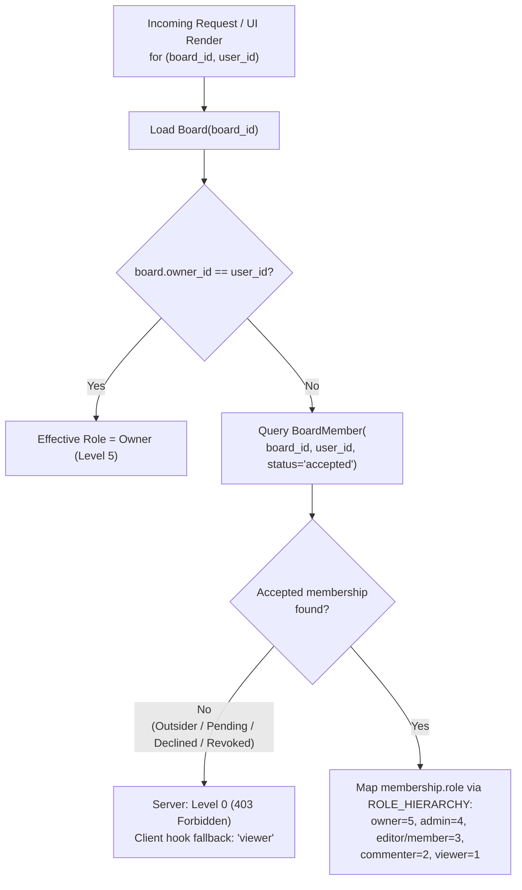

# 03 — Roles and Permissions

**Status:** Verified | **Last scanned:** 2026-10-13 | **Audience:** Product, QA, developers

---

## 1. Role Definitions & Resolution

Sticky Mind Grid implements a 5-role hierarchical Role-Based Access Control (RBAC) model scoped per **Board** (`backend/app/utils/decorators.py#L10-L40`, `src/hooks/useBoardPermissions.ts#L123-L222`).

### 1.1 Role Hierarchy Table

| Role | Code Key | Level (`ROLE_HIERARCHY`) | Summary of Capabilities | Source |
|---|---|---|---|---|
| **Owner** | `'owner'` | `5` | Full control over the board, including soft/hard board deletion, restoring trashed boards, transferring ownership, and granting/revoking `owner` or `admin` roles. Subject to the Last-Owner Guard (`count_owners >= 1`). | `backend/app/utils/decorators.py#L11`, `src/hooks/useBoardPermissions.ts#L166, L192-L201` |
| **Admin** | `'admin'` | `4` | Manages board settings, columns, WIP limits, JSON export, full board activity feed, permanent trash purge, and member invitations/roles for `editor`, `commenter`, and `viewer` (cannot modify or grant `admin` or `owner`). | `backend/app/utils/decorators.py#L12`, `backend/app/services/board_service.py#L381-L382, L835-L837, L981-L985` |
| **Editor** *(plus legacy alias `Member`)* | `'editor'` / `'member'` | `3` | Standard contributor role. Can create, edit, move, reorder, archive, and soft-delete cards, restore cards from trash, be assigned to cards, upload attachments, create/edit notes, and view full member emails. | `backend/app/utils/decorators.py#L13-L14`, `src/hooks/useBoardPermissions.ts#L170-L176, L204-L222` |
| **Commenter** | `'commenter'` | `2` | Read-only on board columns and card fields (`isReadOnly = true`), but can post comments, `@mention` accepted board members, edit/delete own comments, follow/unfollow cards, and download attachments. Member emails are redacted in the member list. | `backend/app/utils/decorators.py#L15`, `src/hooks/useBoardPermissions.ts#L173, L216, L220` |
| **Viewer** | `'viewer'` | `1` | Strictly read-only on board, cards, and comments (`isReadOnly = true`, `canComment = false`). Can view board and card details, view card-level activity history, follow/unfollow cards, download attachments, mute board notifications, and leave the board. Member emails are redacted. | `backend/app/utils/decorators.py#L16`, `src/hooks/useBoardPermissions.ts#L174, L220` |
| **No Access / Pending / Declined / Revoked** | N/A | `0` | Any user without an `'accepted'` `BoardMember` row (and not `Board.owner_id`). Blocked from viewing the board, tasks, comments, attachments, or SSE events (`HTTP 403`). Pending invitees can only see minimal invite card metadata (`{id, name, emoji, color, ownerName}`) and accept, decline, or report the invite. | `backend/app/utils/decorators.py#L25-L38`, `backend/app/models/board_invitation.py#L64-L72` |

### 1.2 Role Resolution Flow

#### Text Version of Role Resolution
1. **Server (`get_effective_role` in `backend/app/utils/decorators.py#L19-L40`):**
   - Loads `Board` via `db.session.get(Board, board_id)`. If `board.owner_id == str(user_id)`, returns `5` (`owner`).
   - Otherwise queries `BoardMember.query.filter_by(board_id=board_id, user_id=str(user_id), status='accepted').first()`.
   - If no accepted row exists, returns `0` (`@require_board_access` and `@require_task_access` return `HTTP 403`).
   - Otherwise returns `ROLE_HIERARCHY.get(membership.role, 0)`.
2. **Client (`useBoardPermissions` in `src/hooks/useBoardPermissions.ts#L123-L161`):**
   - Checks `board.ownerId === user.id` -> `'owner'`.
   - Checks accepted `members` array (`m.userId === user.id && (!m.status || m.status === 'accepted')`) -> `m.role`.
   - Falls back to `board.role` if `members` has not loaded yet, or `'viewer'` as a safe read-only default.
   - When Developer Mode role simulation is active (`devSettings.enabled && devSettings.simulateRole !== 'actual'`, `L71-L120`), overrides the client-side flags for UI testing without altering server enforcement.

---

## 2. Full Role-by-Action Permission Matrix

**Legend:**
- **Yes** — Allowed in both UI and Server.
- **No** — Blocked in both UI (hidden/disabled) and Server (`HTTP 403` or `HTTP 400`).
- **Conditional** — Allowed only when specific ownership/author/count conditions hold (explained in the row).
- **[UI != Server]** — Discrepancy between UI gating and Server enforcement (detailed in [Section 3](#3-ui-vs-server-permission-mismatches)).

### 2.1 Board Actions

| Action | Owner (5) | Admin (4) | Editor / Member (3) | Commenter (2) | Viewer (1) | Server Enforcement | UI Enforcement |
|---|:---:|:---:|:---:|:---:|:---:|---|---|
| **Create a new board** | Yes | Yes | Yes | Yes | Yes | `POST /api/boards` (`@jwt_required()`, caller becomes `owner`, `board_routes.py#L121-L133`) | `BoardsOverview.tsx#L540-L550`, `BoardModal.tsx#L147` |
| **View board & subscribe to board SSE** | Yes | Yes | Yes | Yes | Yes | `GET /api/boards/<id>` (`@require_board_access('viewer')`, `board_routes.py#L60-L68`); `GET /api/boards/<id>/events` (`effective_role >= viewer`, `L70-L94`) | `KanbanBoard.tsx#L187-L188`, `useBoardRealtime.ts#L150` |
| **Edit board name, emoji, color, description, banner** | Yes | Yes | No | No | No | `PATCH\|PUT /api/boards/<id>` (`@require_board_access('admin')`, `board_routes.py#L135-L147`) | `canEditBoard` (`isAdmin`, `useBoardPermissions.ts#L195`), `BoardCard.tsx#L85-L87`, `KanbanBoard.tsx#L1089` |
| **Export board JSON (`GET /api/boards/<id>/export`)** | Yes | Yes | No | No | No | `@require_board_access('admin')` (`board_routes.py#L174-L182`, `board_service.py#L1148-L1150`) | `canExportBoard` (`isAdmin`, `useBoardPermissions.ts#L197`), `BoardModal.tsx#L699-L713` |
| **Mute / unmute board notifications** | Yes | Yes | Yes | Yes | Yes | `PATCH\|PUT\|POST /api/boards/<id>/mute` (`@require_board_access('viewer')`, `board_routes.py#L289-L299`) | `BoardHeader.tsx#L210-L225` |
| **Transfer board ownership** | Yes | No | No | No | No | `POST /api/boards/<id>/transfer-ownership` (`@require_board_access('owner')`, `board_routes.py#L184-L196`) | `canTransferOwnership` (`isOwner`, `useBoardPermissions.ts#L193`), `BoardModal.tsx#L716-L765` |
| **Soft-delete board (30-day trash) or permanently delete board** | Yes *(UI requires typing board name)* | No | No | No | No | `DELETE /api/boards/<id>` (`@require_board_access('owner')`, `board_routes.py#L149-L161`) **[UI != Server: name confirmation is UI-only]** | `canDeleteBoard` (`isOwner`, `useBoardPermissions.ts#L194`), `BoardsOverview.tsx#L765-L795` |
| **View trashed boards & restore soft-deleted board** | Yes | No | No | No | No | `GET /api/boards/trash` (`board_service.py#L316-L336`); `POST /api/boards/<id>/restore` (`@require_board_access('owner')`, `board_routes.py#L163-L171`) | `BoardsOverview.tsx#L680-L735` |
| **Leave board (self-remove)** | **Conditional** *(Only if `ownerCount > 1`)* | Yes | Yes | Yes | Yes | `DELETE /api/boards/<id>/members/<self_id>` (`board_routes.py#L224-L241`, `board_service.py#L840-L842` blocks sole owner with `400`) | `canLeaveBoard` (`isOwner ? ownerCount > 1 : true`, `useBoardPermissions.ts#L144-L153, L196`), `BoardMembers.tsx#L464-L489` |

---

### 2.2 Members & Invitations

| Action | Owner (5) | Admin (4) | Editor / Member (3) | Commenter (2) | Viewer (1) | Server Enforcement | UI Enforcement |
|---|:---:|:---:|:---:|:---:|:---:|---|---|
| **View board member list (names & avatars)** | Yes | Yes | Yes | Yes | Yes | `GET /api/boards/<id>/members` (`@require_board_access('viewer')`, `board_routes.py#L198-L204`) | `BoardMembers.tsx#L268-L495` |
| **View member email addresses & pending invitee emails** | Yes | Yes | Yes | No *(Redacted)* | No *(Redacted)* | `BoardService.get_board_members` (`board_service.py#L1108-L1137` sets `redact_user = actor_level <= ROLE_HIERARCHY['commenter']`) | `canViewFullMemberList` (`isEditor`, `useBoardPermissions.ts#L204`), `BoardMembers.tsx#L305-L318, L354` |
| **Invite user as `Editor`, `Commenter`, or `Viewer`** | Yes | Yes | No **[UI != Server on `/teams`]** | No **[UI != Server on `/teams`]** | No **[UI != Server on `/teams`]** | `POST /api/boards/<id>/members` (`@require_board_access('admin')`, `board_routes.py#L206-L222`, `board_service.py#L373-L480`) | `canInviteMembers` (`isAdmin`, `useBoardPermissions.ts#L199`, `BoardMembers.tsx#L275`), **except `TeamsPage.tsx#L195, L402` which shows Invite buttons to all roles** |
| **Invite user as `Admin`** | Yes | No | No | No | No | `BoardService.add_member` (`board_service.py#L381-L382` rejects `admin` inviting `admin`/`owner` with `400`) | `canGrantAdminOwner` (`isOwner`, `useBoardPermissions.ts#L201`), `InviteMemberDialog.tsx#L85-L107` |
| **Invite user directly as `Owner`** | No | No | No | No | No | `ALLOWED_INVITE_ROLES` excludes `'owner'` (`board_service.py#L369, L374-L375` returns `400`) | `'owner'` not in `InviteMemberDialog.tsx#L85-L107` |
| **Resend or revoke pending invitation (`Editor`/`Commenter`/`Viewer`)** | Yes | Yes | No | No | No | `POST /api/boards/<id>/invitations/<inv_id>/resend` & `/revoke` (`@require_board_access('admin')`, `board_routes.py#L243-L251, L269-L287`) | `canRevokeInvites` (`isAdmin`, `useBoardPermissions.ts#L200`), `BoardMembers.tsx#L374-L400` |
| **Resend or revoke pending invitation for `Admin` role** | Yes | No | No | No | No | `BoardService.resend_invitation` (`board_service.py#L707`) & `revoke_invitation` (`L771`) block `admin` with `400` | `BoardMembers.tsx#L219` (`canRemoveMember` returns `false` if actor is `admin` and target is `admin`/`owner`) |
| **Change member role between `Editor`, `Commenter`, `Viewer`** | Yes | Yes | No | No | No | `PATCH\|PUT /api/boards/<id>/members/<uid>` (`@require_board_access('admin')`, `board_routes.py#L253-L267`, `board_service.py#L981-L985`) | `canManageMembers` (`isAdmin`, `useBoardPermissions.ts#L203`), `BoardMembers.tsx#L203-L211` |
| **Promote member to `Admin` or `Owner`, or demote an `Admin`/`Owner`** | **Conditional** *(Cannot demote sole `Owner`)* | No | No | No | No | `BoardService.update_member_role` (`board_service.py#L981-L990`) **[UI != Server: promoting to `Owner` requires typing board name in UI]** | `canGrantAdminOwner` (`isOwner`, `useBoardPermissions.ts#L201`), `BoardMembers.tsx#L127-L162, L404-L413` |
| **Remove an `Editor`, `Commenter`, or `Viewer` from board** | Yes | Yes | No | No | No | `DELETE /api/boards/<id>/members/<uid>` (`board_routes.py#L224-L241`, `board_service.py#L831-L837`) | `BoardMembers.tsx#L213-L228` (`canRemoveMember`) |
| **Remove an `Admin` or another `Owner` from board** | **Conditional** *(Cannot remove sole `Owner`)* | No | No | No | No | `BoardService.remove_member` (`board_service.py#L835-L842`) | `BoardMembers.tsx#L219-L225` |

---

### 2.3 Columns

| Action | Owner (5) | Admin (4) | Editor / Member (3) | Commenter (2) | Viewer (1) | Server Enforcement | UI Enforcement |
|---|:---:|:---:|:---:|:---:|:---:|---|---|
| **View board columns & WIP limit indicators** | Yes | Yes | Yes | Yes | Yes | `GET /api/boards/<id>` (`@require_board_access('viewer')`, `board_routes.py#L60-L68`) | `KanbanColumn.tsx#L1-L273` |
| **Add, rename, recolor, reorder columns, or set WIP limit** | Yes | Yes | No | No | No | `PATCH\|PUT /api/boards/<id>` (`@require_board_access('admin')`, `board_routes.py#L135-L147`, `board_service.py#L256-L259`) | `canManageColumns` (`isAdmin`, `useBoardPermissions.ts#L205`), `BoardModal.tsx#L148-L149, L615-L675`, `KanbanBoard.tsx#L772` |
| **Delete column** | **Conditional** *(Must leave `>= 1` column and column must have `0` active cards)* | **Conditional** *(Same)* | No | No | No | `BoardService.update_board` (`board_service.py#L262-L274` returns `400` if `< 1` column or active tasks exist in deleted column) | `canDeleteColumn` (`isAdmin`, `useBoardPermissions.ts#L206`), `BoardModal.tsx#L318-L335` |

---

### 2.4 Cards (Tasks) & Trash

| Action | Owner (5) | Admin (4) | Editor / Member (3) | Commenter (2) | Viewer (1) | Server Enforcement | UI Enforcement |
|---|:---:|:---:|:---:|:---:|:---:|---|---|
| **View active cards on board** | Yes | Yes | Yes | Yes | Yes | `GET /api/tasks?boardId=<id>` (`get_effective_role >= viewer`, `task_routes.py#L12-L27`); `GET /api/tasks/<id>` (`@require_task_access('viewer')`, `L49-L56`) | `KanbanBoard.tsx#L1-L1196`, `TaskCard.tsx#L1-L645` |
| **Create new card (or duplicate card)** | Yes | Yes | Yes | No **[UI != Server on `/dashboard`, `/tasks`, `/calendar`]** | No **[UI != Server on `/dashboard`, `/tasks`, `/calendar`]** | `POST /api/tasks` (`get_effective_role >= editor`, `task_routes.py#L58-L86`) | `canCreateTask` (`isEditor`, `useBoardPermissions.ts#L207`), `KanbanBoard.tsx#L795, L1023`, `KanbanColumn.tsx#L177` |
| **Drag/drop card across columns or reorder within column** | Yes | Yes | Yes | No | No | `PATCH /api/tasks/reorder` (`get_effective_role >= editor`, `task_routes.py#L100-L118`); `PATCH\|PUT /api/tasks/<id>` (`@require_task_access('editor')`, `L120-L171`) | `canMoveTask` (`isEditor`, `useBoardPermissions.ts#L209`), `TaskCard.tsx#L93-L98` (`disabled: readOnly`) |
| **Move card to another board (cross-board move)** | **Conditional** *(Requires `Editor`+ on target board)* | **Conditional** *(Requires `Editor`+ on target board)* | **Conditional** *(Requires `Editor`+ on target board)* | No | No | `PATCH\|PUT /api/tasks/<id>` checks `@require_task_access('editor')` on source AND `get_effective_role(target_board_id, user_id) >= editor` on target (`task_routes.py#L121, L129-L133`) | `canMoveCrossBoard` (`isEditor`, `useBoardPermissions.ts#L222`), `TaskCard.tsx#L170-L175`, `TaskHeader.tsx#L137-L142` |
| **Follow / unfollow card** | Yes | Yes | Yes | Yes | Yes | `POST\|PATCH\|PUT /api/tasks/<id>/follow` (`@require_task_access('viewer')`, `task_routes.py#L88-L98`) | `TaskCard.tsx#L334-L356`, `TaskHeader.tsx#L248-L266` (enabled even in `readOnly` mode) |
| **Soft-delete card (move to Trash)** | Yes | Yes | Yes | No **[UI != Server on global pages]** | No **[UI != Server on global pages]** | `DELETE /api/tasks/<id>` (`@require_task_access('editor')`, `task_routes.py#L173-L181`) | `canDeleteTask` (`isEditor`, `useBoardPermissions.ts#L212`), `TaskHeader.tsx#L300-L314`, `TaskCard.tsx#L525-L536` |
| **View board card Trash & restore soft-deleted card** | Yes | Yes | Yes | No | No | `GET /api/boards/<id>/trash` (`get_effective_role >= editor`, `task_routes.py#L29-L37`); `PATCH\|PUT /api/tasks/<id>/restore` (`get_effective_role >= editor`, `L183-L199`) | `canViewTrash` & `canRestoreTask` (`isEditor`, `useBoardPermissions.ts#L214-L215`), `KanbanBoard.tsx#L1072`, `TrashModal.tsx#L173-L183` |
| **Permanently delete card from Trash or Empty Trash** | Yes | Yes | No | No | No | `DELETE /api/tasks/<id>/permanent` (`get_effective_role >= admin`, `task_routes.py#L201-L216`); `DELETE /api/boards/<id>/trash` (`get_effective_role >= admin`, `L39-L47`) | `canPurgeTask` (`isAdmin`, `useBoardPermissions.ts#L213`), `TrashModal.tsx#L94, L184-L195` |

---

### 2.5 Task Modal / Detail Workspace Fields

All task field updates use `PATCH|PUT /api/tasks/<task_id>` (`backend/app/routes/task_routes.py#L120-L171`), which is guarded by `@require_task_access('editor')`.

| Task Modal Field / Control | Owner (5) | Admin (4) | Editor / Member (3) | Commenter (2) | Viewer (1) | Server Enforcement | UI Enforcement (on Board & TaskDetailPage*) |
|---|:---:|:---:|:---:|:---:|:---:|---|---|
| **Edit Title & Emoji** | Yes | Yes | Yes | No* | No* | `@require_task_access('editor')` (`task_routes.py#L121`) | `TaskHeader.tsx#L326-L388` (`!readOnly`) |
| **Toggle Mark Complete (`progress = 100`)** | Yes | Yes | Yes | No* | No* | `@require_task_access('editor')` (`task_routes.py#L121`) | `TaskHeader.tsx#L226-L246` (`disabled={readOnly}`) |
| **Change Status (Column)** | Yes | Yes | Yes | No* | No* | `@require_task_access('editor')` (`task_routes.py#L121`) | `TaskProperties.tsx#L165` (`disabled={readOnly}`) |
| **Change Priority (`low`, `medium`, `high`, `urgent`)** | Yes | Yes | Yes | No* | No* | `@require_task_access('editor')` (`task_routes.py#L121`) | `TaskProperties.tsx#L202` (`disabled={readOnly}`) |
| **Adjust Progress Slider (`0–100%`)** | Yes | Yes | Yes | No* | No* | `@require_task_access('editor')` (`task_routes.py#L121`) | `TaskProperties.tsx#L368`, `TaskCard.tsx#L560-L588` (`!readOnly`) |
| **Change Assignee (`assignedTo`)** | Yes | Yes | Yes | No* | No* | `@require_task_access('editor')` (`task_routes.py#L121`) | `TaskProperties.tsx#L247` (`disabled={readOnly \|\| !canAssignTask}`) |
| **Be Eligible to Be Selected as Assignee** | Yes | Yes | Yes | No | No | `task_routes.py#L72-L76, L148-L155` checks `get_effective_role(board_id, assignee_id) >= editor` (`400` if `< editor`) | `TaskProperties.tsx#L97-L102` & `TaskModal.tsx#L120-L125` filter `members` to accepted `owner\|admin\|editor\|member` |
| **Change or Clear Due Date** | Yes | Yes | Yes | No* | No* | `@require_task_access('editor')` (`task_routes.py#L121`) | `TaskProperties.tsx#L322` (`disabled={readOnly}`) |
| **Add or Remove Tags** | Yes | Yes | Yes | No* | No* | `@require_task_access('editor')` (`task_routes.py#L121`) | `TaskProperties.tsx#L401-L488` (`!readOnly`) |
| **Add, Toggle, or Delete Checklist Subtasks** | Yes | Yes | Yes | No* | No* | `@require_task_access('editor')` (`task_routes.py#L121`) | `TaskChecklist.tsx#L1-L191` (`!readOnly`) |
| **Edit Description (with `409 Conflict` resolution)** | Yes | Yes | Yes | No* | No* | `@require_task_access('editor')` (`task_routes.py#L121`, `task_service.py#L240-L242`) | `TaskDescription.tsx#L42` (`!readOnly`), `TaskDetailWorkspace.tsx#L222-L289` |
| **Archive / Restore Archived Card (`status = 'archive'`)** | Yes | Yes | Yes | No* | No* | `@require_task_access('editor')` (`task_routes.py#L121`) | `canArchiveTask` (`isEditor`, `useBoardPermissions.ts#L211`), `TaskHeader.tsx#L144-L163` |

*\*Note on Global Pages (`[UI != Server]`): When `<TaskDetailWorkspace>` is opened from `/dashboard` (`DashboardPage.tsx#L729-L748`), `/tasks` (`TasksPage.tsx#L806-L828`), or `/calendar` (`CalendarPage.tsx#L155-L177`), `readOnly={false}` is hardcoded in the UI; however, the server rejects all mutations by `Commenter` or `Viewer` with `HTTP 403`.*

---

### 2.6 Comments & `@Mentions`

| Action | Owner (5) | Admin (4) | Editor / Member (3) | Commenter (2) | Viewer (1) | Server Enforcement | UI Enforcement |
|---|:---:|:---:|:---:|:---:|:---:|---|---|
| **View comments on a card** | Yes | Yes | Yes | Yes | Yes | `GET /api/tasks/<id>/comments` (`@require_task_access('viewer')`, `comment_routes.py#L8-L13`) | `TaskComments.tsx#L42-L49` |
| **Post a comment & `@mention` accepted board members** | Yes | Yes | Yes | Yes | No | `POST /api/tasks/<id>/comments` (`@require_task_access('commenter')`, `comment_routes.py#L15-L30`, `comment_service.py#L18-L49`) | `canComment` (`isCommenter`, `useBoardPermissions.ts#L216`), `TaskComments.tsx#L354-L420` |
| **Be `@mentioned` and receive `mention` notification** | Yes | Yes | Yes | Yes | Yes | `CommentService._find_mentioned_board_members` (`comment_service.py#L18-L49` includes all `'accepted'` `BoardMember` rows) | `TaskComments.tsx#L32-L40` (`mentionableMembers` includes all accepted board members) |
| **Edit own comment** | Yes | Yes | Yes | Yes | No | `PATCH\|PUT /api/comments/<id>` (`comment_service.py#L201-L211` checks `comment.user_id == user_id` AND `effective_role >= commenter`) | `TaskComments.tsx#L290-L300` (`canComment && user?.id === comment.userId`) |
| **Edit another user's comment** | No | No | No | No | No | `CommentService.update_comment` (`comment_service.py#L201-L202` returns `403` `'You can only edit your own comments'`) | `TaskComments.tsx#L290` |
| **Delete own comment** | Yes | Yes | Yes | Yes | No **[UI != Server if demoted/removed]** | `DELETE /api/comments/<id>` (`comment_service.py#L152-L158` checks `is_author or is_admin` without checking current role level) | `TaskComments.tsx#L301` (`(user?.id === comment.userId && canComment) \|\| canDeleteAnyComment`) |
| **Delete another user's comment** | Yes | Yes | No | No | No | `CommentService.delete_comment` (`comment_service.py#L153-L158` requires `get_effective_role >= admin`) | `canDeleteAnyComment` (`isAdmin`, `useBoardPermissions.ts#L217`), `TaskComments.tsx#L301-L311` |

---

### 2.7 Attachments

| Action | Owner (5) | Admin (4) | Editor / Member (3) | Commenter (2) | Viewer (1) | Server Enforcement | UI Enforcement |
|---|:---:|:---:|:---:|:---:|:---:|---|---|
| **View & download card attachments** | Yes | Yes | Yes | Yes | Yes | `GET /api/files/<filename>` & `/download` (`FileService.verify_file_access`, `file_service.py#L399-L418` requires `get_effective_role > 0`) | `TaskAttachments.tsx#L71-L95, L184-L201` |
| **Upload attachment & attach to card** | Yes | Yes | Yes | No **[UI != Server on `/api/files/upload`]** | No **[UI != Server on `/api/files/upload`]** | `POST /api/files/upload` checks only `@jwt_required()` (`file_routes.py#L26-L43`), while saving the attachment onto the task via `PATCH /api/tasks/<id>` checks `@require_task_access('editor')` (`task_routes.py#L121`) | `canUploadAttachment` (`isEditor`, `useBoardPermissions.ts#L218`), `TaskAttachments.tsx#L121` |
| **Remove own attachment from card** | Yes | Yes | Yes | No | No | `PATCH\|PUT /api/tasks/<id>` (`@require_task_access('editor')`, `task_routes.py#L121`) | `TaskAttachments.tsx#L106-L113` (`canDeleteAttachment`) |
| **Remove another user's attachment from card** | Yes | Yes | **Server: Yes / UI: No** **[UI != Server]** | No | No | `PATCH\|PUT /api/tasks/<id>` (`@require_task_access('editor')`, `task_routes.py#L121`) allows any `editor`+ to update `task.attachments` | `canDeleteAnyAttachment` (`isAdmin`, `useBoardPermissions.ts#L219`), `TaskAttachments.tsx#L106-L113` hides delete button for `editor` on others' uploads |

---

### 2.8 Activity Feed & Board Notes

| Action | Owner (5) | Admin (4) | Editor / Member (3) | Commenter (2) | Viewer (1) | Server Enforcement | UI Enforcement |
|---|:---:|:---:|:---:|:---:|:---:|---|---|
| **View card-specific activity history (`taskTitle` / `taskId`)** | Yes | Yes | Yes | Yes | Yes | `GET /api/activities?boardId=<id>&taskTitle=...` (`activity_routes.py#L22-L28` requires `effective_role >= viewer`) | `TaskActivityLog.tsx#L1-L155` |
| **View full board activity audit log** | Yes | Yes | No **[UI polls 403 in bg]** | No **[UI polls 403 in bg]** | No **[UI polls 403 in bg]** | `GET /api/activities?boardId=<id>` without `taskTitle`/`taskId` (`activity_routes.py#L25-L28` requires `effective_role >= admin`) | `canViewBoardActivity` (`isAdmin`, `useBoardPermissions.ts#L221`), `BoardHeader.tsx#L236` *(Note: `useActivity.tsx#L31` still polls in background)* |
| **Edit, overwrite, or clear activity log** | No | No | No | No | No | `PUT\|PATCH\|DELETE /api/activities*` returns `403` unconditionally (`activity_routes.py#L51-L55`) | No clear button rendered (`useBoardPermissions.ts#L50`) |
| **View board notes (`DocumentsView`)** | Yes | Yes | Yes | Yes | Yes | `GET /api/boards/<id>/notes` (`@require_board_access('viewer')`, `note_routes.py#L8-L13`) | `DocumentsView.tsx#L40-L45` |
| **Create or edit any board note** | Yes | Yes | Yes | No | No | `POST /api/boards/<id>/notes` (`@require_board_access('member')`, `note_routes.py#L15-L28`); `PATCH\|PUT /api/notes/<id>` (`note_service.py#L64-L71` requires `level >= member`) | `DocumentsView.tsx#L248, L305, L394-L401` (`!readOnly`) |
| **Delete own board note** | Yes | Yes | Yes | No | No | `DELETE /api/notes/<id>` (`note_service.py#L109-L116` checks `is_author or is_admin_or_owner`) | `DocumentsView.tsx#L394, L402-L408` (`!readOnly`) |
| **Delete another user's board note** | Yes | Yes | **UI: Yes / Server: No** **[UI != Server]** | No | No | `NoteService.delete_note` (`note_service.py#L109-L116`) rejects non-author `editor` with `403` | `DocumentsView.tsx#L394, L402-L408` renders Delete button for any `editor` (`!readOnly`) |

---

## 3. Summary of UI vs. Server Permission Discrepancies

The table below catalogs every case where the frontend UI and backend server enforce different permission rules.

| # | Area | UI Behavior | Server Behavior | Exact Code Citations |
|---|---|---|---|---|
| **1** | **Deleting another user's card attachment** | **Blocked for `Editor`:** `TaskAttachments.tsx` checks `canDeleteAnyAttachment` (`isAdmin`) or `att.uploaderId === user.id`, hiding the trash icon on attachments uploaded by other users when the viewer is an `Editor`. | **Allowed for `Editor`:** Attachment removal sends `PATCH /api/tasks/<task_id>` with the updated `attachments` JSON array, which only checks `@require_task_access('editor')`. | UI: `src/hooks/useBoardPermissions.ts#L219`, `src/components/task/TaskAttachments.tsx#L106-L113` Server: `backend/app/routes/task_routes.py#L120-L171`, `backend/app/services/task_service.py#L288-L289` |
| **2** | **Uploading a raw file to `/api/files/upload`** | **Gated to `Editor`+:** The Upload button in `TaskAttachments.tsx` is only shown when `!readOnly && canUploadAttachment` (`isEditor`), and `BoardModal.tsx` is only accessible to `isAdmin`. Also, `TaskAttachments.tsx` and `TaskModal.tsx` call `fileApi.uploadFile(file)` without passing `{ boardId }`. | **Any authenticated user (`@jwt_required()`):** `POST /api/files/upload` does not check board membership or role (though linking the uploaded file to a card or board requires `editor`+ or `admin`+, and unattached staging files can only be read by their uploader). | UI: `src/components/task/TaskAttachments.tsx#L41, L121`, `src/components/kanban/TaskModal.tsx#L290`, `src/services/fileApi.ts#L13-L57` Server: `backend/app/routes/file_routes.py#L26-L43` |
| **3** | **Task Detail Drawer on `/dashboard`, `/tasks`, and `/calendar`** | **Editable UI shown to `Commenter` and `Viewer`:** All three global pages pass `readOnly={false}` to `<TaskDetailWorkspace>` without calling `useBoardPermissions` for the selected task's board, and do not gate their "New Task" / "Schedule Task" buttons by the target board's role. | **Blocked (`HTTP 403`) for `Commenter` and `Viewer`:** `POST /api/tasks`, `PATCH /api/tasks/<id>`, and `DELETE /api/tasks/<id>` enforce `editor`+ on the server. | UI: `src/pages/DashboardPage.tsx#L729-L748`, `src/pages/TasksPage.tsx#L806-L828`, `src/pages/CalendarPage.tsx#L155-L177` Server: `backend/app/routes/task_routes.py#L58-L86, L120-L181` |
| **4** | **Invite buttons on `/teams` (`TeamsPage`)** | **Shown to all roles (`Editor`, `Commenter`, `Viewer`):** `TeamsPage.tsx` renders the top "Invite Teammate" button and per-board `+ Invite` buttons without checking `canInviteMembers` (`isAdmin`). | **Blocked (`HTTP 403`) for `< Admin`:** `POST /api/boards/<board_id>/members` enforces `@require_board_access('admin')`. | UI: `src/pages/TeamsPage.tsx#L195-L198, L288-L322, L402` Server: `backend/app/routes/board_routes.py#L206-L208` |
| **5** | **Deleting another user's Board Note (`DocumentsView`)** | **Shown to any `Editor`:** `DocumentsView.tsx` gates both Edit and Delete buttons on every note card solely with `{!readOnly && ...}` (`isEditor`). | **Blocked (`HTTP 403`) for non-author `Editor`:** `NoteService.delete_note` requires `is_author or is_admin_or_owner`. | UI: `src/components/kanban/DocumentsView.tsx#L394-L408` Server: `backend/app/services/note_service.py#L109-L116`, `backend/app/routes/note_routes.py#L44-L52` |
| **6** | **Deleting own comment after role demotion to `Viewer` or board removal** | **Blocked in UI:** `TaskComments.tsx` checks `(user?.id === comment.userId && canComment) || canDeleteAnyComment`, hiding the delete button for `Viewer` or removed users. | **Allowed on Server:** `CommentService.delete_comment` checks `is_author = str(comment.user_id) == str(user_id)` without checking whether `get_effective_role(board_id, user_id) >= ROLE_HIERARCHY['commenter']`. | UI: `src/components/kanban/TaskComments.tsx#L301` Server: `backend/app/services/comment_service.py#L152-L158` |
| **7** | **Typing board name to confirm Board Deletion or Owner Promotion** | **Enforced in UI:** `BoardsOverview.tsx` (board delete) and `BoardMembers.tsx` (promote to Owner) disable the confirmation button until the user types the exact `board.name`. | **Not checked on Server:** `DELETE /api/boards/<id>` and `PATCH /api/boards/<id>/members/<uid>` do not require a board name confirmation field in the request. | UI: `src/pages/BoardsOverview.tsx#L765-L795`, `src/components/board/BoardMembers.tsx#L127-L162` Server: `backend/app/routes/board_routes.py#L149-L161, L253-L267` |
| **8** | **Background polling of board activity log (`useActivity.tsx`)** | **Polled for all roles:** Opening `KanbanBoard` calls `setCurrentBoardId(boardId)` (`KanbanBoard.tsx#L228`), causing `ActivityProvider` (`useActivity.tsx#L31`) to poll `GET /api/activities?boardId=<id>` every 5 seconds regardless of role. | **Returns `HTTP 403` for `Editor`, `Commenter`, `Viewer`:** `activity_routes.py#L27-L28` rejects full board activity queries unless `effective_role >= admin`. | UI: `src/hooks/useActivity.tsx#L27-L56`, `src/components/kanban/KanbanBoard.tsx#L226-L231` Server: `backend/app/routes/activity_routes.py#L25-L28` |
