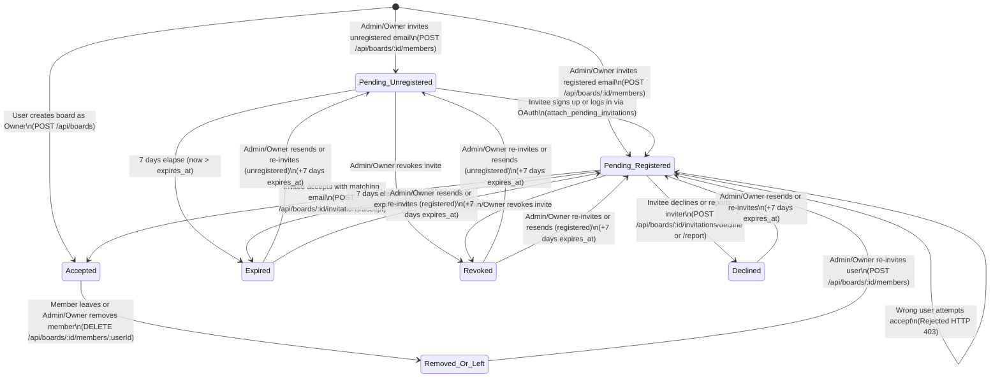

Status: Verified | Last scanned: 2026-10-13 | Audience: Product, Developers

# Board Invitation & Membership Lifecycle (`04-invite-lifecycle.md`)

Each board in **Sticky Mind Grid** acts as an isolated tenant boundary (`backend/app/utils/decorators.py:L19-L40`). Users gain access to a board only when they are the board creator or hold an accepted membership record (`status == 'accepted'`) for that board (`backend/app/utils/decorators.py:L31-L36`).

---

## 1. Dual-Record Data Model

Sticky Mind Grid tracks invitations and active memberships across two synchronized SQLAlchemy models plus an in-app notification model:

| Model & Table | Source File & Lines | Purpose & Key Columns |
|---|---|---|
| **`BoardInvitation`** (`board_invitations`) | `backend/app/models/board_invitation.py:L8-L79` | Email-bound invitation record supporting both registered and unregistered users. Columns: `id` (`String(36)` PK), `board_id` (FK `boards.id` `CASCADE`), `email` (`String(255)`, normalized via `.strip().lower()` at `L28`), `role` (`String(20)`, default `'editor'`), `status` (`'pending'`, `'accepted'`, `'expired'`, `'revoked'`, `'declined'`), `inviter_id` (FK `users.id` `CASCADE`), `created_at`, `expires_at` (defaults to `utcnow() + 7 days` at `L32-L33`), `accepted_at`, `revoked_at`. |
| **`BoardMember`** (`board_members`) | `backend/app/models/board_member.py:L8-L56` | User-bound membership and RBAC record created once a `User` account exists for the invited email. Columns: `id` (`String(36)` PK), `board_id` (FK `boards.id` `CASCADE`), `user_id` (FK `users.id` `CASCADE`), `role` (`'owner'`, `'admin'`, `'editor'`, `'member'`, `'commenter'`, `'viewer'`), `status` (`'pending'`, `'accepted'`, `'declined'`, `'expired'`), `is_muted` (`Boolean`, default `False`), `created_at`. Enforces `UniqueConstraint('board_id', 'user_id', name='uq_board_user')` (`L22-L24`). |
| **`Notification`** (`notifications`) | `backend/app/models/notification.py:L8-L41`, `backend/app/services/notification_service.py:L1-L71` | Stores in-app alerts for `board_invite`, `invite_accepted`, `invite_declined`, `member_left`, and `member_removed` events. |

---

## 2. Invitation & Membership State Diagram

### 2.1 Mermaid State Diagram



### 2.2 Text Version of States and Transitions

1. **Initial Creation (`[*]` → `Pending_Unregistered` / `Pending_Registered` / `Accepted`):**
   - When a user creates a board (`POST /api/boards`, `backend/app/services/board_service.py:L180-L228`), they bypass the invitation flow and immediately receive `BoardMember(role='owner', status='accepted')` (`L209-L215`).
   - When an Admin or Owner invites an email (`POST /api/boards/<board_id>/members`, `board_service.py:L373-L479`), the system creates (or updates) a `BoardInvitation(status='pending', expires_at=now + 7 days)` (`L412-L428`).
   - If the email belongs to an existing `User`, a `BoardMember(status='pending')` row is also created/updated (`Pending_Registered`, `L431-L444`). If no `User` exists yet, only the `BoardInvitation` row exists (`Pending_Unregistered`).
2. **Signup Auto-Attachment (`Pending_Unregistered` → `Pending_Registered`):**
   - When a user registers (`POST /api/auth/register`, `backend/app/routes/auth_routes.py:L137-L162`) or signs in via OAuth (`POST /api/auth/oauth`, `L54-L135`), `attach_pending_invitations(user)` (`auth_routes.py:L12-L53`) looks up all `pending` `BoardInvitation` rows matching `user.email.strip().lower()`. Non-expired invitations generate a `BoardMember(status='pending')` row and a `board_invite` notification (`L28-L48`).
3. **Acceptance (`Pending_Registered` → `Accepted`):**
   - The invitee calls `POST` or `PATCH /api/boards/<board_id>/invitations/accept` (`board_routes.py:L32-L40` → `BoardService.accept_invitation`, `board_service.py:L482-L572`).
   - If the authenticated user's email matches the invitation and it is neither expired nor revoked, `BoardInvitation.status` becomes `'accepted'` (`accepted_at = now`) and `BoardMember.status` becomes `'accepted'` (`L523-L540`).
   - If a different user attempts to accept, the request is rejected with HTTP `403` (`board_routes.py:L38`, `board_service.py:L504-L505, L510-L511`) and the invitation stays `Pending_Registered`.
4. **Decline or Spam Report (`Pending_Registered` → `Declined`):**
   - Calling `POST|PATCH|DELETE /api/boards/<board_id>/invitations/decline` (`board_service.py:L575-L623`) or `POST /api/boards/<board_id>/invitations/report` (`board_service.py:L626-L673`) sets `BoardInvitation.status = 'declined'` (`revoked_at = now`) and `BoardMember.status = 'declined'`.
5. **Lazy Expiration (`Pending_*` → `Expired`):**
   - Once `datetime.utcnow() > expires_at` (7 days after invite creation or last resend), the invitation is evaluated as `'expired'` (`board_invitation.py:L35-L41`) and persisted as `'expired'` on the next read or accept attempt (`board_service.py:L50-L56, L514-L517, L1118-L1120`).
6. **Revocation (`Pending_*` / `Expired` → `Revoked`):**
   - An Admin or Owner revokes the invite via `POST|DELETE /api/boards/<board_id>/invitations/<id>/revoke` (`board_service.py:L752-L809`) or `DELETE /api/boards/<board_id>/members/<user_id>` (`board_service.py:L812-L852`). `BoardInvitation.status` is set to `'revoked'` (`revoked_at = now`) and any `pending` `BoardMember` row is deleted from the database (`L783-L785, L922`).
7. **Resend / Re-invite (`Expired` / `Declined` / `Revoked` / `Pending_*` → `Pending_*`):**
   - An Admin or Owner calls `/resend` (`board_service.py:L676-L749`) or re-submits `POST /api/boards/<board_id>/members` (`board_service.py:L412-L444`). Both paths reset `status = 'pending'`, clear `revoked_at = None`, and extend `expires_at = datetime.utcnow() + timedelta(days=7)`.
8. **Leave or Removal (`Accepted` → `Removed_Or_Left`):**
   - A member leaves voluntarily or is removed by an Admin/Owner via `DELETE /api/boards/<board_id>/members/<user_id>` (`board_service.py:L812-L929`). The `BoardMember` row is hard-deleted (`L922`), active tasks on that board are unassigned (`L905-L906`), and the user can only rejoin if re-invited (`Removed_Or_Left` → `Pending_Registered`).

---

## 3. States & Database Persistence Matrix

Not all non-active states delete database rows; several states are retained in `board_invitations` and `board_members` for auditability and re-invitation handling:

| State | `board_invitations` Row State | `board_members` Row State | Effective Role Level (`get_effective_role`, `decorators.py:L19-L40`) | Visible in Board Members List (`get_board_members`, `board_service.py:L1104-L1144`)? |
|---|---|---|---|---|
| **No Record** | None | None | `0` (HTTP `403`) | No |
| **Pending (Unregistered)** | `status='pending'`, `expires_at=now+7d` (`board_service.py:L421-L428`) | None (`user` does not exist yet) | `0` (No account) | Yes — appended as synthetic entry with `isInvitation: True`, `userId: inv.id` (`L1121-L1137`) |
| **Pending (Registered)** | `status='pending'`, `expires_at=now+7d` | `status='pending'`, `role=<invited_role>` (`L432-L444`) | `0` (HTTP `403` on all board/task/SSE endpoints) | Yes — displays `"Invited"` badge (`src/components/board/BoardMembers.tsx:L247-L253`) |
| **Accepted** | `status='accepted'`, `accepted_at=now` (`L523-L524`) *(None for board creator)* | `status='accepted'`, `role=<role>` (`L529-L540`) | `1` (`viewer`) to `5` (`owner`) | Yes — active member |
| **Expired** | **Persisted:** `status='expired'` (`L50-L51, L515, L1119`) | **Persisted:** `status='expired'` (`L55, L89`) | `0` (HTTP `403`) | Registered `BoardMember` remains in query (`status != 'declined'`, `L1105`) with `"Expired"` badge (`BoardMembers.tsx:L255-L259`); unregistered `BoardInvitation` is skipped (`L1118-L1120`) |
| **Declined** | **Persisted:** `status='declined'`, `revoked_at=now` (`L582-L584`) | **Persisted:** `status='declined'` (`L615-L616`) | `0` (HTTP `403`) | Hidden (`BoardMember.status != 'declined'` filter at `L1105`) |
| **Revoked** | **Persisted:** `status='revoked'`, `revoked_at=now` (`L779-L780, L850-L851`) | **Hard-deleted:** `db.session.delete(bm)` (`L785, L792, L922`) | `0` (HTTP `403`) | No |
| **Removed / Left** | Prior `BoardInvitation` (if any) remains `'accepted'` | **Hard-deleted:** `db.session.delete(membership)` (`L922`) | `0` (HTTP `403`) | No (past tasks/comments/activities render author as `"Former member"`, `activity.py:L50-L73`) |

---

## 4. Transitions, Triggers & Side Effects Matrix

| Action / Transition | HTTP Endpoint (`board_routes.py`) | Service Function (`board_service.py`) | Caller & Required Role | Notification Created | Activity Audit Log | SSE Events Broadcast (`board_id`) |
|---|---|---|---|---|---|---|
| **Send Invite** (`[*]` / non-accepted → `pending`) | `POST /api/boards/<board_id>/members` (`L206-L222`) | `BoardService.add_member` (`L373-L479`) | `admin` or `owner` (Admin cannot grant `admin` or `owner`, `L381-L382`; `owner` not in `ALLOWED_INVITE_ROLES`, `L369`) | If registered user: `type='board_invite'`, `title='Board Invitation'` via `NotificationService.create_notification` (`L450-L456`) | `type='update'`, `message='Invited <name> as <role> (Pending acceptance, expires in 7 days)'` (`L463-L470`) | `member:invited`, `activity:new` (`L476-L477`) |
| **Attach Invite on Signup / OAuth** (`Pending_Unregistered` → `Pending_Registered`) | `POST /api/auth/register` (`auth_routes.py:L137-L162`) or `POST /api/auth/oauth` (`L124-L135`) | `attach_pending_invitations` (`auth_routes.py:L12-L53`) | Newly registered user | `Notification(type='board_invite', title='Board Invitation')` (`auth_routes.py:L41-L48`) | None | None |
| **Resend Invite** (`pending` / `expired` / `declined` / `revoked` → `pending`) | `POST /api/boards/<board_id>/members/<user_id>/resend` (`L243-L251`) or `POST /api/boards/<board_id>/invitations/<id>/resend` (`L279-L287`) | `BoardService.resend_invitation` (`L676-L749`) | `admin` or `owner` (Admin cannot resend `admin`/`owner` invites, `L707-L708`) | If registered user: `type='board_invite'`, `title='Board Invitation Reminder'` (`L738-L744`) | None | `member:invite_resent` (`L748`) |
| **Accept Invite** (`pending` → `accepted`) | `POST\|PATCH /api/boards/<board_id>/invitations/accept` (`L32-L40`) | `BoardService.accept_invitation` (`L482-L572`) | Authenticated invitee with matching email (`@jwt_required()`) | To `board.owner_id`: `type='invite_accepted'`, `title='Invitation Accepted'` (`L547-L555`) | `type='update'`, `message='<user> accepted the invitation and joined the board'` (`L558-L565`) | `member:joined`, `activity:new` (`L569-L570`) |
| **Decline Invite** (`pending` → `declined`) | `POST\|PATCH\|DELETE /api/boards/<board_id>/invitations/decline` (`L42-L49`) | `BoardService.decline_invitation` (`L575-L623`) | Authenticated invitee (`@jwt_required()`) | To `board.owner_id`: `type='invite_declined'`, `title='Invitation Declined'` (`L595-L603`) | `type='update'`, `message='<user> declined the invitation to join the board'` (`L606-L613`) | `member:removed`, `force_disconnect` (via `disconnect_user`), `activity:new` (`L619-L621`) |
| **Report / Block Inviter** (`pending` → `declined` across all boards from inviter) | `POST /api/boards/<board_id>/invitations/report` (`L51-L58`) | `BoardService.report_invitation` (`L626-L673`) | Authenticated invitee (`@jwt_required()`) | None (does not notify reported inviter) | `type='update'`, `message='<user> declined and reported the invitation as spam'` (`L661-L668`) | `member:removed`, `force_disconnect` (`L671-L672`) |
| **Revoke Invite (Dedicated Endpoint)** (`pending` / `expired` → `revoked`) | `POST\|DELETE /api/boards/<board_id>/invitations/<id>/revoke` (`L269-L277`) | `BoardService.revoke_invitation` (`L752-L809`) | `admin` or `owner` (Admin cannot revoke `admin`/`owner`, `L771-L772`) | None | `type='update'`, `message='<actor> revoked invitation for <target>'` (`L796-L803`) | `member:removed`, `activity:new` (`L806-L807`) |
| **Leave Board** (`accepted` → deleted) | `DELETE /api/boards/<board_id>/members/<user_id>` (`L224-L241`, where `actor_id == user_id`) | `BoardService.remove_member` (`L812-L929`) | Any accepted member except the sole `owner` (`L840-L842`) | To `board.owner_id`: `type='member_left'`, `title='Member Left Board'` (`L870-L878`) | `type='update'`, `message='<user> left the board'` (`L860-L867`) + per-task unassign logs (`L907-L918`) | `task:updated`, `member:removed`, `force_disconnect`, `activity:new` (`L919-L927`) |
| **Remove Member** (`accepted` → deleted) | `DELETE /api/boards/<board_id>/members/<user_id>` (`L224-L241`, where `actor_id != user_id`) | `BoardService.remove_member` (`L812-L929`) | `admin` (can only remove `editor` and below, `L835-L837`) or `owner` | To removed `user_id`: `type='member_removed'`, `title='Removed from Board'`, `link=None` (`L891-L897`) | `type='update'`, `message='<actor> removed member <user>'` (`L881-L888`) + per-task unassign logs (`L907-L918`) | `task:updated`, `member:removed`, `force_disconnect`, `activity:new` (`L919-L927`) |

---

## 5. Detailed Lifecycle Rules

### 5.1 Expiry (7-Day Time-to-Live)
- **TTL Calculation:** Every new or resent invitation sets `expires_at = datetime.utcnow() + timedelta(days=7)` (`backend/app/models/board_invitation.py:L32-L33`, `backend/app/services/board_service.py:L408-L409, L716`).
- **Computed Property:** `BoardInvitation.is_expired` (`board_invitation.py:L35-L41`) returns `True` when `self.status == 'expired'` or `(self.status == 'pending' and self.expires_at and datetime.utcnow() > self.expires_at)`.
- **Lazy Evaluation (No Background Cron):** Expiration is evaluated and persisted lazily at four checkpoints:
  1. **Listing user invitations (`GET /api/boards/invitations` → `BoardService.get_user_invitations`, `board_service.py:L48-L56, L87-L90`):** Marks expired `BoardInvitation` and `BoardMember` rows as `'expired'` and omits them from the invitee's active invitations list.
  2. **Attempting to accept (`POST /api/boards/<board_id>/invitations/accept` → `BoardService.accept_invitation`, `board_service.py:L514-L517`):** Marks the invitation `'expired'`, commits to the database, and returns HTTP `400` with `{"error": "This invitation has expired. Please ask a board admin to resend it"}`.
  3. **Listing board members (`GET /api/boards/<board_id>/members` → `BoardService.get_board_members`, `board_service.py:L1118-L1120`):** Marks expired unregistered `BoardInvitation` rows as `'expired'`.
  4. **Account registration / OAuth (`attach_pending_invitations`, `backend/app/routes/auth_routes.py:L24-L26`):** Skips and marks expired invitations when a new user registers.
- **UI Indicators:**
  - On the Home page (`src/pages/BoardsOverview.tsx:L68-L88, L480-L486`), `formatInviteExpiry(invite)` calculates remaining days and renders `"expires today"`, `"expires in 1 day"`, or `"expires in X days"` (`data-testid="invite-expiry"`).
  - In the Board Members modal (`src/components/board/BoardMembers.tsx:L255-L259`), expired registered member rows display a red `"Expired"` badge alongside Resend and Revoke actions.

### 5.2 Resend & Duplicate Invite Handling
- **Re-inviting via `POST /api/boards/<board_id>/members` (`BoardService.add_member`, `board_service.py:L402-L444`):**
  - If the target user already has `BoardMember.status == 'accepted'`, the backend rejects the request with HTTP `400`: `"User is already an active member of this board"` (`L403-L406`).
  - If a `BoardInvitation` already exists for `(board_id, clean_email)` in any non-accepted state (`pending`, `expired`, `declined`, `revoked`), `BoardService.add_member` **updates the existing row in-place** rather than creating a duplicate (`L412-L419`):
    - Updates `role` to the newly requested role.
    - Resets `status = 'pending'`, `created_at = now`, `expires_at = now + timedelta(days=7)`, and `revoked_at = None`.
    - Updates any existing `BoardMember` row to `status = 'pending'` and `role = role` (`L432-L436`).
- **Dedicated Resend Endpoints (`POST /api/boards/<board_id>/members/<user_id>/resend` at `board_routes.py:L243-L251` and `POST /api/boards/<board_id>/invitations/<invitation_id>/resend` at `board_routes.py:L279-L287`):**
  - Calls `BoardService.resend_invitation(board_id, target_id_or_email, actor_id)` (`board_service.py:L676-L749`), which resolves the target by `BoardInvitation.id`, `User.id`, or email address (`L685-L704`).
  - Resets `status = 'pending'`, extends `expires_at = now + timedelta(days=7)`, clears `revoked_at = None`, sends a `'Board Invitation Reminder'` notification (`L738-L744`), and broadcasts `member:invite_resent` (`L748`).
  - In the UI (`src/components/board/BoardMembers.tsx:L120-L128, L331-L343`), Admins and Owners see a `<Send />` icon button (`title="Resend invitation"`) on any `pending` or `expired` row.

### 5.3 Revoke vs. Remove Member
- **Dedicated Revoke Route (`POST|DELETE /api/boards/<board_id>/invitations/<invitation_id>/revoke` → `BoardService.revoke_invitation`, `board_service.py:L752-L809`):**
  - Sets `invitation.status = 'revoked'` and `invitation.revoked_at = datetime.utcnow()` (`L779-L780`).
  - Hard-deletes any associated `pending` `BoardMember` row (`L783-L785, L790-L792`).
  - Logs `"<actor_name> revoked invitation for <target_label>"` (`L796-L803`) and broadcasts `member:removed` and `activity:new` (`L806-L807`).
- **UI Revoke via `DELETE /api/boards/<board_id>/members/<user_id>` (`BoardMembers.tsx:L365-L385` → `BoardService.remove_member`, `board_service.py:L812-L852`):**
  - When an Admin or Owner clicks the revoke (`<UserMinus />`) button in `BoardMembers.tsx` (`L378`), the frontend calls `boardApi.removeMember(boardId, member.userId || member.id)` (`DELETE /api/boards/${boardId}/members/${userId}`).
  - **Unregistered invitee:** `member.userId` is `inv.id` (`board_service.py:L1125`). `BoardService.remove_member` finds no `BoardMember`, detects `BoardInvitation` (`L816-L818`), and delegates to `BoardService.revoke_invitation`.
  - **Registered pending invitee:** `member.userId` is `user.id`. `BoardService.remove_member` sets the matching `BoardInvitation.status = 'revoked'` and deletes the `BoardMember` row (`board_service.py:L890-L899`). It purges the pending `board_invite` notification (`L898`), logs an activity entry (`L928-L935`), and explicitly suppresses sending a `member_removed` notification to pending invitees (`L936`).

### 5.4 Decline & Spam Reporting
- **Standard Decline (`POST|PATCH|DELETE /api/boards/<board_id>/invitations/decline` → `BoardService.decline_invitation`, `board_service.py:L575-L623`):**
  - Accessible from the Home Page Pending Invitations banner (`src/pages/BoardsOverview.tsx:L238-L248, L511-L528`) and the Teams page (`src/pages/TeamsPage.tsx:L82-L91, L257-L270`).
  - Sets `BoardInvitation.status = 'declined'`, `BoardInvitation.revoked_at = datetime.utcnow()`, and `BoardMember.status = 'declined'` (`board_service.py:L582-L584, L615-L616`).
  - Sends an `invite_declined` notification to `board.owner_id` (`L595-L603`), logs an `Activity` entry (`L606-L613`), and broadcasts `member:removed` + `disconnect_user` (`L619-L620`).
- **Report or Block Inviter (`POST /api/boards/<board_id>/invitations/report` → `BoardService.report_invitation`, `board_service.py:L626-L673`):**
  - Triggered via the `<ShieldAlert />` (`"Report or block inviter"`) button on an invitation card (`src/pages/BoardsOverview.tsx:L250-L263, L493-L508`).
  - Declines the current invitation **and** queries all other `pending` `BoardInvitation` records sent by the same `inviter_id` to the invitee's email across all boards, marking both those `BoardInvitation` rows and their corresponding `BoardMember` rows as `'declined'` (`board_service.py:L640-L658`).
  - Logs `"<user_name> declined and reported the invitation as spam"` (`L661-L668`) without sending a notification to the reported inviter.

### 5.5 Wrong-Email & Edge-Case Handling

| Scenario | System Behavior | Code Citation |
|---|---|---|
| **Email belongs to an unregistered user** | `BoardService.add_member` creates a `BoardInvitation(status='pending')` row with no `BoardMember` row and returns HTTP `201`. In `get_board_members`, it appears with `isInvitation: True`. When the user later registers or logs in via OAuth with that email, `attach_pending_invitations(user)` creates the `BoardMember(status='pending')` row and `board_invite` notification. | `backend/app/services/board_service.py:L400-L445, L1116-L1137`; `backend/app/routes/auth_routes.py:L12-L53` |
| **Missing or blank email** | `POST /api/boards/<board_id>/members` returns HTTP `400`: `{"error": "Email is required"}`. | `backend/app/routes/board_routes.py:L215-L216` |
| **Malformed / non-email string** | Enforced via `email-validator`: `BoardService.add_member` validates syntax and normalizes emails via `email_validator.validate_email(clean_email, check_deliverability=False)` (falling back to strict regex `^[^@\s]+@[^@\s]+\.[^@\s]+$`). Invalid formats return HTTP `400`: `{"error": "Invalid email format"}`. | `backend/app/services/board_service.py:L395-L406` |
| **Inviting self or an already-active member** | Rejected with HTTP `400`: `{"error": "User is already an active member of this board"}`. | `backend/app/services/board_service.py:L403-L406` |
| **Invited to wrong email address by mistake** | Admin or Owner clicks the Revoke (`<UserMinus />`) button in `BoardMembers.tsx`, which transitions `BoardInvitation.status` to `'revoked'` and deletes any `pending` `BoardMember` row. | `src/components/board/BoardMembers.tsx:L365-L385`; `backend/app/services/board_service.py:L752-L809` |
| **User B attempts to accept User A's invitation** | `BoardService.accept_invitation` checks whether a `pending` `BoardInvitation` exists on `board_id` for another email (`L501-L505`) or if `clean_user_email != invitation.email.strip().lower()` (`L510-L511`). Returns `"Email mismatch: This invitation was sent to another email address"`, which `board_routes.py:L38` maps to **HTTP `403 Forbidden`**. The invitation remains `'pending'`. | `backend/app/routes/board_routes.py:L36-L39`; `backend/app/services/board_service.py:L490-L512`; `backend/tests/test_invitations.py:L254-L278` |
| **User B attempts to decline User A's invitation** | `BoardService.decline_invitation` queries `BoardInvitation` by `(board_id, clean_user_email)` and `BoardMember` by `(board_id, user_id)`. Neither matches User B, returning HTTP `400`: `{"error": "Invitation not found"}`. | `backend/app/services/board_service.py:L580-L588` |
| **Pre-acceptance board data exposure** | Before acceptance, `GET /api/boards/invitations` returns only `board.id`, `board.name`, `board.emoji`, `board.color`, and `ownerName` (`board_service.py:L73-L79`). Direct calls to `GET /api/boards/<board_id>`, `/tasks`, `/members`, or `/events` return **HTTP `403`** because `get_effective_role` requires `status == 'accepted'` (`decorators.py:L34-L38`). | `backend/app/services/board_service.py:L73-L79`; `backend/app/utils/decorators.py:L34-L38` |
| **Email case sensitivity & whitespace** | All invitation queries and user registrations normalize emails with `.strip().lower()`. Both OAuth logins and local `POST /api/auth/register` pass user emails through `normalize_and_validate_email()` before persisting or checking duplicates. | `backend/app/models/board_invitation.py:L28`; `backend/app/services/board_service.py:L394-L400`; `backend/app/routes/auth_routes.py:L176-L187` |

### 5.6 Rate Limits
- **Outgoing Invitation Rate Limit (Enforced in Application Logic):**
  - `BoardService.add_member` (`backend/app/services/board_service.py:L407-L416`) enforces a rolling 24-hour cap of **20 invitations per inviter (`actor_id`)**:
    ```python
    one_day_ago = datetime.utcnow() - timedelta(days=1)
    recent_invites_count = BoardInvitation.query.filter(
        BoardInvitation.inviter_id == actor_id,
        BoardInvitation.created_at >= one_day_ago
    ).count()
    if recent_invites_count >= 20:
        return None, "Daily invitation limit reached (maximum 20 invites per day). Please try again tomorrow."
    ```
  - When `recent_invites_count >= 20`, `POST /api/boards/<board_id>/members` returns HTTP `400` (`backend/app/routes/board_routes.py:L218-L220`, verified in `backend/tests/test_invitations.py:L338-L363`).
- **HTTP / IP Rate Limiting (Flask-Limiter):**
  - **Enforced via `Flask-Limiter`:** Configured with in-memory / Redis backend in `backend/app/__init__.py`. Rate limits are applied to sensitive endpoints:
    - Auth endpoints (`/api/auth/login`, `/api/auth/register`): `10 per minute` (`backend/app/routes/auth_routes.py:L169, L214`).
    - OAuth endpoints (`/api/auth/oauth*`): `20 per minute` (`backend/app/routes/auth_routes.py:L154, L163`).
    - Invitation dispatch (`POST /api/boards/<id>/members`): `20 per minute` at the route layer, plus the 20-invite rolling 24-hour business cap in `BoardService.add_member`.
