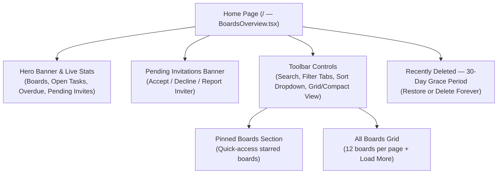
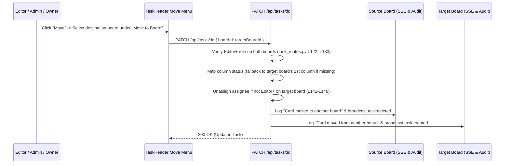

Status: Verified | Last scanned: 2026-10-13 | Audience: End Users

# Sticky Mind Grid — User Guide (`05-user-guide.md`)

Welcome to **Sticky Mind Grid**, a real-time collaborative Kanban workspace where each board is a private space for your team. This guide walks you through getting started and performing every core task in the application.

---

## 1. Getting Started

### 1.1 Create an Account or Sign In

1. **Register with Email & Password (`src/pages/Register.tsx:L15-L146`):**
   - Open `/register` and enter your **Full Name**, **Email**, and a **Password** (minimum **6 characters**, enforced at `src/pages/Register.tsx:L26-L29`).
   - Click **Create Account**. You are signed in automatically and taken to your Home page (`/`).
   - Any pending board invitations sent to your email before you signed up are automatically attached to your new account (`backend/app/routes/auth_routes.py:L12-L53`).
2. **Sign In with Email & Password (`src/pages/Login.tsx:L15-L132`):**
   - Open `/login`, enter your **Email** and **Password**, and click **Sign In**.
3. **Sign In with Google, GitHub, or Microsoft (`src/components/auth/OAuthButtons.tsx:L89-L390`):**
   - On `/login` or `/register`, click **Google**, **GitHub**, or **Microsoft** (`src/components/auth/OAuthButtons.tsx:L174-L206`).
   - Choose a preset account or click **Use another account** (`L301-L371`) to sign in with your email address (`backend/app/routes/auth_routes.py:L54-L135`).
4. **Session Duration (`backend/config.py:L41`, `src/contexts/AuthContext.tsx:L24-L91`):**
   - Your login session lasts **24 hours**. When your session expires, Sticky Mind Grid automatically logs you out and returns you to `/login`.

### 1.2 Understanding Board Roles

Every board has five permission roles (`backend/app/utils/decorators.py:L10-L17`, `src/hooks/useBoardPermissions.ts:L53-L224`):

| Role | Badge | What You Can Do on the Board |
|---|---|---|
| **Owner** | `👑 Owner` | Full control: manage board settings, columns, members, and roles; promote co-owners or transfer ownership; export board JSON; soft-delete, restore, or permanently delete the board (`useBoardPermissions.ts:L183-L222`). |
| **Admin** | `🛡️ Admin` | Edit board name, banner, color, and columns; invite members (up to Editor); change roles for Editors, Commenters, and Viewers; delete any comment or attachment; empty the Trash bin; view the full board Activity Log; export board JSON (`useBoardPermissions.ts:L191-L218`, `board_service.py:L381-L382, L981-L985`). |
| **Editor** *(or legacy Member)* | `✏️ Editor` | Create, edit, drag-and-drop, assign, archive, soft-delete, and restore tasks; move tasks across boards (where you are also an Editor+); manage checklists; upload attachments (and delete your own); create and edit board notes (`useBoardPermissions.ts:L205-L219`). |
| **Commenter** | `💬 Commenter` | View all board views, tasks, and attachments in read-only mode; post comments, `@mention` board members, and edit or delete your own comments (`useBoardPermissions.ts:L214, L220`). |
| **Viewer** | `👁️ Viewer` | View the board, tasks, calendar, notes, and analytics in read-only mode; download attachments; follow tasks; mute board notifications; leave the board (`useBoardPermissions.ts:L189, L220`). |

---

## 2. Using the Home Page (`My Boards`)

When you sign in, you land on the **Home Page** (`src/pages/BoardsOverview.tsx:L90-L806`).

### 2.1 Home Page Overview Diagram

**Text Version of Home Page Layout:**
1. **Hero Banner & Summary Strip (`src/components/boards/BoardsHeroBanner.tsx:L19-L180`, `src/pages/BoardsOverview.tsx:L250-L266`):** Shows a personalized greeting, live counters for your total boards, open tasks, overdue/due-soon tasks, and pending invitations, plus a **New Board** button.
2. **Pending Invitations Banner (`src/pages/BoardsOverview.tsx:L428-L549`):** Appears automatically whenever you have unaccepted board invitations (refreshes every 6 seconds, `L218-L222`).
3. **Search, Filter, Sort & View Toolbar (`src/pages/BoardsOverview.tsx:L278-L426`):**
   - **Search (`L282-L302`):** Type in `"Search boards…"` to filter boards by name or description in real time (`src/hooks/useBoards.ts:L304-L310`). Click the `X` icon to clear your search.
   - **Filter Tabs (`L306-L331`):** Switch between **All**, **Owned by me** (boards where you are an Owner), and **Shared with me** (`src/hooks/useBoards.ts:L299-L303`).
   - **Sort Dropdown (`L335-L353`):** Order boards by **Last Updated** (default), **Name (A–Z)**, or **Created Date** (`src/hooks/useBoards.ts:L312-L322`).
   - **View Mode Toggle (`L356-L395`):** Toggle between **Grid** view (cards with cover banners) and **Compact** view (streamlined cards without banners). Your sort, filter, and view choices are saved automatically in your browser (`src/hooks/useBoards.ts:L24-L57`).
4. **Pinned Boards & Board Grid (`src/pages/BoardsOverview.tsx:L608-L676`, `src/components/boards/BoardCard.tsx:L62-L414`):**
   - Click the **Pin** icon on any board card (`BoardCard.tsx:L223-L236`) to pin it to the top **Pinned Boards** section (`src/utils/pinnedBoardsUtils.ts:L1-L44`).
   - Each board card shows the board's emoji, title, your role badge, a `Shared` badge (if shared), description, open task count, overdue or due-soon warning badge, last-updated time, and up to 3 member avatars (`BoardCard.tsx:L180-L410`).
   - Up to **12 boards** are shown initially; click **Load more boards** at the bottom to view additional boards (`BoardsOverview.tsx:L27, L662-L674`).
5. **Recently Deleted Boards (`src/pages/BoardsOverview.tsx:L680-L735`):** Displays soft-deleted boards you own that are within their 30-day recovery window.

---

## 3. How to Create a Board

1. Click **New Board** in the Home page header/hero banner (`src/pages/BoardsOverview.tsx:L270-L276`) or click the `+` icon next to **Boards** in the left sidebar (`src/components/layout/AppSidebar.tsx`).
2. In the **Create Board** modal (`src/components/boards/BoardModal.tsx:L249-L844`):
   - Click the **Emoji button** (`default: 🚀`, `L255, L487`) to pick a board icon.
   - Enter a **Board Name** (`L489-L500`, required).
3. *(Optional)* Click **Customize** (`data-testid="toggle-customize-board"`, `L503-L526`) to configure advanced settings:
   - **Starter Template (`L61-L106, L534-L566`):**
     - **Kanban** *(default)*: `📋 To Do`, `⚡ In Progress`, `✅ Done`
     - **Sprint**: `📥 Backlog`, `📋 To Do`, `⚡ In Progress`, `👀 In Review`, `✅ Done`
     - **Personal**: `📌 To Do`, `🎉 Done`
     - **Ideas**: `💡 Ideas`, `🔨 Doing`
     *(Note: An `📦 Archive` column is also added automatically to support task archiving, `L424-L430`).*
   - **Description (`L568-L580`):** Add an optional summary of the board's purpose.
   - **Banner Image (`L670-L800`):** Upload a `JPG`, `PNG`, `WebP`, or `GIF` image up to **5 MB** (`L160-L161, L697-L706`), paste an Unsplash image URL (`https://images.unsplash.com/...`), or pick one of the **6 curated presets** (`Aurora`, `Minimalist Abstract`, `Cyber Space`, `Modern Studio`, `Atmosphere`, `High-Rise Geometry`, `L109-L159`).
   - **Theme Accent Color (`L52-L59, L802-L823`):** Choose from 6 color swatches.
4. Click **Create Board** (`L833-L839`).

---

## 4. How to Customize Columns & WIP Limits

Only **Owners** and **Admins** can add, rename, or remove columns (`src/hooks/useBoardPermissions.ts:L203-L204`, `backend/app/services/board_service.py:L256-L259`).

1. Open the board and click the **Edit Board & Icon** (pencil) button in the board header (`src/components/kanban/KanbanBoard.tsx:L858-L868`), or click the three-dot menu (`⋯`) on a board card on the Home page and select **Edit** (`src/components/boards/BoardCard.tsx:L253-L262`).
2. Under **Board States / Workflow Columns** (`src/components/boards/BoardModal.tsx:L583-L668`):
   - **Add a Column:** Click **Add State** (`L591-L600`) to add a new column at the end of the workflow.
   - **Change Emoji or Title:** Click a column's emoji button or edit its title text box (`L616-L632`). Every column must have a non-empty title (`L401-L404`). You can also rename a column directly on the Kanban board by double-clicking its column header (`src/components/kanban/KanbanColumn.tsx`).
   - **Set a WIP (Work-in-Progress) Limit:** Enter a positive whole number (`min 1`) in the **WIP** field next to any column (`BoardModal.tsx:L633-L648`, `board_service.py:L166-L178`). When tasks in that column reach or exceed the WIP limit, the column header highlights in amber (at limit) or red (over limit) with a warning icon (`src/components/kanban/KanbanColumn.tsx:L75-L76, L156-L182`).
   - **Remove a Column:** Click the `X` button next to a column (`BoardModal.tsx:L650-L662`).
     - A board must always keep **at least 1 workflow column** (`L319-L322`, `board_service.py:L262-L264`).
     - **Active Task Protection:** You cannot delete a column while it still contains active tasks (`BoardModal.tsx:L324-L333`, `board_service.py:L268-L274`). Move or delete the tasks in that column first.
3. Click **Save** (`L833-L839`).

---

## 5. How to Invite a Person with a Role

Only **Owners** and **Admins** can invite people to a board (`src/hooks/useBoardPermissions.ts:L198`, `backend/app/routes/board_routes.py:L208`).

1. Open the board and click the **Invite** button in the top header (`src/components/board/BoardMembers.tsx:L164-L176`), or click **Invite** next to a board on the **Teams** page (`src/pages/TeamsPage.tsx`).
2. In the **Invite to Board** dialog (`src/components/board/InviteMemberDialog.tsx:L48-L304`):
   - **Email or Name (`L169-L230`):** Type a teammate's name or email to pick from autocomplete suggestions (`GET /api/auth/users/search`, `auth_routes.py:L232-L244`), or enter any email address directly (even if the person has not created a Sticky Mind Grid account yet, `board_service.py:L400-L445`).
   - **Select Role (`L233-L274`):**
     - **Owners** can invite someone as **Admin**, **Editor**, **Commenter**, or **Viewer** (`InviteMemberDialog.tsx:L255-L260`, `board_service.py:L369`).
     - **Admins** can invite someone as **Editor**, **Commenter**, or **Viewer** (only Owners can grant Admin or Owner roles, `board_service.py:L381-L382`).
3. Click **Send Invitation** (`L288-L299`).
   - **Expiration:** The invitation is valid for **7 days** (`board_service.py:L408-L409`).
   - **Daily Limit:** Each user can send up to **20 invitations per 24 hours** (`board_service.py:L390-L398`).
4. **Resending or Revoking a Pending Invite (`src/components/board/BoardMembers.tsx:L331-L385`):**
   - Click the member avatars in the board header to open the **Board Team** modal.
   - Next to any `Invited` or `Expired` user, click the **Resend** icon (`<Send />`, `L332-L343`) to send a reminder and reset the 7-day timer, or click the **Revoke** icon (`<UserMinus />`, `L365-L385`) to cancel the invitation.

---

## 6. How to Accept or Decline an Invitation

When you are invited to a board, you cannot view its tasks, columns, or members until you accept the invitation (`backend/app/utils/decorators.py:L34-L38`).

1. **Where to Find Your Pending Invitations:**
   - **Home Page (`/`):** Look at the **Pending Board Invitations** banner near the top of `My Boards` (`src/pages/BoardsOverview.tsx:L428-L549`).
   - **Teams Page (`/teams`):** Listed under **Pending Board Invitations** (`src/pages/TeamsPage.tsx:L170-L275`).
   - **Notification Bell:** Click the bell icon in the top header (`src/components/notifications/NotificationBell.tsx:L170-L188`) and click the **"X pending board invitation(s) — Review →"** banner to jump to the Home page.
2. **Each Invitation Card Shows (`BoardsOverview.tsx:L455-L507`):**
   - Board emoji and name, the role you are being granted (`Admin`, `Editor`, `Commenter`, or `Viewer`), who invited you, and when the invite expires (`expires in X days` or `expires today`).
3. **Choose an Action (`BoardsOverview.tsx:L493-L544`):**
   - **Accept:** Click **Accept** (`L529-L541`). You immediately join the board and are navigated to `/boards/<boardId>` (`L227-L232`).
   - **Decline:** Click **Decline** (`L511-L528`). The invitation is removed from your list and the board owner is notified (`board_service.py:L575-L623`).
   - **Report or Block Inviter:** Click the shield alert icon (`title="Report or block inviter"`, `L493-L508`) to decline this invitation **and** automatically decline all other pending invitations from the same sender (`board_service.py:L626-L673`).

---

## 7. Working in the Task Modal & Task Detail Workspace

### 7.1 Creating a New Task (`src/components/kanban/TaskModal.tsx:L85-L938`)

Requires **Editor**, **Admin**, or **Owner** role (`src/hooks/useBoardPermissions.ts:L205`).

1. Click **+ Add Task** in the bottom floating dock (`src/components/kanban/KanbanBoard.tsx:L1103-L1119`) or click `+` in any column header (`src/components/kanban/KanbanColumn.tsx:L196-L209`).
2. Fill in the task details (`TaskModal.tsx:L492-L915`):
   - **Icon & Title (`L494-L512`):** Pick an emoji and enter a required **Task Title**.
   - **Labels (`L515-L598`):** Click **+ Label** to create color-coded labels (8 color presets).
   - **Description (`L601-L614`):** Add task notes or instructions.
   - **Priority (`L619-L654`):** Choose `Low`, `Medium` (default), or `High`.
   - **Due Date & Time (`L657-L685`):** Pick a date and time (or click `X` to clear).
   - **Stage / Column (`L690-L716`):** Select which workflow column the card starts in.
   - **Assignee (`L719-L755`):** Assign the card to an accepted board member with **Editor**, **Admin**, or **Owner** role (`L105-L109`, enforced on server at `backend/app/routes/task_routes.py:L72-L76`).
   - **Checklist (`L758-L828`):** Add subtasks to track step-by-step completion.
   - **Attachments (`L831-L912`):** Attach files up to **25 MB** per file (`backend/config.py:L55`).
3. Click **Create Task** (or press `Ctrl+Enter` / `Cmd+Enter`, `L307-L312`).

### 7.2 Inspecting & Editing in the Task Detail Workspace (`src/components/task/TaskDetailWorkspace.tsx:L33-L456`)

Click any task card on a board, list, or calendar to open the **Task Detail Drawer** (`TaskDetailWorkspace.tsx`), or open `/boards/<boardId>/tasks/<taskId>` for the full-screen view (`src/pages/TaskDetailPage.tsx:L19-L337`).
- For **Commenters** and **Viewers**, all task fields are visible in read-only mode so you can inspect the card, while edit/delete controls are hidden (`src/hooks/useBoardPermissions.ts:L220`).
- For **Editors**, **Admins**, and **Owners**, edits save automatically (`TaskDetailWorkspace.tsx:L414-L453`):

| Feature | How It Works | Source Citation |
|---|---|---|
| **Cover Banner, Emoji & Title** | Hover over the header to click **Add cover** (7 gradient themes), click the emoji to change the icon, or edit the title inline (auto-saves after 600 ms or on blur). | `src/components/task/TaskHeader.tsx:L38-L46, L299-L393` |
| **Status (Column)** | Select a column from the **Status** dropdown (`TaskProperties.tsx:L125-L166`) or drag the card between columns on the board. Both write a single unified log entry: `Moved "<title>" from <Old Column> to <New Column>`. | `src/components/task/TaskProperties.tsx:L125-L166`; `backend/app/services/task_service.py:L328-L343` |
| **Priority** | Choose `Low`, `Medium`, `High`, or `Urgent`. | `src/components/task/TaskProperties.tsx:L24-L45, L169-L233` |
| **Assignee** | Pick any accepted `Owner`, `Admin`, or `Editor` on the board, or select `Unassigned`. If an assignee is later removed from the board or demoted to Commenter/Viewer, they are automatically unassigned. | `src/components/task/TaskProperties.tsx:L115, L236-L284`; `backend/app/services/board_service.py:L905-L920, L1023-L1041` |
| **Due Date** | Pick a date and time. Cards show an **Overdue** badge (rose) if past due or **Due Today** (amber). | `src/components/task/TaskProperties.tsx:L102-L108, L287-L352` |
| **Progress & Subtasks (Checklist)** | When a task has **no checklist items**, drag the **Progress** slider manually (`0%–100%` in 5% steps). As soon as you add **1 or more checklist items**, the slider locks (`(checklist)`) and progress is calculated automatically from completed subtasks (`Math.round(completed / total * 100)`). | `src/components/task/TaskProperties.tsx:L83, L355-L395`; `src/components/task/TaskChecklist.tsx:L40-L47` |
| **Description & Conflict Resolution** | Click into the description, type your changes, and click **Save** (or press `Ctrl+Enter`). If a teammate edits and saves the description while you are typing, a **Concurrent Edit Conflict** banner appears (`HTTP 409`), letting you choose **Load Remote** (keep their version) or **Overwrite With Mine**. | `src/components/task/TaskDescription.tsx:L18-L111`; `backend/app/services/task_service.py:L240-L242` |
| **Attachments** | Drag and drop files or click **Upload File** (up to **25 MB** per file, **100 MB** per board, **500 MB** per board owner, `backend/config.py:L55-L57`). All board members can view and download attachments. Editors can delete their own uploads; Admins and Owners can delete any attachment. | `src/components/task/TaskAttachments.tsx:L30-L232`; `backend/app/services/file_service.py:L177-L207` |
| **Comments & `@Mentions`** | Available to **Commenters**, **Editors**, **Admins**, and **Owners** (`TaskComments.tsx:L36-L422`). Type `@` to open the member autocomplete popup (`L91-L199`) and notify an accepted board member (`comment_service.py:L18-L75`). You can edit or delete your own comments (edited comments show `(edited)` with the original text on hover, `L244-L251`); Admins and Owners can delete anyone's comment (`comment_service.py:L151-L158`). | `src/components/kanban/TaskComments.tsx:L36-L422`; `backend/app/services/comment_service.py:L18-L250` |
| **Follow Task** | Click **Follow** (`Bell` icon, `TaskHeader.tsx:L152-L168`) in the task header to receive notifications whenever the card is moved or commented on (`task_service.py:L71-L98, L210-L224`). | `src/components/task/TaskHeader.tsx:L152-L168` |
| **Card Activity Feed** | At the bottom of the Task Detail Workspace, switch between **All**, **Comments**, and **History** (`TaskDetailWorkspace.tsx:L349-L410`) to view every change made to the card (`TaskActivityLog.tsx:L1-L155`). Visible to all 5 board roles (`activity_routes.py:L25-L28`). | `src/components/task/TaskDetailWorkspace.tsx:L349-L410`; `src/components/task/TaskActivityLog.tsx:L1-L155` |

---

## 8. How to Move a Task to Another Board

You can move a task card from one board to another if you hold **Editor**, **Admin**, or **Owner** role on **both** the source board and the destination board (`src/hooks/useBoardPermissions.ts:L219`, `backend/app/routes/task_routes.py:L129-L134`).

**Text Version — Step-by-Step Cross-Board Move:**
1. Open the task in the **Task Detail Workspace** (`src/components/task/TaskDetailWorkspace.tsx`).
2. In the top toolbar, click the **Move** button (`src/components/task/TaskHeader.tsx:L181-L242`).
3. Under the **Move to Board** section of the dropdown (`L212-L241`), click the destination board.
4. **What Happens Automatically (`backend/app/routes/task_routes.py:L135-L146`, `backend/app/services/task_service.py:L301-L327`):**
   - **Column Mapping:** If the task's current column ID does not exist on the destination board, the task is placed in the destination board's first column (`task_routes.py:L135-L139`).
   - **Assignee Privacy & Tenancy Check:** If the current assignee is not an accepted `Editor`, `Admin`, or `Owner` on the destination board, the task is automatically set to **Unassigned** (`task_routes.py:L141-L146`).
   - **Attachments, Checklist & Comments:** Stay attached to the task.
   - **Privacy-Safe Activity Logs:** The source board records `'Card "<title>" moved to another board'` and the destination board records `'Card "<title>" moved from another board'` without revealing the other board's name to members who do not belong to both boards (`task_service.py:L301-L327`).

---

## 9. How to Restore a Deleted Task (or Board)

### 9.1 Restoring a Deleted Task (`src/components/kanban/TrashModal.tsx:L22-L214`)

Deleted tasks are soft-deleted and kept in the board's **Trash Bin** for **30 days** before automatic permanent deletion (`backend/app/services/task_service.py:L47-L64`).

1. **Instant Undo After Deleting (`src/components/kanban/KanbanBoard.tsx:L247-L262`):**
   - When you move a task to Trash, a `"Task moved to trash"` notification toast appears with an **Undo** button. Click **Undo** to restore the task immediately.
2. **Restoring from the Trash Bin Modal (`TrashModal.tsx:L22-L214`):**
   - Requires **Editor**, **Admin**, or **Owner** role (`src/hooks/useBoardPermissions.ts:L211-L212`).
   - On the board's filter toolbar (Row 2), click the **Trash** (`Trash2` icon) button on the right (`src/components/kanban/KanbanBoard.tsx:L1072-L1081`).
   - In the **Trash Bin** modal, locate your deleted task (you can filter using the `"Search deleted tasks..."` box, `TrashModal.tsx:L103-L116`).
   - Click **Restore** (`RotateCcw` icon, `L158-L168`). The task returns immediately to its board column (`PATCH /api/tasks/<task_id>/restore`, `task_routes.py:L183-L199`).
3. **Permanent Deletion & Emptying Trash (Admins & Owners Only):**
   - **Admins** and **Owners** (`permissions.canPurgeTask`, `useBoardPermissions.ts:L213`) can also click the red trash icon next to an item to permanently delete it (`DELETE /api/tasks/<task_id>/permanent`, `TrashModal.tsx:L169-L181`) or click **Empty Trash (N)** (`DELETE /api/boards/<board_id>/trash`, `L185-L207`).

### 9.2 Restoring a Deleted Board (`src/pages/BoardsOverview.tsx:L680-L735`)

- When a board **Owner** deletes a board from the Home page (after typing the board's name to confirm, `BoardsOverview.tsx:L746-L802`), it moves to the **Recently Deleted — 30-Day Grace Period** section at the bottom of the Home page (`DELETE /api/boards/<board_id>?soft=true`, `board_routes.py:L153-L157`).
- Click **Restore** (`data-testid="restore-board-btn-${board.id}"`, `BoardsOverview.tsx:L712-L721`) to restore the board (`POST /api/boards/<board_id>/restore`), or click **Delete Forever** (`L722-L731`) to permanently erase it.

---

## 10. How to Leave a Board

Any member can leave a board at any time, **except** the sole **Owner** of a board (`src/hooks/useBoardPermissions.ts:L196`, `backend/app/services/board_service.py:L840-L842`).

### 10.1 Leaving as a Member, Admin, or Co-Owner
- **From the Home Page (`src/components/boards/BoardCard.tsx:L272-L302, L322-L345`):**
  1. Click the three-dot menu (`⋯`) on the board card.
  2. Click **Leave Board** and confirm in the dialog.
- **From Inside the Board (`src/components/board/BoardMembers.tsx:L388-L416`):**
  1. Click the member avatars in the top header to open the **Board Team** dialog.
  2. Next to your own name (`(You)`), click **Leave** (`L392-L401`) and confirm (`L403-L415`).
- **What Happens When You Leave (`backend/app/services/board_service.py:L860-L928`):**
  - Your board access ends immediately, you are unassigned from any active tasks on that board (`L905-L906`), and your past comments and activity entries remain intact under the label `"Former member"` (`backend/app/models/activity.py:L50-L73`).

### 10.2 Leaving When You Are the Sole Owner
If you are the only **Owner** on a board, the **Leave Board** option is disabled with `"Transfer ownership first"` (`src/components/boards/BoardCard.tsx:L273-L287`, `backend/app/services/board_service.py:L840-L842`). You must either:
1. **Promote Another Member to Owner / Transfer Ownership (`src/components/board/BoardMembers.tsx:L273-L279, L346-L363, L424-L495`):**
   - Open the **Board Team** dialog on the board.
   - Change another accepted member's role dropdown to **Owner** (or click the crown `Make Owner` button) and type the board's exact name to confirm (`POST /api/boards/<board_id>/transfer-ownership`, `board_routes.py:L184-L196`). Once another Owner exists, you can leave the board or change your own role.
2. **Or Delete the Board (`src/components/boards/BoardCard.tsx:L294-L306`):** Move the board to Recently Deleted if it is no longer needed.

---

## 11. How to Export Data

Sticky Mind Grid provides two JSON export options:

### 11.1 Export a Single Board (Owners & Admins)
1. Open the board you want to export.
2. In the board header (Row 1, next to the Mute Bell icon), click the **Export Board Data (JSON)** (`Download` icon) button (`src/components/kanban/KanbanBoard.tsx:L896-L906`, visible when `permissions.canExportBoard` is `true`, `useBoardPermissions.ts:L192`).
3. Your browser downloads `<board_name>_export_<YYYY-MM-DD>.json` containing the board metadata, columns, member list, active tasks, and recent activity log (`src/components/kanban/KanbanBoard.tsx:L299-L346`; backend endpoint `GET /api/boards/<board_id>/export` at `backend/app/routes/board_routes.py:L174-L182`).

### 11.2 Export All Your Account Data (All Users)
1. Click your profile avatar in the top-left sidebar (`src/components/layout/AppSidebar.tsx:L227-L337`) and select **All Settings** (or press `Ctrl+,` / `Cmd+,`).
2. Select the **Data & Privacy** tab (`src/components/settings/tabs/PrivacyTab.tsx:L22-L213`).
3. Under **Export Account Data**, click **Export JSON** (`L67-L98`).
4. Your browser calls `GET /api/users/me/export` (`backend/app/routes/user_routes.py:L83-L123`) and downloads `sticky-mind-grid-export-<YYYY-MM-DD>.json` containing your user profile, preferences, accessible boards, tasks, and notes.
