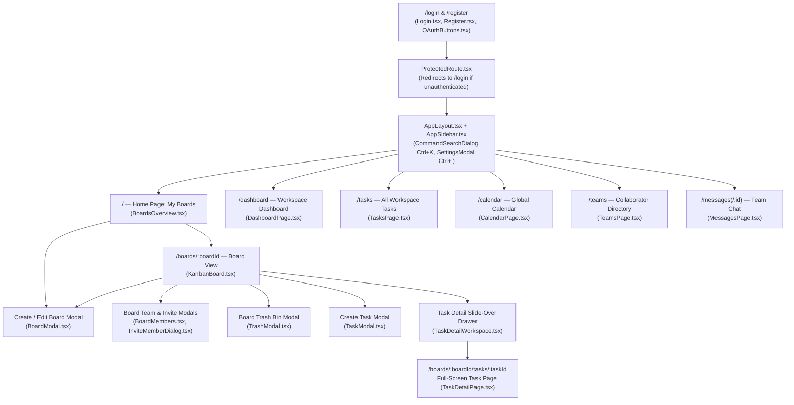
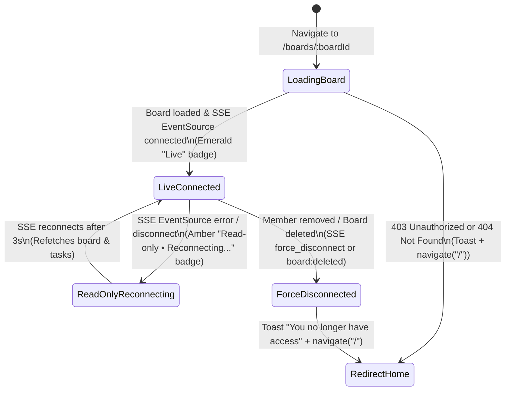

Status: Verified | Last scanned: 2026-10-13 | Audience: Product, QA, Designers

# Sticky Mind Grid — Functional Specification (`06-functional-spec.md`)

This document specifies the screens, modals, components, fields, UI states, client/server validations, empty/error states, and role-based visibility rules across **Sticky Mind Grid**. Every specification cites its implementation in the repository.

---

## 1. Screen & Modal Navigation Architecture

### 1.1 Mermaid Navigation Flow

### 1.2 Text Version of Screen Hierarchy
1. **Public Authentication Routes (`src/App.tsx:L51-L52`):** `/login` (`src/pages/Login.tsx:L15-L132`) and `/register` (`src/pages/Register.tsx:L15-L146`), both embedding `OAuthButtons` (`src/components/auth/OAuthButtons.tsx:L89-L390`).
2. **Protected Workspace Shell (`src/components/auth/ProtectedRoute.tsx:L5-L17` → `src/components/layout/AppLayout.tsx:L19-L114`):** Wraps all authenticated routes with `AppSidebar` (`src/components/layout/AppSidebar.tsx`), `CommandSearchDialog` (`src/components/search/CommandSearchDialog.tsx:L40-L323`), `SettingsModal` (`src/components/settings/SettingsModal.tsx:L43-L136`), and `PersonalScratchpadModal` (`src/components/documents/PersonalScratchpadModal.tsx:L78-L329`).
3. **Home Page (`/` — `src/pages/BoardsOverview.tsx:L90-L806`):** Displays the Hero Banner, Pending Board Invitations, Search/Filter/Sort toolbar, Pinned Boards, All Boards Grid (`BoardCard.tsx`), and Recently Deleted Boards, and launches `BoardModal.tsx`.
4. **Board View (`/boards/:boardId` — `src/components/kanban/KanbanBoard.tsx:L55-L1195`):** Hosts 6 switchable sub-views (`Kanban`, `List`, `Calendar`, `Notes & Docs`, `Analytics`, `Activity`), plus `BoardModal`, `BoardMembers`, `InviteMemberDialog`, `TrashModal`, `TaskModal` (create), and `TaskDetailWorkspace` (slide-over drawer).
5. **Full-Screen Task View (`/boards/:boardId/tasks/:taskId` — `src/pages/TaskDetailPage.tsx:L19-L337`):** Renders `TaskDetailWorkspace` as a dedicated page.

---

## 2. Authentication Screens (`Login.tsx`, `Register.tsx`, `OAuthButtons.tsx`)

| Screen & Component | Field / Control | Input Type & Default | Client Validation | Server Validation & Response (`auth_routes.py`) | Error & Loading States |
|---|---|---|---|---|---|
| **Login** (`src/pages/Login.tsx:L15-L132`) | `Email` (`#email`, `L68-L77`) | `type="email"`, `required`, `placeholder="name@example.com"` | Native HTML5 email & required check | `POST /api/auth/login` (`L164-L193`): `400 Missing email or password` (`L169-L170`); `401 Invalid credentials` (`L177, L181`) | Submit button disabled with `"Signing in..."` while `loading=true` (`L108-L114`); toast error on `401`/`500` (`L29-L31`) |
| | `Password` (`#password`, `L79-L106`) | `type="password"` with `Eye`/`EyeOff` toggle (`L92-L104`), `required` | Native required check | Checked via `user.check_password()` (`L179`) | Same as above |
| **Register** (`src/pages/Register.tsx:L15-L146`) | `Full Name` (`#name`, `L73-L82`) | `type="text"`, `required`, `placeholder="John Doe"` | Native required check | Stored in `user.full_name` (`L149`) | Submit button disabled with `"Creating account..."` (`L122-L128`) |
| | `Email` (`#email`, `L85-L95`) | `type="email"`, `required` | Native HTML5 email & required check | `POST /api/auth/register` (`L137-L162`): `400 Missing email or password` (`L141-L142`); `400 User already exists` if duplicate (`L144-L145`) | Toast error displays server `message` (`L38-L40`) |
| | `Password` (`#password`, `L97-L120`) | `type="password"` with `Eye`/`EyeOff` toggle, `required` | `password.length < 6` → toast error `"Password must be at least 6 characters"` (`L26-L29`) | Hashed via Bcrypt (`L151`) | Toast error on `< 6` chars |
| **OAuth Picker** (`src/components/auth/OAuthButtons.tsx:L89-L390`) | `Google`, `GitHub`, `Microsoft` buttons (`L174-L206`) | Opens Account Picker `Dialog` (`L209-L388`) with 2 preset accounts per provider (`L25-L65`) + `"Use another account"` form (`customEmail`, `customName`, `L301-L371`) | `customEmail.trim()` required & must contain `@` (`L135-L142` → `"Please enter a valid email address"`) | `POST /api/auth/oauth/<provider>` (`L54-L135`): `400 Unsupported provider` (`L58`); `400 Missing email` (`L64`); `200` existing user or `201` new user (`L73-L87`) | Shows spinner on active provider button (`isSubmitting`, `L183`); toast error on failure (`L129`) |

---

## 3. Home Page (`My Boards` — `src/pages/BoardsOverview.tsx`)

### 3.1 Screen Controls & Fields (`BoardsOverview.tsx:L90-L806`)

| Section / Control | Component & Lines | Fields / Options & Defaults | Behavior & Validation |
|---|---|---|---|
| **Hero Banner** | `src/components/boards/BoardsHeroBanner.tsx:L19-L180` | Time-based greeting (`Good morning/afternoon/evening, <firstName>`), stat pills (`X boards`, `Y open tasks`, `Z overdue` or `Z due soon`, `W pending invites`), `"New Board"` CTA, 3-slide carousel (`5500ms` auto-advance, `L69-L75`). | `"New Board"` opens `BoardModal` in Create mode (`BoardsOverview.tsx:L270-L276`). |
| **Pending Invitations Banner** | `BoardsOverview.tsx:L428-L549` (`[data-testid="pending-invitations-banner"]`) | Polls `GET /api/boards/invitations` every `6000ms` (`L218-L222`). Each card (`[data-testid="pending-invite-card-${invite.boardId}"]`) renders: Board Emoji & Name (`L455-L467`), Role Badge (`L468-L473`), `Invited by <inviterName>` (`L477-L479`), Expiry Pill (`[data-testid="invite-expiry"]`, `L68-L88, L480-L486`), `Report or block inviter` (`ShieldAlert` button, `L493-L508`), `Decline` button (`L511-L528`), `Accept` button (`L529-L541`). | **Pre-Acceptance Redaction:** Board description, columns, tasks, and member lists are omitted (`board_service.py:L73-L79`). Clicking **Accept** calls `POST /api/boards/:id/invitations/accept` and navigates to `/boards/:id` (`L227-L232`). |
| **Search Input** | `BoardsOverview.tsx:L282-L302` | `type="text"`, `placeholder="Search boards…"`, `aria-label="Search boards"`, default `""`. Clear (`X`) button shown when non-empty (`L293-L300`). | Case-insensitive substring filter on `board.name` and `board.description` (`src/hooks/useBoards.ts:L304-L310`). |
| **Filter Tabs** | `BoardsOverview.tsx:L306-L331` (`role="tablist"`) | Options: `all` (`"All"`, default), `owned` (`"Owned by me"`), `shared` (`"Shared with me"`). | Persisted per user in `localStorage` under `sticky_mind_grid_board_prefs_${userId}` (`useBoards.ts:L24-L57`). |
| **Sort Select** | `BoardsOverview.tsx:L335-L353` (`aria-label="Sort boards"`) | Options: `updated` (`"Last Updated"`, default — `updatedAt DESC`), `name` (`"Name (A–Z)"` — `localeCompare`), `created` (`"Created Date"` — `createdAt DESC`). | Persisted per user in `localStorage` (`useBoards.ts:L312-L322`). |
| **View Mode Toggle** | `BoardsOverview.tsx:L356-L395` | Options: `grid` (default, 4-col max grid with hero images) or `compact` (3-col max grid without hero images). | Persisted per user in `localStorage` (`useBoards.ts:L42`). |
| **Pinned Boards Section** | `BoardsOverview.tsx:L613-L634` (`[data-testid="pinned-boards-section"]`) | Displays boards whose IDs are stored in `localStorage` key `sticky_mind_grid_pinned_boards:${userId}` (`src/utils/pinnedBoardsUtils.ts:L1-L44`). | Hidden when no matching boards are pinned. |
| **All Boards Grid & Pagination** | `BoardsOverview.tsx:L636-L675` | Displays up to `PAGE_SIZE = 12` boards initially (`L27, L204`). Shows `"Load more boards (X remaining)"` (`[data-testid="load-more-boards-btn"]`, `L662-L674`) when `filteredBoards.length > visibleCount`. | Polls `GET /api/boards` every `8000ms` while tab is visible (`useBoards.ts:L163-L167`). |
| **Board Card** | `src/components/boards/BoardCard.tsx:L62-L414` | Displays: Hero image (`BoardHeroImage.tsx:L15-L74`, hidden in `compact` view), top color bar (`board.color`), Emoji + Name link, Role Badge (`Owner`, `Admin`, `Editor`, `Commenter`, `Viewer`), `Shared` badge (`L209-L219`), Pin toggle button (`[data-testid="pin-board-btn-${board.id}"]`, `L223-L236`), `⋯` Action Menu (`L238-L308`), 1-line description (`L311-L315`), open task count (`L325-L327`), overdue badge (rose) or due-soon badge (amber) (`L328-L350`), relative `Updated X ago` (`L353-L359`), and up to 3 member avatars + `+N` overflow (`L362-L409`). | **Menu Visibility (`BoardCard.tsx:L248-L307`):** • `Pin / Unpin Board`: All roles. • `Edit`: Visible only when `canEdit` (`owner` or `admin`, `L74, L253`). • `Leave Board`: Visible when `!isOwner \|\| isShared` (`L272`). Disabled with `"Transfer ownership first"` when `isSoleOwnerOfSharedBoard` (`isOwner && ownerCount <= 1`, `L76, L273-L287`). • `Delete`: Visible only when `isOwner` (`L73, L294-L306`). |
| **Type-to-Confirm Delete Board Dialog** | `BoardsOverview.tsx:L746-L802` | `AlertDialog` with input `[data-testid="confirm-delete-board-input"]` (`placeholder={boardToDelete?.name}`). | `"Delete Board"` button (`[data-testid="confirm-delete-board-submit"]`) is `disabled` until `confirmDeleteName.trim() === boardToDelete.name` (`L787-L791`). Calls `DELETE /api/boards/:id?soft=true` (`useBoards.ts:L238-L267`). |
| **Recently Deleted Section** | `BoardsOverview.tsx:L680-L735` (`[data-testid="recently-deleted-boards-section"]`) | Lists `trashedBoards` (`GET /api/boards/trash`, owner only) with deletion timestamp and two buttons: `Restore` (`[data-testid="restore-board-btn-${b.id}"]`) and `Delete Forever` (`[data-testid="purge-board-btn-${b.id}"]`). | Hidden when `trashedBoards.length === 0`. Boards older than 30 days are auto-purged on fetch (`board_service.py:L15-L25, L317-L326`). |

### 3.2 Home Page Loading, Error & Empty States

| State | Trigger Condition | Rendered UI & Actions | Source Lines |
|---|---|---|---|
| **Loading State** | `loading === true` on initial fetch (or `devSettings.simulateSkeletonLoading`) | Renders `<BoardsOverviewSkeleton />` shimmer cards | `BoardsOverview.tsx:L227-L234` |
| **Error State** | Initial `GET /api/boards` fails | Toast error `"Failed to load boards"` (`useBoards.ts:L138`) | `useBoards.ts:L136-L140` |
| **Empty State 1: No Search Results** | `allBoards.length > 0 && search.trim() !== "" && boards.length === 0` | `[data-testid="empty-state-search"]`: Search icon, `"No boards match \"<search>\""`, and `"Clear search"` button (`setSearch("")`) | `BoardsOverview.tsx:L552-L568` |
| **Empty State 2: No Filter Matches** | `allBoards.length > 0 && !search.trim() && filter !== "all" && boards.length === 0` | `[data-testid="empty-state-filter"]`: Filter icon, `"Noowned/shared boards found"`, and `"Show all boards"` button (`setFilter("all")`) | `BoardsOverview.tsx:L569-L587` |
| **Empty State 3: No Boards Yet** | `allBoards.length === 0` | `[data-testid="empty-state-no-boards"]`: LayoutGrid icon, `"No boards yet"`, subtitle, and `"Create Board"` CTA button | `BoardsOverview.tsx:L588-L606` |

---

## 4. Create / Edit Board Modal (`src/components/boards/BoardModal.tsx`)

| Field / Control | Input Type & Default | Client Validation (`BoardModal.tsx`) | Server Validation (`board_routes.py` & `board_service.py`) | Permission Visibility |
|---|---|---|---|---|
| **Emoji Icon** (`L487`) | `EmojiSelector` popover; default `"🚀"` on create (`L255`) | Optional string | Stored in `boards.emoji` (`board_service.py:L198, L250`) | Create: Any user. Edit: `owner` or `admin` (`canEditBoard`) |
| **Board Name** (`L489-L500`) | `<Input type="text" required autoFocus />`, default `""` | Submit button disabled when `!name.trim()` (`L834`) | `POST /api/boards` returns `400 {'error': 'Board name is required'}` if empty (`board_routes.py:L126-L127`) | Create: Any user. Edit: `owner` or `admin` |
| **Customize Toggle** (`L503-L526`) | Collapsible button `[data-testid="toggle-customize-board"]` (Create mode only; Edit mode always expanded, `L529`) | N/A | N/A | Create mode only |
| **Starter Template** (`L61-L106, L534-L566`) | 4 preset buttons (Create mode only): • `kanban` (default): `To Do`, `In Progress`, `Done` • `sprint`: `Backlog`, `To Do`, `In Progress`, `In Review`, `Done` • `personal`: `To Do`, `Done` • `ideas`: `Ideas`, `Doing` | Selecting a template replaces the draft columns list (`L299-L304`). On create submit, `{id: "archive", title: "Archive", emoji: "📦"}` is auto-appended (`L424-L430`). | If `columns` omitted, backend defaults to `[todo, in_progress, done, archive]` (`board_service.py:L181-L186`). | Create mode only |
| **Description** (`L568-L580`) | `<Textarea rows={2} />`, default `""` | Optional | Stored in `boards.description` (`board_service.py:L199, L251`) | Create: Any user. Edit: `owner` or `admin` |
| **Workflow Columns (`Board States`)** (`L583-L668`) | Per column row: • `EmojiSelector` (`L616`) • `Title` `<Input />` (`L622-L632`) • `WIP Limit` `<Input type="number" min={1} placeholder="WIP" />` (`L633-L648`) • `Remove` (`X`) button (`L650-L662`) • `"Add State"` button (`L591-L600`) | • **Min 1 column:** Removing the last column shows toast `"A board must have at least 1 workflow state."` (`L319-L322`). • **Non-empty title:** Blank title shows toast `"All board states must have a title."` (`L401-L404`). • **Active tasks check:** Removing a column with active tasks shows toast `"Cannot delete column \"...\" while it contains active tasks. Move or delete its tasks first."` (`L324-L333`). | • `len(non_archive) < 1` raises `ValueError("Board must have at least 1 workflow column")` → `400` (`board_service.py:L190-L191, L263-L264`). • `wipLimit` must be `None` or `int >= 1`, else `400 Column WIP limit must be a positive integer` (`L166-L178`). • Deleting column with active tasks raises `ValueError` → `400` (`L268-L274`). | Requires `canManageColumns` (`owner` or `admin`, `BoardModal.tsx:L275`, `board_service.py:L256-L259`) |
| **Banner / Header Image** (`L670-L800`) | 3 tabs/methods: 1. `Upload Image` (`JPG, PNG, WebP, GIF`, max `5 MB`, `L160-L161, L697-L706`) 2. `Image URL` input (`L717-L757`) 3. `6 Curated Presets` (`HERO_PRESETS`, `L109-L159`) | • Upload checks MIME & `file.size <= 5 MB` (`L345-L353`). • URL input validated by `validateBannerUrl` (`L171-L227`): allows only `/api/files/*`, `data:image/*`, or `https://(images\|plus).unsplash.com/*`. | `BoardService.validate_hero_image_url` (`board_service.py:L135-L164`) converts `data:image/*` to `/api/files/<uuid>.<ext>`, validates magic bytes & malware signatures (`file_service.py:L63-L109`), and rejects third-party hosts with `400`. | Create: Any user. Edit: `owner` or `admin` |
| **Theme Accent Color** (`L52-L59, L802-L823`) | 6 HSL color swatches; default `hsl(220, 80%, 56%)` | Selection always valid | Stored in `boards.color` (`board_service.py:L200, L252`) | Create: Any user. Edit: `owner` or `admin` |

---

## 5. Board View (`src/components/kanban/KanbanBoard.tsx`)

### 5.1 Board View State & Real-Time Connection Lifecycle

**Text Version of Board View Connection States (`KanbanBoard.tsx:L88-L320`, `useBoardRealtime.ts:L140-L298`):**
1. **Initial Load (`LoadingBoard`):** Fetches `GET /api/boards/:boardId` and `GET /api/tasks?boardId=:boardId`. While loading, renders `<KanbanBoardSkeleton />` (`KanbanBoard.tsx:L607-L613`). If the user lacks access (`403`, e.g., pending invitee) or the board does not exist (`404`), displays a toast error and redirects to `"/"` (`L94-L99`).
2. **Live Connected (`isConnected && !isReconnecting`):** Displays the emerald `Live` badge in the board header (`L844-L857`). Edit controls follow the user's RBAC role (`effectiveReadOnly = permissions.isReadOnly`).
3. **Read-Only Reconnecting (`isReconnecting === true`):** On SSE drop (`EventSource.onerror`, `useBoardRealtime.ts:L285-L298`), displays the amber `Read-only • Reconnecting...` badge (`KanbanBoard.tsx:L846-L851`) and forces `effectiveReadOnly = true` (`L128`), locking drag-and-drop, task edits, and comments until SSE reconnects (3-second retry loop) and resynchronizes board state (`onReconnect`, `L275-L280`).
4. **Force Disconnected (`force_disconnect` / `board:deleted`):** If an Admin/Owner removes the user from the board or deletes the board, the backend pushes `force_disconnect` (`event_broadcaster.py:L82-L117`) or `board:deleted` (`board_service.py:L312, L365`). The client closes `EventSource`, shows `"You no longer have access to this board."` (or `"This board has been deleted."`), and redirects to `"/"` (`KanbanBoard.tsx:L257-L273, L313-L316`).

### 5.2 Board Header, Filter Bar & Sub-Views (`KanbanBoard.tsx:L592-L1120`)

| Area / Sub-View | Component & Lines | Controls, Fields & States | Permission Visibility |
|---|---|---|---|
| **Top App Header** | `src/components/kanban/BoardHeader.tsx:L26-L267` | • Task search input (`placeholder="Search tasks..."`, `Ctrl+F` shortcut, filters by `title` or `description`, `KanbanBoard.tsx:L558-L567`) • `BoardMembers` avatar stack + `"Invite"` button (`BoardMembers.tsx:L135-L178`) • `NotificationBell` (`NotificationBell.tsx:L30-L236`) • User profile dropdown (`ProfileModal.tsx`) | Search, `NotificationBell`, and profile menu visible to all roles. `"Invite"` button visible only to `owner` and `admin` (`permissions.canInviteMembers`). In `TeamsPage` (`TeamsPage.tsx:L213, L330`), invite buttons are similarly gated by `canInviteAnywhere` and `canInviteToBoard(b)`. |
| **Pinned Board Header (Row 1)** | `KanbanBoard.tsx:L819-L915` | • Board Emoji + Title (`h1`) • Role Badge (`👑 Owner`, `🛡️ Admin`, `✏️ Editor`, `💬 Commenter`, `👁️ Viewer`) • SSE Status Badge (`Live` or `Read-only • Reconnecting...`) • `Edit Board & Icon` button (`Pencil`, `L858-L868`) • `Mute / Unmute Board` button (`[data-testid="board-mute-toggle"]`, `PUT /api/boards/:id/mute`, `L869-L895`) • `Export Board Data (JSON)` button (`Download`, `L896-L906`) | • `Edit Board & Icon`: `canEditBoard && !effectiveReadOnly` (`owner`, `admin`). • `Mute / Unmute`: All accepted board roles (`viewer`+). • `Export Board Data`: `canExportBoard` (`owner`, `admin`). |
| **Filter Toolbar (Row 2)** | `KanbanBoard.tsx:L918-L1083` | Shown on `board`, `list`, and `calendar` views: • Assignee pills: `All (N)`, `Me (N)`, `Unassigned (N)`, plus up to 3 member avatars inline + `+N` overflow dropdown (`L924-L1044`) • Tag filter pills (`availableTags`, `L1047-L1068`) • `Trash Bin` button (`Trash2` icon, `L1072-L1081`) | Filter pills visible to all roles. `Trash Bin` button visible only when `permissions.canViewTrash` (`owner`, `admin`, `editor`). |
| **Bottom Floating Dock** | `KanbanBoard.tsx:L592-L605, L1093-L1120` | `PillNavBar` switching views: 1. `board` (`Kanban`) 2. `list` (`List View`) 3. `calendar` (`Calendar`) 4. `documents` (`Notes & Docs`) 5. `overview` (`Analytics`) 6. `changes` (`Activity`) Plus `+ Add Task` button (`L1103-L1119`). | Views 1–5 visible to all roles. View 6 (`changes` / `Activity`) is **hidden** unless `permissions.canViewBoardActivity` is `true` (`owner`, `admin`, `L599-L604`). `+ Add Task` visible only when `permissions.canCreateTask && !effectiveReadOnly` (`owner`, `admin`, `editor`). |
| **View 1: Kanban Board** | `KanbanColumn.tsx:L32-L272`, `TaskCard.tsx:L55-L644` | • Horizontal columns (`id !== "archive"`) + collapsible **Archived Tasks Drawer** (`KanbanBoard.tsx:L751-L787`). • Column header: emoji, title (double-click to inline-rename for `admin`/`owner`), count or `count / wipLimit` badge, amber/rose WIP warning ring (`KanbanColumn.tsx:L75-L76, L156-L182`), and `+` add button. • Empty column state: dashed drop target `"No tasks yet"` (`KanbanColumn.tsx:L228-L246`). | Drag-and-drop, column `+` button, card quick-assign popover (`TaskCard.tsx:L273-L326`), and card `⋯` menu (`Move to...`, `Archive`, `Move to Trash`, `L329-L348`) are disabled/hidden when `effectiveReadOnly` (`commenter`, `viewer`, or SSE reconnecting). |
| **View 2: List View** | `src/components/kanban/TaskListView.tsx:L37-L238` | Table with columns: `Task Title`, `Stage`, `Priority`, `Progress`, `Assignee`, `Due Date`, `Actions` (`Trash2`). Empty state: `"No tasks found"` (`L68-L78`). | `Actions` delete column hidden when `readOnly`. |
| **View 3: Calendar View** | `src/components/kanban/CalendarView.tsx:L64-L949` | `Month`, `Week`, and `Agenda` sub-views (`L292-L315`), drag-to-reschedule task chips (`L196-L224`), right sidebar with Selected Day Agenda (`+ Add`), Overdue Tasks Alert, and Completed Tasks (`L814-L945`). | Drag-to-reschedule and `+ Add` button disabled when `readOnly`. |
| **View 4: Notes & Docs** | `src/components/kanban/DocumentsView.tsx:L38-L428`, `src/components/documents/NoteModal.tsx:L35-L199` | Split view: **Project Notes** (`title` required, `content`, 6 preset colors in `NoteModal.tsx:L26-L33`) and **Board Attachments Repository** (search & download all task files on board, `L338-L408`). Empty states for 0 notes and 0 files. | `New Note`, note edit, and note delete hidden when `readOnly` (`commenter`, `viewer`). Note delete button gated with `canDeleteNote(note)` (`isAdminOrOwner || isAuthor`, `DocumentsView.tsx:L59-L63`). Backend `DELETE /api/notes/:id` requires active board membership and allows note author or `admin`/`owner` (`note_service.py:L112-L124`). |
| **View 5: Analytics (`Overview`)** | `src/components/kanban/BoardOverview.tsx:L16-L131` | 4 KPI cards (`Total Tasks`, `Completed` + %, `In Progress`, `To Do`) + Recharts bar charts (`Tasks by Column`, `Tasks by Priority`). | Read-only telemetry; visible to all 5 roles. |
| **View 6: Activity (`Changes`)** | `src/components/kanban/LatestChangesPanel.tsx:L6-L41` | Chronological board audit feed (`GET /api/activities?boardId=:id`). Empty state: `"No activity recorded yet"` (`L25-L31`). | **Restricted to `owner` and `admin`** (`permissions.canViewBoardActivity` & `activity_routes.py:L27-L28`). Entries are immutable (`403` on `PUT`/`PATCH`/`DELETE`, `activity_routes.py:L51-L55`). |
| **Board Team Modal** | `src/components/board/BoardMembers.tsx:L57-L498` | Lists active members and pending/expired invitations. Controls: Role dropdown (`L267-L329`), `Resend` (`<Send />`, `L332-L343`), `Make Owner` (`<Crown />`, `L346-L363`), `Revoke` / `Remove` (`<UserMinus />`, `L365-L385`), `Leave` (`L388-L416`), and Type-to-Confirm Owner Promotion `AlertDialog` (`[data-testid="confirm-promote-owner-input"]`, `L424-L495`). | • **Email Redaction:** `commenter` and `viewer` receive `email: None` (and `"Invited Guest"` for unregistered invites) from `GET /api/boards/:id/members` (`board_service.py:L1107-L1132`). • Role/Remove controls shown only to `owner` (all roles except sole owner) and `admin` (`editor` and below only). |
| **Trash Bin Modal** | `src/components/kanban/TrashModal.tsx:L22-L214` | Search input (`placeholder="Search deleted tasks..."`), task list with deleted timestamp, per-task `Restore` button (`L158-L168`), per-task `Delete Forever` button (`L169-L181`), and `"Empty Trash (N)"` footer button (`L185-L207`). Empty state: `"Trash is empty"` (`L124-L132`). | Modal accessible to `owner`, `admin`, `editor` (`canViewTrash`). `Delete Forever` and `Empty Trash` visible **only** to `owner` and `admin` (`canPurgeTask`, `TrashModal.tsx:L169, L186`, `task_routes.py:L43, L209`). |

---

## 6. Task Modal (`TaskModal.tsx`) & Task Detail Workspace (`TaskDetailWorkspace.tsx`)

Sticky Mind Grid uses `TaskModal.tsx` (`src/components/kanban/TaskModal.tsx:L85-L938`) for **creating** a new task and `TaskDetailWorkspace.tsx` (`src/components/task/TaskDetailWorkspace.tsx:L33-L456`) for **viewing and editing** an existing task (either as a slide-over drawer or full-screen at `/boards/:boardId/tasks/:taskId` via `src/pages/TaskDetailPage.tsx:L19-L337`).

### 6.1 Complete Task Fields, States & Validations

| Field / Component | Source File & Lines | Input Type, Options & Default | Client & Server Validations | Permission Visibility (`useBoardPermissions.ts`) |
|---|---|---|---|---|
| **Emoji Icon** | `TaskModal.tsx:L495`, `TaskHeader.tsx:L326-L343` | `EmojiSelector` popover; default `"📝"` (`task.py:L16`) | Optional string | Editable for `owner`, `admin`, `editor`; read-only for `commenter`, `viewer`. |
| **Cover Banner** | `TaskHeader.tsx:L38-L46, L299-L323` | 7 gradient presets (`COVER_GRADIENTS`), `"Add cover"` / `"Change Cover"` / `"Remove"` buttons | Stored in local state per card header (`TaskHeader.tsx:L84`) | Buttons hidden when `readOnly` (`commenter`, `viewer`). |
| **Task Title** | `TaskModal.tsx:L497-L512`, `TaskHeader.tsx:L345-L392` | Required text input (`autoFocus` on create; debounced `600ms` + blur auto-save in `TaskHeader.tsx:L88-L103`) | • Create submit disabled when `!title.trim()` (`TaskModal.tsx:L925`). • Server `POST /api/tasks` returns `400 boardId and title are required` if missing (`task_routes.py:L65-L66`). | Input `readOnly` for `commenter` and `viewer` (`TaskHeader.tsx:L352`). |
| **Status (Column)** | `TaskModal.tsx:L690-L716`, `TaskProperties.tsx:L125-L166` | `Select` dropdown of board columns; defaults to `"todo"` or clicked column ID. Shows `"Moved live"` pulse badge if updated via SSE while open (`TaskDetailWorkspace.tsx:L76-L92`). | Changing status logs `Moved "<title>" from <Old> to <New>` (`task_service.py:L328-L343`) and notifies task followers (`L71-L98`). | `Select` disabled when `readOnly` (`TaskProperties.tsx:L132`). |
| **Priority** | `TaskModal.tsx:L619-L654`, `TaskProperties.tsx:L24-L45, L169-L233` | `Select` dropdown: • `low` (Slate) • `medium` (Amber, default) • `high` (Orange) • `urgent` (Rose, in `TaskProperties.tsx:L40-L44`) | Stored in `tasks.priority` (`task.py:L19`). | `Select` disabled when `readOnly` (`TaskProperties.tsx:L176`). |
| **Assignee** | `TaskModal.tsx:L105-L109, L719-L755`, `TaskProperties.tsx:L115, L236-L284` | `Select` dropdown of `Unassigned` + accepted board members holding `owner`, `admin`, `editor`, or `member` role. | **Server Enforcement (`task_routes.py:L72-L76, L148-L156`):** Assigning a user with `< editor` role returns `400 Cards can only be assigned to members with Editor role or above`. Demoting or removing a member auto-unassigns their tasks (`board_service.py:L905-L920, L1023-L1041`). | `Select` disabled when `readOnly` (`TaskProperties.tsx:L245`). |
| **Due Date & Time** | `TaskModal.tsx:L657-L685`, `TaskProperties.tsx:L287-L352` | `<input type="datetime-local" />` + clear (`X`) button. Shows `Overdue` badge (rose) if past & not today, or `Due Today` (amber) (`TaskProperties.tsx:L102-L108`). | Parsed as ISO-8601 UTC (`task_service.py:L154-L158, L281-L288`). | Input `disabled` and clear button hidden when `readOnly` (`TaskProperties.tsx:L313, L333`). |
| **Progress (`0%–100%`)** | `TaskProperties.tsx:L83, L355-L395` | `<input type="range" min={0} max={100} step={5} />`, default `0`. | **Server Checklist Derivation & Adaptive Column Snapping:** • If a task has checklist subtasks, `task_service.py` auto-derives `progress = round((completed / total) * 100)` and ignores client overrides. • In the UI, moving a card to the first column snaps progress to `0%` (with warning indicator) and moving to the final column fills progress to `100%`. Progress bar UI is hidden on cards residing in the first or last column (`KanbanCard.tsx`, `TaskProperties.tsx`). | Slider `disabled` when `readOnly \|\| hasChecklist` (`TaskProperties.tsx:L361, L379`). |
| **Labels** | `TaskModal.tsx:L515-L598`, `TaskProperties.tsx:L416-L494` | Label pills `[{id, name, color}]` + `+ Add Label` popover with text input and 8 `TAG_COLORS` swatches. | Duplicate or empty label names ignored (`TaskProperties.tsx:L88-L99`). | `+ Add Label` button and label remove (`X`) icons hidden when `readOnly` (`TaskProperties.tsx:L434, L445`). |
| **Description & Concurrent Conflict Banner** | `TaskModal.tsx:L601-L614`, `src/components/task/TaskDescription.tsx:L11-L167` | Auto-growing `<textarea>` with word count, `Save` (`Ctrl+Enter`) and `Cancel` (`Esc`) buttons when dirty. | **Dual Concurrency Conflict Detection (`409 Conflict`):** Server validates updates using either field-level `baseDescription` or task-wide timestamp `lastKnownUpdatedAt` (`task_service.py:L268-L288`). If the remote task was modified (`updated_at` delta > 0.5s or description modified), returns `409 Conflict`. UI renders **Concurrent Edit Conflict** banner with `Load Remote` and `Overwrite With Mine` (`forceOverwrite: true`). | `<textarea>` is `readOnly` for `commenter` and `viewer` (`TaskDescription.tsx:L118`). |
| **Subtasks / Checklist** | `TaskModal.tsx:L758-L828`, `src/components/task/TaskChecklist.tsx:L20-L190` | Progress bar (`X of Y completed (Z%)`), checkbox per item, inline title input (`[data-testid="checklist-item-input"]`), delete (`Trash2`) button, and `"Add a subtask..."` input. | Empty item titles ignored. Every add/toggle/delete recalculates `task.progress` (`TaskChecklist.tsx:L40-L79`). | Checkboxes disabled, inputs `readOnly`, and add/delete controls hidden when `readOnly` (`TaskChecklist.tsx:L98, L111, L136, L156`). |
| **File Attachments** | `TaskModal.tsx:L831-L912`, `src/components/task/TaskAttachments.tsx:L30-L232` | Drag-and-drop dropzone + `"Upload File"` button (`POST /api/files/upload?boardId=:id`), file cards with preview/download link and delete (`Trash2`) button. Empty state: `"No files attached"` (`L137-L141`). | **Server Quotas & Security (`config.py:L55-L74`, `file_service.py:L63-L207`):** • Allowed extensions whitelist (`images`, `docs`, `archives`, `media`). • Max `25 MB` per file (`413` / `400`). • Max `100 MB` per board & `500 MB` per board owner (`400`). • Magic-byte validation & malware signature scan (`EICAR`, `MZ`, `ELF`, `Mach-O`, `#!`, `<script`). • Server strictly checks attachment author or board admin/owner when removing attachments (`task_service.py:L313-L320`), raising `PermissionError` / `403` if an editor tries to delete another user's attachment. | • **View & Download:** All 5 roles (`viewer`+, verified via JWT at `GET /api/files/:name`, `file_service.py:L382-L460`). • **Upload:** `owner`, `admin`, `editor` (`canUploadAttachment`). • **Delete:** `owner` and `admin` can delete any attachment (`canDeleteAnyAttachment`); `editor` can delete only own uploads (`!att.uploaderId \|\| att.uploaderId === currentUser.id`, `TaskAttachments.tsx:L72-L79`). |
| **Header Actions (`Follow`, `Copy Link`, `Move`, `Archive`, `Trash`)** | `src/components/task/TaskHeader.tsx:L152-L282` | • `Follow` / `Following` (`[data-testid="task-follow-button"]`, `POST /api/tasks/:id/follow`) • `Copy Link` • `Move` dropdown (`Move to Column` + `Move to Board`) • `Archive` / `Unarchive` • `⋯` menu → `Move to Trash` | Cross-board move (`PATCH /api/tasks/:id { boardId }`) requires `editor`+ on both source and destination boards (`task_routes.py:L133-L134`), remaps invalid column status to `target_cols[0]` (`L138-L139`), unassigns non-member/non-editor assignees (`L141-L146`), and strips tags and comments for strict board tenant isolation (`task_service.py:L185-L215`). | • `Follow` & `Copy Link`: Visible to all 5 roles. • `Move`, `Archive`, `Move to Trash`: Hidden when `readOnly` (`commenter`, `viewer`, or SSE reconnecting). `Move to Board` requires `canMoveCrossBoard` (`editor`+). |
| **Comments & `@Mentions`** | `src/components/kanban/TaskComments.tsx:L36-L422` | Comment list with author avatar, timestamp, `(edited)` badge (hover shows `Original: <originalContent>`, `L244-L251`), edit (`Pencil`) and delete (`Trash2`) buttons, composer `<Textarea>` with `@` autocomplete popover (`L91-L199, L345-L418`). Empty state: `"No comments yet"` (`L206-L212`). | • Empty comment rejected (`400 Comment content cannot be empty`, `comment_routes.py:L23-L24`). • `@mention` autocomplete lists only **accepted board members** (`TaskComments.tsx:L48-L55`, `comment_service.py:L18-L75`). | • **Post, `@mention`, Edit Own, Delete Own:** `owner`, `admin`, `editor`, `commenter` (`canComment && !isReconnecting`). • **Edit Others' Comment:** Forbidden for all roles (`comment_service.py:L200-L202`). • **Delete Anyone's Comment:** `owner` and `admin` (`canDeleteAnyComment`, `comment_service.py:L151-L158`). • **Viewer:** Composer replaced by `"Commenting is disabled for viewers"` (`TaskComments.tsx:L340-L343`). |
| **Card Activity Feed** | `TaskDetailWorkspace.tsx:L349-L410`, `src/components/task/TaskActivityLog.tsx:L1-L155` | Tabs: `All`, `Comments`, `History`. Queries `GET /api/activities?boardId=:boardId&taskId=:taskId&taskTitle=:title`. | System audit entries are immutable (`403` on `PUT`/`PATCH`/`DELETE`, `activity_routes.py:L51-L55`). Departed board members render as `"Former member"` (`activity.py:L50-L73`). | Visible to **all 5 roles** (`owner`, `admin`, `editor`, `commenter`, `viewer` — `activity_routes.py:L25-L28`). |

---

## 7. Master Permission-Dependent Visibility Matrix

Derived from `src/hooks/useBoardPermissions.ts:L53-L224` (UI) and `backend/app/utils/decorators.py:L10-L95` + route/service guards (Server):

| Screen / Component | Element / Action | Owner (5) | Admin (4) | Editor (3) | Commenter (2) | Viewer (1) | SSE Reconnecting (`isReconnecting=true`) |
|---|---|:---:|:---:|:---:|:---:|:---:|:---:|
| **Home Page (`BoardsOverview`)** | View board in grid, search, sort, filter, pin | ✅ | ✅ | ✅ | ✅ | ✅ | ✅ |
| | `BoardCard` → `Edit` (opens `BoardModal`) | ✅ | ✅ | Hidden | Hidden | Hidden | Disabled inside board |
| | `BoardCard` → `Leave Board` | ✅ *(if >1 owner)* | ✅ | ✅ | ✅ | ✅ | ✅ |
| | `BoardCard` → `Delete` & Recently Deleted (`Restore` / `Delete Forever`) | ✅ | Hidden | Hidden | Hidden | Hidden | N/A |
| **Board Modal (`BoardModal`)** | Edit name, emoji, description, banner, color | ✅ | ✅ | Hidden (`403`) | Hidden (`403`) | Hidden (`403`) | Hidden |
| | Add, rename, set WIP limit, or delete empty column | ✅ | ✅ | Hidden (`403`) | Hidden (`403`) | Hidden (`403`) | Hidden |
| **Board View (`KanbanBoard`)** | View Kanban, List, Calendar, Notes, Analytics | ✅ | ✅ | ✅ | ✅ | ✅ | ✅ (Read-only) |
| | View `Activity` (`changes`) tab (full board audit log) | ✅ | ✅ | **Hidden (`403`)** | **Hidden (`403`)** | **Hidden (`403`)** | ✅ (for Admin/Owner) |
| | Export Board JSON (`Download` button) | ✅ | ✅ | Hidden (`403`) | Hidden (`403`) | Hidden (`403`) | ✅ (for Admin/Owner) |
| | Mute / Unmute Board Notifications | ✅ | ✅ | ✅ | ✅ | ✅ | ✅ |
| | View Member Email Addresses in `BoardMembers` | ✅ | ✅ | ✅ | **Redacted** | **Redacted** | Same as role |
| | Invite Members & Resend/Revoke Pending Invites | ✅ | ✅ *(up to Editor)* | Hidden (`403`) | Hidden (`403`) | Hidden (`403`) | ✅ (for Admin/Owner) |
| | Grant Admin or Owner Role / Transfer Ownership | ✅ | Hidden (`400`) | Hidden (`403`) | Hidden (`403`) | Hidden (`403`) | ✅ (for Owner) |
| | Create, Drag/Move, Reorder, Archive Tasks | ✅ | ✅ | ✅ | Hidden (`403`) | Hidden (`403`) | **Disabled (Locked)** |
| | Open Trash Bin Modal & Restore Deleted Tasks | ✅ | ✅ | ✅ | Hidden (`403`) | Hidden (`403`) | ✅ |
| | Permanently Delete Task / Empty Trash | ✅ | ✅ | **Hidden (`403`)** | Hidden (`403`) | Hidden (`403`) | ✅ (for Admin/Owner) |
| | Create / Edit Board Notes (`DocumentsView`) | ✅ | ✅ | ✅ | Hidden (`403`) | Hidden (`403`) | **Disabled (Locked)** |
| | Delete Board Note | ✅ *(any)* | ✅ *(any)* | ✅ *(own only)* | Hidden (`403`) | Hidden (`403`) | **Disabled (Locked)** |
| **Task Modal / Workspace** | Inspect all fields, attachments & card activity history | ✅ | ✅ | ✅ | ✅ (Read-only) | ✅ (Read-only) | ✅ (Read-only) |
| | Edit Title, Status, Priority, Progress, Assignee, Due Date, Tags, Description, Checklist | ✅ | ✅ | ✅ | **Read-only (`403`)** | **Read-only (`403`)** | **Read-only (Locked)** |
| | Eligible to appear in Assignee dropdown | ✅ | ✅ | ✅ | **Excluded (`400`)** | **Excluded (`400`)** | N/A |
| | Move Task to Another Board (`Move to Board`) | ✅ *(Editor+ on target)* | ✅ *(Editor+ on target)* | ✅ *(Editor+ on target)* | Hidden (`403`) | Hidden (`403`) | **Hidden (Locked)** |
| | Upload Attachment & Delete Own Attachment | ✅ | ✅ | ✅ | Hidden (`403`) | Hidden (`403`) | **Hidden (Locked)** |
| | Delete Another User's Attachment | ✅ | ✅ | **Hidden** | Hidden | Hidden | **Hidden (Locked)** |
| | Post Comment, `@Mention`, Edit/Delete Own Comment | ✅ | ✅ | ✅ | ✅ | **Disabled (`403`)** | **Disabled (Locked)** |
| | Delete Another User's Comment | ✅ | ✅ | **Hidden (`403`)** | **Hidden (`403`)** | Hidden (`403`) | **Hidden (Locked)** |
