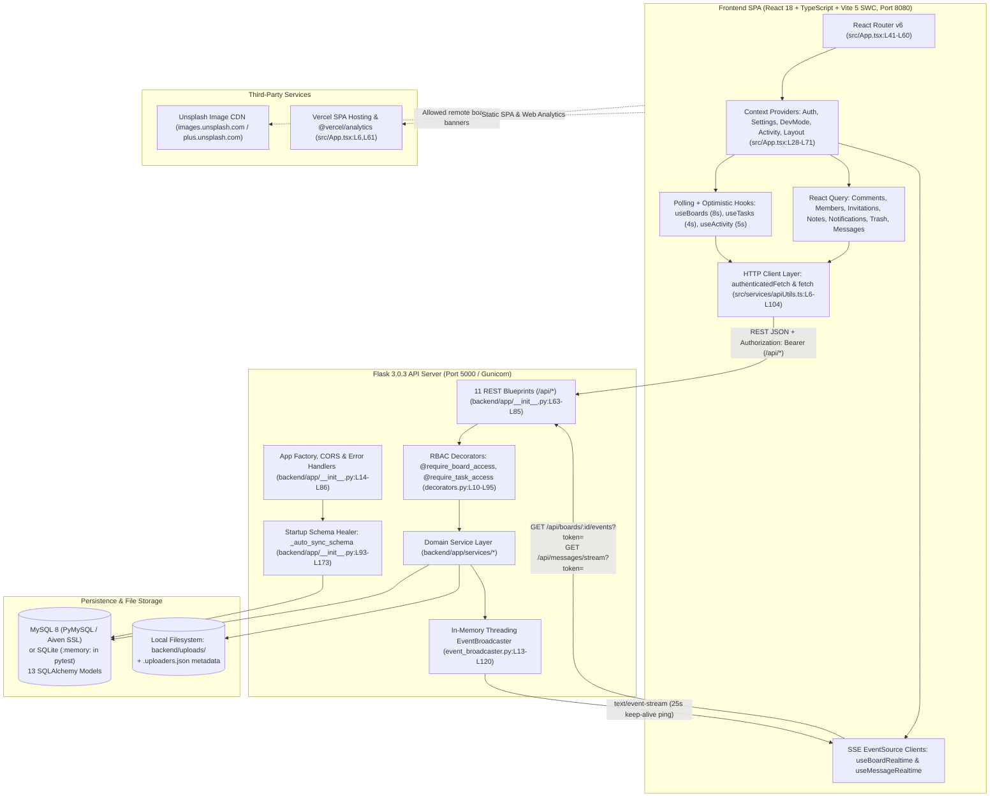
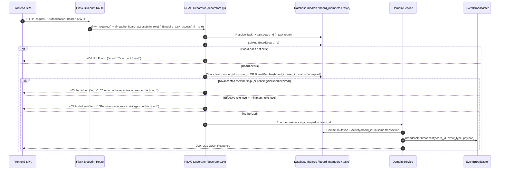

> **Status:** Verified | **Last scanned:** 2026-10-13 | **Audience:** Developers

# 07 — System Architecture & Board-Level Tenant Isolation

Sticky Mind Grid is a full-stack, real-time Kanban task management application built with a React 18 / TypeScript Single-Page Application (SPA) frontend and a Flask 3 / SQLAlchemy REST and Server-Sent Events (SSE) backend (`package.json:L1-L99`, `backend/requirements.txt:L1-L13`, `backend/app/__init__.py:L14-L91`). Each **Board** (`boards.id`) serves as the primary multi-tenant isolation boundary (`backend/app/utils/decorators.py:L19-L95`).

---

## 1. High-Level Component Architecture

### 1.1 Architecture Diagram (Mermaid)



### 1.2 Architecture Diagram (Text Version)

```text
[Frontend SPA: React 18 + TypeScript + Vite 5 (Port 8080)]
  ├── Routing: React Router v6 (Public: /login, /register; Protected: /, /dashboard, /tasks, /calendar, /teams, /boards/:boardId, /boards/:boardId/tasks/:taskId, /messages)
  ├── Contexts: QueryClientProvider -> ThemeProvider -> TooltipProvider -> AuthProvider -> SettingsProvider -> DevModeProvider -> ActivityProvider -> LayoutProvider
  ├── State Layer:
  │     ├── Custom Hooks (useState + Polling + Optimistic UI): useBoards (8s), useTasks (4s), useActivity (5s)
  │     ├── React Query: Comments, Board Members/Invitations, Notes, Notifications, Trash, Direct/Group Messages
  │     └── Real-Time SSE Clients: useBoardRealtime (board channel) & useMessageRealtime (user channel)
  └── Transport Layer: authenticatedFetch() (attaches Bearer JWT, handles 401 redirect, runs DevMode chaos/seed interceptors)
        │
        │  HTTPS / HTTP REST (/api/*) + Server-Sent Events (text/event-stream)
        ▼
[Backend API: Flask 3.0.3 + Gunicorn (Port 5000)]
  ├── App Factory (backend/app/__init__.py:create_app)
  │     ├── CORS Middleware (localhost:8080/5173/3000, *.vercel.app, custom CORS_ORIGINS)
  │     ├── Global Error Handlers (HTTPException passthrough, 413 Upload > 25 MB, 500 sanitization)
  │     └── Startup Schema Sync (_auto_sync_schema: db.create_all() + idempotent ALTER TABLE ADD COLUMN)
  ├── 11 Flask Blueprints (/api/auth, /api/boards, /api, /api/activities, /api/notifications, /api/files, /api/users, /api/messages)
  ├── RBAC Enforcement (backend/app/utils/decorators.py: get_effective_role, @require_board_access, @require_task_access)
  ├── 9 Domain Services (board, task, comment, activity, notification, file, note, message, user)
  └── Real-Time Broadcaster (backend/app/utils/event_broadcaster.py: in-memory thread-safe Queue pub/sub per board_id and user:<id>)
        │
        ├──────────────────────────────┬──────────────────────────────┐
        ▼                              ▼                              ▼
[Database Layer]              [Local File Storage]          [External Integrations]
  - MySQL via PyMySQL           - backend/uploads/<uuid>.<ext> - Vercel SPA & @vercel/analytics
    (Aiven SSL auto-config)     - backend/uploads/.uploaders.json - Unsplash CDN (banner allowlist)
  - SQLite :memory: (pytest)    - EICAR/magic-byte scan        - Simulated OAuth (no external RPC)
  - 13 SQLAlchemy Models        - 100 MB/board & 500 MB/owner
```

---

## 2. System Components in Detail

### 2.1 Frontend Single-Page Application (SPA)

| Aspect | Implementation Details | Source Citation |
|---|---|---|
| **Framework & Build** | React `18.3.1`, TypeScript `5.8.3`, Vite `5.4.19` (`@vitejs/plugin-react-swc`), TailwindCSS `3.4.17`, shadcn/ui (Radix UI primitives), `@dnd-kit/core` + `@dnd-kit/sortable`, Framer Motion. | `package.json:L18-L98`, `vite.config.ts:L1-L24` |
| **Dev Server & Proxy** | Listens on `::` port `8080`; proxies `/api` requests to `http://127.0.0.1:5000` with `changeOrigin: true`. | `vite.config.ts:L8-L16` |
| **Provider Tree** | `QueryClientProvider` → `ThemeProvider` (`next-themes`, class-based light/dark/system) → `TooltipProvider` → `BrowserRouter` → `AuthProvider` → `SettingsProvider` → `DevModeProvider` → `ActivityProvider` → `<Routes>`. Protected routes wrap `<ProtectedRoute>` and `<AppLayout>` (which provides `LayoutProvider`). | `src/App.tsx:L28-L71`, `src/components/layout/AppLayout.tsx:L108-L114` |
| **Client Routing** | Public: `/login`, `/register`. Protected: `/`, `/dashboard`, `/tasks`, `/calendar`, `/teams`, `/boards/:boardId`, `/boards/:boardId/tasks/:taskId`, `/messages`, `/messages/:conversationId`, fallback `*` (`NotFound`). | `src/App.tsx:L41-L60` |
| **State Management** | **Hybrid architecture:**<br>1. `useBoards`: `useState` + 8s polling (`POLL_INTERVAL = 8000`) + window `focus`/`visibilitychange` refresh (`src/hooks/useBoards.ts:L66-L182`).<br>2. `useTasks`: `useState` + 4s polling (`POLL_INTERVAL = 4000`) + optimistic mutations with error rollback and HTTP `409` conflict handling (`src/hooks/useTasks.ts:L13-L192`).<br>3. `useActivity`: Context + 5s polling (`POLL_INTERVAL = 5000`) (`src/hooks/useActivity.tsx:L16-L116`).<br>4. `@tanstack/react-query`: Used for comments, board members/invitations, notes, notifications, trash, and messages (`src/hooks/useMessages.ts:L16-L65`). | `src/hooks/useBoards.ts:L66-L347`, `src/hooks/useTasks.ts:L13-L192`, `src/hooks/useActivity.tsx:L16-L116`, `src/hooks/useMessages.ts:L1-L274` |
| **HTTP Client & DevMode** | `API_BASE` defaults to `VITE_API_BASE_URL` or `http://${window.location.hostname || "127.0.0.1"}:5000/api`. `authenticatedFetch()` injects `Authorization: Bearer <token>`, validates client-side JWT expiry (`isJwtExpired`), clears storage and dispatches `auth:session-expired` on `401`, and in `import.meta.env.DEV` intercepts requests for simulated latency, HTTP chaos (`500`/`403`/`401`), or in-memory seed sandbox takeover. *(Note: `userApi.ts`, `fileApi.ts`, and parts of `authApi.ts` call native `fetch()` directly instead of `authenticatedFetch()`.)* | `src/config/api.ts:L1-L15`, `src/services/apiUtils.ts:L6-L104`, `src/services/userApi.ts:L13-L120`, `src/services/fileApi.ts:L15-L104` |

### 2.2 Backend API Layer

| Aspect | Implementation Details | Source Citation |
|---|---|---|
| **App Factory** | `create_app(config_class=Config)` initializes `SQLAlchemy`, `Migrate` (Alembic), `JWTManager`, `Bcrypt`, and `CORS`. | `backend/app/__init__.py:L14-L91` |
| **CORS Policy** | Allows `CORS_ORIGINS` env list plus `http://localhost:{8080,5173,3000}`, `http://127.0.0.1:{8080,5173,3000}`, `https://sticky-mind-grid.vercel.app`, and `r"https:\/\/.*\.vercel\.app"` with `supports_credentials=True`. | `backend/app/__init__.py:L21-L42`, `backend/config.py:L43-L44` |
| **Blueprints (11)** | `board_routes` (`/api/boards`), `task_routes` (`/api`), `activity_routes` (`/api/activities`), `auth_routes` (`/api/auth`), `comment_routes` (`/api`), `notification_routes` (`/api/notifications`), `file_routes` (`/api/files`), `note_routes` (`/api`), `system_routes` (`/api`), `user_routes` (`/api/users`), `message_routes` (`/api/messages`). | `backend/app/__init__.py:L63-L85` |
| **Service Layer (9)** | Business logic is encapsulated in static service classes under `backend/app/services/`: `BoardService`, `TaskService`, `CommentService`, `ActivityService`, `NotificationService`, `FileService`, `NoteService`, `MessageService`, and `UserService`. | `backend/app/services/` |
| **Global Error Handling** | Unhandled `HTTPException` returns `{"error": e.description}` with `e.code`; HTTP `413` returns `{"error": "File too large. Maximum upload size is 25 MB"}`; other unhandled exceptions return `500` with `str(e)` in debug mode or `"Internal server error"` in production. | `backend/app/__init__.py:L47-L61` |
| **Rate Limiting** | **No global HTTP rate limiter** (e.g., `Flask-Limiter`) is installed. Only a domain-specific limit of **20 board invitations per user per 24 hours** is enforced in `BoardService.add_member()`. | `backend/requirements.txt:L1-L13`, `backend/app/services/board_service.py:L390-L398` |

### 2.3 Real-Time Layer (Server-Sent Events)

- **In-Memory EventBroadcaster (`backend/app/utils/event_broadcaster.py:L13-L120`):**
  - Thread-safe singleton (`broadcaster = EventBroadcaster()`) backed by `threading.Lock()`, mapping `channel_id -> set[queue.Queue(maxsize=100)]` and tracking `(channel_id, id(q)) -> user_id` (`L14-L18`).
  - Supports `subscribe(channel_id, user_id)` (`L20-L28`), `unsubscribe(channel_id, q)` (`L30-L38`), `broadcast(channel_id, event_type, data)` (`L40-L57`), `send_to_user(channel_id, user_id, event_type, data)` (`L59-L82`), and `disconnect_user(channel_id, user_id, reason)` (`L84-L117`).
- **SSE Endpoints:**
  1. **Board Stream (`GET /api/boards/<board_id>/events`, `backend/app/routes/board_routes.py:L70-L119`):**
     - Authenticates JWT via `Authorization: Bearer` header or `?token=<jwt>` query parameter (`L73-L81`).
     - Verifies `get_effective_role(board_id, user_id) >= ROLE_HIERARCHY['viewer']` (`L88-L93`).
     - Calls `db.session.remove()` (`L95`) **before** entering the streaming generator so the database connection is returned to the SQLAlchemy pool immediately.
     - Emits an initial `connected` payload, yields JSON frames (`data: {...}\n\n`), and sends `: ping\n\n` every 25 seconds when idle (`L98-L108`).
     - Terminates the HTTP response immediately if `msg is None` (sentinel pushed by `disconnect_user()` after sending `force_disconnect` when a member is removed or leaves, `L102-L103`).
  2. **User Messaging Stream (`GET /api/messages/stream`, `backend/app/routes/message_routes.py:L152-L190`):**
     - Authenticates via header or `?token=<jwt>`, calls `db.session.remove()` (`L165`), and subscribes to `channel_id = f"user:{user_id}"` (`L169`).
- **Process Scope Constraint:** Because subscriptions reside in Python process memory (`event_broadcaster.py:L16-L18`), SSE broadcasts only reach clients connected to the same OS worker process.

### 2.4 Database Layer

- **Engine & Connection Pooling (`backend/config.py:L11-L37,L68-L71`):**
  - Production/Development: MySQL via `PyMySQL` (`mysql+pymysql://`). Automatically detects `aivencloud.com` or `ssl-mode` parameters, strips `ssl-mode`/`ssl_mode` from the query string, and sets `connect_args={"ssl": {"check_hostname": False}}` (`L16-L30`).
  - Pool settings: `pool_pre_ping=True`, `pool_recycle=280`, `pool_timeout=20` (`L33-L37`).
  - Automated Testing (`TestingConfig`): In-memory SQLite (`sqlite:///:memory:`) with `TESTING = True` (`L68-L71`).
- **Startup Schema Healing (`_auto_sync_schema` in `backend/app/__init__.py:L88-L173`):**
  - When `TESTING` is `False`, `create_app()` runs `db.create_all()` (`L99`) followed by idempotent `ALTER TABLE <table_name> ADD COLUMN ...` checks (`L103-L169`) to ensure columns added after early migrations exist on live databases.

### 2.5 File Storage, Quotas & Malware Scanning

- **Local Disk Storage (`backend/app/services/file_service.py:L8-L60,L294-L379`):**
  - Uploaded files are stored in `backend/uploads/` under a randomized `<uuid4>.<ext>` filename (`L10,L366`).
  - Uploader ownership is tracked in `backend/uploads/.uploaders.json` (`UPLOADER_META_PATH`, `L11,L30-L60`).
- **Size Limits & Storage Quotas (`backend/config.py:L55-L57`, `backend/app/services/file_service.py:L12,L177-L207`):**
  - Max single request upload (`MAX_CONTENT_LENGTH`): **25 MB** default (`MAX_UPLOAD_MB=25`, `config.py:L55`).
  - Max board banner size (`MAX_BANNER_BYTES`): **5 MB** (`file_service.py:L12`).
  - Max per-board attachment storage (`MAX_BOARD_STORAGE_BYTES`): **100 MB** (`MAX_BOARD_STORAGE_MB=100`, `config.py:L56`).
  - Max per-owner aggregate storage across all owned boards (`MAX_OWNER_STORAGE_BYTES`): **500 MB** (`MAX_OWNER_STORAGE_MB=500`, `config.py:L57`).
- **Malware & Magic-Byte Validation (`backend/app/services/file_service.py:L16-L27,L63-L109,L326-L353`):**
  - `scan_bytes_for_malware()` scans the first 2 MB of every upload for the EICAR test string, Windows PE (`MZ`), Linux ELF (`\x7fELF`), macOS Mach-O binaries, shell shebangs (`#!`), and embedded `<script` or `javascript:` payloads in the first 64 KB (`L81-L109`).
  - `validate_magic_bytes()` verifies binary signatures against claimed extensions (e.g., PNG, JPEG, GIF, WebP, PDF, ZIP/Office) (`L326-L353`).
- **Attachment Lifecycle Cleanup (`backend/app/services/file_service.py:L210-L251`):**
  - When a task is permanently deleted, emptied from trash, or auto-purged after 30 days in trash (`task_service.py:L47-L64,L584-L648`), `FileService.cleanup_task_attachments()` deletes the underlying file from `backend/uploads/` if no other task references its URL.

### 2.6 Authentication Layer

- **JWT Authentication (`backend/config.py:L39-L41`, `backend/app/routes/auth_routes.py:L137-L230`):**
  - Uses `Flask-JWT-Extended` with 24-hour access tokens (`JWT_ACCESS_TOKEN_EXPIRES = timedelta(hours=24)`).
  - Passwords are hashed and verified using `Flask-Bcrypt` (`backend/app/models/user.py:L40-L44`).
  - No refresh token or server-side token revocation blocklist is implemented; logout is handled client-side by clearing `localStorage` (`src/contexts/AuthContext.tsx:L65-L71`).
- **Simulated OAuth 2.0 Flow (`backend/app/routes/auth_routes.py:L54-L135`, `src/components/auth/OAuthButtons.tsx:L25-L157`):**
  - `GET /api/auth/oauth/providers` reports Google, GitHub, and Microsoft as `"enabled": True` (`auth_routes.py:L116-L122`).
  - `POST /api/auth/oauth` and `POST /api/auth/oauth/<provider>` accept a JSON payload `{ provider, profile: { email, fullName, avatarUrl, providerId } }` directly from the client without verifying any OAuth provider token or authorization code (`auth_routes.py:L54-L114`). See `docs/open-questions.md` for security implications.

### 2.7 Third-Party Services & External Connections

| Service | Usage in Codebase | Source Citation |
|---|---|---|
| **Vercel (`@vercel/analytics`)** | SPA static hosting config (`vercel.json`) and `<Analytics />` telemetry component mounted in `App.tsx`. | `vercel.json:L1-L22`, `src/App.tsx:L6,L61` |
| **Unsplash Image CDN** | `images.unsplash.com` and `plus.unsplash.com` are the only external hosts permitted by `BoardService.validate_hero_image_url()` for remote board banner images. | `backend/app/services/board_service.py:L135-L163` |
| **Aiven MySQL** | `backend/config.py` includes automatic SSL connection argument normalization for `aivencloud.com` MySQL URIs. | `backend/config.py:L16-L30` |
| **Email / SMTP Provider** | **Not found in code.** Board invitations are delivered purely in-app via `BoardInvitation`, `BoardMember(status='pending')`, and `Notification` records. | `backend/app/services/board_service.py:L373-L479` |

---

## 3. Tenant Isolation by Board (`board_id`)

Each **Board** acts as an independent tenant boundary. Access to a board and its child resources (columns, tasks, comments, notes, activities, attachments, and real-time SSE events) is governed by the user's effective role on that specific board (`backend/app/utils/decorators.py:L19-L95`).

### 3.1 Request Authorization & Tenant Isolation Flow (Mermaid)



### 3.2 Request Authorization & Tenant Isolation Flow (Text Version)

```text
1. Client sends HTTP request with `Authorization: Bearer <JWT>` (or `?token=<JWT>` for SSE/files).
2. Flask-JWT-Extended validates the token signature and expiration (24h TTL) and extracts `current_user_id`.
3. Route decorator resolves the target tenant (`board_id`):
   - `@require_board_access(min_role)` reads `board_id` (or `id`) from the URL path (`backend/app/utils/decorators.py:L46`).
   - `@require_task_access(min_role)` loads `Task` by `task_id` and resolves `task.board_id` (`decorators.py:L79-L83`).
4. `get_effective_role(board_id, current_user_id)` computes the user's integer privilege level (`decorators.py:L19-L40`):
   - If `board.owner_id == current_user_id` -> returns `5` (`owner`).
   - Else queries `BoardMember` where `board_id = board_id`, `user_id = current_user_id`, AND `status = 'accepted'`.
   - If no `accepted` row exists (including `pending`, `declined`, `revoked`, `expired`) -> returns `0` (`403 Forbidden`).
5. If `user_level < ROLE_HIERARCHY[min_role]`, returns `403 Forbidden`.
6. Domain service executes the query/mutation scoped to `board_id`, writes an `Activity` row with `board_id` in the same DB transaction, and broadcasts the SSE event exclusively to `broadcaster` subscribers of `channel_id = board_id`.
```

### 3.3 Role Hierarchy & Permissions Matrix

Both the backend (`backend/app/utils/decorators.py:L10-L17`) and frontend (`src/hooks/useBoardPermissions.ts:L19-L26`) define 5 hierarchical role levels (plus `'member'` as a legacy alias for `'editor'` at level 3):

| Role | Level | Summary of Capabilities |
|---|---|---|
| **Owner** (`owner`) | `5` | Full control: soft/hard delete board, restore board, transfer ownership, promote/demote Admins and Owners (`board_routes.py:L149-L196`, `board_service.py:L959-L1101`). |
| **Admin** (`admin`) | `4` | Manage board settings & columns, export board JSON, view full board activity log, invite/remove/update members at Editor role or below, permanently delete tasks / empty trash, delete any comment or note (`board_routes.py:L135-L287`, `task_routes.py:L39-L47,L201-L216`, `activity_routes.py:L27-L28`). |
| **Editor** (`editor` / `member`) | `3` | Create, edit, assign, move (including cross-board moves if Editor on both boards), reorder, soft-delete, and restore tasks; view task trash; create and edit project notes; view member email addresses (`task_routes.py:L29-L199`, `note_routes.py:L15-L42`, `board_service.py:L1108`). |
| **Commenter** (`commenter`) | `2` | View board/tasks/notes, add comments (`@mention` board members), edit/delete own comments (`comment_routes.py:L15-L56`). Member email addresses are redacted (`board_service.py:L1108`). |
| **Viewer** (`viewer`) | `1` | Read-only access to board, tasks, comments, notes, task-level activity history, and board SSE stream; can follow/unfollow tasks, mute/unmute board notifications, and leave board (`board_routes.py:L60-L119,L224-L241,L289-L299`, `task_routes.py:L88-L98`). Member email addresses are redacted. |

### 3.4 Multi-Layer Tenant Isolation Mechanisms

1. **Invitation Gating (`status == 'accepted'`):**
   - Invited users start with `BoardMember.status = 'pending'` (for registered users) and/or `BoardInvitation.status = 'pending'` (`backend/app/services/board_service.py:L412-L445`).
   - `get_effective_role()` explicitly filters `status='accepted'` (`backend/app/utils/decorators.py:L33-L37`). Pending, declined, revoked, or expired invitees receive `0` effective role and cannot read board data or subscribe to SSE.

2. **Cross-Board Task Move Verification & Audit Anonymization:**
   - Moving a task to another board (`PATCH /api/tasks/<task_id>` with a new `boardId`) requires `editor` privileges on **both** the source board and the target board (`backend/app/routes/task_routes.py:L131-L134`).
   - If the task's current `assigned_to` user does not hold at least `editor` privileges on the target board, `TaskService.update_task()` automatically unassigns the task (`task.assigned_to = None`, `backend/app/services/task_service.py:L308-L315`).
   - If the task's `status` column ID does not exist on the target board, it is placed into the target board's first column (`task_service.py:L303-L306`).
   - To prevent leaking board names across tenant boundaries, the source board logs `'Card "<title>" moved to another board'` (`after_value='Another board'`) and the target board logs `'Card "<title>" moved from another board'` (`before_value='Another board'`) (`task_service.py:L316-L327`).

3. **@Mention Scoping & Board Mute Enforcement:**
   - `CommentService._extract_mentioned_user_ids()` only matches `@mentions` against users who are `accepted` members (or the owner) of `task.board_id` (`backend/app/services/comment_service.py:L18-L49`). Non-members are never notified.
   - `NotificationService.should_notify()` extracts `/boards/<board_id>` from notification links and suppresses notifications if the recipient is no longer an active board member or has set `BoardMember.is_muted = True` (`backend/app/services/notification_service.py:L9-L48`).

4. **Member Privacy Redaction & Former Member Masking:**
   - In `BoardService.get_board_members()`, if the caller's role is `commenter` or `viewer` (`actor_level <= ROLE_HIERARCHY['commenter']`), member `email`, `authProvider`, and `createdAt` fields are stripped, and unregistered invitees are masked as `"Invited Guest"` (`backend/app/services/board_service.py:L1107-L1135`, `backend/app/models/board_member.py:L34-L45`).
   - When serializing `Task.creator`, `Comment.user`, or `Activity.user`, if the user is no longer an accepted member of the board (or deleted their account), their identity is masked as `{"id": ..., "fullName": "Former member", "avatarUrl": None}` (`backend/app/models/task.py:L68-L88`, `comment.py:L34-L58`, `activity.py:L50-L73`).

5. **Instant SSE Revocation on Member Removal:**
   - When a member leaves, declines, or is removed from a board (`backend/app/services/board_service.py:L620,L672,L926`), `broadcaster.disconnect_user(board_id, user_id, reason="membership_revoked")` sends a `force_disconnect` SSE event to that user's queues on `board_id` and pushes a `None` sentinel that closes their open HTTP stream (`backend/app/utils/event_broadcaster.py:L84-L117`).

6. **File Access Verification (`FileService.verify_file_access`):**
   - `GET /api/files/<filename>` and `GET /api/files/<filename>/download` inspect whether the file is a user avatar (public), a task attachment (requires active membership on the task's board), a message attachment (requires conversation participation), a board hero banner (requires active membership on the board), or an unattached upload (restricted to the original uploader recorded in `.uploaders.json`) (`backend/app/services/file_service.py:L382-L459`).

### 3.5 Non-Board-Scoped Subsystems & Known Isolation Exceptions

| Subsystem / Endpoint | Scope | Behavior & Code Citation |
|---|---|---|
| **In-App Messaging (`/api/messages/*`)** | **Conversation-scoped** (cross-board) | `Conversation`, `ConversationParticipant`, and `Message` have no `board_id` column (`backend/app/models/message.py:L8-L198`). Any authenticated user can create a direct or group conversation with any valid `user_id` (`backend/app/services/message_service.py:L9-L85`). |
| **Global User Search (`GET /api/auth/users/search`)** | **Global** (all registered users) | Queries `User.email.ilike` / `User.full_name.ilike` across all users in the database and returns `user.to_dict()` (including email) regardless of board membership (`backend/app/routes/auth_routes.py:L232-L244`), whereas `GET /api/users/teammates` (`backend/app/routes/user_routes.py:L125-L169`) is strictly restricted to shared boards. |
| **User Data Export (`GET /api/users/me/export`)** | **User-scoped** (all joined boards) | Exports full board, task, and note JSON for every board where the user is an accepted member, including boards where the user is a `viewer` or `commenter` (`backend/app/routes/user_routes.py:L83-L123`), whereas `GET /api/boards/<board_id>/export` requires `admin` (`backend/app/routes/board_routes.py:L174-L182`). |
| **Activity Creation (`POST /api/activities`)** | **Viewer-accessible / optional `boardId`** | Allows any `viewer` on a board to post an activity entry (`backend/app/routes/activity_routes.py:L41-L44`), and skips the board role check if `boardId` is omitted from the request body. |
| **Workspace Column (`boards.workspace_id`)** | **Unused placeholder** | `Board.workspace_id` (`backend/app/models/board.py:L21`) is indexed in the database and serialized in `Board.to_dict()`, but no `Workspace` model or workspace-level filtering exists in backend services. |
