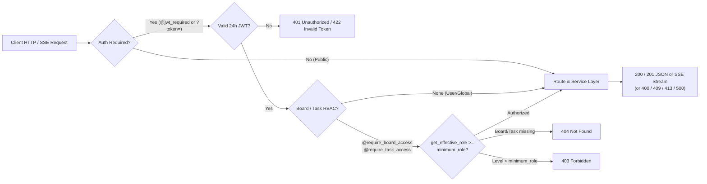

> **Status:** Verified | **Last scanned:** 2026-10-13 | **Audience:** Developers

# 09 — REST & Real-Time API Reference

This document specifies all **76 HTTP and Server-Sent Events (SSE) endpoints** registered across the **11 Flask Blueprints** in `backend/app/__init__.py:L63-L85`.

---

## 1. Global API Conventions

### 1.1 Base URL, Authentication, Rate Limits & Error Shapes

| Convention | Specification | Source Citation |
|---|---|---|
| **Base URL** | `http://127.0.0.1:5000/api` (configurable on the frontend via `VITE_API_BASE_URL`). | `src/config/api.ts:L3-L8`, `backend/app/__init__.py:L63-L85` |
| **Authentication** | **JWT Bearer Token** (`Flask-JWT-Extended`, 24-hour TTL):<br>• Header: `Authorization: Bearer <JWT_TOKEN_PLACEHOLDER>`<br>• Query parameter `?token=<JWT_TOKEN_PLACEHOLDER>` is supported only on `GET /api/boards/<board_id>/events`, `GET /api/messages/stream`, `GET /api/files/<filename>`, and `GET /api/files/<filename>/download`. | `backend/config.py:L39-L41`, `backend/app/routes/board_routes.py:L73`, `message_routes.py:L155`, `file_routes.py:L7-L24` |
| **RBAC Hierarchy** | `owner` (`5`) > `admin` (`4`) > `editor` / `member` (`3`) > `commenter` (`2`) > `viewer` (`1`) > none/pending/declined (`0`). Evaluated per board by `get_effective_role(board_id, user_id)`. | `backend/app/utils/decorators.py:L10-L40` |
| **Error Payloads** | Three JSON error formats appear across blueprints:<br>1. `{"error": "<description>"}` — used by `board`, `task`, `comment`, `activity`, `notification`, `file`, `note`, `message` routes, `DELETE /api/users/me`, and global `413`/`500` handlers (`backend/app/__init__.py:L47-L61`).<br>2. `{"message": "<description>"}` (with optional `"error"` field on `500`) — used by `auth_routes.py` and `user_routes.py` (except `DELETE /api/users/me`).<br>3. `{"msg": "<description>"}` — returned by `Flask-JWT-Extended` on missing/expired/malformed tokens (`401`/`422`). | `backend/app/__init__.py:L47-L61`, `backend/app/routes/auth_routes.py:L58-L226`, `user_routes.py:L22-L89` |
| **Rate Limits** | • **Global HTTP rate limiter:** Not found in code (`Flask-Limiter` is not installed).<br>• **Board invitation rate limit:** Maximum **20 invitations per inviter per rolling 24-hour window** in `BoardService.add_member()` (`400 Bad Request`). | `backend/requirements.txt:L1-L13`, `backend/app/services/board_service.py:L390-L398` |

### 1.2 API Request Processing Flow (Mermaid)



### 1.3 API Request Processing Flow (Text Version)

```text
[Client HTTP / SSE Request]
  ├── Public Route (/api/health, /api/auth/login, /api/auth/register, /api/auth/oauth*, avatar GET /api/files/:name)
  │     └──> Execute Route & Service Layer
  └── Authenticated Route
        ├── Verify 24h JWT (Authorization: Bearer <TOKEN> or ?token=<TOKEN> on SSE/file routes)
        │     ├── Invalid / Expired ──> 401 Unauthorized ({"msg": "..."} or {"error": "..."})
        │     └── Valid ──> Check Resource Scope
        │           ├── User / Conversation Scope ──> Verify ownership / ConversationParticipant ──> Service Layer
        │           └── Board / Task Scope (@require_board_access / @require_task_access)
        │                 ├── Resource missing ──> 404 Not Found
        │                 ├── Not accepted member or role < minimum_role ──> 403 Forbidden
        │                 └── Role >= minimum_role ──> Service Layer ──> 200 / 201 Response (or 400 / 409 / 413)
```

---

## 2. System & Health (`backend/app/routes/system_routes.py`)

### 2.1 `GET /api/health`
- **Source:** `backend/app/routes/system_routes.py:L8-L22`
- **Auth:** None (Public) | **Required Role:** None | **Rate Limit:** None
- **Request:** No parameters or body.
- **Response (`200 OK` or `503 Service Unavailable`):**
  ```json
  {
    "status": "healthy",
    "database": "connected",
    "version": "1.2.0",
    "environment": "development",
    "timestamp": "2026-10-13T00:00:00Z"
  }
  ```
- **Error Codes:** `503` (returns same JSON shape with `"status": "degraded"`, `"database": "disconnected"` when `SELECT 1` fails, `L15-L22`).

---

## 3. Authentication (`backend/app/routes/auth_routes.py`)

### 3.1 Endpoint Summary

| Method | Path | Auth | Required Role | Success | Error Codes | Source |
|---|---|---|---|---|---|---|
| `GET` | `/api/auth/oauth/providers` | Public | None | `200` | — | `auth_routes.py:L116-L122` |
| `POST` | `/api/auth/oauth` | Public | None | `200` / `201` | `400`, `500` | `auth_routes.py:L124-L130` |
| `POST` | `/api/auth/oauth/<provider>` | Public | None | `200` / `201` | `400`, `500` | `auth_routes.py:L132-L135` |
| `POST` | `/api/auth/register` | Public | None | `201` | `400` | `auth_routes.py:L137-L162` |
| `POST` | `/api/auth/login` | Public | None | `200` | `400`, `401`, `500` | `auth_routes.py:L164-L193` |
| `GET` | `/api/auth/me` | JWT | Authenticated user | `200` | `401`, `404` | `auth_routes.py:L195-L204` |
| `PATCH`, `PUT` | `/api/auth/me` | JWT | Authenticated user (self) | `200` | `400`, `401`, `403`, `404` | `auth_routes.py:L206-L230` |
| `GET` | `/api/auth/users/search` | JWT | Authenticated user | `200` | `401` | `auth_routes.py:L232-L244` |

### 3.2 Detailed Endpoints

#### `GET /api/auth/oauth/providers`
- **Source:** `backend/app/routes/auth_routes.py:L116-L122`
- **Auth:** None | **Role:** None | **Rate Limit:** None
- **Response (`200 OK`):**
  ```json
  {
    "google": { "name": "Google", "enabled": true },
    "github": { "name": "GitHub", "enabled": true },
    "microsoft": { "name": "Microsoft", "enabled": true }
  }
  ```

#### `POST /api/auth/oauth` & `POST /api/auth/oauth/<provider>`
- **Source:** `backend/app/routes/auth_routes.py:L54-L114,L124-L135`
- **Auth:** None | **Role:** None | **Rate Limit:** None
- **Request Body:**
  ```json
  {
    "provider": "google",
    "profile": {
      "email": "<USER_EMAIL_PLACEHOLDER>",
      "fullName": "Jane Doe",
      "avatarUrl": "https://...",
      "providerId": "<PROVIDER_UID_PLACEHOLDER>"
    }
  }
  ```
  *(`provider` is required in body for `/api/auth/oauth` and in path for `/api/auth/oauth/<provider>`; must be `'google'`, `'github'`, or `'microsoft'`.)*
- **Response (`200 OK` existing user / `201 Created` new user):**
  ```json
  {
    "user": {
      "id": "<USER_UUID>",
      "email": "<USER_EMAIL_PLACEHOLDER>",
      "fullName": "Jane Doe",
      "avatarUrl": "https://...",
      "authProvider": "google",
      "createdAt": "2026-10-13T00:00:00Z"
    },
    "token": "<JWT_TOKEN_PLACEHOLDER>",
    "provider": "google"
  }
  ```
- **Error Codes:** `400` `{"message": "Missing provider field"}`, `400` `{"message": "Unsupported provider: <provider>"}`, `400` `{"message": "Missing email in OAuth request"}`, `500` `{"message": "OAuth authentication failed", "error": "..."}`.

#### `POST /api/auth/register`
- **Source:** `backend/app/routes/auth_routes.py:L12-L52,L137-L162`
- **Auth:** None | **Role:** None | **Rate Limit:** None
- **Request Body:** `{ "email": "<USER_EMAIL_PLACEHOLDER>", "password": "<PASSWORD_PLACEHOLDER>", "fullName"?: "Jane Doe" }`
- **Side Effects:** Attaches any non-expired `pending` `BoardInvitation` rows matching `email` by creating `BoardMember(status='pending')` and `Notification(type='board_invite')` (`L12-L52`).
- **Response (`201 Created`):** `{ "user": User, "token": "<JWT_TOKEN_PLACEHOLDER>" }`
- **Error Codes:** `400` `{"message": "Missing email or password"}`, `400` `{"message": "User already exists"}`.

#### `POST /api/auth/login`
- **Source:** `backend/app/routes/auth_routes.py:L164-L193`
- **Auth:** None | **Role:** None | **Rate Limit:** None
- **Request Body:** `{ "email": "<USER_EMAIL_PLACEHOLDER>", "password": "<PASSWORD_PLACEHOLDER>" }`
- **Response (`200 OK`):** `{ "user": User, "token": "<JWT_TOKEN_PLACEHOLDER>" }`
- **Error Codes:** `400` `{"message": "Missing email or password"}`, `401` `{"message": "Invalid credentials"}`, `500` `{"message": "Internal Server Error", "error": "..."}`.

#### `GET /api/auth/me`
- **Source:** `backend/app/routes/auth_routes.py:L195-L204`
- **Auth:** `@jwt_required()` | **Role:** Authenticated user | **Rate Limit:** None
- **Response (`200 OK`):** `User` object (`id`, `email`, `fullName`, `avatarUrl`, `authProvider`, `createdAt`).
- **Error Codes:** `401`, `404` `{"message": "User not found"}`.

#### `PATCH, PUT /api/auth/me`
- **Source:** `backend/app/routes/auth_routes.py:L206-L230`
- **Auth:** `@jwt_required()` | **Role:** Authenticated user (self) | **Rate Limit:** None
- **Request Body:** `{ "fullName"?: string, "avatarUrl"?: string | null, "password"?: string, "currentPassword"?: string }` (`currentPassword` is verified when `password` is non-empty, `L223-L227`).
- **Response (`200 OK`):** Updated `User` object.
- **Error Codes:** `400` `{"message": "No data provided"}`, `401`, `403` `{"message": "Current password is incorrect"}`, `404` `{"message": "User not found"}`.

#### `GET /api/auth/users/search`
- **Source:** `backend/app/routes/auth_routes.py:L232-L244`
- **Auth:** `@jwt_required()` | **Role:** Authenticated user | **Rate Limit:** None
- **Query Params:** `q` (`string`, optional; returns `[]` if empty). Matches `email` or `full_name` (`ILIKE %q%`, limit 10).
- **Response (`200 OK`):** `User[]` (up to 10 users).
- **Error Codes:** `401`.

---

## 4. Users & Preferences (`backend/app/routes/user_routes.py`)

### 4.1 Endpoint Summary

| Method | Path | Auth | Required Role | Success | Error Codes | Source |
|---|---|---|---|---|---|---|
| `GET` | `/api/users/me/preferences` | JWT | Self | `200` | `401`, `404` | `user_routes.py:L16-L30` |
| `PATCH`, `PUT` | `/api/users/me/preferences` | JWT | Self | `200` | `401`, `404` | `user_routes.py:L32-L81` |
| `GET` | `/api/users/me/export` | JWT | Self | `200` | `401`, `404` | `user_routes.py:L83-L123` |
| `GET` | `/api/users/teammates` | JWT | Self (shared boards) | `200` | `401` | `user_routes.py:L125-L169` |
| `DELETE` | `/api/users/me` | JWT | Self | `200` | `400`, `401` | `user_routes.py:L171-L179`, `user_service.py:L14-L86` |

### 4.2 Detailed Endpoints

#### `GET /api/users/me/preferences` & `PATCH, PUT /api/users/me/preferences`
- **Source:** `backend/app/routes/user_routes.py:L16-L81`, `backend/app/models/user_preference.py:L29-L40`
- **Auth:** `@jwt_required()` | **Role:** Self | **Rate Limit:** None
- **Request Body (`PATCH`/`PUT`, all optional):**
  ```json
  {
    "defaultBoardView": "board",
    "timezone": "UTC",
    "dateFormat": "MM/DD/YYYY",
    "firstDayOfWeek": 0,
    "notifyMentions": true,
    "notifyAssignments": true,
    "notifyInvites": true,
    "notifyComments": true
  }
  ```
- **Response (`200 OK`):** `UserPreference.to_dict()` (includes `updatedAt`).
- **Error Codes:** `401`, `404` `{"message": "User not found"}`.

#### `GET /api/users/me/export`
- **Source:** `backend/app/routes/user_routes.py:L83-L123`
- **Auth:** `@jwt_required()` | **Role:** Self | **Rate Limit:** None
- **Response (`200 OK`, `Content-Disposition: attachment;filename=sticky_mind_grid_export_<id>.json`):**
  ```json
  {
    "exportMetadata": { "exportedAt": "2026-10-13T00:00:00Z", "version": "1.0", "appName": "Sticky Mind Grid" },
    "user": { ... },
    "preferences": { ... },
    "boards": [ ... ],
    "tasks": [ ... ],
    "notes": [ ... ]
  }
  ```
- **Error Codes:** `401`, `404` `{"message": "User not found"}`.

#### `GET /api/users/teammates`
- **Source:** `backend/app/routes/user_routes.py:L125-L169`
- **Auth:** `@jwt_required()` | **Role:** Self (returns users who share at least one `accepted` board membership) | **Rate Limit:** None
- **Response (`200 OK`):**
  ```json
  [
    {
      "id": "<USER_UUID>",
      "email": "<USER_EMAIL_PLACEHOLDER>",
      "fullName": "Teammate",
      "avatarUrl": null,
      "role": "editor",
      "sharedBoards": [{ "id": "<BOARD_UUID>", "name": "Sprint Board", "emoji": "🚀", "color": "hsl(220, 80%, 56%)", "role": "editor" }]
    }
  ]
  ```
- **Error Codes:** `401`.

#### `DELETE /api/users/me`
- **Source:** `backend/app/routes/user_routes.py:L171-L179`, `backend/app/services/user_service.py:L14-L86`
- **Auth:** `@jwt_required()` | **Role:** Self | **Rate Limit:** None
- **Side Effects:** Transfers ownership of owned boards to the oldest accepted `admin` (or oldest accepted `editor`/`member`/`commenter`/`viewer` if no admin exists), or deletes boards where the user is sole member (`L22-L58`); unassigns tasks (`L66-L68`); sets `user_id = None` on comments and activities so they render as `"Former member"` (`L72-L78`); deletes user record (`L84`).
- **Response (`200 OK`):** `{"message": "Account deleted successfully"}`.
- **Error Codes:** `400` `{"error": "User not found"}`, `401`.

---

## 5. Boards, Members & Invitations (`backend/app/routes/board_routes.py`)

### 5.1 Endpoint Summary

| Method | Path | Auth | Required Role | Success | Error Codes | Source |
|---|---|---|---|---|---|---|
| `GET` | `/api/boards` | JWT | Accepted member | `200` | `401` | `board_routes.py:L10-L15` |
| `POST` | `/api/boards` | JWT | Authenticated user | `201` | `400`, `401` | `board_routes.py:L121-L133` |
| `GET` | `/api/boards/trash` | JWT | `owner` (filtered) | `200` | `401` | `board_routes.py:L17-L22` |
| `GET` | `/api/boards/<board_id>` | JWT | `viewer` | `200` | `401`, `403`, `404` | `board_routes.py:L60-L68` |
| `PATCH`, `PUT` | `/api/boards/<board_id>` | JWT | `admin` | `200` | `400`, `401`, `403`, `404` | `board_routes.py:L135-L147` |
| `DELETE` | `/api/boards/<board_id>` | JWT | `owner` | `200` | `401`, `403`, `404` | `board_routes.py:L149-L161` |
| `POST` | `/api/boards/<board_id>/restore` | JWT | `owner` | `200` | `401`, `403`, `404` | `board_routes.py:L163-L171` |
| `GET` | `/api/boards/<board_id>/export` | JWT | `admin` | `200` | `400`, `401`, `403`, `404` | `board_routes.py:L174-L182` |
| `POST` | `/api/boards/<board_id>/transfer-ownership` | JWT | `owner` | `200` | `400`, `401`, `403`, `404` | `board_routes.py:L184-L196` |
| `PATCH`, `PUT`, `POST` | `/api/boards/<board_id>/mute` | JWT | `viewer` | `200` | `400`, `401`, `403`, `404` | `board_routes.py:L289-L299` |
| `GET` | `/api/boards/<board_id>/events` | JWT / `?token=` | `viewer` | `200` (SSE) | `401`, `403`, `404` | `board_routes.py:L70-L119` |
| `GET` | `/api/boards/invitations` | JWT | Invitee (self) | `200` | `401` | `board_routes.py:L25-L30` |
| `POST`, `PATCH` | `/api/boards/<board_id>/invitations/accept` | JWT | Invitee (email match) | `200` | `400`, `401`, `403` | `board_routes.py:L32-L40` |
| `POST`, `PATCH`, `DELETE` | `/api/boards/<board_id>/invitations/decline` | JWT | Invitee (self) | `200` | `400`, `401` | `board_routes.py:L42-L49` |
| `POST` | `/api/boards/<board_id>/invitations/report` | JWT | Invitee (self) | `200` | `400`, `401` | `board_routes.py:L51-L58` |
| `GET` | `/api/boards/<board_id>/members` | JWT | `viewer` | `200` | `401`, `403`, `404` | `board_routes.py:L198-L204` |
| `POST` | `/api/boards/<board_id>/members` | JWT | `admin` (20/day limit) | `201` | `400`, `401`, `403`, `404` | `board_routes.py:L206-L222` |
| `DELETE` | `/api/boards/<board_id>/members/<user_id>` | JWT | Self or `admin` | `200` | `400`, `401`, `403`, `404` | `board_routes.py:L224-L241` |
| `PATCH`, `PUT` | `/api/boards/<board_id>/members/<user_id>` | JWT | `admin` / `owner` | `200` | `400`, `401`, `403`, `404` | `board_routes.py:L253-L267` |
| `POST` | `/api/boards/<board_id>/members/<user_id>/resend` | JWT | `admin` | `200` | `400`, `401`, `403`, `404` | `board_routes.py:L243-L251` |
| `POST` | `/api/boards/<board_id>/invitations/<invitation_id>/resend` | JWT | `admin` | `200` | `400`, `401`, `403`, `404` | `board_routes.py:L279-L287` |
| `POST`, `DELETE` | `/api/boards/<board_id>/invitations/<invitation_id>/revoke` | JWT | `admin` | `200` | `400`, `401`, `403`, `404` | `board_routes.py:L269-L277` |

### 5.2 Detailed Endpoints

#### `GET /api/boards` & `GET /api/boards/<board_id>`
- **Source:** `backend/app/routes/board_routes.py:L10-L15,L60-L68`, `backend/app/services/board_service.py:L14-L30,L123-L129`, `backend/app/models/board.py:L47-L145`
- **Auth:** `@jwt_required()` | **Role:** Accepted member (`GET /api/boards`), `@require_board_access('viewer')` (`GET /api/boards/<board_id>`)
- **Response (`200 OK`):** `Board[]` or single `Board`:
  ```json
  {
    "id": "<BOARD_UUID>",
    "name": "Product Roadmap",
    "emoji": "🚀",
    "description": "Q4 deliverables",
    "color": "hsl(220, 80%, 56%)",
    "heroImageUrl": "/api/files/<UUID>.png",
    "columns": [
      { "id": "todo", "title": "To Do", "emoji": "📝", "wipLimit": 5 }
    ],
    "ownerId": "<USER_UUID>",
    "workspaceId": null,
    "role": "owner",
    "taskCount": 8,
    "openTaskCount": 5,
    "overdueCount": 1,
    "dueSoonCount": 2,
    "ownerCount": 1,
    "memberCount": 3,
    "isShared": true,
    "membersPreview": [{ "id": "<USER_UUID>", "fullName": "Jane Doe", "avatarUrl": null, "role": "owner" }],
    "isMuted": false,
    "isDeleted": false,
    "deletedAt": null,
    "createdAt": "2026-10-13T00:00:00Z",
    "updatedAt": "2026-10-13T00:00:00Z"
  }
  ```
- **Error Codes (`GET /api/boards/<board_id>`):** `401`, `403` `{"error": "You do not have active access to this board"}`, `404` `{"error": "Board not found"}`.

#### `POST /api/boards` & `PATCH, PUT /api/boards/<board_id>`
- **Source:** `backend/app/routes/board_routes.py:L121-L147`, `backend/app/services/board_service.py:L135-L294`
- **Auth:** `@jwt_required()` | **Role:** Any authenticated user (`POST`); `@require_board_access('admin')` (`PATCH`/`PUT`)
- **Request Body:** `{ "name": string, "emoji"?: string, "description"?: string, "color"?: string, "heroImageUrl"?: string, "columns"?: Column[] }`
- **Response:** `201 Created` (`POST`) or `200 OK` (`PATCH`/`PUT`) returning `Board`.
- **Error Codes:**
  - `400`: `{"error": "Board name is required"}` (`POST`)
  - `400`: `{"error": "Board must have at least 1 workflow column"}`
  - `400`: `{"error": "Column WIP limit must be a positive integer"}`
  - `400`: `{"error": "Cannot delete column '<title>' because it contains active cards. Move or delete cards first."}` (`PATCH`/`PUT`)
  - `400`: `{"error": "Remote banner URLs are restricted to prevent third-party tracking. Please upload an image or choose a preset banner."}`
  - `401`, `403`, `404`.

#### `DELETE /api/boards/<board_id>`, `GET /api/boards/trash`, & `POST /api/boards/<board_id>/restore`
- **Source:** `backend/app/routes/board_routes.py:L17-L22,L149-L171`, `backend/app/services/board_service.py:L297-L366`
- **Auth:** `@jwt_required()` | **Role:** `owner`
- **Query Params (`DELETE`):** `soft=true` moves the board to 30-day trash; omitting `soft=true` permanently deletes the board.
- **Responses (`200 OK`):**
  - `DELETE ?soft=true`: `{"message": "Board moved to trash (30-day grace period)", "isDeleted": true}`
  - `DELETE`: `{"message": "Board deleted successfully"}`
  - `GET /api/boards/trash`: `Board[]`
  - `POST /api/boards/<board_id>/restore`: Restored `Board` object.
- **Error Codes:** `401`, `403`, `404` `{"error": "Board not found"}` / `{"error": "Board not found in trash"}`.

#### `GET /api/boards/<board_id>/export`, `POST /api/boards/<board_id>/transfer-ownership`, & `PATCH, PUT, POST /api/boards/<board_id>/mute`
- **Source:** `backend/app/routes/board_routes.py:L174-L196,L289-L299`, `backend/app/services/board_service.py:L932-L956,L1056-L1101,L1147-L1165`
- **Roles:** `export` requires `admin`; `transfer-ownership` requires `owner` (`{"userId": "<TARGET_USER_UUID>"}`); `mute` requires `viewer` (`{"isMuted": boolean}`).
- **Responses (`200 OK`):**
  - `export`: `{"board": Board, "tasks": Task[], "members": BoardMember[], "exportedAt": "...Z"}`
  - `transfer-ownership`: `{"message": "Ownership transferred successfully"}`
  - `mute`: `{"boardId": "<BOARD_UUID>", "isMuted": true}`
- **Error Codes:** `400`, `401`, `403`, `404`.

#### `GET /api/boards/<board_id>/events` (Board SSE Stream)
- **Source:** `backend/app/routes/board_routes.py:L70-L119`, `backend/app/utils/event_broadcaster.py:L13-L118`
- **Auth:** Bearer header or `?token=<JWT_TOKEN_PLACEHOLDER>` | **Role:** `viewer`
- **Response (`200 OK`, `Content-Type: text/event-stream`):**
  - Emits `data: {"type":"connected","boardId":"<BOARD_UUID>"}\n\n`, keep-alive `: ping\n\n` every 25s, and board events (`board:updated`, `board:deleted`, `task:created`, `task:updated`, `task:deleted`, `tasks:reordered`, `comment:created`, `comment:updated`, `comment:deleted`, `note:created`, `note:updated`, `note:deleted`, `member:added`, `member:removed`, `member:role_updated`, `member:invite_resent`, `board:ownership_transferred`, `activity:new`, `force_disconnect`).
- **Error Codes:** `401`, `403`, `404`.

#### Member & Invitation Management Endpoints
- **Source:** `backend/app/routes/board_routes.py:L25-L58,L198-L287`, `backend/app/services/board_service.py:L34-L120,L373-L929,L959-L1053,L1104-L1144`
- **`GET /api/boards/<board_id>/members` (`viewer`):** Returns `BoardMember[]` + unregistered `BoardInvitation[]`. Redacts `email` when caller is `commenter` or `viewer` (`board_service.py:L1108`).
- **`POST /api/boards/<board_id>/members` (`admin`, Rate Limit: 20 invites/day/user):** Body `{ "email": string, "role"?: "admin"|"editor"|"commenter"|"viewer"|"member" }`. Admins cannot grant `admin` or `owner` (`400`). Returns `201 Created` with `BoardMember` or `BoardInvitation`.
- **`PATCH, PUT /api/boards/<board_id>/members/<user_id>` (`admin`):** Body `{ "role": string }`. Admins cannot modify `admin`/`owner` or grant `admin`/`owner` (`400`); last Owner cannot be demoted (`400`). Demoting below `editor` unassigns the user's tasks on the board (`L1023-L1041`).
- **`DELETE /api/boards/<board_id>/members/<user_id>` (Self or `admin`):** Removes member (or revokes invitation if `user_id` matches an invitation ID), unassigns tasks, removes from `followers`, and disconnects SSE. Last Owner cannot leave or be removed (`400`).
- **`GET /api/boards/invitations` (Self):** Lists pending invitations for the current user.
- **`POST, PATCH /api/boards/<board_id>/invitations/accept` (Invitee):** Accepts pending invitation (`403` on email mismatch; `400` if expired/revoked).
- **`POST, PATCH, DELETE /api/boards/<board_id>/invitations/decline` & `POST /api/boards/<board_id>/invitations/report` (Invitee):** Declines invitation (`report` also declines all other pending invitations from the same `inviter_id`, `L640-L651`).
- **`POST /api/boards/<board_id>/members/<user_id>/resend`, `POST /api/boards/<board_id>/invitations/<invitation_id>/resend`, & `POST, DELETE /api/boards/<board_id>/invitations/<invitation_id>/revoke` (`admin`):** Resends (extending expiry +7 days) or revokes a pending invitation.

---

## 6. Tasks & Board Trash (`backend/app/routes/task_routes.py`)

### 6.1 Endpoint Summary

| Method | Path | Auth | Required Role | Success | Error Codes | Source |
|---|---|---|---|---|---|---|
| `GET` | `/api/tasks` | JWT | `viewer` (on `boardId`) | `200` | `401`, `403` | `task_routes.py:L12-L27` |
| `GET` | `/api/tasks/<task_id>` | JWT | `viewer` | `200` | `401`, `403`, `404` | `task_routes.py:L49-L56` |
| `POST` | `/api/tasks` | JWT | `editor` | `201` | `400`, `401`, `403`, `500` | `task_routes.py:L58-L86` |
| `PATCH`, `PUT` | `/api/tasks/<task_id>` | JWT | `editor` (both boards if moved) | `200` | `400`, `401`, `403`, `404`, `409` | `task_routes.py:L120-L171` |
| `POST`, `PATCH`, `PUT` | `/api/tasks/<task_id>/follow` | JWT | `viewer` | `200` | `401`, `403`, `404` | `task_routes.py:L88-L98` |
| `PATCH` | `/api/tasks/reorder` | JWT | `editor` | `200` | `400`, `401`, `403`, `500` | `task_routes.py:L100-L118` |
| `DELETE` | `/api/tasks/<task_id>` | JWT | `editor` | `200` | `401`, `403`, `404` | `task_routes.py:L173-L181` |
| `GET` | `/api/boards/<board_id>/trash` | JWT | `editor` | `200` | `401`, `403` | `task_routes.py:L29-L37` |
| `PATCH`, `PUT` | `/api/tasks/<task_id>/restore` | JWT | `editor` | `200` | `400`, `401`, `403`, `404` | `task_routes.py:L183-L199` |
| `DELETE` | `/api/tasks/<task_id>/permanent` | JWT | `admin` | `200` | `400`, `401`, `403`, `404` | `task_routes.py:L201-L216` |
| `DELETE` | `/api/boards/<board_id>/trash` | JWT | `admin` | `200` | `401`, `403` | `task_routes.py:L39-L47` |

### 6.2 Detailed Endpoints

#### `GET /api/tasks` & `GET /api/tasks/<task_id>`
- **Source:** `backend/app/routes/task_routes.py:L12-L27,L49-L56`, `backend/app/services/task_service.py:L26-L44,L67-L68`
- **Query Params (`GET /api/tasks`):** `boardId` (UUID or `'all'`), `assignedToMe` (`'true' | 'false'`).
- **Response (`200 OK`):** `Task[]` or `Task` (`id`, `boardId`, `boardName`, `boardEmoji`, `boardColor`, `title`, `emoji`, `description`, `status`, `priority`, `progress`, `position`, `checklist`, `tags`, `dueDate`, `assignedTo`, `assignee`, `createdBy`, `creator`, `attachments`, `followers`, `isDeleted`, `deletedAt`, `createdAt`, `updatedAt`).

#### `POST /api/tasks` & `PATCH, PUT /api/tasks/<task_id>`
- **Source:** `backend/app/routes/task_routes.py:L58-L86,L120-L171`, `backend/app/services/task_service.py:L101-L207,L227-L439`
- **Role:** `editor` on target board (and on both source and destination boards when `boardId` changes on `PATCH`/`PUT`, `task_routes.py:L131-L134`). Any `assignedTo` user must hold at least `editor` role (`task_routes.py:L73-L76,L150-L155`).
- **Request Body:** `{ "boardId": string, "title": string, "emoji"?: string, "description"?: string, "baseDescription"?: string, "forceOverwrite"?: boolean, "status"?: string, "priority"?: string, "progress"?: number, "position"?: number, "checklist"?: ChecklistItem[], "tags"?: Tag[], "attachments"?: Attachment[], "followers"?: string[], "assignedTo"?: string | null, "dueDate"?: string | null }`
- **Conflict Response (`409 Conflict` on `PATCH`/`PUT` when `baseDescription` differs from DB `description` and `forceOverwrite` is falsy, `task_routes.py:L162-L167`):**
  ```json
  {
    "error": "Conflict: Description was modified by another user",
    "conflict": true,
    "currentTask": { ... }
  }
  ```
- **Other Error Codes:** `400` (`boardId and title are required`, `Cards can only be assigned to members with Editor role or above`, or storage quota exceeded), `401`, `403`, `404`, `500`.

#### `POST, PATCH, PUT /api/tasks/<task_id>/follow` & `PATCH /api/tasks/reorder`
- **Source:** `backend/app/routes/task_routes.py:L88-L118`, `backend/app/services/task_service.py:L210-L224,L442-L507`
- **`follow` (`viewer`):** Body `{"follow"?: boolean}` toggles or sets follow state in `Task.followers`. Returns `200 OK` with updated `Task`.
- **`reorder` (`editor`):** Body `{"boardId": "<UUID>", "items": [{"id": "<TASK_UUID>", "position": 1000.0, "status"?: "in_progress", "fromStatus"?: "todo"}]}`. Returns `200 OK` with `Task[]`.

#### Task Trash Endpoints
- **Source:** `backend/app/routes/task_routes.py:L29-L47,L173-L216`, `backend/app/services/task_service.py:L47-L64,L510-L648`
- **`DELETE /api/tasks/<task_id>` (`editor`):** Soft-deletes task (`is_deleted=True`). Returns `200 OK` `{"message": "Task moved to trash"}`.
- **`GET /api/boards/<board_id>/trash` (`editor`):** Auto-purges tasks in trash >30 days (including physical files) and returns remaining trashed `Task[]` (`200 OK`).
- **`PATCH, PUT /api/tasks/<task_id>/restore` (`editor`):** Restores soft-deleted task (`200 OK` with `Task`; `400` if not in trash).
- **`DELETE /api/tasks/<task_id>/permanent` (`admin`):** Permanently deletes task and its physical attachment files (`200 OK` `{"message": "Task permanently deleted"}`).
- **`DELETE /api/boards/<board_id>/trash` (`admin`):** Permanently deletes all trashed tasks on the board and cleans up physical attachments (`200 OK` `{"message": "Emptied trash with <N> tasks permanently deleted"}`).

---

## 7. Comments (`backend/app/routes/comment_routes.py`)

| Method | Path | Auth | Required Role | Request Body | Success Response | Error Codes | Source |
|---|---|---|---|---|---|---|---|
| `GET` | `/api/tasks/<task_id>/comments` | JWT | `viewer` | — | `200 OK` `Comment[]` | `401`, `403`, `404` | `comment_routes.py:L8-L13` |
| `POST` | `/api/tasks/<task_id>/comments` | JWT | `commenter` | `{"content": string}` | `201 Created` `Comment` | `400`, `401`, `403`, `404` | `comment_routes.py:L15-L30`, `comment_service.py:L52-L140` |
| `PATCH`, `PUT` | `/api/comments/<comment_id>` | JWT | Comment author + `commenter` on board | `{"content": string}` | `200 OK` `Comment` (`isEdited: true`, `originalContent` preserved) | `400` (empty), `401`, `403` (not author/not found) | `comment_routes.py:L32-L46`, `comment_service.py:L195-L271` |
| `DELETE` | `/api/comments/<comment_id>` | JWT | Comment author OR board `admin`/`owner` | — | `200 OK` `{"message": "Comment deleted successfully"}` | `401`, `403` | `comment_routes.py:L48-L56`, `comment_service.py:L143-L192` |

---

## 8. Activities (`backend/app/routes/activity_routes.py`)

| Method | Path | Auth | Required Role | Request Params / Body | Success Response | Error Codes | Source |
|---|---|---|---|---|---|---|---|
| `GET` | `/api/activities` | JWT | `admin` for full board/global log; `viewer` when `taskId` or `taskTitle` is passed | Query: `boardId?`, `taskId?`, `taskTitle?`, `limit?=50` | `200 OK` `Activity[]` | `401`, `403` | `activity_routes.py:L8-L31`, `activity_service.py:L19-L75` |
| `POST` | `/api/activities` | JWT | `viewer` (if `boardId` provided) | Body: `{"type": string, "message": string, "boardId"?: string, "taskTitle"?: string, "targetType"?: string, "targetId"?: string, "beforeValue"?: string, "afterValue"?: string}` | `201 Created` `Activity` | `400`, `401`, `403` | `activity_routes.py:L33-L49`, `activity_service.py:L78-L92` |
| `PUT`, `PATCH`, `DELETE` | `/api/activities` & `/api/activities/<activity_id>` | JWT | Blocked for all roles | — | None | `403` `{"error": "Activity log entries are immutable and cannot be edited or deleted"}` | `activity_routes.py:L51-L55` |

---

## 9. Notifications (`backend/app/routes/notification_routes.py`)

| Method | Path | Auth | Required Role | Request Params | Success Response | Error Codes | Source |
|---|---|---|---|---|---|---|---|
| `GET` | `/api/notifications` | JWT | Self | Query: `limit?=30` | `200 OK` `{"notifications": Notification[], "unreadCount": number}` | `401` | `notification_routes.py:L8-L20` |
| `PATCH`, `PUT` | `/api/notifications/<notification_id>/read` | JWT | Self (owner of notification) | — | `200 OK` `Notification` | `401`, `404` | `notification_routes.py:L22-L32` |
| `PATCH`, `PUT` | `/api/notifications/read-all` | JWT | Self | — | `200 OK` `{"message": "All notifications marked as read"}` | `401` | `notification_routes.py:L34-L40` |

---

## 10. Files & Attachments (`backend/app/routes/file_routes.py`)

| Method | Path | Auth | Required Role | Request Params / Form | Success Response | Error Codes | Source |
|---|---|---|---|---|---|---|---|
| `POST` | `/api/files/upload` | JWT | Authenticated user (checks 100MB board / 500MB owner quota if `boardId` supplied) | `multipart/form-data`: `file` (required), `purpose?` (`'banner'` = 5MB raster image limit; default = 25MB `ALLOWED_UPLOAD_EXTENSIONS`), `boardId?` | `201 Created` `{"id", "name", "storedName", "url", "type", "size", "sizeBytes"}` | `400` (missing file, bad extension/magic bytes, malware signature, or quota), `401`, `413` (>25MB) | `file_routes.py:L26-L43`, `file_service.py:L294-L379` |
| `GET` | `/api/files/<filename>` | Public for avatars; JWT / `?token=` for all other files | Board `viewer` (task/board files), conversation participant (message files), or uploader (unattached files) | Path: `filename`, Query: `token?` | `200 OK` inline binary stream | `401`, `403`, `404` | `file_routes.py:L45-L51`, `file_service.py:L382-L472` |
| `GET` | `/api/files/<filename>/download` | Public for avatars; JWT / `?token=` for all other files | Same as `GET /api/files/<filename>` | Path: `filename`, Query: `name?` (download filename), `token?` | `200 OK` attachment binary stream | `401`, `403`, `404` | `file_routes.py:L53-L60`, `file_service.py:L382-L472` |

---

## 11. Project Notes (`backend/app/routes/note_routes.py`)

| Method | Path | Auth | Required Role | Request Body | Success Response | Error Codes | Source |
|---|---|---|---|---|---|---|---|
| `GET` | `/api/boards/<board_id>/notes` | JWT | `viewer` | — | `200 OK` `Note[]` | `401`, `403`, `404` | `note_routes.py:L8-L13` |
| `POST` | `/api/boards/<board_id>/notes` | JWT | `editor` (`member`) | `{"title": string, "content"?: string, "color"?: string}` | `201 Created` `Note` | `400`, `401`, `403`, `404` | `note_routes.py:L15-L28`, `note_service.py:L15-L54` |
| `PATCH`, `PUT` | `/api/notes/<note_id>` | JWT | `editor` (`member`) | `{"title"?: string, "content"?: string, "color"?: string}` | `200 OK` `Note` | `400` (includes not-found & permission errors in `note_routes.py:L40`), `401` | `note_routes.py:L30-L42`, `note_service.py:L57-L100` |
| `DELETE` | `/api/notes/<note_id>` | JWT | Note author OR board `admin`/`owner` | — | `200 OK` `{"message": "Note deleted successfully"}` | `401`, `403` (includes not-found in `note_routes.py:L50`) | `note_routes.py:L44-L52`, `note_service.py:L103-L137` |

---

## 12. In-App Messaging (`backend/app/routes/message_routes.py`)

| Method | Path | Auth | Required Role | Request Params / Body | Success Response | Error Codes | Source |
|---|---|---|---|---|---|---|---|
| `GET` | `/api/messages/conversations` | JWT | Participant | — | `200 OK` `Conversation[]` | `401` | `message_routes.py:L9-L14` |
| `POST` | `/api/messages/conversations` | JWT | Authenticated user | Direct: `{"type"?: "direct", "recipientId": string}`<br>Group: `{"type": "group", "title"?: string, "participantIds": string[]}` | `201 Created` `Conversation` | `400`, `401` | `message_routes.py:L16-L46`, `message_service.py:L9-L85` |
| `GET` | `/api/messages/conversations/<conversation_id>` | JWT | Participant | — | `200 OK` `Conversation` | `401`, `403`, `404` | `message_routes.py:L48-L55` |
| `GET` | `/api/messages/conversations/<conversation_id>/messages` | JWT | Participant | Query: `limit?=50` (max `100`), `beforeId?` | `200 OK` `Message[]` | `401`, `403` | `message_routes.py:L57-L69` |
| `POST` | `/api/messages/conversations/<conversation_id>/messages` | JWT | Participant | `{"content"?: string, "attachments"?: array, "replyToId"?: string, "isForwarded"?: boolean}` | `201 Created` `Message` | `400`, `401`, `403`, `404` | `message_routes.py:L71-L92`, `message_service.py:L144-L205` |
| `POST` | `/api/messages/<message_id>/forward` | JWT | Participant in source & target conversations | `{"targetConversationIds": string[]}` | `200 OK` `{"forwarded": Message[]}` | `400`, `401`, `403`, `404` | `message_routes.py:L94-L104`, `message_service.py:L208-L248` |
| `POST` | `/api/messages/conversations/<conversation_id>/read` | JWT | Participant | — | `200 OK` `{"success": true, "conversationId": "<UUID>"}` | `401`, `403` | `message_routes.py:L106-L113` |
| `POST` | `/api/messages/<message_id>/reactions` | JWT | Participant | `{"emoji": string}` | `200 OK` `Message` | `400`, `401`, `403`, `404` | `message_routes.py:L115-L125` |
| `DELETE` | `/api/messages/<message_id>` | JWT | Sender OR conversation `admin` | — | `200 OK` `Message` (`isDeleted: true`, `content: "This message was unsent"`) | `401`, `403`, `404` | `message_routes.py:L127-L134`, `message_service.py:L311-L334` |
| `POST` | `/api/messages/<message_id>/pin` | JWT | Participant | — | `200 OK` `Message` | `401`, `403`, `404` | `message_routes.py:L136-L143` |
| `GET` | `/api/messages/unread-count` | JWT | Self | — | `200 OK` `{"unreadCount": number}` | `401` | `message_routes.py:L145-L150` |
| `GET` | `/api/messages/stream` | JWT / `?token=` | Self | Query: `token?` | `200 OK` (`text/event-stream` on channel `user:<user_id>`) | `401` | `message_routes.py:L152-L190` |
