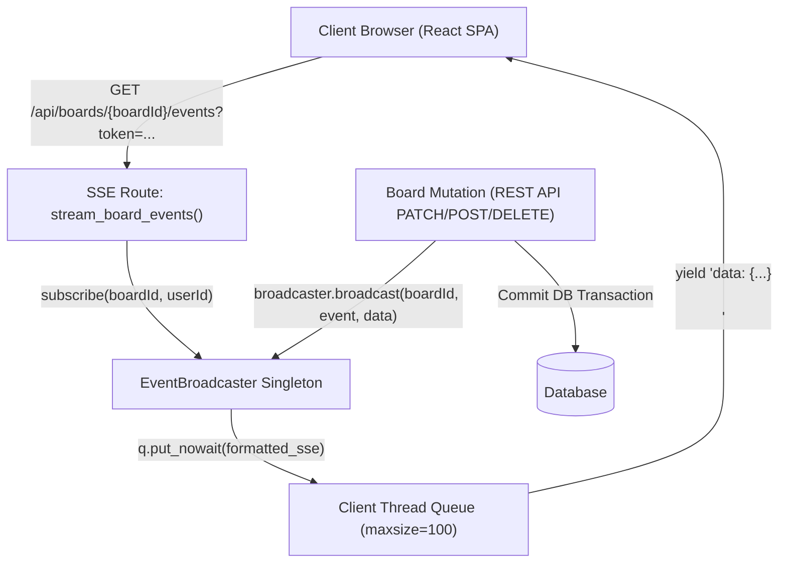
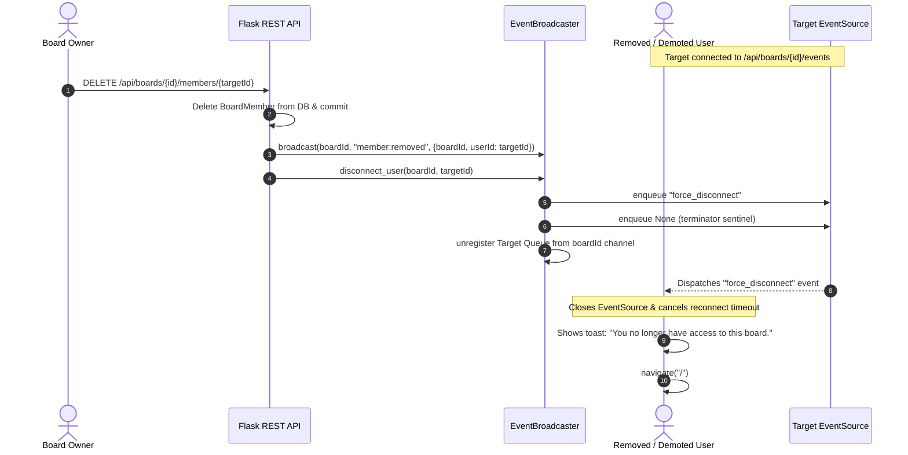
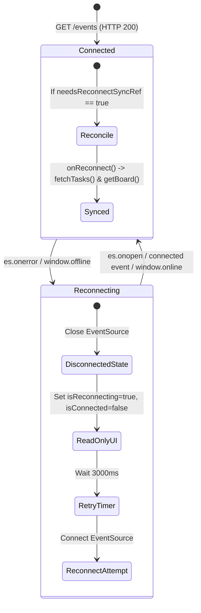

# Real-Time Collaboration & Synchronization Architecture

Status: Verified | Last scanned: 2026-10-13 | Audience: Developers

---

## 1. Overview & Architecture

Sticky Mind Grid uses Server-Sent Events (SSE) over HTTP to deliver real-time, unidirectional server-to-client updates. An in-memory, thread-safe broadcasting hub manages connection queues and routes mutation events to active board members and direct messaging participants.



### Text Version of Architecture Flow
1. **Subscription:** The client browser initiates an SSE connection to `GET /api/boards/<board_id>/events` with a JWT authentication token.
2. **Channel Registration:** The route verifies JWT credentials and role membership, releases the SQLAlchemy connection back to the pool, and registers a Python thread queue (`queue.Queue(maxsize=100)`) in the singleton `EventBroadcaster`.
3. **Database Mutation:** When any user performs a board action (e.g., moves a card, edits a description), the REST endpoint commits changes to the database and generates an audit log entry.
4. **Event Broadcast:** Inside the application service layer, `broadcaster.broadcast()` or `broadcaster.send_to_user()` sends JSON-formatted SSE events to all queues subscribed to that channel.
5. **Consumption:** The generator yields the event to the client over the persistent HTTP connection.

*Sources:*
- Event broadcaster singleton: [`backend/app/utils/event_broadcaster.py:7-121`](file:///c:/Users/ramos/sticky-mind-grid/backend/app/utils/event_broadcaster.py#L7-L121)
- Board SSE route: [`backend/app/routes/board_routes.py:70-120`](file:///c:/Users/ramos/sticky-mind-grid/backend/app/routes/board_routes.py#L70-L120)
- Messaging SSE route: [`backend/app/routes/message_routes.py:152-191`](file:///c:/Users/ramos/sticky-mind-grid/backend/app/routes/message_routes.py#L152-L191)
- Client hook: [`src/hooks/useBoardRealtime.ts:1-341`](file:///c:/Users/ramos/sticky-mind-grid/src/hooks/useBoardRealtime.ts#L1-L341)

---

## 2. Channels & Addressing

The `EventBroadcaster` supports three channel naming conventions:

| Channel Pattern | Intended Audience | Example | Subscription Route |
|---|---|---|---|
| `<board_id>` (UUID) | All active viewers, editors, admins, and owner of a specific board | `d4e5f6a7-...` | `GET /api/boards/<board_id>/events` |
| `user:<user_id>` | A single authenticated user across all sessions (for direct notifications / conversation invites) | `user:u123-abc` | `GET /api/messages/stream` |
| `conv:<conversation_id>` | Participants in a 1-on-1 or group chat thread | `conv:c456-def` | Direct message service broadcasts |

*Sources:*
- Channel discrimination in broadcaster: [`backend/app/utils/event_broadcaster.py:38-40`](file:///c:/Users/ramos/sticky-mind-grid/backend/app/utils/event_broadcaster.py#L38-L40)
- Direct user message streaming: [`backend/app/routes/message_routes.py:169-180`](file:///c:/Users/ramos/sticky-mind-grid/backend/app/routes/message_routes.py#L169-L180)

---

## 3. SSE Protocol & Frame Formatting

### Headers
Every SSE response stream sets the following HTTP response headers:
- `Content-Type: text/event-stream`
- `Cache-Control: no-cache`
- `X-Accel-Buffering: no` (disables buffering in Nginx / reverse proxies)
- `Connection: keep-alive`

*Source:* [`backend/app/routes/board_routes.py:113-118`](file:///c:/Users/ramos/sticky-mind-grid/backend/app/routes/board_routes.py#L113-L118)

### Envelope Structure
Every broadcast message follows a strict JSON envelope sent as standard SSE `data: <json>\n\n`:

```json
{
  "type": "task:updated",
  "channelId": "481a540a-9ff6-47b5-b747-fc7bc97e93da",
  "boardId": "481a540a-9ff6-47b5-b747-fc7bc97e93da",
  "data": { ... },
  "timestamp": "2026-10-13T06:30:00.000000Z"
}
```

*Source:* [`backend/app/utils/event_broadcaster.py:36-43`](file:///c:/Users/ramos/sticky-mind-grid/backend/app/utils/event_broadcaster.py#L36-L43)

### Keep-Alive Pings
To keep intermediate proxies and firewalls from dropping idle TCP connections, the backend generator times out waiting on the subscriber queue after 25.0 seconds and yields an SSE comment frame:
```http
: ping\n\n
```
The browser's native `EventSource` parser ignores comment lines starting with `:` and does not dispatch message events for them.

*Sources:*
- Backend ping timeout: [`backend/app/routes/board_routes.py:101-107`](file:///c:/Users/ramos/sticky-mind-grid/backend/app/routes/board_routes.py#L101-L107)
- Frontend client ignore handler: [`src/hooks/useBoardRealtime.ts:280-282`](file:///c:/Users/ramos/sticky-mind-grid/src/hooks/useBoardRealtime.ts#L280-L282)

---

## 4. Events & Payloads Matrix

| Event Type | Channel | Trigger | Payload Schema (`data`) | Client Handler (`useBoardRealtime`) |
|---|---|---|---|---|
| `connected` | Board / User | Initial connection established | `{"type": "connected", "boardId": "<id>"}` | Sets `isConnected=true`, triggers `onReconnect` if reconciling |
| `task:created` | Board | New task added, or task moved *into* this board from another board, or restored from trash | Task dictionary representation (`Task.to_dict()`) plus optional `actorId` | Calls `onTaskChange(data)` |
| `task:updated` | Board | Task attributes updated (title, assignee, progress, tags, etc.) | Task dictionary representation (`Task.to_dict()`) | Calls `onTaskChange(data)`, `onTaskUpdate(data)` |
| `task:moved` | Board | Task dragged or moved to another column | Task dictionary representation (`Task.to_dict()`) with `previousStatus` | Calls `onTaskMoved(data)`, `onTaskChange(data)` |
| `tasks:reordered` | Board | Multiple tasks reordered within or across columns | `{"boardId": str, "items": [{"id": str, "status": str, "position": float}]}` | Calls `onTasksReordered(data)`, `onTaskChange(data)` |
| `task:deleted` | Board | Task soft-deleted to trash, permanently purged, or moved *out* to another board | `{"taskId": str, "permanent": bool}` | Calls `onTaskDelete(taskId)`, `onTaskChange(data)` |
| `trash:emptied` | Board | Admin or Owner empties board trash bin | `{"count": int}` | Empties trash cache |
| `note:created` | Board | New project document/note created | Note dictionary representation (`Note.to_dict()`) | React Query cache invalidation |
| `note:updated` | Board | Project document/note edited | Note dictionary representation (`Note.to_dict()`) | React Query cache invalidation |
| `note:deleted` | Board | Project document/note deleted | `{"noteId": str}` | React Query cache invalidation |
| `activity:new` | Board | Any audited board mutation occurs | Activity dictionary representation (`Activity.to_dict()`) | Calls `onActivityChange(data)` |
| `member:joined` | Board | Invitee accepts board invitation | Member dictionary representation (`BoardMember.to_dict()`) | Calls `onMemberChange(data)` |
| `member:role_updated` | Board | Member role modified (e.g. editor demoted to viewer) | `{"userId": str, "role": str, "actorId": str}` | Calls `onMemberChange(data)`, triggers immediate read-only lock if self |
| `member:removed` | Board | Member removed from board, voluntarily leaves, or declines invite | `{"boardId": str, "userId": str}` | If self: closes `EventSource`, shows toast, redirects to `/` |
| `force_disconnect` | Board | Explicit queue termination signal dispatched to specific removed user | `{"boardId": str, "userId": str}` | Calls `onForceDisconnect(data)`, closes `EventSource`, redirects to `/` |
| `board:updated` | Board | Board name, columns, color, or banner edited | Board dictionary representation (`Board.to_dict()`) | Calls `onBoardChange(data)` |
| `board:deleted` | Board | Owner deletes board | `{"boardId": str}` | Calls `onBoardDeleted(data)` |

*Sources:*
- Event emissions: [`backend/app/services/task_service.py:200-646`](file:///c:/Users/ramos/sticky-mind-grid/backend/app/services/task_service.py#L200-L646), [`backend/app/services/board_service.py:619-1099`](file:///c:/Users/ramos/sticky-mind-grid/backend/app/services/board_service.py#L619-L1099), [`backend/app/services/note_service.py:51-135`](file:///c:/Users/ramos/sticky-mind-grid/backend/app/services/note_service.py#L51-L135)
- Frontend client event dispatcher: [`src/hooks/useBoardRealtime.ts:182-279`](file:///c:/Users/ramos/sticky-mind-grid/src/hooks/useBoardRealtime.ts#L182-L279)

---

## 5. Session Disconnection on Role Change & Removal



### Text Version of Disconnection Flow
1. **Trigger:** The Board Owner removes a member via `DELETE /api/boards/<board_id>/members/<member_id>`.
2. **Database Mutation:** The membership row is removed from the database and an audit record is committed.
3. **Broadcast:** The API broadcasts `"member:removed"` to the board channel so remaining members see the member list update.
4. **Targeted Force-Disconnect:** `broadcaster.disconnect_user(board_id, target_id)` locates all subscriber queues matching the target's `user_id`:
   - Enqueues a `force_disconnect` SSE message.
   - Enqueues a `None` sentinel into the Python queue.
   - Discards the queues from the active subscription set under `self._lock`.
5. **Backend Generator Termination:** In `board_routes.py`, the generator loop reads `msg = q.get()`. Receiving `None`, it breaks the loop and executes the `finally` cleanup block.
6. **Frontend Handling:** In `useBoardRealtime.ts`, when `force_disconnect` or `member:removed` (matching `currentUser.id`) is parsed:
   - Any scheduled reconnection timer is cancelled (`clearTimeout(reconnectTimeoutRef.current)`).
   - The native `EventSource` instance is explicitly closed (`es.close()`).
   - Connection state flags are reset (`setIsConnected(false)`, `setIsReconnecting(false)`).
   - In `KanbanBoard.tsx`, a toast error is raised (`"You no longer have access to this board."`) and React Router navigates the user to `/`.
7. **Mid-Session Role Downgrade (Editor -> Viewer):**
   - The owner patches member role to `viewer` (`PATCH /api/boards/<board_id>/members/<member_id>`).
   - Backend broadcasts `member:role_updated`.
   - The connection remains open so the user still receives live read-only updates.
   - Subsequent REST mutations from that user's session token are immediately rejected with HTTP 403 Forbidden by `@require_task_access` and `@require_board_access` decorators.
   - Frontend catches `member:role_updated`, displays info toast (`"Your role on this board was updated to viewer."`), and switches UI to read-only (disables card dragging, hides task creation buttons).

*Sources:*
- Disconnect queue logic: [`backend/app/utils/event_broadcaster.py:82-118`](file:///c:/Users/ramos/sticky-mind-grid/backend/app/utils/event_broadcaster.py#L82-L118)
- Member removal service: [`backend/app/services/board_service.py:922-927`](file:///c:/Users/ramos/sticky-mind-grid/backend/app/services/board_service.py#L922-L927)
- Frontend force-disconnect listener: [`src/hooks/useBoardRealtime.ts:232-267`](file:///c:/Users/ramos/sticky-mind-grid/src/hooks/useBoardRealtime.ts#L232-L267)
- Removal test verification: [`backend/tests/test_realtime_conflicts.py:209-356`](file:///c:/Users/ramos/sticky-mind-grid/backend/tests/test_realtime_conflicts.py#L209-L356)
- Frontend component test: [`src/test/components/RealtimeCollaborationConflicts.test.tsx:268-324`](file:///c:/Users/ramos/sticky-mind-grid/src/test/components/RealtimeCollaborationConflicts.test.tsx#L268-L324)

---

## 6. Conflict Handling & Resolution

Sticky Mind Grid implements specific conflict strategies based on mutation type:

### 1. Concurrent Card Moves (Last-Write-Wins with Full Audit)
When multiple users drag or reorder the same card concurrently:
- **State Resolution:** The database executes updates sequentially; the last HTTP request processed by MySQL wins (`position` and `status` values reflect the latest write).
- **Audit Logging:** To prevent lost intent, clients send `fromStatus` alongside `status`. Even if User B drags from an outdated local column state, both moves are written into the immutable `activities` table (e.g. `'Moved "Card" from To Do to In Progress'` and `'Moved "Card" from To Do to Done'`).
- **Live Viewing Highlight:** If User B is currently viewing a task modal when User A moves it remotely:
  - The modal status updates live.
  - A `"Moved live"` highlight badge (`data-testid="task-status-live-highlight"`) appears in the task workspace.
  - The board card displays `data-highlighted="true"` with a visual pulse indicator.

*Sources:*
- Backend move audit: [`backend/app/services/task_service.py:290-344`](file:///c:/Users/ramos/sticky-mind-grid/backend/app/services/task_service.py#L290-L344)
- Test verification: [`backend/tests/test_realtime_conflicts.py:9-132`](file:///c:/Users/ramos/sticky-mind-grid/backend/tests/test_realtime_conflicts.py#L9-L132)
- Frontend live indicator test: [`src/test/components/RealtimeCollaborationConflicts.test.tsx:224-266`](file:///c:/Users/ramos/sticky-mind-grid/src/test/components/RealtimeCollaborationConflicts.test.tsx#L224-L266)

### 2. Concurrent Description Edits (Optimistic Concurrency & 409 Conflict)
To prevent silent overwrites of task specifications:
- When a client opens a task, it tracks `baseDescription`.
- When saving description updates, the client submits:
  ```json
  {
    "description": "User B local edits...",
    "baseDescription": "Original specification v1",
    "forceOverwrite": false
  }
  ```
- If the description in the database differs from `baseDescription` and `forceOverwrite` is not set, the backend rejects the update with **HTTP 409 Conflict**:
  ```json
  {
    "conflict": true,
    "error": "Task has been modified by another user",
    "currentTask": { ... }
  }
  ```
- **Client Resolution Options:** The Task Modal renders a conflict alert banner offering two explicit choices:
  1. **"Load Remote"**: Replaces local unsaved draft with the current server description (`conflictPayload.currentTask.description`).
  2. **"Overwrite With Mine"**: Re-sends the PATCH request with `"forceOverwrite": true`, forcibly writing the user's version and logging the overwrite to the activity trail.

*Sources:*
- Backend conflict detection: [`backend/app/services/task_service.py:239-243`](file:///c:/Users/ramos/sticky-mind-grid/backend/app/services/task_service.py#L239-L243)
- Task conflict route handling: [`backend/app/routes/task_routes.py:162-167`](file:///c:/Users/ramos/sticky-mind-grid/backend/app/routes/task_routes.py#L162-L167)
- Conflict test suite: [`backend/tests/test_realtime_conflicts.py:134-207`](file:///c:/Users/ramos/sticky-mind-grid/backend/tests/test_realtime_conflicts.py#L134-L207)
- UI conflict banner test: [`src/test/components/RealtimeCollaborationConflicts.test.tsx:133-222`](file:///c:/Users/ramos/sticky-mind-grid/src/test/components/RealtimeCollaborationConflicts.test.tsx#L133-L222)

---

## 7. Reconnection, Backoff & State Resynchronization



### Text Version of Reconnection Lifecycle
1. **Failure Detection:** Network loss, server restart, or proxy disconnect triggers `es.onerror` or the browser `window.addEventListener("offline")` event.
2. **Protective Read-Only Mode:**
   - `isConnected` becomes `false`; `isReconnecting` becomes `true`.
   - The UI mounts a warning badge: `Read-only • Reconnecting...` (`data-testid="realtime-reconnecting-badge"`).
   - Task creation and drag-and-drop are disabled to prevent users from queueing conflicting or stale offline mutations.
3. **Retry Strategy:**
   - The client closes the failed `EventSource` instance.
   - A retry timeout is scheduled for **3000ms (3 seconds)**.
   - If the browser detects an `online` event prior to timer expiration, it reconnects immediately.
4. **Reconciliation on Reconnect:**
   - Upon successful reconnection (`es.onopen` or receiving `{"type": "connected"}`), `needsReconnectSyncRef` triggers `callbacksRef.current.onReconnect()`.
   - `onReconnect()` calls `fetchTasks()` and `boardApi.getBoard(boardId)` to refresh local state against the database, pulling any changes that occurred during disconnection.

*Sources:*
- Reconnection logic: [`src/hooks/useBoardRealtime.ts:285-325`](file:///c:/Users/ramos/sticky-mind-grid/src/hooks/useBoardRealtime.ts#L285-L325)
- Board reconnection UI test: [`src/test/components/RealtimeCollaborationConflicts.test.tsx:326-353`](file:///c:/Users/ramos/sticky-mind-grid/src/test/components/RealtimeCollaborationConflicts.test.tsx#L326-L353)
