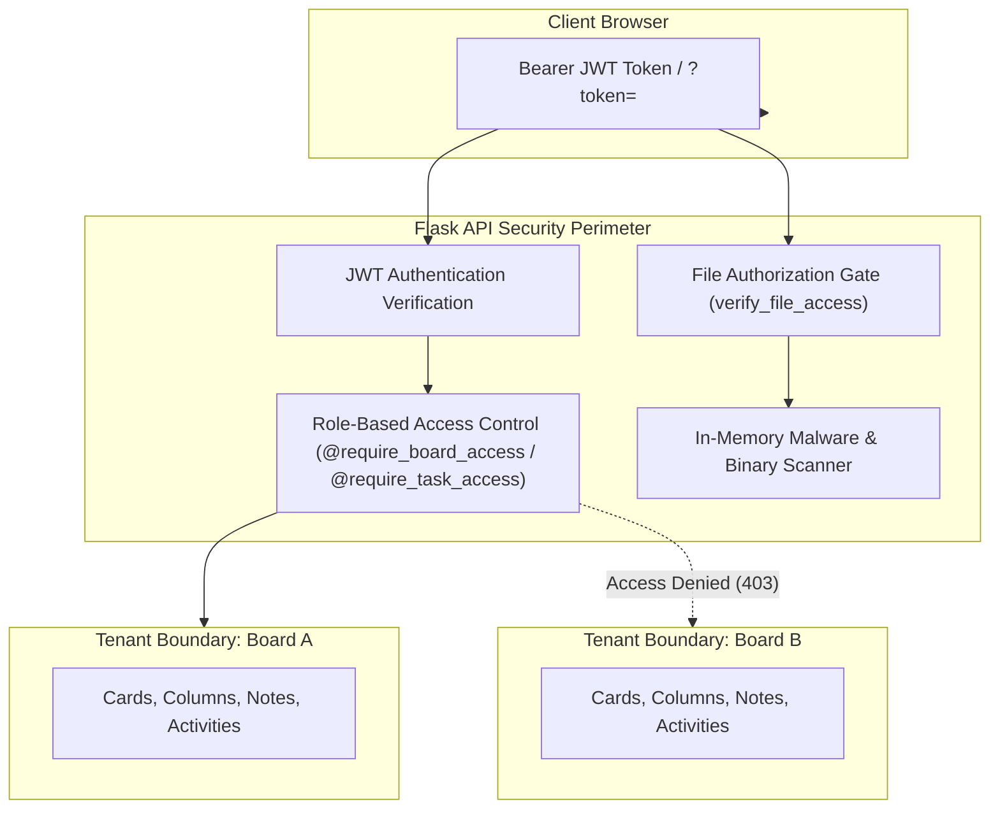

# Security, Privacy & Tenancy Specification

Status: Verified | Last scanned: 2026-10-13 | Audience: Developers, Security, Compliance

---

## 1. Security Architecture & Threat Model

Sticky Mind Grid treats each **Board** as an isolated tenant boundary. Users belong to a global authentication pool but have zero cross-board visibility unless explicitly invited and accepted onto a specific board.

### Text Version of Security Flow
1. **Request Intake:** Clients send requests with an `Authorization: Bearer <token>` header, or a `?token=` query parameter for native `EventSource` streams and direct download links.
2. **Authentication (AuthN):** Flask-JWT-Extended verifies token signature, issuer, and expiration (24h).
3. **Authorization (AuthZ):** Decorators lookup the user's role on the specific board containing the entity. Non-members receive HTTP 403 Forbidden.
4. **File Access Control:** File requests resolve against task, message, or hero associations. Stranger requests are rejected with HTTP 403.
5. **Malware & Stream Scrutiny:** Uploaded streams are scanned in memory for malicious binary headers, EICAR test signatures, and executable scripts before writing to disk.

---

## 2. Authentication (AuthN)

Sticky Mind Grid supports both password-based local authentication and third-party OAuth social login.

| Mechanism | Configuration / Source | Implementation Details |
|---|---|---|
| **JWT Access Tokens** | `backend/config.py:38-41`, `backend/app/__init__.py:11,44` | Tokens are generated via Flask-JWT-Extended (`create_access_token(identity=str(user.id))`) with a default lifespan of 24 hours (`JWT_ACCESS_TOKEN_EXPIRES = timedelta(hours=24)`). Enforced on routes via `@jwt_required()`. |
| **Password Hashing** | `backend/app/models/user.py:40-44`, `backend/app/__init__.py:12,45` | Passwords are salted and hashed using Flask-Bcrypt (`bcrypt.generate_password_hash(password).decode('utf-8')`). Plaintext passwords are never persisted. |
| **OAuth Providers** | `backend/app/routes/auth_routes.py:10,54-136` | Supports `google`, `github`, and `microsoft` OAuth identity providers. Unregistered OAuth users automatically create a user record with `auth_provider` set and an auto-generated UUID password placeholder. |
| **Session Persistence** | `src/config/api.ts:10-15`, `src/contexts/AuthContext.tsx` | Tokens are stored in `localStorage` under `auth_token`. On receiving an HTTP 401 response, `authenticatedFetch` automatically clears local credentials and redirects to `/login`. |
| **Unauthenticated Endpoints** | `backend/app/routes/auth_routes.py:116-188`, `backend/app/routes/file_routes.py:46-51` | Only `/api/auth/login`, `/api/auth/register`, `/api/auth/oauth*`, and public user avatar downloads (`User.avatar_url`) allow unauthenticated requests. |

---

## 3. Authorization & RBAC (AuthZ)

Role-based access control is enforced **strictly on the backend**. Frontend permission checks (via `useBoardPermissions`) serve solely to optimize user interface ergonomics.

### Role Hierarchy & Capabilities Matrix

The system defines 5 hierarchical levels. Numeric precedence is defined in `backend/app/utils/decorators.py:10-17`:
- **Owner (Level 5)**
- **Admin (Level 4)**
- **Editor (Level 3)** *(Legacy `member` maps to level 3)*
- **Commenter (Level 2)**
- **Viewer (Level 1)**
- **Non-Member (Level 0)**

| Permission / Action | Owner (5) | Admin (4) | Editor (3) | Commenter (2) | Viewer (1) | Backend Enforcement Source |
|---|---|---|---|---|---|---|
| View Board, Tasks & Columns | Yes | Yes | Yes | Yes | Yes | `require_board_access('viewer')` [`board_routes.py:62`](file:///c:/Users/ramos/sticky-mind-grid/backend/app/routes/board_routes.py#L62) |
| Follow Tasks & Get Move Notifs | Yes | Yes | Yes | Yes | Yes | `require_task_access('viewer')` [`task_routes.py:90`](file:///c:/Users/ramos/sticky-mind-grid/backend/app/routes/task_routes.py#L90) |
| View Card-Specific Audit Log | Yes | Yes | Yes | Yes | Yes | `ActivityService.get_activities` [`activity_routes.py:27`](file:///c:/Users/ramos/sticky-mind-grid/backend/app/routes/activity_routes.py#L27) |
| Post Task Comments & @Mentions | Yes | Yes | Yes | Yes | **No (403)** | `CommentService.add_comment` [`comment_routes.py:20`](file:///c:/Users/ramos/sticky-mind-grid/backend/app/routes/comment_routes.py#L20) |
| Edit Own Comment | Yes | Yes | Yes | Yes | **No (403)** | Author check [`comment_routes.py:34`](file:///c:/Users/ramos/sticky-mind-grid/backend/app/routes/comment_routes.py#L34) |
| Create, Edit, Drag & Reorder Tasks | Yes | Yes | Yes | **No (403)** | **No (403)** | `require_task_access('editor')` [`task_routes.py:69,111,122`](file:///c:/Users/ramos/sticky-mind-grid/backend/app/routes/task_routes.py#L69) |
| Assign Tasks (Card Assignee) | Yes | Yes | Yes | **No (400)** | **No (400)** | Role check [`task_routes.py:75,154`](file:///c:/Users/ramos/sticky-mind-grid/backend/app/routes/task_routes.py#L75) |
| Soft-Delete Task (Trash) & Restore | Yes | Yes | Yes | **No (403)** | **No (403)** | `require_task_access('editor')` [`task_routes.py:175,193`](file:///c:/Users/ramos/sticky-mind-grid/backend/app/routes/task_routes.py#L175) |
| View Trash Bin | Yes | Yes | Yes | **No (403)** | **No (403)** | Role check [`task_routes.py:33`](file:///c:/Users/ramos/sticky-mind-grid/backend/app/routes/task_routes.py#L33) |
| Upload / Attach Files to Tasks | Yes | Yes | Yes | **No (403)** | **No (403)** | `FileService.verify_file_access` [`file_service.py:414`](file:///c:/Users/ramos/sticky-mind-grid/backend/app/services/file_service.py#L414) |
| Move Tasks Cross-Board | Yes | Yes | Yes | **No (403)** | **No (403)** | Target board Editor check [`task_routes.py:133`](file:///c:/Users/ramos/sticky-mind-grid/backend/app/routes/task_routes.py#L133) |
| View Full Board Audit Trail | Yes | Yes | **No (403)** | **No (403)** | **No (403)** | Role check [`activity_routes.py:27`](file:///c:/Users/ramos/sticky-mind-grid/backend/app/routes/activity_routes.py#L27) |
| Manage Columns (Add/Edit/Delete) | Yes | Yes | **No (403)** | **No (403)** | **No (403)** | `require_board_access('admin')` [`board_routes.py:255,271,281`](file:///c:/Users/ramos/sticky-mind-grid/backend/app/routes/board_routes.py#L255) |
| Invite Members & Manage Roles | Yes | Yes | **No (403)** | **No (403)** | **No (403)** | `require_board_access('admin')` [`board_routes.py:137,208`](file:///c:/Users/ramos/sticky-mind-grid/backend/app/routes/board_routes.py#L137) |
| Export Board Data | Yes | Yes | **No (403)** | **No (403)** | **No (403)** | `require_board_access('admin')` [`board_routes.py:176`](file:///c:/Users/ramos/sticky-mind-grid/backend/app/routes/board_routes.py#L176) |
| Empty Trash & Permanent Delete Task | Yes | Yes | **No (403)** | **No (403)** | **No (403)** | Role check [`task_routes.py:43,209`](file:///c:/Users/ramos/sticky-mind-grid/backend/app/routes/task_routes.py#L43) |
| Delete Any Comment | Yes | Yes | **No (403)** | **No (403)** | **No (403)** | Role check [`comment_service.py:75`](file:///c:/Users/ramos/sticky-mind-grid/backend/app/services/comment_service.py#L75) |
| Transfer Board Ownership | Yes | **No (403)** | **No (403)** | **No (403)** | **No (403)** | `require_board_access('owner')` [`board_routes.py:186`](file:///c:/Users/ramos/sticky-mind-grid/backend/app/routes/board_routes.py#L186) |
| Delete Board (Hard Delete) | Yes | **No (403)** | **No (403)** | **No (403)** | **No (403)** | `require_board_access('owner')` [`board_routes.py:165`](file:///c:/Users/ramos/sticky-mind-grid/backend/app/routes/board_routes.py#L165) |
| Mutate / Delete Audit Log Entries | **No (403)** | **No (403)** | **No (403)** | **No (403)** | **No (403)** | Hardcoded 403 [`activity_routes.py:54`](file:///c:/Users/ramos/sticky-mind-grid/backend/app/routes/activity_routes.py#L54) |

*Sources:*
- Role definitions: [`backend/app/utils/decorators.py:10-94`](file:///c:/Users/ramos/sticky-mind-grid/backend/app/utils/decorators.py#L10-L94)
- Task modal permissions test: [`backend/tests/test_rbac.py:526-580`](file:///c:/Users/ramos/sticky-mind-grid/backend/tests/test_rbac.py#L526-L580)
- Client permissions hook: [`src/hooks/useBoardPermissions.ts:6-224`](file:///c:/Users/ramos/sticky-mind-grid/src/hooks/useBoardPermissions.ts#L6-L224)

---

## 4. Attachment Access Control & Storage Security

All attachments are routed through authorization checks before the static file handler streams bytes to the browser.

### Authorization Gate (`FileService.verify_file_access`)
Direct requests to `GET /api/files/<filename>` or `GET /api/files/<filename>/download` are evaluated in strict order:
1. **Public User Avatars:** Checked against `User.avatar_url`. If matched, allowed without authentication (`200 OK`).
2. **Authentication Gate:** If no valid JWT header or `?token=` parameter is provided, rejected with `401 Unauthorized`.
3. **Task Attachments:** If the file is attached to any task, queries the user's role on that task's board (`get_effective_role(task.board_id, user_id) > 0`). If the user is not an accepted member of the board, access is rejected with `403 Forbidden`. If a member is removed from the board, their access to previously downloaded or linked attachments is immediately revoked.
4. **Chat Message Attachments:** If attached to a chat message, verifies that the user is an active participant in `ConversationParticipant`. Strangers receive `403 Forbidden`.
5. **Board Hero Banners:** Verifies that the user has `get_effective_role(board.id, user_id) > 0` on the associated board.
6. **Unattached Staging Files:** Files uploaded but not yet attached to a task are checked against an internal uploader registry (`.uploaders.json`). Only the uploading `user_id` can access the file during staging (`403 Forbidden` for other members).

*Sources:*
- Route handler: [`backend/app/routes/file_routes.py:45-61`](file:///c:/Users/ramos/sticky-mind-grid/backend/app/routes/file_routes.py#L45-L61)
- Access verification algorithm: [`backend/app/services/file_service.py:381-460`](file:///c:/Users/ramos/sticky-mind-grid/backend/app/services/file_service.py#L381-L460)
- Test verification: [`backend/tests/test_privacy_and_tenancy.py:197-249, 421-442`](file:///c:/Users/ramos/sticky-mind-grid/backend/tests/test_privacy_and_tenancy.py#L197-L249)

### In-Memory Malware & File Type Screening
Before writing any file to disk, the backend inspects the byte stream in memory:
- **EICAR Standard Antivirus Signature:** Rejects files containing the EICAR test string (`X5O!P%@AP[4\PZX54(P^)7CC)7}$EICAR-STANDARD-ANTIVIRUS-TEST-FILE!$H+H*`).
- **Executable Binaries:** Rejects disguised executables matching magic byte headers:
  - Windows PE/MZ (`sample[:2] == b'MZ'`)
  - Linux ELF (`sample[:4] == b'\x7fELF'`)
  - macOS Mach-O (`b'\xfe\xed\xfa\xce'`, `b'\xfe\xed\xfa\xcf'`, `b'\xce\xfa\xed\xfe'`, `b'\xcf\xfa\xed\xfe'`)
  - Unix Shebang scripts (`sample[:2] == b'#!'`)
- **Script Payloads:** Scans the first 64KB for embedded `<script` or `javascript:` payloads in documents and images.
- **Raster Image Validation:** Banner images must pass raster magic byte verification (`is_valid_image_bytes`) for JPEG (`\xff\xd8\xff`), PNG (`\x89PNG\r\n\x1a\n`), GIF (`GIF87a`/`GIF89a`), or WebP (`RIFF....WEBP`).

*Sources:*
- Malware scanner: [`backend/app/services/file_service.py:81-119`](file:///c:/Users/ramos/sticky-mind-grid/backend/app/services/file_service.py#L81-L119)
- Raster byte checks: [`backend/app/services/file_service.py:63-78`](file:///c:/Users/ramos/sticky-mind-grid/backend/app/services/file_service.py#L63-L78)
- Test verification: [`backend/tests/test_privacy_and_tenancy.py:400-420`](file:///c:/Users/ramos/sticky-mind-grid/backend/tests/test_privacy_and_tenancy.py#L400-L420)

### Upload Limits & Storage Quotas

| Limit Parameter | Default Value | Config Key | Enforcement Level |
|---|---|---|---|
| **Max Upload File Size** | 25 MB (10 MB in sample env) | `MAX_UPLOAD_MB` / `MAX_CONTENT_LENGTH` | Per HTTP request; rejects with HTTP 413 |
| **Max Banner Image Size** | 5 MB | `MAX_BANNER_SIZE_BYTES` | Dedicated banner limit; rejects with HTTP 400 |
| **Per-Board Storage Quota** | 100 MB | `MAX_BOARD_STORAGE_MB` / `MAX_BOARD_STORAGE_BYTES` | Sum of all active task attachments on board; rejects with HTTP 400 |
| **Per-Owner Storage Quota** | 500 MB | `MAX_OWNER_STORAGE_MB` / `MAX_OWNER_STORAGE_BYTES` | Sum across all boards owned by user; rejects with HTTP 400 |
| **Allowed File Extensions** | Images, Docs, Archives, Media | `ALLOWED_UPLOAD_EXTENSIONS` | Whitelist verification; rejects unsupported extensions |

*Sources:*
- Configuration: [`backend/config.py:54-74`](file:///c:/Users/ramos/sticky-mind-grid/backend/config.py#L54-L74)
- Quota validation: [`backend/app/services/file_service.py:177-207, 333-364`](file:///c:/Users/ramos/sticky-mind-grid/backend/app/services/file_service.py#L177-L207)

---

## 5. Tenant Isolation & Redaction Rules

Because Boards act as independent tenant boundaries, specific redaction policies prevent information leakage across boards and roles.

### 1. Member Profile Redaction for Guests
- **Rule:** Commenters and Viewers receive only `fullName` and `avatarUrl` when querying board members. Email addresses are strictly redacted (`email = None` or omitted) to prevent contact harvesting.
- **Unregistered Pending Invitees:** Display as `fullName: "Invited Guest"` with `email: None` when viewed by Commenters and Viewers.

*Sources:*
- Member serialization: [`backend/app/models/board_member.py:34-45`](file:///c:/Users/ramos/sticky-mind-grid/backend/app/models/board_member.py#L34-L45)
- Redaction logic: [`backend/app/services/board_service.py:1107-1132`](file:///c:/Users/ramos/sticky-mind-grid/backend/app/services/board_service.py#L1107-L1132)
- Test verification: [`backend/tests/test_privacy_and_tenancy.py:47-84`](file:///c:/Users/ramos/sticky-mind-grid/backend/tests/test_privacy_and_tenancy.py#L47-L84)

### 2. Pre-Acceptance Invitation Tenancy
- **Rule:** When an invited user queries their pending invitations (`GET /api/boards/invitations`), the response exposes only board name, inviter display name, role, and expiration date.
- **Redaction:** Board `description`, columns, and existing `members` are **never exposed** prior to explicit invitation acceptance.
- **Spam Reporting:** A recipient can report an invitation as spam (`POST /api/boards/<board_id>/invitations/report`). This declines the invitation and automatically revokes all other pending invitations from that same inviter.

*Sources:*
- Invitation endpoint: [`backend/app/services/board_service.py:57-78, 626-674`](file:///c:/Users/ramos/sticky-mind-grid/backend/app/services/board_service.py#L57-L78)
- Test verification: [`backend/tests/test_invitations.py:365-416`](file:///c:/Users/ramos/sticky-mind-grid/backend/tests/test_invitations.py#L365-L416)

### 3. Cross-Board Task Move Redaction
When moving a task from Board A to Board B:
- **Authorization:** Requires Editor privileges on **both** boards.
- **Assignee Stripping:** Assignees who are not accepted members with Editor or above on the target board are automatically stripped (`assignedTo = 'unassigned'`).
- **Audit Name Redaction:**
  - Source Board A activity log records: `Card "{title}" moved to another board` (the name of target Board B is masked as `"Another board"`).
  - Target Board B activity log records: `Card "{title}" moved from another board` (the name of source Board A is masked as `"Another board"`).
  - This prevents non-common members from discovering confidential board titles in the other tenant boundary.

*Sources:*
- Cross-board move controller: [`backend/app/routes/task_routes.py:127-147`](file:///c:/Users/ramos/sticky-mind-grid/backend/app/routes/task_routes.py#L127-L147)
- Cross-board audit redaction: [`backend/app/services/task_service.py:301-327`](file:///c:/Users/ramos/sticky-mind-grid/backend/app/services/task_service.py#L301-L327)

### 4. "Former Member" Attribution on Removal / Leaving
When a user leaves a board, is removed, or deletes their account:
- **Rule:** Authored content (tasks, comments, and activity audit trails) is **preserved** to maintain project continuity and audit integrity.
- **Attribution Redaction:** The user's name is dynamically masked as `"Former member"` with `email: ""` and `avatarUrl: null` when retrieved by board members.

*Sources:*
- Serialization masking: [`backend/app/models/task.py:85-88`](file:///c:/Users/ramos/sticky-mind-grid/backend/app/models/task.py#L85-L88), [`backend/app/models/comment.py:53-58`](file:///c:/Users/ramos/sticky-mind-grid/backend/app/models/comment.py#L53-L58), [`backend/app/models/activity.py:68-73`](file:///c:/Users/ramos/sticky-mind-grid/backend/app/models/activity.py#L68-L73)
- Test verification: [`backend/tests/test_privacy_and_tenancy.py:150-196, 533-556`](file:///c:/Users/ramos/sticky-mind-grid/backend/tests/test_privacy_and_tenancy.py#L150-L196)

---

## 6. Personal Data Stored, Data Portability & Erasure

### Personal Data Inventory (PII)

| Entity / Field | Storage Location | Sensitivity | Description |
|---|---|---|---|
| `users.email` | MySQL (`users` table) | Confidential | Unique user email address used for login and notifications |
| `users.password_hash` | MySQL (`users` table) | Secret | Bcrypt hash with per-user salt |
| `users.full_name` | MySQL (`users` table) | General | User display name |
| `users.avatar_url` | MySQL (`users` table) | General | Profile picture URL (custom upload or OAuth) |
| `users.auth_provider` / `auth_provider_id` | MySQL (`users` table) | Internal | OAuth provider metadata (`google`, `github`, `microsoft`) |
| `comments.content` | MySQL (`comments` table) | User Content | Text discussions, including user @mentions |
| `activities.message` | MySQL (`activities` table) | Audit Log | Action messages attributed to user IDs |
| `messages.content` | MySQL (`messages` table) | Private Content | Direct message contents |

*Source:* [`backend/app/models/user.py:8-19`](file:///c:/Users/ramos/sticky-mind-grid/backend/app/models/user.py#L8-L19)

### Data Portability (Export)
Sticky Mind Grid supports two JSON export mechanisms:
1. **User Personal Export (`GET /api/users/me/export`):**
   - Exports the authenticated user's profile metadata, user preferences, all boards owned or joined, all active tasks within those boards, and project notes.
   - Returned with `Content-Disposition: attachment; filename=sticky_mind_grid_export_<user_id[:8]>.json`.
2. **Board Data Export (`GET /api/boards/<board_id>/export`):**
   - Restricted to Board Admins and Owners (`403 Forbidden` for Editor, Commenter, Viewer).
   - Exports board settings, all columns, active tasks with checklists and attachments, and member lists with roles.

*Sources:*
- User export route: [`backend/app/routes/user_routes.py:83-124`](file:///c:/Users/ramos/sticky-mind-grid/backend/app/routes/user_routes.py#L83-L124)
- Board export route: [`backend/app/routes/board_routes.py:174-183`](file:///c:/Users/ramos/sticky-mind-grid/backend/app/routes/board_routes.py#L174-L183)
- Board export service: [`backend/app/services/board_service.py:1147-1165`](file:///c:/Users/ramos/sticky-mind-grid/backend/app/services/board_service.py#L1147-L1165)

### Account Erasure & Ownership Auto-Promotion (`DELETE /api/users/me`)
When an account is deleted via `UserService.delete_account(user_id)`:
1. **Board Ownership Resolution:**
   - For boards owned by the user with other members: the backend searches for the oldest accepted **Admin** (`created_at.asc()`) and auto-promotes them to **Owner** (`board.owner_id = successor.user_id`).
   - If no Admin exists, the oldest active Editor, Member, Commenter, or Viewer is auto-promoted.
   - An audit record is logged (`"Auto-promoted {name} to Owner following account deletion of former owner"`), and a `member:role_updated` event is broadcast.
   - If the user is the **sole owner with zero other members**, the orphaned board is deleted cleanly.
2. **Task Assignments:** The user is removed as assignee from all tasks (`assigned_to = None`).
3. **Foreign Key Detachment:** User references in comments and activities are detached (`c.user_id = None`, `a.user_id = None`), preserving the audit trail under the `"Former member"` label.
4. **Memberships & Invites:** Board memberships and pending invitations sent by the user are deleted.
5. **Physical Record Deletion:** The user row is permanently deleted from the `users` table.

*Sources:*
- Deletion service: [`backend/app/services/user_service.py:14-87`](file:///c:/Users/ramos/sticky-mind-grid/backend/app/services/user_service.py#L14-L87)
- Test verification: [`backend/tests/test_privacy_and_tenancy.py:85-196`](file:///c:/Users/ramos/sticky-mind-grid/backend/tests/test_privacy_and_tenancy.py#L85-L196)

---

## 7. Audit Log Access & Retention Policies

### Immutability
All records in the `activities` table are **immutable and append-only**:
- `PUT`, `PATCH`, and `DELETE` requests to `/api/activities` or `/api/activities/<activity_id>` are unconditionally rejected with **HTTP 403 Forbidden** (`"Activity log entries are immutable and cannot be edited or deleted"`), even for the Board Owner.

*Sources:*
- Immutability guard: [`backend/app/routes/activity_routes.py:51-56`](file:///c:/Users/ramos/sticky-mind-grid/backend/app/routes/activity_routes.py#L51-L56)
- Test verification: [`backend/tests/test_privacy_and_tenancy.py:515-519`](file:///c:/Users/ramos/sticky-mind-grid/backend/tests/test_privacy_and_tenancy.py#L515-L519)

### Audit Log Retention
Configurable via the `ACTIVITY_RETENTION_DAYS` environment variable:
- `ACTIVITY_RETENTION_DAYS=0` (default): Activities are retained indefinitely.
- `ACTIVITY_RETENTION_DAYS > 0`: Queries filter out activities older than `utcnow() - timedelta(days=retention_days)`.

*Sources:*
- Config: [`backend/config.py:59`](file:///c:/Users/ramos/sticky-mind-grid/backend/config.py#L59)
- Query cutoff filter: [`backend/app/services/activity_service.py:9-16, 24-27`](file:///c:/Users/ramos/sticky-mind-grid/backend/app/services/activity_service.py#L9-L16)

### 30-Day Trash Retention & Purge
Tasks and boards use soft deletion with a mandatory 30-day recovery window:
1. **Soft Delete:** Tasks are flagged `is_deleted = True` and stamped with `deleted_at = datetime.utcnow()`.
2. **File Retention During Trash Period:** Physical attachment files remain on disk while the task is in the trash bin.
3. **Automated 30-Day Purge:** When `TaskService.get_deleted_tasks(board_id)` or `BoardService.get_user_boards(user_id)` is invoked, entities with `deleted_at < utcnow() - timedelta(days=30)` are automatically purged.
4. **Permanent Purge Cleanup:** When a task is permanently purged (either via 30-day expiration, individual hard delete `DELETE /api/tasks/<id>/permanent`, or `DELETE /api/boards/<id>/trash`), `FileService.cleanup_task_attachments(task)` removes the underlying physical files from `backend/uploads/`, provided no other task references the file.

*Sources:*
- Task 30-day purge: [`backend/app/services/task_service.py:50-64`](file:///c:/Users/ramos/sticky-mind-grid/backend/app/services/task_service.py#L50-L64)
- Board 30-day purge: [`backend/app/services/board_service.py:15-25`](file:///c:/Users/ramos/sticky-mind-grid/backend/app/services/board_service.py#L15-L25)
- Disk file purge: [`backend/app/services/file_service.py:210-252`](file:///c:/Users/ramos/sticky-mind-grid/backend/app/services/file_service.py#L210-L252)
- Test verification: [`backend/tests/test_privacy_and_tenancy.py:457-478`](file:///c:/Users/ramos/sticky-mind-grid/backend/tests/test_privacy_and_tenancy.py#L457-L478)
