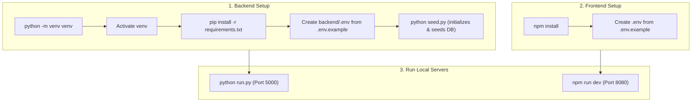

# Contributor & Development Guide

Status: Verified | Last scanned: 2026-10-13 | Audience: Contributors

---

## 1. Prerequisites & Environment Setup

### Required Tooling
- **Node.js:** v18.x or v20.x (supports `npm` or `bun`)
- **Python:** 3.10+ (with `venv` and `pip`)
- **Database Server:** MySQL 8.0+ or compatible (PostgreSQL supported via SQLAlchemy `DATABASE_URL`)
- **Browser Automation (Optional for E2E):** Chromium (via Playwright)

*Sources:*
- Requirements: [`backend/requirements.txt:1-13`](file:///c:/Users/ramos/sticky-mind-grid/backend/requirements.txt#L1-L13)
- Package dependencies: [`package.json:18-98`](file:///c:/Users/ramos/sticky-mind-grid/package.json#L18-L98)
- Architecture reference: [`AGENTS.md:10-38`](file:///c:/Users/ramos/sticky-mind-grid/AGENTS.md#L10-L38)

---

## 2. Step-by-Step Setup



### Text Version of Setup Steps
1. **Clone & Enter Workspace:**
   ```bash
   git clone <repo-url>
   cd sticky-mind-grid
   ```

2. **Backend Setup:**
   ```bash
   cd backend
   python -m venv venv
   # On Windows (PowerShell / Command Prompt):
   venv\Scripts\activate
   # On Linux / macOS:
   source venv/bin/activate

   pip install -r requirements.txt
   cp .env.example .env
   # Ensure your local MySQL server is running and database exists
   python seed.py
   ```
   *Note:* `seed.py` creates tables, runs migrations, and inserts demonstration users, sample boards, tasks, and columns.

3. **Frontend Setup:**
   ```bash
   # From project root:
   npm install
   cp .env.example .env
   ```

---

## 3. Environment Variables (Names Only)

In compliance with security rules, only variable names and configuration purposes are documented. Never commit values or secrets to version control.

### Frontend (`.env`)
| Variable Name | Purpose | Default / Fallback |
|---|---|---|
| `VITE_API_BASE_URL` | Base URL for Flask REST API endpoints | `http://127.0.0.1:5000/api` |

*Source:* [`src/config/api.ts:5-6`](file:///c:/Users/ramos/sticky-mind-grid/src/config/api.ts#L5-L6), [`.env.example:3`](file:///c:/Users/ramos/sticky-mind-grid/.env.example#L3)

### Backend (`backend/.env`)
| Variable Name | Purpose | Default / Fallback in Code |
|---|---|---|
| `SECRET_KEY` | Flask application secret key for session signatures | `'dev-secret-key'` |
| `DATABASE_URL` | SQLAlchemy database connection string | `'mysql+pymysql://root@localhost/sticky_mind_grid'` |
| `JWT_SECRET_KEY` | Secret key for signing Flask-JWT-Extended tokens | Dev placeholder (32+ chars) |
| `CORS_ORIGINS` | Comma-delimited list of permitted browser origins | `localhost:8080, 5173, 3000, *.vercel.app` |
| `MAX_UPLOAD_MB` | Maximum single file upload limit in megabytes | `25` (10 in `.env.example`) |
| `MAX_BOARD_STORAGE_MB` | Cumulative storage quota per board in megabytes | `100` |
| `MAX_OWNER_STORAGE_MB` | Cumulative storage quota across all owned boards in megabytes | `500` |
| `ACTIVITY_RETENTION_DAYS` | Audit log retention window in days (`0` = retain forever) | `0` |
| `ALLOWED_UPLOAD_EXTENSIONS` | Comma-delimited whitelist of file extensions | Whitelist of images, docs, archives, media |
| `FLASK_DEBUG` | Enables hot reloading and debug exception tracing | `'true'` in local dev |
| `RENDER_API_KEY` | Optional Render API token used by diagnostic log scripts | Unset |
| `RENDER_SERVICE_ID` | Optional Render backend service ID for log fetching | Unset |

*Sources:*
- Backend configuration: [`backend/config.py:5-74`](file:///c:/Users/ramos/sticky-mind-grid/backend/config.py#L5-L74)
- Environment template: [`backend/.env.example:1-22`](file:///c:/Users/ramos/sticky-mind-grid/backend/.env.example#L1-L22)
- Server runner: [`backend/run.py:7`](file:///c:/Users/ramos/sticky-mind-grid/backend/run.py#L7)
- Render logs script: [`scripts/fetch_render_logs.py:27-31`](file:///c:/Users/ramos/sticky-mind-grid/scripts/fetch_render_logs.py#L27-L31)

---

## 4. Execution, Build & Test Commands

### Running Locally
```bash
# Start Backend dev server (from backend/ directory):
python run.py
# Serves API on http://127.0.0.1:5000

# Start Frontend dev server (from repository root):
npm run dev
# Serves SPA on http://localhost:8080 (proxies /api to http://127.0.0.1:5000)
```

*Sources:*
- Vite configuration: [`vite.config.ts:7-19`](file:///c:/Users/ramos/sticky-mind-grid/vite.config.ts#L7-L19)
- Flask runner: [`backend/run.py:6-9`](file:///c:/Users/ramos/sticky-mind-grid/backend/run.py#L6-L9)

### Building for Production
```bash
# Compile and bundle TypeScript & React assets:
npm run build

# Preview production build locally:
npm run preview
```

*Sources:* [`package.json:8,11`](file:///c:/Users/ramos/sticky-mind-grid/package.json#L8-L11)

### Testing Strategy & Verification Suite

Testing adheres to a strict tiered lifecycle: fast feedback during active development, automated full verification at completion gates, and user-triggered Playwright E2E.

| Test Tier | Target Scope | Command | Purpose |
|---|---|---|---|
| **Targeted Frontend** | Single component / hook | `npx vitest run src/test/path/to/Target.test.tsx` | Instant feedback during UI changes |
| **Targeted Backend** | Single pytest file or method | `cd backend && pytest tests/test_target.py -k test_name -v && cd ..` | Instant feedback during API/service edits |
| **Typecheck** | Whole TypeScript codebase | `npx tsc --noEmit` | Strict type verification |
| **Code Quality** | ESLint rules | `npm run lint` | Style and code sanity checks |
| **Full Automated Verification** | Frontend unit + coverage | `npm run test:coverage` | Vitest coverage report |
| **Full Automated Verification** | Backend pytest + coverage | `cd backend && pytest --cov=app tests -v && cd ..` | Pytest coverage report |
| **Targeted Playwright E2E** | Specific user journey | `npx playwright test e2e/task-crud.spec.ts` | Validates workflow end-to-end |
| **Full Playwright E2E** | Entire browser test suite | `npm run test:e2e` | Complete browser regression against test DB |
| **Playwright Report** | View test report in browser | `npm run test:e2e:report` | HTML trace and failure inspection |

*Sources:*
- Package scripts: [`package.json:12-16`](file:///c:/Users/ramos/sticky-mind-grid/package.json#L12-L16)
- Lifecycle rules: [`AGENTS.md:127-268`](file:///c:/Users/ramos/sticky-mind-grid/AGENTS.md#L127-L268)

### Database Isolation Policy
- **Development (`sticky_mind_grid`):** Reserved exclusively for manual interactive development.
- **Pytest (`sqlite:///:memory:`):** Ephemeral in-memory database built and torn down per test session.
- **Playwright E2E (`sticky_mind_grid_test`):** Automated test database seeded fresh before browser journeys. Tests must never run against or mutate development databases.

*Source:* [`AGENTS.md:255-268`](file:///c:/Users/ramos/sticky-mind-grid/AGENTS.md#L255-L268), [`backend/tests/conftest.py:15-35`](file:///c:/Users/ramos/sticky-mind-grid/backend/tests/conftest.py#L15-L35)

---

## 5. Project Structure

```
sticky-mind-grid/
├── .agents/                    # Agent customizations, rules, and protocols
├── .github/                    # CI/CD workflows and actions
├── backend/
│   ├── app/
│   │   ├── models/             # SQLAlchemy ORM entity models (one per table)
│   │   ├── routes/             # Thin Flask Blueprints (HTTP parsing & dispatch)
│   │   ├── services/           # Business logic layer (transactions, quotas, audit)
│   │   └── utils/              # Decorators (RBAC) and EventBroadcaster (SSE)
│   ├── migrations/             # Alembic schema migrations
│   ├── tests/                  # Pytest test suite (100% ephemeral SQLite)
│   ├── uploads/                # Local file attachment storage (gitignored)
│   ├── config.py               # Flask environment configuration class
│   ├── run.py                  # Local development server entrypoint
│   ├── seed.py                 # Seed script with demo boards, tasks, and users
│   └── requirements.txt        # Python dependency manifest
├── docs/                       # Project documentation and architectural specs
├── e2e/                        # Playwright E2E test specs and runner
├── public/                     # Static client public assets
├── src/
│   ├── components/             # React UI components organized by domain
│   │   ├── auth/               # Login, registration, guards, profile
│   │   ├── board/              # Board members, invitations
│   │   ├── boards/             # Board grid cards, creation modals, hero banner
│   │   ├── common/             # Shared primitives (EmojiSelector)
│   │   ├── dev/                # Developer mode tools, state inspection modal
│   │   ├── documents/          # Notes editor, attachment repository
│   │   ├── kanban/             # Core board views (Kanban, List, Calendar, Overview)
│   │   ├── notifications/      # Notification bell and dropdown feed
│   │   ├── task/               # TaskDetailWorkspace, modal, attachments, comments
│   │   └── ui/                 # shadcn/ui primitives (Radix UI wrappers)
│   ├── config/                 # Centralized API configuration (api.ts)
│   ├── contexts/               # React contexts (AuthContext, DevModeContext)
│   ├── hooks/                  # Custom hooks (useTasks, useBoards, useBoardRealtime)
│   ├── pages/                  # Route-level page components
│   ├── services/               # API clients wrapping authenticatedFetch
│   ├── test/                   # Vitest unit and integration test specs
│   ├── types/                  # TypeScript interfaces (one file per domain)
│   └── utils/                  # Pure frontend utility functions
├── index.html                  # Single-page application HTML entrypoint
├── package.json                # Node.js project manifest and scripts
├── playwright.config.ts        # Playwright E2E configuration
├── tailwind.config.ts          # TailwindCSS design tokens and themes
├── tsconfig.json               # Root TypeScript configuration
└── vite.config.ts              # Vite bundler, HMR, and API proxy settings
```

---

## 6. Development Conventions & Architectural Patterns

### Frontend Architecture
1. **API Communications:**
   - All HTTP requests must use `authenticatedFetch()` from `src/services/apiUtils.ts`.
   - Never write raw `fetch()` or `axios` calls in components or hooks.
   - Automatically injects JWT Bearer tokens and handles 401 redirect flows.
2. **State Separation:**
   - **Board and Task State:** Managed via `useBoards.ts` and `useTasks.ts` using raw `useState`, optimistic local updates with rollback on error, and 4-second polling intervals. Do not migrate core boards/tasks to React Query without architectural consensus.
   - **Secondary State:** Members, Comments, Notes, Notifications, and Trash use React Query (`useQuery` / `useMutation`) with query invalidation.
3. **Component Naming & Exports:**
   - PascalCase for UI components (`TaskCard.tsx`, `KanbanBoard.tsx`).
   - Use named exports for reusable components (`export function TaskCard`).
   - Default exports are strictly reserved for top-level route pages (`src/pages/`).
4. **Style & Accessibility:**
   - Styled using TailwindCSS and shadcn/ui (Radix primitives).
   - Use stable locators (`getByRole`, `getByText`, `getByLabel`, `data-testid`) in tests.

*Sources:*
- API utilities: [`src/services/apiUtils.ts:1-74`](file:///c:/Users/ramos/sticky-mind-grid/src/services/apiUtils.ts#L1-L74)
- Task management hook: [`src/hooks/useTasks.ts:1-250`](file:///c:/Users/ramos/sticky-mind-grid/src/hooks/useTasks.ts#L1-L250)
- Architecture rules: [`AGENTS.md:40-80`](file:///c:/Users/ramos/sticky-mind-grid/AGENTS.md#L40-L80)

### Backend Architecture
1. **Layering Separation:**
   - **Routes (`backend/app/routes/`):** Thin controller endpoints. Parse JSON/query parameters, extract JWT identity, invoke the service, and return HTTP status responses.
   - **Services (`backend/app/services/`):** All business logic, transaction management, quota calculations, virus scanning, and SSE broadcasting reside here.
   - **Models (`backend/app/models/`):** SQLAlchemy declarations. Every model implements `to_dict()` with camelCase keys matching frontend TypeScript interfaces.
2. **Authorization Enforcement:**
   - Never rely on frontend checks. Routes must apply `@require_board_access('role')` or `@require_task_access('role')`.
3. **Real-Time Integration:**
   - Broadcast significant mutations using `broadcaster.broadcast(board_id, event_name, payload)`.
   - Ensure the database transaction is flushed/committed before or during the broadcast.
4. **Audit Trail Integrity:**
   - Any state-altering mutation must write an `Activity` row within the same database transaction.
   - Never delete or modify activity rows; entries are append-only.

*Sources:*
- App factory: [`backend/app/__init__.py:14-91`](file:///c:/Users/ramos/sticky-mind-grid/backend/app/__init__.py#L14-L91)
- Decorators: [`backend/app/utils/decorators.py:42-94`](file:///c:/Users/ramos/sticky-mind-grid/backend/app/utils/decorators.py#L42-L94)
- Architecture conventions: [`AGENTS.md:82-120`](file:///c:/Users/ramos/sticky-mind-grid/AGENTS.md#L82-L120)

---

## 7. Branching, PR & Review Process

### Git Branching
- **Default Branch:** `main`.
- **Feature Branches:** Create focused feature branches named by domain and ticket:
  - `feat/task-modal-attachments`
  - `fix/sse-reconnect-backoff`
  - `refactor/board-permissions-hook`

### PR Quality Gates & Self-Audit
Before requesting a code review or merging changes, contributors must verify:
1. **Acceptance Criteria:** Are all requirements verified and testable?
2. **Targeted Tests:** Did Vitest and Pytest targeted tests pass cleanly?
3. **Automated Verification:**
   ```bash
   npm run test:coverage
   cd backend && pytest --cov=app tests -v && cd ..
   npx tsc --noEmit
   npm run lint
   ```
4. **Data Isolation:** Ensure test runs did not touch or mutate the development database.
5. **Code Review Audit:**
   - No dead code, debug `console.log` statements, or leftover print statements.
   - No untyped `any` casts in TypeScript files.
   - Soft-delete semantics on tasks and 30-day trash cleanup respected.
   - Server-side RBAC applied to any new routes.

*Source:* [`AGENTS.md:270-360`](file:///c:/Users/ramos/sticky-mind-grid/AGENTS.md#L270-L360)
