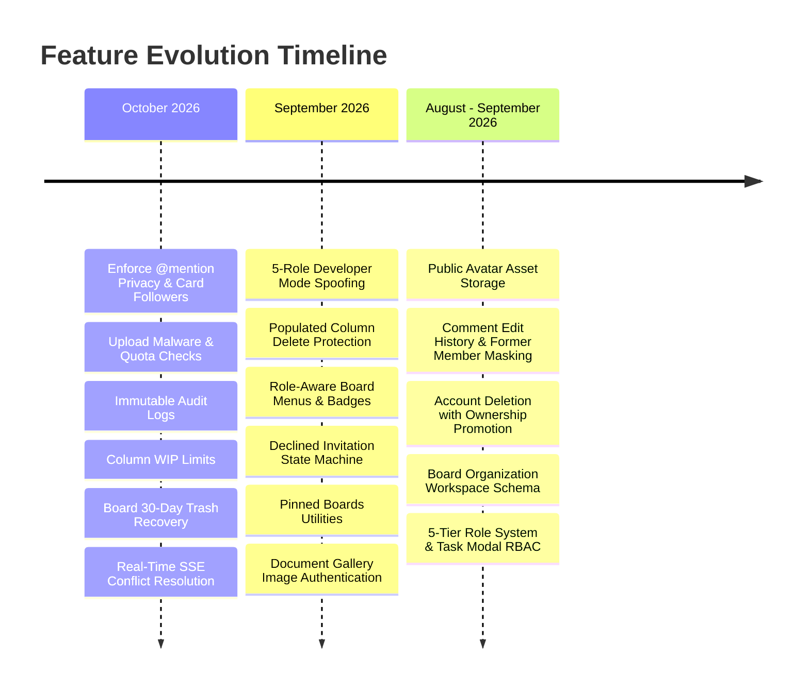

# Project Changelog & Release History

Status: Verified | Last scanned: 2026-10-13 | Audience: Everyone

---

## 1. Overview & Versioning Structure

This changelog summarizes notable features, bug fixes, security enhancements, and architectural refactors across the Sticky Mind Grid repository. 

> [!NOTE]
> **Git Tags:** No formal SemVer release tags are currently defined in version control (`git tag` returns empty). All milestone changes below are cited directly with their respective Git commit hashes and implementation files.

### Text Version of Feature Evolution
- **October 2026:** Enforcement of `@mention` privacy, card follower notification routing, board mute settings, in-memory malware scanning, storage quotas, immutable audit logs, column WIP limits, board 30-day trash recovery, and SSE conflict resolution with optimistic description locking.
- **September 2026:** Developer mode 5-role simulation matrix, populated column deletion guards, role-aware card actions, invitation decline & re-invite state transitions, pinned boards, and authenticated media URLs.
- **August – September 2026:** Public avatar storage access, edited comment histories with original content tracking, account deletion with automatic owner succession, multi-tenant workspace schemas, and the 5-tier role hierarchy (Owner, Admin, Editor, Commenter, Viewer).

---

## 2. Summary by Feature Domain

### Feature 1: Real-Time Synchronization & Collaborative Conflict Handling

| Commit | Date | Files Changed | Summary of Changes |
|---|---|---|---|
| [`3ef5408`](file:///c:/Users/ramos/sticky-mind-grid/backend/app/utils/event_broadcaster.py) | 2026-10-12 | [`event_broadcaster.py`](file:///c:/Users/ramos/sticky-mind-grid/backend/app/utils/event_broadcaster.py), [`board_routes.py`](file:///c:/Users/ramos/sticky-mind-grid/backend/app/routes/board_routes.py), [`useBoardRealtime.ts`](file:///c:/Users/ramos/sticky-mind-grid/src/hooks/useBoardRealtime.ts), [`test_realtime_conflicts.py`](file:///c:/Users/ramos/sticky-mind-grid/backend/tests/test_realtime_conflicts.py) | **SSE Session Disconnection & Sentinel:** Added `broadcaster.disconnect_user()` to enqueue `force_disconnect` followed by a `None` sentinel that safely unregisters thread queues when members are removed or leave. **Optimistic Conflict Detection:** Detects stale edits on task descriptions and responds with HTTP 409 Conflict containing `currentTask`; enables `forceOverwrite` resolution. **Reconnection & Guard Rails:** Added 3000ms retry backoff, window offline/online listeners, `onReconnect` state resynchronization, and read-only UI locks while disconnected. **Live Viewing Indicators:** Renders `"Moved live"` badges in open task modals and pulsed cards when cards are moved by remote collaborators. |
| [`45e2a85`](file:///c:/Users/ramos/sticky-mind-grid/backend/app/services/task_service.py) | 2026-10-12 | [`task_service.py`](file:///c:/Users/ramos/sticky-mind-grid/backend/app/services/task_service.py), [`KanbanBoard.tsx`](file:///c:/Users/ramos/sticky-mind-grid/src/components/kanban/KanbanBoard.tsx) | **Concurrent Reordering Intent:** Preserves `fromStatus` in payloads during concurrent column drops so the audit log captures all simultaneous moves under Last-Write-Wins. |

---

### Feature 2: Security, Malware Defense & Attachment Storage

| Commit | Date | Files Changed | Summary of Changes |
|---|---|---|---|
| [`45e2a85`](file:///c:/Users/ramos/sticky-mind-grid/backend/app/services/file_service.py) | 2026-10-12 | [`file_service.py`](file:///c:/Users/ramos/sticky-mind-grid/backend/app/services/file_service.py), [`file_routes.py`](file:///c:/Users/ramos/sticky-mind-grid/backend/app/routes/file_routes.py), [`config.py`](file:///c:/Users/ramos/sticky-mind-grid/backend/config.py) | **In-Memory Malware & Binary Scanner:** Blocks uploads matching EICAR signatures, Windows PE/MZ headers, Linux ELF binaries, Mach-O binaries, Unix shebang scripts, or embedded `<script>` payloads before saving to disk. **Storage Quotas:** Implemented cumulative storage limits: 100MB per board (`MAX_BOARD_STORAGE_BYTES`) and 500MB per owner (`MAX_OWNER_STORAGE_BYTES`). **Staging File Isolation:** Restricts unattached uploaded files so they are only readable by the original uploader prior to being attached to a task. |
| [`3ef5408`](file:///c:/Users/ramos/sticky-mind-grid/backend/app/services/file_service.py) | 2026-10-12 | [`file_service.py`](file:///c:/Users/ramos/sticky-mind-grid/backend/app/services/file_service.py), [`BoardModal.tsx`](file:///c:/Users/ramos/sticky-mind-grid/src/components/boards/BoardModal.tsx) | **Banner Image Validation:** Added strict 5MB banner upload limits, raster magic-byte validation (JPEG, PNG, WebP, GIF), and data URL base64 persistence. |
| [`34d197c`](file:///c:/Users/ramos/sticky-mind-grid/backend/app/services/file_service.py) | 2026-09-23 | [`file_service.py`](file:///c:/Users/ramos/sticky-mind-grid/backend/app/services/file_service.py) | **Public User Avatar Access:** Granted unauthenticated public read access to avatar profile assets matching `User.avatar_url` while retaining strict auth for card attachments. |
| [`9ecbe12`](file:///c:/Users/ramos/sticky-mind-grid/backend/app/routes/file_routes.py) | 2026-09-22 | [`file_routes.py`](file:///c:/Users/ramos/sticky-mind-grid/backend/app/routes/file_routes.py) | **Query Token Authentication:** Added `?token=` parameter support to `/api/files/<filename>` to permit authenticated downloads and image previews in browsers. |
| [`aaefb46`](file:///c:/Users/ramos/sticky-mind-grid/src/components/task/TaskAttachments.tsx) | 2026-09-29 | [`TaskAttachments.tsx`](file:///c:/Users/ramos/sticky-mind-grid/src/components/task/TaskAttachments.tsx), [`apiUtils.ts`](file:///c:/Users/ramos/sticky-mind-grid/src/services/apiUtils.ts) | **Authenticated Media URLs:** Wrapped card thumbnails and modal previews in `getMediaUrl` helpers to attach bearer tokens automatically. |

---

### Feature 3: Privacy, Tenancy Isolation & Audit Trail Integrity

| Commit | Date | Files Changed | Summary of Changes |
|---|---|---|---|
| [`45e2a85`](file:///c:/Users/ramos/sticky-mind-grid/backend/app/routes/activity_routes.py) | 2026-10-12 | [`activity_routes.py`](file:///c:/Users/ramos/sticky-mind-grid/backend/app/routes/activity_routes.py), [`activity_service.py`](file:///c:/Users/ramos/sticky-mind-grid/backend/app/services/activity_service.py), [`board_routes.py`](file:///c:/Users/ramos/sticky-mind-grid/backend/app/routes/board_routes.py), [`task_routes.py`](file:///c:/Users/ramos/sticky-mind-grid/backend/app/routes/task_routes.py) | **Immutable Audit Logs:** Hardened `/api/activities` against mutation—HTTP `PUT`, `PATCH`, and `DELETE` calls are blocked with HTTP 403 Forbidden. **Board Mute Setting:** Added `PATCH /api/boards/<id>/mute` (`is_muted` column) to suppress task move and comment notifications for muted members. **Card Followers:** Added card subscription toggle (`POST /api/tasks/<id>/follow`) notifying followers on moves and comments. **@Mention Privacy:** Restricted `@mention` auto-completion and notification triggers strictly to accepted members of the active board. |
| [`c58a0e3`](file:///c:/Users/ramos/sticky-mind-grid/backend/tests/test_privacy_and_tenancy.py) | 2026-09-21 | [`test_privacy_and_tenancy.py`](file:///c:/Users/ramos/sticky-mind-grid/backend/tests/test_privacy_and_tenancy.py) | **Tenancy Isolation Tests:** Added test coverage verifying that teammates are never leaked across boards, guest emails are redacted, and cross-board move activities mask source board titles as `"Another board"`. |
| [`1447a4c`](file:///c:/Users/ramos/sticky-mind-grid/backend/app/models/board.py) | 2026-09-20 | [`board.py`](file:///c:/Users/ramos/sticky-mind-grid/backend/app/models/board.py), [`migrations/`](file:///c:/Users/ramos/sticky-mind-grid/backend/migrations/) | **Workspace Scaling:** Added optional `workspace_id` column to `boards` table to support enterprise tenant grouping. |

---

### Feature 4: Board Management, Column WIP Limits & 30-Day Trash Recovery

| Commit | Date | Files Changed | Summary of Changes |
|---|---|---|---|
| [`545ece1`](file:///c:/Users/ramos/sticky-mind-grid/backend/app/services/board_service.py) | 2026-10-12 | [`board_service.py`](file:///c:/Users/ramos/sticky-mind-grid/backend/app/services/board_service.py), [`BoardModal.tsx`](file:///c:/Users/ramos/sticky-mind-grid/src/components/boards/BoardModal.tsx), [`KanbanColumn.tsx`](file:///c:/Users/ramos/sticky-mind-grid/src/components/kanban/KanbanColumn.tsx) | **Column WIP Limits:** Introduced Work-in-Progress limit validation in `BoardService`; added inputs in column configuration and warning badges when card counts exceed limits. |
| [`3ef5408`](file:///c:/Users/ramos/sticky-mind-grid/backend/app/models/board.py) | 2026-10-12 | [`board.py`](file:///c:/Users/ramos/sticky-mind-grid/backend/app/models/board.py), [`board_service.py`](file:///c:/Users/ramos/sticky-mind-grid/backend/app/services/board_service.py), [`BoardsOverview.tsx`](file:///c:/Users/ramos/sticky-mind-grid/src/pages/BoardsOverview.tsx) | **Board Soft Deletion & 30-Day Recovery:** Added `is_deleted` and `deleted_at` fields to boards; introduced "Recently Deleted" view with restore actions, type-to-confirm modal, and 30-day auto-purge. **Dashboard Context Rail:** Redesigned dashboard sidebar with upcoming deadlines and real-time workspace activity stream. |
| [`1d39bb9`](file:///c:/Users/ramos/sticky-mind-grid/backend/app/routes/board_routes.py) | 2026-09-24 | [`board_routes.py`](file:///c:/Users/ramos/sticky-mind-grid/backend/app/routes/board_routes.py) | **Admin Board Edits & Column Guards:** Restricted board updates to Admins and Owners; blocked deleting populated columns that still contain cards. |
| [`ee63a7e`](file:///c:/Users/ramos/sticky-mind-grid/src/components/boards/BoardCard.tsx) | 2026-09-22 | [`BoardCard.tsx`](file:///c:/Users/ramos/sticky-mind-grid/src/components/boards/BoardCard.tsx), [`BoardMembers.tsx`](file:///c:/Users/ramos/sticky-mind-grid/src/components/board/BoardMembers.tsx) | **Sole Owner Protection:** Prohibited the sole owner of a board from leaving without first transferring ownership to another member or deleting the board. |
| [`e9cc5dc`](file:///c:/Users/ramos/sticky-mind-grid/src/hooks/useBoards.ts) | 2026-09-06 | [`useBoards.ts`](file:///c:/Users/ramos/sticky-mind-grid/src/hooks/useBoards.ts) | **Pinned Boards:** Added local persistence utilities to pin preferred boards to the top of the dashboard. |

---

### Feature 5: Task Management, Granular Modal RBAC & Card Silhouette

| Commit | Date | Files Changed | Summary of Changes |
|---|---|---|---|
| [`addc53d`](file:///c:/Users/ramos/sticky-mind-grid/src/components/kanban/TaskCard.tsx) | 2026-10-02 | [`TaskCard.tsx`](file:///c:/Users/ramos/sticky-mind-grid/src/components/kanban/TaskCard.tsx) | **Card Styling & Priorities:** Aligned task titles flush with card edges and conditionally rendered priority iconography. |
| [`1a08abc`](file:///c:/Users/ramos/sticky-mind-grid/src/components/task/TaskDetailWorkspace.tsx) | 2026-09-18 | [`TaskDetailWorkspace.tsx`](file:///c:/Users/ramos/sticky-mind-grid/src/components/task/TaskDetailWorkspace.tsx), [`useBoardPermissions.ts`](file:///c:/Users/ramos/sticky-mind-grid/src/hooks/useBoardPermissions.ts) | **Task Modal Granular RBAC Matrix:** Enforced read-only presentation for Commenters and Viewers; locked progress slider to auto-calculate from checklist completion; restricted assignees to Editor role and above. |
| [`3af6cdb`](file:///c:/Users/ramos/sticky-mind-grid/src/components/kanban/TaskCard.tsx) | 2026-09-28 | [`TaskCard.tsx`](file:///c:/Users/ramos/sticky-mind-grid/src/components/kanban/TaskCard.tsx) | **Card Container Cleanup:** Handled empty tag containers cleanly and routed cover images through media authentication helpers. |
| [`d96d195`](file:///c:/Users/ramos/sticky-mind-grid/src/components/kanban/KanbanBoard.tsx) | 2026-10-02 | [`KanbanBoard.tsx`](file:///c:/Users/ramos/sticky-mind-grid/src/components/kanban/KanbanBoard.tsx) | **Standardized Column Widths:** Aligned stage creation buttons and column containers to identical layout widths across all board display modes. |

---

### Feature 6: Comments, Discussion History & Former Member Anonymization

| Commit | Date | Files Changed | Summary of Changes |
|---|---|---|---|
| [`45e2a85`](file:///c:/Users/ramos/sticky-mind-grid/backend/app/models/comment.py) | 2026-10-12 | [`comment.py`](file:///c:/Users/ramos/sticky-mind-grid/backend/app/models/comment.py), [`comment_service.py`](file:///c:/Users/ramos/sticky-mind-grid/backend/app/services/comment_service.py) | **Comment Audit Logging:** Editing or deleting a comment records the original text (`before_value`) and updated text (`after_value`) in the immutable board activity log. |
| [`3b7bd21`](file:///c:/Users/ramos/sticky-mind-grid/src/components/kanban/TaskComments.tsx) | 2026-09-21 | [`TaskComments.tsx`](file:///c:/Users/ramos/sticky-mind-grid/src/components/kanban/TaskComments.tsx), [`comment.py`](file:///c:/Users/ramos/sticky-mind-grid/backend/app/models/comment.py) | **Former Member Masking:** Detached or deleted authors dynamically display as `"Former member"` with blank emails to preserve discussion continuity without exposing orphaned accounts. |
| [`24e54ef`](file:///c:/Users/ramos/sticky-mind-grid/backend/app/models/comment.py) | 2026-09-20 | [`comment.py`](file:///c:/Users/ramos/sticky-mind-grid/backend/app/models/comment.py), [`migrations/`](file:///c:/Users/ramos/sticky-mind-grid/backend/migrations/) | **Comment Version Tracking:** Added `is_edited` flag and `original_content` column to track inline comment revisions. |

---

### Feature 7: Memberships, Invitations & 5-Tier Role System

| Commit | Date | Files Changed | Summary of Changes |
|---|---|---|---|
| [`8eccb32`](file:///c:/Users/ramos/sticky-mind-grid/backend/app/models/board_invitation.py) | 2026-09-16 | [`board_invitation.py`](file:///c:/Users/ramos/sticky-mind-grid/backend/app/models/board_invitation.py), [`board_service.py`](file:///c:/Users/ramos/sticky-mind-grid/backend/app/services/board_service.py) | **Invitation State Machine & Resend:** Added support for `declined` states; allowed Admins and Owners to re-invite declined emails, transitioning them back to `pending` with a refreshed 7-day expiration window. |
| [`edfa7aa`](file:///c:/Users/ramos/sticky-mind-grid/src/components/board/BoardMembers.tsx) | 2026-09-20 | [`BoardMembers.tsx`](file:///c:/Users/ramos/sticky-mind-grid/src/components/board/BoardMembers.tsx) | **5-Tier Role Badges:** Rendered distinct visual badges for Owner, Admin, Editor, Commenter, and Viewer across team lists and invitation banners. |
| [`7163291`](file:///c:/Users/ramos/sticky-mind-grid/backend/app/models/board.py) | 2026-09-13 | [`board.py`](file:///c:/Users/ramos/sticky-mind-grid/backend/app/models/board.py) | **Board Serialization Serialization:** Enriched board API payloads with active `ownerCount` and computed `effectiveRole`. |
| [`4c2f69d`](file:///c:/Users/ramos/sticky-mind-grid/backend/app/services/board_service.py) | 2026-09-10 | [`board_service.py`](file:///c:/Users/ramos/sticky-mind-grid/backend/app/services/board_service.py), [`board_routes.py`](file:///c:/Users/ramos/sticky-mind-grid/backend/app/routes/board_routes.py) | **Invitation Generation & Expiry:** Implemented email-based board invitations, 7-day TTL expiration, and rate-limiting (20 invites per user per day). |

---

### Feature 8: Account Lifecycle & Data Portability

| Commit | Date | Files Changed | Summary of Changes |
|---|---|---|---|
| [`aa07742`](file:///c:/Users/ramos/sticky-mind-grid/src/components/auth/ProfileModal.tsx) | 2026-10-13 | [`ProfileModal.tsx`](file:///c:/Users/ramos/sticky-mind-grid/src/components/auth/ProfileModal.tsx) | **Profile Avatar Cleanup:** Fixed redundant profile picture rendering in settings modals. |
| [`d2362c4`](file:///c:/Users/ramos/sticky-mind-grid/backend/app/services/user_service.py) | 2026-09-20 | [`user_service.py`](file:///c:/Users/ramos/sticky-mind-grid/backend/app/services/user_service.py) | **Account Erasure with Succession:** Deleting an account auto-promotes the oldest Admin (or oldest Editor) to Owner on owned boards; cleans up sole-owner boards; detaches foreign keys to `"Former member"`. |
| [`4d7e7dc`](file:///c:/Users/ramos/sticky-mind-grid/backend/app/routes/user_routes.py) | 2026-09-20 | [`user_routes.py`](file:///c:/Users/ramos/sticky-mind-grid/backend/app/routes/user_routes.py) | **Personal Data Export:** Implemented `GET /api/users/me/export` providing a downloadable JSON export of profile, preferences, boards, tasks, and notes for GDPR data portability. |
| [`207f879`](file:///c:/Users/ramos/sticky-mind-grid/src/components/settings/tabs/PrivacyTab.tsx) | 2026-09-20 | [`PrivacyTab.tsx`](file:///c:/Users/ramos/sticky-mind-grid/src/components/settings/tabs/PrivacyTab.tsx) | **Account Deletion UI:** Added multi-step confirmation dialog warning users of board succession and content preservation rules. |

---

### Feature 9: Developer Suite & Operational Diagnostics

| Commit | Date | Files Changed | Summary of Changes |
|---|---|---|---|
| [`4a48b25`](file:///c:/Users/ramos/sticky-mind-grid/src/components/dev/DevSuiteModal.tsx) | 2026-09-29 | [`DevSuiteModal.tsx`](file:///c:/Users/ramos/sticky-mind-grid/src/components/dev/DevSuiteModal.tsx), [`DevModeContext.tsx`](file:///c:/Users/ramos/sticky-mind-grid/src/contexts/DevModeContext.tsx) | **5-Role Spoofing Matrix:** Added live role-spoofing toggles in the developer mode suite allowing instant simulation of Owner, Admin, Editor, Commenter, and Viewer permissions client-side. |
| [`3ef5408`](file:///c:/Users/ramos/sticky-mind-grid/src/data/devSeedDataset.ts) | 2026-10-12 | [`devSeedDataset.ts`](file:///c:/Users/ramos/sticky-mind-grid/src/data/devSeedDataset.ts) | **Showcase Sandbox Datasets:** Added comprehensive in-memory seed presets for developer testing without backend database mutations. |
| [`45e2a85`](file:///c:/Users/ramos/sticky-mind-grid/scripts/fetch_render_logs.py) | 2026-10-12 | [`fetch_render_logs.py`](file:///c:/Users/ramos/sticky-mind-grid/scripts/fetch_render_logs.py) | **Production Diagnostics:** Added CLI script to pull live Render API logs, deployment statuses, and unhandled tracebacks using local `.env` API keys. |

---

## 3. Notable Bug Fixes & Schema Hotfixes

- **Deployment Schema Sync ([`709b1d6`](file:///c:/Users/ramos/sticky-mind-grid/backend/app/__init__.py), [`1a78758`](file:///c:/Users/ramos/sticky-mind-grid/backend/app/__init__.py)):** Updated `_auto_sync_schema()` in `app/__init__.py` to safely inspect and add missing columns (`is_muted`, `target_type`, `before_value`, `after_value`, `mentions`, `is_edited`, `original_content`) during startup on Render.
- **Empty Emoji Fallback Handling ([`287b7bb`](file:///c:/Users/ramos/sticky-mind-grid/src/components/kanban/TaskCard.tsx)):** Resolved null pointer exceptions when tasks or boards contain blank emoji attributes in filters.
- **API Error Message Propagation ([`448323f`](file:///c:/Users/ramos/sticky-mind-grid/src/services/boardApi.ts)):** Ensured server-side JSON error messages are surfaced to toast notifications rather than generic network failure messages.
- **Notification Popover Badge Alignment ([`d46db8a`](file:///c:/Users/ramos/sticky-mind-grid/src/components/notifications/NotificationBell.tsx)):** Refined styling and positioning of unread count badges on the application navigation bar.
- **Sidebar Height Alignment ([`356ba6e`](file:///c:/Users/ramos/sticky-mind-grid/src/components/layout/BottomNavBar.tsx)):** Standardized layout padding and collapse transitions across desktop and mobile screens.
