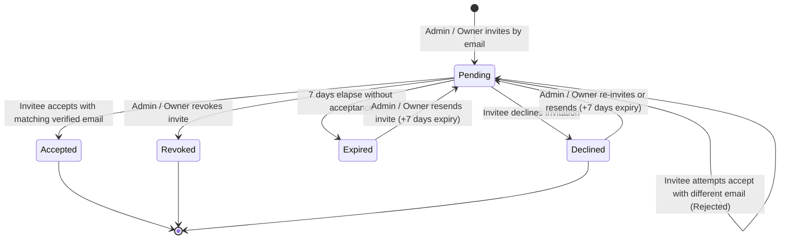

# Architecture

**Status:** Verified | **Last scanned:** 2026-10-13 | **Audience:** Developers, Architects

Sticky Mind Grid is a full-stack task management application modeled after Trello. It consists of a React SPA frontend communicating with a Flask REST API backend, backed by MySQL for persistence. Real-time multi-user synchronization is achieved via Server-Sent Events (SSE).

```
┌─────────────────────────────────────────────────────────────────┐
│                        React SPA (Vite)                         │
│  ┌──────────┐ ┌──────────┐ ┌──────────┐ ┌────────────────────┐  │
│  │  Pages   │ │ Components│ │  Hooks   │ │    Services (API)  │  │
│  └──────────┘ └──────────┘ └──────────┘ └────────────────────┘  │
│                          │ SSE / fetch                          │
└──────────────────────────┼──────────────────────────────────────┘
                           │
┌──────────────────────────┼──────────────────────────────────────┐
│                     Flask API                                    │
│  ┌──────────┐ ┌──────────┐ ┌──────────┐ ┌────────────────────┐  │
│  │  Routes  │ │ Services │ │  Models  │ │  EventBroadcaster  │  │
│  │(Blueprints)│ │(Business│ │(SQLAlchemy)│ │  (In-Memory SSE)  │  │
│  └──────────┘ └──────────┘ └──────────┘ └────────────────────┘  │
│                          │                                       │
└──────────────────────────┼──────────────────────────────────────┘
                           │
┌──────────────────────────┼──────────────────────────────────────┐
│                     MySQL Database                               │
│  users │ user_preferences │ boards │ board_members               │
│  board_invitations │ tasks │ activities │ comments               │
│  notifications │ notes │ conversations                           │
│  conversation_participants │ messages                            │
└─────────────────────────────────────────────────────────────────┘
```

---

## Frontend Architecture

### Entry & Routing

- **Entry:** `src/main.tsx` → `createRoot` → `<App />`
- **Router:** `src/App.tsx` defines routes via React Router v6

| Route | Component | Auth |
|-------|-----------|------|
| `/login` | `Login.tsx` | No |
| `/register` | `Register.tsx` | No |
| `/` | `BoardsOverview.tsx` | Yes (ProtectedRoute + AppLayout) |
| `/dashboard` | `DashboardPage.tsx` | Yes (ProtectedRoute + AppLayout) |
| `/tasks` | `TasksPage.tsx` | Yes (ProtectedRoute + AppLayout) |
| `/calendar` | `CalendarPage.tsx` | Yes (ProtectedRoute + AppLayout) |
| `/teams` | `TeamsPage.tsx` | Yes (ProtectedRoute + AppLayout) |
| `/boards/:boardId` | `KanbanBoard.tsx` | Yes (ProtectedRoute + AppLayout) |
| `/boards/:boardId/tasks/:taskId` | `TaskDetailPage.tsx` | Yes (ProtectedRoute + AppLayout) |
| `/messages` | `MessagesPage.tsx` | Yes (ProtectedRoute + AppLayout) |
| `/messages/:conversationId` | `MessagesPage.tsx` | Yes (ProtectedRoute + AppLayout) |
| `*` | `NotFound.tsx` | No |

- `ProtectedRoute` (`src/components/auth/ProtectedRoute.tsx`) wraps authenticated routes. Redirects to `/login` if no user in AuthContext.

### Provider Hierarchy

```
QueryClientProvider
  └─ ThemeProvider
      └─ TooltipProvider
          └─ BrowserRouter
              └─ AuthProvider
                  └─ SettingsProvider
                      └─ DevModeProvider
                          └─ ActivityProvider
                              └─ AppLayout (with LayoutProvider)
                                  └─ Routes
```

### State Management

There is no single global store. State is managed through:

1. **AuthContext** (`src/contexts/AuthContext.tsx`) — `user`, `token`, `loading`. Persists to `localStorage`.
2. **ActivityContext** (`src/hooks/useActivity.tsx`) — `activities[]`, `currentBoardId`. Polls every 5s.
3. **React Query** (`@tanstack/react-query`) — Used for board members, notes, comments, notifications, trash, and invitations. NOT used for tasks or boards themselves.
4. **Custom hooks** — `useTasks` and `useBoards` use raw `useState` + polling intervals.
5. **Local component state** — Modals, search, filters, form inputs.

### Key Hooks

| Hook | File | Purpose |
|------|------|---------|
| `useAuth` | `src/contexts/AuthContext.tsx` | Access auth state (user, token, login, logout) |
| `useActivity` | `src/hooks/useActivity.tsx` | Activity feed context (fetch, add, clear) |
| `useBoards` | `src/hooks/useBoards.ts` | Board CRUD + search/sort with optimistic updates |
| `useTasks` | `src/hooks/useTasks.ts` | Task CRUD + reorder/move + 4s polling + optimistic updates |
| `useBoardPermissions` | `src/hooks/useBoardPermissions.ts` | Derives `BoardPermissions` from board + members + user |
| `useBoardRealtime` | `src/hooks/useBoardRealtime.ts` | SSE `EventSource` connection for live board sync |
| `useIsMobile` | `src/hooks/use-mobile.tsx` | Media query for `<768px` breakpoint |

### API Communication

All API calls go through `authenticatedFetch()` (`src/services/apiUtils.ts`):
- Prepends `API_BASE` (from `VITE_API_BASE_URL` env var)
- Adds `Authorization: Bearer <token>` header
- Sets `Content-Type: application/json` (skipped for FormData)
- On 401: clears `localStorage`, redirects to `/login`

Service files (one per domain) wrap `authenticatedFetch`:
- `src/services/authApi.ts` — login, register, profile, user search
- `src/services/boardApi.ts` — board CRUD, members, invitations
- `src/services/api.ts` — task CRUD, reorder, trash
- `src/services/commentApi.ts` — comment CRUD
- `src/services/fileApi.ts` — file upload/download
- `src/services/noteApi.ts` — note CRUD
- `src/services/notificationApi.ts` — notification list, mark read

### UI Components

- **shadcn/ui** primitives in `src/components/ui/` — Radix-based accessible components (Dialog, DropdownMenu, Select, Tabs, etc.)
- **Domain components** organized by feature:
  - `src/components/kanban/` — KanbanBoard, KanbanColumn, TaskCard, TaskModal, TaskListView, CalendarView, DocumentsView, BoardOverview, TrashModal, BoardHeader, LatestChangesPanel, ActivityItem, TaskComments
  - `src/components/boards/` — BoardCard, BoardModal, BoardHeroImage, BoardsHeroBanner
  - `src/components/board/` — BoardMembers, InviteMemberDialog
  - `src/components/auth/` — ProtectedRoute, ProfileModal
  - `src/components/documents/` — NoteModal
  - `src/components/notifications/` — NotificationBell
  - `src/components/common/` — EmojiSelector

### Board Views

`KanbanBoard` (`src/components/kanban/KanbanBoard.tsx`) is the main board orchestrator. It renders view tabs and switches between:

| View | Component | Description |
|------|-----------|-------------|
| Overview | `BoardOverview` | Stats cards, progress bar, board metadata |
| Board | `KanbanBoard` (inline) | Drag-and-drop kanban columns |
| List | `TaskListView` | Sortable table with task columns |
| Calendar | `CalendarView` | Month/week/day views with task chips |
| Documents | `DocumentsView` | Project notes + aggregated task attachments |
| Members | `BoardMembers` + `InviteMemberDialog` | Member management |

### Drag & Drop

Uses `@dnd-kit/core` + `@dnd-kit/sortable`:
- `KanbanBoard` wraps content in `<DndContext>` with `PointerSensor` (5px activation distance)
- `KanbanColumn` is a `useDroppable` container with `SortableContext`
- `TaskCard` uses `useSortable` for visual reordering
- `DragOverlay` renders a ghost copy during drag
- On drop: determines target column, computes new positions (`(index+1)*1000`), auto-adjusts progress (0% first col, 30% in_progress, 100% last col)

---

## Backend Architecture

### App Factory

`backend/app/__init__.py` — `create_app(config_class=Config)`:
1. Creates Flask app with config
2. Initializes extensions: SQLAlchemy, Migrate, JWT, Bcrypt, CORS, Limiter (`Flask-Limiter`)
3. Registers 11 Blueprints: `board_routes`, `task_routes`, `activity_routes`, `auth_routes`, `comment_routes`, `notification_routes`, `file_routes`, `note_routes`, `system_routes`, `user_routes`, `message_routes`
4. Sets up global error handlers (Exception → 500, 413 → file too large, 429 → rate limit exceeded)

### Blueprint / Route Structure

All routes are prefixed with `/api/`.

#### Auth Routes (`/api/auth`)
| Method | Path | Auth | Description |
|--------|------|------|-------------|
| POST | `/register` | No | Create user with verification token, return `{user, token}` (rate limited) |
| POST | `/login` | No | Validate credentials, return `{user, token}` (rate limited) |
| GET | `/me` | JWT | Get current user profile |
| PATCH | `/me` | JWT | Update profile (name/password) |
| POST | `/verify-email` | No | Verify email address with token, attach pending invitations |
| POST | `/resend-verification` | JWT | Resend email verification token (rate limited) |
| GET | `/users/search?q=` | JWT | Search users by email/name |

#### Board Routes (`/api/boards`)
| Method | Path | Auth | RBAC | Description |
|--------|------|------|------|-------------|
| GET | `/` | JWT | — | List user's boards |
| POST | `/` | JWT | — | Create board + owner membership |
| GET | `/<id>` | JWT | viewer | Get board details |
| PATCH | `/<id>` | JWT | admin | Update board (metadata, columns, WIP limits) |
| DELETE | `/<id>` | JWT | owner | Soft-delete board (`?soft=true`, 30d grace) or permanent delete (requires matching `confirm_name`) |
| GET | `/trash` | JWT | owner | List user's soft-deleted boards |
| POST | `/<id>/restore` | JWT | owner | Restore soft-deleted board from trash |
| POST | `/<id>/transfer-ownership` | JWT | owner | Transfer board ownership (demotes former owner to admin) |
| GET | `/<id>/export` | JWT | admin | Export board JSON (board, tasks, members) |
| GET | `/invitations` | JWT | — | List pending invitations for current user |
| POST | `/<id>/invitations/accept` | JWT | — | Accept board invitation |
| POST | `/<id>/invitations/decline` | JWT | — | Decline board invitation |
| POST | `/<id>/invitations/report` | JWT | — | Decline and report inviter spam |
| GET | `/<id>/events` | Token | viewer | SSE real-time event stream |
| GET | `/<id>/members` | JWT | viewer | List members (emails redacted for commenter/viewer) |
| POST | `/<id>/members` | JWT | admin | Invite member (rate limited: 20/day) |
| DELETE | `/<id>/members/<uid>` | JWT | self/admin | Remove member (or leave board; sole owner blocked) |
| PATCH | `/<id>/members/<uid>` | JWT | admin | Update member role |

#### Task Routes (`/api`)
| Method | Path | Auth | RBAC | Description |
|--------|------|------|------|-------------|
| GET | `/tasks?boardId=` | JWT | viewer | List active tasks for board |
| POST | `/tasks` | JWT | editor | Create task (assignee requires editor+, checklist derives progress) |
| GET | `/tasks/<id>` | JWT | viewer | Get task details |
| PATCH | `/tasks/<id>` | JWT | editor | Update task (dual-board check if moved, optimistic concurrency with `lastKnownUpdatedAt`/`baseDescription`) |
| DELETE | `/tasks/<id>` | JWT | editor | Soft-delete task (move to trash) |
| PATCH | `/tasks/<id>/restore` | JWT | editor | Restore task from trash |
| DELETE | `/tasks/<id>/permanent` | JWT | admin | Permanently delete task and disk attachments |
| PATCH | `/tasks/reorder` | JWT | editor | Batch reorder tasks within/across columns |
| POST | `/tasks/<id>/follow` | JWT | viewer | Follow/unfollow task for notifications |
| GET | `/boards/<id>/trash` | JWT | editor | List soft-deleted tasks (auto-purges >30 days) |
| DELETE | `/boards/<id>/trash` | JWT | admin | Empty board trash (cleans disk files) |

#### Comment Routes (`/api`)
| Method | Path | Auth | RBAC | Description |
|--------|------|------|------|-------------|
| GET | `/tasks/<id>/comments` | JWT | viewer | List comments for task |
| POST | `/tasks/<id>/comments` | JWT | commenter | Add comment (supports @mentions of board members) |
| PATCH | `/comments/<id>` | JWT | author | Edit own comment (stores original snapshot) |
| DELETE | `/comments/<id>` | JWT | author/admin | Delete comment (requires active board membership) |

#### Activity Routes (`/api/activities`)
| Method | Path | Auth | RBAC | Description |
|--------|------|------|------|-------------|
| GET | `/` | JWT | admin/viewer | List activities (board-wide requires admin; card-specific requires viewer) |
| POST | `/` | JWT | viewer | Create activity record |
| PUT, PATCH, DELETE | `/` | JWT | — | Blocked for all (HTTP 403: Activity entries are immutable) |

#### Notification Routes (`/api/notifications`)
| Method | Path | Auth | Description |
|--------|------|------|-------------|
| GET | `/` | JWT | List user notifications + unreadCount |
| PATCH | `/<id>/read` | JWT | Mark single notification read |
| PATCH | `/read-all` | JWT | Mark all user notifications read |

#### File Routes (`/api/files`)
| Method | Path | Auth | Description |
|--------|------|------|-------------|
| POST | `/upload` | JWT | Upload file (25 MB limit, magic-byte verified, malware scanned, board/owner quota checked) |
| POST | `/avatar` | JWT | Upload profile avatar picture |
| GET | `/<filename>` | JWT* | Serve file inline (requires JWT and board viewer+ or chat participant; avatars public) |
| GET | `/<filename>/download` | JWT* | Serve file as attachment download (same access control as inline) |

#### Note Routes (`/api`)
| Method | Path | Auth | RBAC | Description |
|--------|------|------|------|-------------|
| GET | `/boards/<id>/notes` | JWT | viewer | List project notes for board |
| POST | `/boards/<id>/notes` | JWT | editor | Create board note |
| PATCH | `/notes/<id>` | JWT | editor | Update board note |
| DELETE | `/notes/<id>` | JWT | author/admin | Delete board note (requires active board membership) |

#### System Routes (`/api`)
| Method | Path | Auth | Description |
|--------|------|------|-------------|
| GET | `/health` | No | System health check (`{"status": "healthy"}`) |

#### User Routes (`/api/users`)
| Method | Path | Auth | Description |
|--------|------|------|-------------|
| GET | `/me/preferences` | JWT | Get user preferences |
| PATCH | `/me/preferences` | JWT | Update user preferences |
| GET | `/me/export` | JWT | Export personal user data JSON |
| DELETE | `/me` | JWT | Delete user account (auto-promotes oldest admin/member on owned boards) |

#### Message Routes (`/api/messages`)
| Method | Path | Auth | Description |
|--------|------|------|-------------|
| GET | `/conversations` | JWT | List direct message conversations |
| POST | `/conversations` | JWT | Create or get direct message conversation |
| GET | `/conversations/<id>` | JWT | Get conversation metadata |
| GET | `/conversations/<id>/messages` | JWT | List messages in conversation |
| POST | `/conversations/<id>/messages` | JWT | Send direct message |
| DELETE | `/<message_id>` | JWT | Soft-unsend message (`is_deleted=True`) |

### Service Layer

Services contain all business logic. Routes parse requests, call services, and format responses.

| Service | File | Responsibilities |
|---------|------|-----------------|
| `BoardService` | `backend/app/services/board_service.py` | Board CRUD, 30-day trash/restore, members, invitations, role changes, ownership transfer, quota checks |
| `TaskService` | `backend/app/services/task_service.py` | Task CRUD, reorder, auto-progress derivation, cross-board move, trash/restore, 30-day auto-purge, concurrency conflict detection |
| `ActivityService` | `backend/app/services/activity_service.py` | Activity creation, board/card scoped queries with retention filtering, immutable audit trail |
| `CommentService` | `backend/app/services/comment_service.py` | Comment CRUD, @mention extraction and notifications, active member authorization checks |
| `FileService` | `backend/app/services/file_service.py` | Supabase Cloud Storage integration (public avatar bucket, private signed-url attachment bucket), magic-byte verification, malware signature scanner, board/owner storage quotas, authenticated file access, orphan cleanup |
| `NoteService` | `backend/app/services/note_service.py` | Board note CRUD with active membership validation and author/admin deletion checks |
| `NotificationService` | `backend/app/services/notification_service.py` | In-app notification creation, user preference and board mute suppression |
| `UserService` | `backend/app/services/user_service.py` | User profile, preferences, account deletion with ownership succession, personal data export |
| `MessageService` | `backend/app/services/message_service.py` | Direct message conversations, participants, messaging, soft-unsend |
| `EmailService` | `backend/app/services/email_service.py` | Outbound email provider interface (`ConsoleEmailProvider`, `SMTPEmailProvider`) for verification and invitations |
| `SchedulerService` | `backend/app/services/scheduler_service.py` | Background maintenance scheduler & decoupled webhook executor (`POST /api/internal/jobs/purge`) for 30-day soft-deleted board & task purges and cloud attachment cleanup |

---

## Database Architecture

### Tables

```
users
├── id (String(36), PK)
├── email (String(255), UNIQUE, NOT NULL)
├── password_hash (String(255), NOT NULL)
├── full_name (String(255), nullable)
├── avatar_url (Text, nullable)
├── is_active (Boolean, default True)
├── email_verified (Boolean, default False)
├── verification_token (String(100), nullable, index)
├── verification_token_expires_at (DateTime, nullable)
└── created_at (DateTime)

user_preferences
├── id (String(36), PK)
├── user_id (String(36), FK→users.id, CASCADE, UNIQUE, NOT NULL)
├── theme (String(20), default 'system') — light|dark|system
├── notify_mentions (Boolean, default True)
├── notify_assignments (Boolean, default True)
├── notify_invites (Boolean, default True)
├── notify_comments (Boolean, default True)
├── notify_card_moves (Boolean, default True)
├── created_at (DateTime)
└── updated_at (DateTime)

boards
├── id (String(36), PK)
├── name (String(255), NOT NULL)
├── emoji (String(50), nullable)
├── description (Text, nullable)
├── color (String(50), NOT NULL, default HSL)
├── hero_image_url (Text/LONGTEXT, nullable)
├── columns (JSON, default [])
├── owner_id (String(36), FK→users.id, nullable)
├── is_deleted (Boolean, NOT NULL, default False)
├── deleted_at (DateTime, nullable)
├── created_at (DateTime)
└── updated_at (DateTime)

board_members
├── id (String(36), PK)
├── board_id (String(36), FK→boards.id, CASCADE, NOT NULL)
├── user_id (String(36), FK→users.id, CASCADE, NOT NULL)
├── role (String(20), NOT NULL, default 'editor') — owner|admin|editor|member|commenter|viewer
├── status (String(20), NOT NULL, default 'accepted') — pending|accepted|declined|expired
├── is_muted (Boolean, default False)
├── created_at (DateTime)
└── UNIQUE(board_id, user_id)

board_invitations
├── id (String(36), PK)
├── board_id (String(36), FK→boards.id, CASCADE, NOT NULL, index)
├── email (String(255), NOT NULL, index)
├── role (String(20), default 'editor')
├── status (String(20), default 'pending') — pending|accepted|expired|revoked|declined
├── inviter_id (String(36), FK→users.id, CASCADE, NOT NULL)
├── created_at (DateTime)
├── expires_at (DateTime, default utcnow + 7 days)
├── accepted_at (DateTime, nullable)
└── revoked_at (DateTime, nullable)

tasks
├── id (String(36), PK)
├── board_id (String(36), FK→boards.id, CASCADE, NOT NULL) — migration e1a2b3c4d5e6
├── title (String(255), NOT NULL)
├── emoji (String(50), nullable)
├── description (Text/LONGTEXT, nullable)
├── status (String(50), default 'todo')
├── priority (String(50), default 'medium')
├── progress (Integer, default 0)
├── due_date (DateTime, nullable)
├── assigned_to (String(36), FK→users.id, nullable)
├── created_by (String(36), FK→users.id, nullable)
├── position (Float, NOT NULL, default 0.0)
├── checklist (JSON, default [])
├── tags (JSON, default [])
├── attachments (JSON, default [])
├── followers (JSON, default [])
├── is_deleted (Boolean, NOT NULL, default False)
├── deleted_at (DateTime, nullable)
├── created_at (DateTime)
└── updated_at (DateTime)

activities
├── id (String(36), PK)
├── board_id (String(36), FK→boards.id, CASCADE, nullable)
├── type (String(50), NOT NULL) — create|move|update|delete
├── target_type (String(50), default 'task')
├── target_id (String(36), nullable)
├── task_title (String(255), NOT NULL)
├── before_value (Text, nullable)
├── after_value (Text, nullable)
├── message (Text, NOT NULL)
├── user_id (String(36), FK→users.id, nullable)
└── timestamp (DateTime)

comments
├── id (String(36), PK)
├── task_id (String(36), FK→tasks.id, CASCADE, NOT NULL)
├── user_id (String(36), FK→users.id, SET NULL, nullable)
├── content (Text, NOT NULL)
├── mentions (JSON, default [])
├── is_edited (Boolean, default False)
├── original_content (Text, nullable)
├── created_at (DateTime)
└── updated_at (DateTime)

notifications
├── id (String(36), PK)
├── user_id (String(36), FK→users.id, CASCADE, NOT NULL)
├── type (String(50), NOT NULL) — mention|assignment|invite|board_invite|invite_accepted|invite_declined|member_left|member_removed|system
├── title (String(255), NOT NULL)
├── message (Text, NOT NULL)
├── link (String(255), nullable)
├── is_read (Boolean, NOT NULL, default False)
└── created_at (DateTime)

notes
├── id (String(36), PK)
├── board_id (String(36), FK→boards.id, CASCADE, NOT NULL)
├── user_id (String(36), FK→users.id, CASCADE, NOT NULL)
├── title (String(255), NOT NULL)
├── content (Text, nullable, default '')
├── color (String(50), NOT NULL, default '#fef3c7')
├── created_at (DateTime)
└── updated_at (DateTime)

conversations
├── id (String(36), PK)
├── created_by (String(36), FK→users.id, SET NULL, nullable)
├── created_at (DateTime)
└── updated_at (DateTime)

conversation_participants
├── id (String(36), PK)
├── conversation_id (String(36), FK→conversations.id, CASCADE, NOT NULL)
├── user_id (String(36), FK→users.id, CASCADE, NOT NULL)
├── last_read_at (DateTime, nullable)
├── created_at (DateTime)
└── UNIQUE(conversation_id, user_id)

messages
├── id (String(36), PK)
├── conversation_id (String(36), FK→conversations.id, CASCADE, NOT NULL)
├── sender_id (String(36), FK→users.id, CASCADE, NOT NULL)
├── reply_to_id (String(36), FK→messages.id, SET NULL, nullable)
├── content (Text, NOT NULL)
├── attachments (JSON, default [])
├── is_deleted (Boolean, default False)
├── created_at (DateTime)
└── updated_at (DateTime)
```

### Key Relationships

- Board → User (owner): `boards.owner_id` → `users.id`
- Board → Tasks: One-to-many, cascade delete (`Task.board_id` has `ondelete='CASCADE'`)
- Board → BoardMembers: One-to-many, cascade delete
- Board → BoardInvitations: One-to-many, cascade delete
- Board → Activities: One-to-many (via `board_id`), cascade delete
- Board → Notes: One-to-many, cascade delete
- Task → Board: Many-to-one
- Task → User (creator): via `created_by`
- Task → User (assignee): via `assigned_to`
- Task → Comments: One-to-many, cascade delete
- BoardMember → Board: Many-to-one, cascade delete
- BoardMember → User: Many-to-one, cascade delete
- Comment → Task: Many-to-one, cascade delete
- Comment → User: Many-to-one, SET NULL on user deletion
- Notification → User: Many-to-one, cascade delete
- Note → Board: Many-to-one, cascade delete
- Note → User: Many-to-one, cascade delete
- Conversation → Participants: One-to-many, cascade delete
- Conversation → Messages: One-to-many, cascade delete
- User → Preferences: One-to-one, cascade delete

### Soft Delete & Lifecycle Retention Patterns

The system implements distinct soft-delete and status retention mechanisms across entities:

1. **Tasks (Cards):**
   - `is_deleted = True` + `deleted_at = datetime.utcnow()` on soft-delete.
   - Regular queries filter `is_deleted == False`; trash queries filter `is_deleted == True`.
   - Restoring a card resets `is_deleted = False, deleted_at = None`.
   - **30-Day Auto-Purge:** Tasks in trash older than 30 days are automatically hard-deleted (and unreferenced disk attachments purged) during trash reads (`GET /api/boards/<id>/trash`).
   - Admins/owners can permanently delete individual cards or empty trash immediately.

2. **Boards:**
   - Supports 30-day soft delete (`DELETE /api/boards/<id>?soft=true`) setting `is_deleted = True, deleted_at = utcnow()`.
   - Trashed boards are listed at `GET /api/boards/trash` and can be restored via `POST /api/boards/<id>/restore` within 30 days.
   - Trashed boards older than 30 days are lazily purged during board reads (`BoardService.get_user_boards`, `get_trashed_boards`) and via the daily `SchedulerService` maintenance job.
   - Permanent board deletion requires confirming the exact board name (`confirm_name: "<name>"`), preventing accidental automated destruction.

3. **Direct Messages:**
   - Unsend uses soft delete (`is_deleted = True`). Trashed messages display as `"[Message unsent]"` while preserving message timeline ordering.

4. **Invitations & Memberships:**
   - Declining, expiring, or revoking an invitation updates status in-place (`'declined'`, `'expired'`, `'revoked'`) with timestamps (`revoked_at`), retaining records for re-invite extension and spam protection telemetry.

---

## Authentication

- **Flask-JWT-Extended** with `create_access_token(identity=user.id)`
- Identity is the user's UUID string
- Token expiry: 24 hours (`JWT_ACCESS_TOKEN_EXPIRES = timedelta(hours=24)`)
- Client sends `Authorization: Bearer <token>` header
- `@jwt_required()` on all protected routes
- SSE endpoint manually extracts token from query param (`?token=`) since EventSource can't set custom headers
- Passwords hashed with Flask-Bcrypt
- Login/register return `{user: {...}, token: "..."}`

---

## Authorization / RBAC

### Role Hierarchy

```
owner = 5
admin = 4
editor = 3 (member = 3 legacy alias)
commenter = 2
viewer = 1
none = 0
```

### Role Resolution & Capabilities

`get_effective_role(board_id, user_id)` in `backend/app/utils/decorators.py`:
1. If user is `board.owner_id` → returns `owner` (5) regardless of membership row
2. Looks up `BoardMember` with `status='accepted'` → returns role level (`owner: 5, admin: 4, editor: 3, member: 3, commenter: 2, viewer: 1`)
3. No membership → returns 0

| Domain | Action | Owner | Admin | Editor | Commenter | Viewer |
|---|---|---|---|---|---|---|
| **Board** | View board, columns, cards | Yes | Yes | Yes | Yes | Yes |
| | Rename board, edit settings | Yes | Yes | No | No | No |
| | Export board data | Yes | Yes | No | No | No |
| | Manage billing & storage | Yes | No | No | No | No |
| | Transfer ownership | Yes | No | No | No | No |
| | Delete board | Yes | No | No | No | No |
| | Leave board | Yes (if >1 owner) | Yes | Yes | Yes | Yes |
| **Members** | View member list | Yes | Yes | Yes | Name/avatar only | Name/avatar only |
| | Send invite | Yes | Yes | No | No | No |
| | Revoke / resend pending invite | Yes | Yes | No | No | No |
| | Grant Admin or Owner role | Yes | No | No | No | No |
| | Grant Editor, Commenter, Viewer | Yes | Yes | No | No | No |
| | Change or remove a member | Any (except last owner) | Editor & below only | No | No | No |
| **Columns** | Create, rename, reorder columns | Yes | Yes | No | No | No |
| | Delete column | Yes (if empty) | Yes (if empty) | No | No | No |
| **Cards** | Create, edit, move, assign, archive | Yes | Yes | Yes | No | No |
| | Be assigned a card | Yes | Yes | Yes | No | No |
| | Soft delete card (send to trash) | Yes | Yes | Yes | No | No |
| | View trash and restore a card | Yes | Yes | Yes | No | No |
| | Permanently purge card from trash | Yes | Yes | No | No | No |
| **Comments** | Post comment | Yes | Yes | Yes | Yes | No |

### Task Modal: Fields & Actions Permission Matrix

| Modal Element | Owner | Admin | Editor | Commenter | Viewer |
|---|---|---|---|---|---|
| Open modal, read all fields & activity feed | Yes | Yes | Yes | Yes | Yes |
| Edit task title | Yes | Yes | Yes | No | No |
| Change status dropdown (moves card to column) | Yes | Yes | Yes | No | No |
| Set priority | Yes | Yes | Yes | No | No |
| Update progress | Yes | Yes | Yes | No | No |
| Add or remove assignees | Yes | Yes | Yes | No | No |
| Set or clear due date | Yes | Yes | Yes | No | No |
| Edit description (save or cancel) | Yes | Yes | Yes | No | No |
| Move button: to another column on this board | Yes | Yes | Yes | No | No |
| Move button: to another board | Yes (if Editor+ on target) | Yes (if Editor+ on target) | Yes (if Editor+ on target) | No | No |
| Archive task | Yes | Yes | Yes | No | No |
| Delete task (soft delete, goes to trash) | Yes | Yes | Yes | No | No |
| View trash and restore a task | Yes | Yes | Yes | No | No |
| Purge a task from trash permanently | Yes | Yes | No | No | No |

### Comments & Mentions Permission Matrix

| Action | Owner | Admin | Editor | Commenter | Viewer |
|---|---|---|---|---|---|
| Add comment | Yes | Yes | Yes | Yes | No |
| @mention a board member | Yes | Yes | Yes | Yes | No |
| Edit or delete own comment | Yes | Yes | Yes | Yes | No |
| Delete anyone's comment | Yes | Yes | No | No | No |

### Attachments & Activity Permission Matrix

| Action | Owner | Admin | Editor | Commenter | Viewer |
|---|---|---|---|---|---|
| View and download attachments | Yes | Yes | Yes | Yes | Yes |
| Upload attachment | Yes | Yes | Yes | No | No |
| Remove own attachment | Yes | Yes | Yes | No | No |
| Remove anyone's attachment | Yes | Yes | No | No | No |
| View a card's history | Yes | Yes | Yes | Yes | Yes |
| View full board activity log | Yes | Yes | No | No | No |
| Edit or delete log entries | No | No | No | No | No |

### Task Modal Rules Behind The Matrix

1. **Read-only, not hidden:** For Commenters and Viewers, all fields render as read-only (so they can inspect task details and card history), while mutation and action buttons (Move, Archive, Delete, Upload Dropzone) are hidden.
2. **Status equals column:** Column is the single source of truth for both the dropdown and drag-and-drop operations. Both operations require Editor+ permission and write one unified activity log entry: `Moved '{title}' from {old_col} to {new_col}`.
3. **Assignee eligibility & auto-unassign:** Only members with Editor role or above can be assigned to a card. If an assignee is removed from the board or demoted below Editor, the backend automatically unassigns them from all tasks on that board and writes an audit log entry.
4. **Progress field calculation:** Automatically computed from checklist completion (`Math.round(completed / total * 100)`) whenever checklist items exist; the manual slider is locked. When no checklist items exist, the manual slider is unlocked for manual input.
5. **Soft delete & 30-Day auto-purge:** Deleted tasks sit in the trash for 30 days with comments, files, and history intact, after which they are automatically purged. Admins and Owners can purge early. Deletion and restore are both written to the activity log.
6. **Cross-board tenancy rules:** Moving across boards requires Editor or above on both source and target boards. Any assignees not belonging to the target board (with Editor+ role) are automatically unassigned. Activity logged on the target board displays `Card '{title}' moved from another board` without disclosing the source board name.
7. **Concurrent description edits:** Conflict detection warns users if the remote task description was modified while they have an unsaved dirty draft, offering options to "Load Remote" or "Overwrite With Mine".
8. **Activity feed immutability:** System audit log entries are immutable and cannot be edited or cleared. Comments are editable by their author, displaying an `(edited)` marker and preserving `original_content` in the database.
9. **Sole owner protection & Admin ceiling:** A board must always have at least one Owner; the last Owner cannot leave or be demoted. Admins cannot modify or remove Owners or other Admins.

### Enforcement

Decorators enforce access:
- `@require_board_access(minimum_role)` — For board-scoped routes (`owner`, `admin`, `editor`, `commenter`, `viewer`)
- `@require_task_access(minimum_role)` — For task-scoped routes (resolves board via `task.board_id`)
- Cross-board moves validate that the authenticated user possesses `editor` role or higher on the destination board.

### Frontend Permissions

`useBoardPermissions(board, members)` derives a `BoardPermissions` object for UI decisions matching the 5-role capabilities:
- `isReadOnly` for non-editors (commenters and viewers)
- `canComment` for commenters, editors, admins, owners
- `canCreateTask`, `canEditTask`, `canMoveTask`, `canArchiveTask` for editors+
- `canDeleteTask` (soft delete / send to trash) for editors+
- `canViewTrash`, `canRestoreTask` for editors+
- `canPurgeTask` (permanently delete from trash) for admins+
- `canManageColumns`, `canDeleteColumn`, `canEditBoard`, `canExportBoard`, `canManageMembers` for admins+
- `canDeleteBoard`, `canTransferOwnership`, `canManageBilling`, `canGrantAdminOwner` for owners only
- `canLeaveBoard` for everyone (except sole owner)
- `canViewBoardActivity` for admins and owners only
- `canDeleteAnyComment` for admins and owners only
- `canUploadAttachment` for editors, admins, owners
- `canDeleteAnyAttachment` for admins and owners only
- `canMoveCrossBoard` for editors, admins, owners

**Critical:** Frontend permissions are UX-only. All authorization is strictly enforced server-side.

---

## Board Invite Lifecycle Architecture

### Scenario & Business Rules Matrix

| Scenario | Explicit Business & Security Rule |
|---|---|
| **Invitee has no account yet** | The invite remains in `pending` state. When the user signs up and verifies their email, pending invites automatically attach to that verified email and appear in their invitations dashboard. |
| **Invite expiry** | Invites expire in 7 days (`expires_at = created_at + 7 days`). Expired invites cannot be accepted, but can be resent by an Admin or Owner (which resets expiration to `now + 7 days`). |
| **Invite by username vs. email** | Strict email-first policy. Usernames can be guessed or spammed. Invitee must explicitly accept the invitation before any board data, columns, tasks, or member lists become accessible. |
| **Duplicate invites** | Exactly one active invite per email per board. Re-inviting an existing email updates the existing record (updates role if changed, refreshes expiration to `now + 7 days`, updates timestamp) instead of creating duplicate records. |
| **Invite sent to wrong email** | Board Admins and Owners can revoke the invitation while it is pending (`status -> revoked`). |
| **Invitee accepts with a different email** | Strictly rejected with HTTP 403. The authenticated user's verified email must match the invite's target email (case-insensitive). The invite remains `pending`. |
| **Invitee declines invitation** | The invitee actively declines the invitation (`status -> declined`). The board owner receives an in-app notification. The declined invitation can be re-sent by an Admin or Owner (which resets status to `pending` with a fresh 7-day expiration). |
| **Spam protection & Rate limiting** | Outgoing invitations are rate-limited per user per day (e.g., maximum 20 invites per 24 hours) to prevent platform abuse and spam. |
| **Verified email security binding** | Board membership is granted only when the invitation is accepted by a verified email. This prevents account hijacking where an adversary registers an unverified account using a target's invited email. |

### Lifecycle States



- **`Pending`**: Invitation has been sent and is awaiting acceptance; active for 7 days.
- **`Accepted`**: Invitee has accepted the invitation and joined the board (terminal state for invite; creates active `BoardMember` record).
- **`Declined`**: Invitee actively rejected the invitation. Owner receives an in-app notification. An Admin or Owner can re-send or re-invite the user, resetting it to `Pending` with a fresh 7-day expiration.
- **`Expired`**: 7 days passed without acceptance. Acceptance is disabled; Admin or Owner can resend to reset to `Pending`.
- **`Revoked`**: Admin or Owner revoked the invitation (terminal state; access denied).

### State Transitions & Edge Cases

1. **Admin/Owner sends invite by email (`[None] -> Pending`):** A new invitation is created with `status = pending` and `expires_at = now + 7 days`. If an invitation already exists for `(board_id, email)`, its role is updated, `expires_at` is extended by 7 days, and `status` is reset to `pending`.
2. **Pending to Accepted:** Invitee signs in with a verified email matching the invitation and clicks Accept. The invite status changes to `accepted`, an active board membership is provisioned with the designated role, and real-time SSE event `member:joined` is broadcast.
3. **Pending to Declined:** Invitee signs in and clicks Decline on the invitation banner. The invite status transitions to `declined`, the board owner is notified via `invite_declined` notification, and any matching board membership is updated to `declined`.
4. **Declined to Pending:** An Admin or Owner re-invites the same email or resends the invitation. The status resets to `pending`, and `expires_at` is extended to `utcnow() + timedelta(days=7)`.
5. **Pending to Pending (Email Mismatch):** If a user tries to accept an invitation sent to a different email address, the API rejects the request (HTTP 403) and the invitation remains `pending`.
6. **Pending to Expired:** If `datetime.utcnow() > expires_at`, the invitation is evaluated as expired. Attempts to accept return HTTP 400 (`"Invitation has expired"`).
7. **Pending to Revoked:** An Admin or Owner cancels the invite. Status becomes `revoked`.
8. **Expired to Pending:** An Admin or Owner resends the invitation. Status resets to `pending`, and `expires_at` is updated to `utcnow() + timedelta(days=7)`.

---

## Member Privacy and Tenancy Architecture

Sticky Mind Grid implements a strict "locked room" tenancy model ensuring privacy across users, boards, and organization structures.

### 1. Guest Visibility & Board Isolation
- **Locked Room Boundary**: Board members (including guests and viewers) can see other members assigned to that same board.
- **Cross-Board Secrecy**: Users never see another user's boards unless they are explicitly invited and accepted onto those boards.
- **Teammate & Discovery Protection**: Teammate lookups (`/api/users/teammates`) only return users with whom the requesting user shares at least one common board. Global user directory dumping is strictly disallowed.

### 2. User Profile Leakage Prevention
- **Role-Based Profile Masking**: When members are retrieved via `/api/boards/<board_id>/members` or suggested in `@mentions`:
  - **Admins & Owners**: Can see member email addresses to manage invitations, roles, and administrative workflows.
  - **Viewers & Commenters (Guests)**: Receive only `fullName` and `avatarUrl`. Email addresses are redacted (`email = None`) to prevent user profile and personal contact harvesting.
  - **Pending Guest Invites**: Unregistered pending invitees display as `"Invited Guest"` with redacted email when viewed by viewers or commenters.

### 3. Account Deletion vs. Board Ownership
- **Ownership Resilience**: If a board owner deletes their account:
  1. The system locates the oldest active Admin (`role = 'admin'` ordered by `created_at ASC`) and auto-promotes them to `Owner`.
  2. If no Admin exists, the system locates the oldest active Member/Editor (`role IN ('editor', 'member')` ordered by `created_at ASC`) and auto-promotes them to `Owner`.
  3. If no other members exist (sole owner board), the orphaned board is cleanly removed.
- **Self-Account Deletion Endpoint**: `DELETE /api/users/me` handles complete cleanup, auto-promoting successor owners, unlinking memberships, setting authorship references, and purging personal profile data.

### 4. Preserved Content of Removed & Former Members
- **Authorship Preservation**: Cards and comments authored by removed members or deleted accounts are **never** cascade-deleted. Removing an author must never break team conversation threads or project boards.
- **Display Fallback**: Any card creator, comment author, or activity performer whose user record is missing or who is no longer on the board is rendered as **"Former member"** with a neutral avatar.
- **Audit Log Continuity**: Audit activities in the `activities` table remain immutable, attributing past historical events to "Former member" if the account is subsequently closed.

### 5. Permission-Checked File Attachments
- **Guarded File Serving**: File URLs (`/api/files/<filename>` and `/api/files/<filename>/download`) are not public unauthenticated assets.
- **Access Verification**: Every file download requires JWT authentication (Bearer token or `?token=` parameter) and verifies that the requesting user currently has active access (`role > 0`) to the board containing the task with the attachment.
- **Immediate Revocation**: If a member is removed from a board, any cached or copied direct links to attachments immediately yield **HTTP 403 Forbidden**.

### 6. Workspace / Multi-Tenancy Scalability
- **Hierarchy Readiness**: The data model supports `Workspace → Boards → Columns → Cards`.
- **Isolation Key**: `board_id` remains the primary isolation key, while `boards.workspace_id` (nullable `String(36)`) provides forward compatibility for enterprise organizations managing dozens of boards and hundreds of users without requiring database re-architecting.

---


## Board Architecture

- Boards have a `columns` JSON array defining kanban columns (e.g., `[{id: "todo", title: "To Do"}, ...]`)
- Default columns on creation: To Do, In Progress, Done, Archive
- Column IDs are slugified strings (e.g., `in_progress`)
- Board metadata: name, emoji, description, color (HSL), hero_image_url
- Hero images can be: uploaded file, pasted URL, or one of 6 Unsplash presets (client-side resize to 1400x800)

---

## Task Architecture

- Tasks belong to a board via `board_id`
- Status matches a column ID from the board's `columns` array
- Position is a Float; tasks are ordered by position then created_at
- Priority: `low`, `medium`, `high`
- Progress: 0-100 integer; auto-snapped on column move (0% first, 30% in_progress, 100% last)
- Checklist, tags, and attachments stored as JSON arrays
- Tags: `[{id, name, color}]`
- Checklist: `[{id, title, completed}]`
- Attachments: `[{id, name, url, type, size}]` — file upload system exists but attachments are stored inline

---

## Real-Time Architecture

### Backend (EventBroadcaster)

- In-memory pub/sub using `threading.Lock` + `queue.Queue` per subscriber (`backend/app/utils/event_broadcaster.py`)
- Pinned to single-process multi-threaded Gunicorn deployment (`workers = 1`, `worker_class = "gthread"`, `threads = 8` in `backend/gunicorn.conf.py`)
- `subscribe(board_id)` → returns a Queue
- `broadcast(board_id, event_type, payload)` → pushes SSE-formatted JSON to all subscribers
- `disconnect_user(board_id, user_id)` → terminates active SSE connection on member removal or demotion
- Queue maxsize=100; stale messages discarded silently
- Keep-alive ping every 25 seconds

### Frontend (useBoardRealtime)

- Opens `EventSource` to `/api/boards/{id}/events?token={jwt}`
- Handles all 22 backend SSE events with targeted React Query cache invalidation and UI state callbacks
- Debounced Reconnection: Disconnections under 4 seconds (`RECONNECT_LOCK_DEBOUNCE_MS = 4000`) do not trigger the read-only lock. If disconnected >= 4 seconds, `isReconnecting` becomes `true` and locks editing until reconnected.
- Automatic reconnection with immediate debounce timer cancellation upon fast reconnect.

### Event Types Catalog (22 Events)

| Event | Triggered By | Frontend Handler & Side Effects |
|-------|-------------|--------------------------------|
| `connected` | SSE connection established | Acknowledges stream, cancels debounce, clears `isReconnecting` |
| `task:created` | Task created, cross-board move destination, restore | Updates task list, triggers `onTaskChange` |
| `task:updated` | Task field changes, follower/assignee update | Patches local task state, triggers `onTaskUpdate` |
| `task:moved` | Task status/column change | Updates column task arrays, triggers `onTaskMoved` |
| `tasks:reordered` | Batch drag-drop position updates | Updates column ordering, triggers `onTasksReordered` |
| `task:deleted` | Task soft-delete, cross-board source, permanent delete | Removes card, invalidates `["trashTasks", boardId]` |
| `trash:emptied` | Board trash emptied by Admin/Owner | Invalidates `["trashTasks", boardId]`, invokes `onTrashEmptied` |
| `board:updated` | Board settings, name, banner, or columns changed | Invalidates `["boards"]` and `["board", boardId]` |
| `board:deleted` | Board soft-deleted or permanently deleted | Invokes `onBoardDeleted`, redirects user to board list |
| `member:invited` | New member invited | Invalidates `["boardMembers", boardId]` and `["pendingInvitations"]` |
| `member:invite_resent` | Invitation reminder resent | Invalidates `["boardMembers", boardId]` and `["pendingInvitations"]` |
| `member:joined` | Invitation accepted by invitee | Invalidates `["boardMembers", boardId]`, triggers `onMemberChange` |
| `member:role_updated` | Member role changed by Admin/Owner | Invalidates `["boardMembers", boardId]`, updates permissions |
| `member:removed` | Member removed, revoked, or voluntarily left | Invalidates `["boardMembers"]`; disconnects SSE if current user |
| `force_disconnect` | Server forces socket termination | Closes `EventSource` immediately |
| `comment:created` | New comment posted on task | Invalidates `["taskComments", taskId]`, triggers `onCommentChange` |
| `comment:updated` | Existing comment edited | Invalidates `["taskComments", taskId]`, triggers `onCommentChange` |
| `comment:deleted` | Comment deleted by author or Admin/Owner | Invalidates `["taskComments", taskId]`, triggers `onCommentChange` |
| `note:created` | New board note created in Documents view | Invalidates `["boardNotes", boardId]` and `["notes", boardId]` |
| `note:updated` | Board note edited | Invalidates `["boardNotes", boardId]` and `["notes", boardId]` |
| `note:deleted` | Board note deleted | Invalidates `["boardNotes", boardId]` and `["notes", boardId]` |
| `activity:new` | Any audit activity logged | Pushes activity item to state, triggers `onActivityChange` |

---

## File/Attachment Architecture

### Upload Flow

1. Frontend sends multipart `FormData` to `POST /api/files/upload?boardId=<id>` with JWT auth header.
2. Backend enforces validation rules:
   - File size <= 25 MB (`MAX_CONTENT_LENGTH = 25 * 1024 * 1024`).
   - Filename extension must match `ALLOWED_UPLOAD_EXTENSIONS`.
   - Magic bytes verified for image formats (`.png`, `.jpg`/`.jpeg`, `.gif`, `.webp`).
   - Malware signature scanning: checks file bytes for EICAR test string, Windows PE (`MZ`), Linux `ELF`, macOS `Mach-O`, shell scripts (`#!`), and `<script>`/`javascript:` payloads.
   - Storage quotas checked: rejects with HTTP 400 if board total exceeds 100 MB (`MAX_BOARD_STORAGE_BYTES`) or owner cross-board total exceeds 500 MB (`MAX_OWNER_STORAGE_BYTES`).
3. Backend saves file to `backend/uploads/` with a UUID filename and stores original metadata.
4. Returns `{id, name, storedName, url, type, size, sizeBytes}`.
5. Frontend stores attachment metadata in task's `attachments` JSON array via `PATCH /api/tasks/<id>`.

### Storage

- Files stored on disk at `backend/uploads/`.
- Filenames use UUID strings to prevent collision and directory traversal.
- Deleting an attachment via task update enforces uploader or Admin/Owner authorization and physically unlinks the file from disk (`FileService.delete_attachment_file`).
- Orphan detection script provided at `scripts/find_orphaned_attachments.py`.

### Serving & Access Control

- `GET /api/files/<filename>` — serves file inline.
- `GET /api/files/<filename>/download?name=...` — serves as attachment download.
- **Authentication strictly required:**
  - Every file request requires a valid JWT (either in the `Authorization: Bearer <token>` header or `?token=<jwt>` query parameter).
  - Calling user must have active access: board `viewer`+ for task attachments and banners, or conversation participant for message attachments.
  - If a user leaves or is removed from a board, file access is immediately revoked with HTTP 403.
  - **Exception:** User avatar pictures (`User.avatar_url`) are public and do not require JWT authentication.

---

## Activity/Audit System

- Every significant mutation creates an `Activity` record
- Types: `create`, `move`, `update`, `delete`
- Contains: `task_title`, human-readable `message`, `board_id`, `user_id`, `timestamp`
- Created inside the same DB transaction as the mutation
- Broadcast via SSE as `activity:new` after commit
- Frontend polls every 5 seconds (when document is visible)
- Displayed in `LatestChangesPanel` sidebar with icons, user avatars, and relative timestamps

---

## Testing Architecture

The project adheres to a tiered testing strategy designed for rapid development feedback, reliable automated verification checkpoints, and realistic browser validation. For full details on the development lifecycle, see [`AGENTS.md`](../AGENTS.md).

### Tiered Testing Strategy

1. **Targeted Testing (Continuous during development):**
   - **Frontend:** Scoped Vitest runs for changed utilities, hooks, components, or state logic (`npx vitest run <path>`).
   - **Backend:** Scoped pytest runs for changed services, routes, or RBAC rules (`pytest <path> -k <test_name>`).
   - **TypeScript:** Typechecking via `npx tsc --noEmit` when interfaces or types change.
   - **Targeted Playwright:** Automated spec runs (`npx playwright test e2e/<spec>`) when modifying user-facing workflows.

2. **Full Verification Suite (Checkpoints & Handoffs):**
   - Comprehensive automated verification covering Vitest coverage (`npm run test:coverage`), backend pytest with coverage (`pytest --cov=app tests -v`), TypeScript typecheck (`npx tsc --noEmit`), and ESLint (`npm run lint`).
   - Executed at meaningful completion boundaries or before merge/PR.

3. **Full Playwright E2E Suite (User-Triggered):**
   - Executed against the running application and dedicated test database (`sticky_mind_grid_test`) when manually requested by the user.

### Frontend Unit & Component Testing
- **Framework:** Vitest + React Testing Library + jsdom + `@vitest/coverage-v8`
- **Setup:** `src/test/setup.ts` mocks browser APIs and ActivityContext
- **Utilities:** `src/test/test-utils.tsx` provides `renderWithProviders()` with QueryClient, AuthContext, BrowserRouter
- **Scope:** Fast, isolated testing of pure functions, utility helpers, custom hooks (`useBoardPermissions`, `useTasks`), React UI components, API services (`apiUtils`), and contexts
- **Commands:** `npm run test`, `npm run test:coverage`

### Backend Testing
- **Framework:** pytest + `pytest-cov`
- **Setup:** `backend/tests/conftest.py` provides Flask test client, auth headers, factory functions
- **Database:** SQLite in-memory (`sqlite:///:memory:`) for test isolation
- **Scope:** REST API endpoints, RBAC permissions, service business logic, cascading deletes, and database models
- **Commands:** `pytest tests -v`, `pytest --cov=app tests -v`

### End-to-End (E2E) Testing
- **Framework:** Playwright (`@playwright/test`)
- **Configuration:** `playwright.config.ts` (manages test directory `./e2e`, local webServer on port 5173, trace capture, and reporters)
- **Scope:** Real browser-based automation covering full user journeys, authentication lifecycle, board CRUD, kanban drag-and-drop, permissions, notifications, activity feeds, documents, settings, and regression prevention
- **Test Specs:** Located in `e2e/` (12 spec suites covering 117 tests)
- **Execution Policy:** Targeted specs run during workflow changes; complete suite is user-triggered

### Database Isolation Strategy
- **Primary Dev Database (`sticky_mind_grid`):** Dedicated to manual development and developer data. Automated test runners never touch or mutate this database.
- **Local E2E Test Database (`sticky_mind_grid_test`):** MySQL database used by local Playwright runs. Seeded fresh before each run via `npm run test:e2e` (orchestrated by `e2e/run.mjs`). Isolated from the dev database.
- **CI E2E Test Database (`sticky_mind_grid_test`):** MySQL database provisioned via GitHub Actions service container. Seeded fresh each CI run. Matches local and production MySQL.
- **Pytest Database (`sqlite:///:memory:`):** In-memory ephemeral database created and destroyed per test.

### CI / Automation
- GitHub Actions workflow at `.github/workflows/test.yml`
- Runs three parallel/staged jobs on push/PR to `main` and `MultiUserCollab`:
  1. `backend-tests`: Installs Python dependencies and runs `pytest --cov=app tests -v`
  2. `frontend-tests`: Runs `npx tsc --noEmit` and `npm run test:coverage` (Vitest with V8 coverage)
  3. `e2e-tests`: Provisions a MySQL 8.0 service container (`sticky_mind_grid_test`), seeds it, starts the Flask backend daemon, waits on `/api/health`, installs Node dependencies + Chromium, and executes `npx playwright test` with report artifacts.
