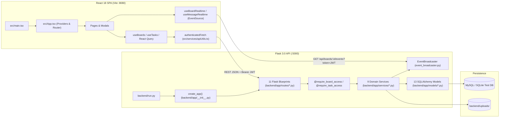
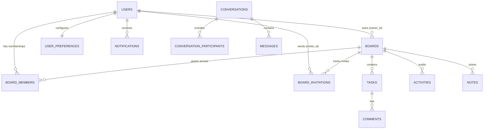

Status: Verified | Last scanned: 2026-10-13 | Audience: Engineers, Technical Writers, Maintainers

# Sticky Mind Grid — Repository Scan Notes & Feature Map (`_scan-notes.md`)

This document records the Step 1 repository inventory and Step 2 feature-to-file and business-rule enforcement mapping for **Sticky Mind Grid**. Every factual claim cites its source file path and line numbers.

---

## Step 1: Repository Inventory

### 1.1 Repository Structure

```text
sticky-mind-grid/
├── .github/workflows/
│   └── test.yml                         # 4-job GitHub Actions CI pipeline (test.yml:L1-L168)
├── backend/
│   ├── app/
│   │   ├── __init__.py                  # Flask app factory create_app() & _auto_sync_schema() (__init__.py:L14-L174)
│   │   ├── models/                      # 11 model files defining 13 SQLAlchemy models
│   │   │   ├── activity.py              # Activity model (activity.py:L8-L87)
│   │   │   ├── board.py                 # Board model (board.py:L10-L145)
│   │   │   ├── board_invitation.py      # BoardInvitation model (board_invitation.py:L8-L79)
│   │   │   ├── board_member.py          # BoardMember model (board_member.py:L8-L56)
│   │   │   ├── comment.py               # Comment model (comment.py:L8-L70)
│   │   │   ├── message.py               # Conversation, ConversationParticipant, Message (message.py:L8-L197)
│   │   │   ├── note.py                  # Note model (note.py:L8-L43)
│   │   │   ├── notification.py          # Notification model (notification.py:L8-L41)
│   │   │   ├── task.py                  # Task model (task.py:L10-L116)
│   │   │   ├── user.py                  # User model (user.py:L8-L54)
│   │   │   └── user_preference.py       # UserPreference model (user_preference.py:L8-L40)
│   │   ├── routes/                      # 11 Flask Blueprint modules
│   │   │   ├── activity_routes.py       # /api/activities (activity_routes.py:L1-L58)
│   │   │   ├── auth_routes.py           # /api/auth (auth_routes.py:L1-L247)
│   │   │   ├── board_routes.py          # /api/boards (board_routes.py:L1-L303)
│   │   │   ├── comment_routes.py        # /api/tasks/<id>/comments, /api/comments/<id> (comment_routes.py:L1-L57)
│   │   │   ├── file_routes.py           # /api/files (file_routes.py:L1-L62)
│   │   │   ├── message_routes.py        # /api/messages (message_routes.py:L1-L191)
│   │   │   ├── note_routes.py           # /api/boards/<id>/notes, /api/notes/<id> (note_routes.py:L1-L53)
│   │   │   ├── notification_routes.py   # /api/notifications (notification_routes.py:L1-L41)
│   │   │   ├── system_routes.py         # /api/health (system_routes.py:L1-L23)
│   │   │   ├── task_routes.py           # /api/tasks, /api/boards/<id>/trash (task_routes.py:L1-L217)
│   │   │   └── user_routes.py           # /api/users (user_routes.py:L1-L181)
│   │   ├── services/                    # 9 domain service modules
│   │   │   ├── activity_service.py      # ActivityService (activity_service.py:L1-L94)
│   │   │   ├── board_service.py         # BoardService (board_service.py:L1-L1166)
│   │   │   ├── comment_service.py       # CommentService (comment_service.py:L1-L272)
│   │   │   ├── file_service.py          # FileService (file_service.py:L1-L474)
│   │   │   ├── message_service.py       # MessageService (message_service.py:L1-L396)
│   │   │   ├── note_service.py          # NoteService (note_service.py:L1-L138)
│   │   │   ├── notification_service.py  # NotificationService (notification_service.py:L1-L71)
│   │   │   ├── task_service.py          # TaskService & TaskConflictError (task_service.py:L1-L649)
│   │   │   └── user_service.py          # UserService (user_service.py:L1-L87)
│   │   └── utils/
│   │       ├── decorators.py            # ROLE_HIERARCHY, get_effective_role, RBAC decorators (decorators.py:L1-L97)
│   │       └── event_broadcaster.py     # EventBroadcaster singleton (event_broadcaster.py:L1-L121)
│   ├── migrations/                      # Flask-Migrate / Alembic revisions (versions/33fd1f6ecfb3, 45dfebdb7151)
│   ├── tests/                           # 15 pytest suites + conftest.py
│   ├── uploads/                         # Local file upload storage (gitignored)
│   ├── config.py                        # Flask Config class (config.py:L1-L76)
│   ├── requirements.txt                 # Python dependencies (requirements.txt:L1-L13)
│   ├── run.py                           # Flask entry point (run.py:L1-L9)
│   └── seed.py                          # Dev/E2E database seeder (seed.py:L1-L545)
├── docs/                                # Project documentation
├── e2e/                                 # 16 Playwright E2E spec files + run.mjs orchestrator
├── scripts/
│   └── fetch_render_logs.py             # Render deployment log diagnostic script
├── src/
│   ├── components/                      # Domain UI components (auth, board, boards, common, dev, documents, kanban, layout, messages, notifications, search, settings, task, ui)
│   ├── config/api.ts                    # API_BASE and token storage key (src/config/api.ts:L1-L18)
│   ├── contexts/                        # AuthContext, SettingsContext, DevModeContext, LayoutContext
│   ├── hooks/                           # useBoards, useTasks, useBoardPermissions, useBoardRealtime, useActivity, useMessages, useSoundEffects
│   ├── pages/                           # 10 active route pages + legacy Index.tsx
│   ├── services/                        # 10 API client modules wrapping authenticatedFetch
│   ├── test/                            # 44 Vitest unit/component test suites + setup.ts + test-utils.tsx
│   ├── types/                           # TypeScript interfaces (board.ts, task.ts, activity.ts, comment.ts, message.ts, note.ts, notification.ts)
│   ├── utils/                           # Mention, pinned boards, geometry, and sound utilities
│   ├── App.tsx                          # Provider tree & React Router v6 routes (src/App.tsx:L1-L75)
│   └── main.tsx                         # React DOM root mount (src/main.tsx:L1-L6)
├── package.json                         # Frontend dependencies and scripts (package.json:L1-L100)
├── playwright.config.ts                 # Playwright test runner config (playwright.config.ts:L1-L32)
├── vite.config.ts                       # Vite dev server & /api proxy (vite.config.ts:L1-L26)
└── vitest.config.ts                     # Vitest test & coverage config (vitest.config.ts:L1-L17)
```

---

### 1.2 Languages, Frameworks & Libraries

#### Frontend (`package.json:L1-L100`)
- **Language & Build:** TypeScript `^5.8.3` (`package.json:L95`), Vite `^5.4.19` (`package.json:L96`), `@vitejs/plugin-react-swc` `^3.11.0` (`package.json:L74`).
- **UI & Routing:** React `^18.3.1` (`package.json:L60`), `react-router-dom` `^6.30.1` (`package.json:L65`), TailwindCSS `^3.4.17` (`package.json:L94`), 27 `@radix-ui/react-*` packages (`package.json:L23-L46`), `framer-motion` `^12.38.0` (`package.json:L55`), `lucide-react` `^0.462.0` (`package.json:L57`), `sonner` `^1.7.4` (`package.json:L68`), `cmdk` `^1.1.1` (`package.json:L52`).
- **State & Data Fetching:** `@tanstack/react-query` `^5.83.0` (`package.json:L47`) + React Context (`AuthContext`, `SettingsContext`, `DevModeContext`, `ActivityContext`, `LayoutContext`) + custom hooks (`useBoards`, `useTasks`).
- **Drag & Drop:** `@dnd-kit/core` `^6.3.1`, `@dnd-kit/sortable` `^10.0.0`, `@dnd-kit/utilities` `^3.2.2` (`package.json:L19-L21`).
- **Charts & Utilities:** `recharts` `^2.15.4` (`package.json:L66`), `date-fns` `^3.6.0` (`package.json:L53`), `zod` `^3.25.76` (`package.json:L73`), `react-hook-form` `^7.61.1` (`package.json:L63`).
- **Testing & Quality:** `vitest` `^3.2.4` (`package.json:L98`), `@vitest/coverage-v8` `^3.2.4` (`package.json:L82`), `@testing-library/react` `^16.0.0` (`package.json:L78`), `@playwright/test` `^1.57.0` (`package.json:L75`), `eslint` `^9.32.0` (`package.json:L85`).

#### Backend (`backend/requirements.txt:L1-L13`)
- **Language & Web Framework:** Python 3.10+ (`Flask==3.0.3`, `gunicorn>=21.2.0`).
- **Database & ORM:** `Flask-SQLAlchemy==3.1.1`, `SQLAlchemy==2.0.35`, `Flask-Migrate==4.0.7` (Alembic), `PyMySQL==1.1.0`, `cryptography>=42.0.0`.
- **Authentication & Security:** `Flask-JWT-Extended==4.6.0`, `flask-bcrypt==1.0.1`, `Flask-CORS==4.0.0`.
- **Testing:** `pytest>=8.0.0`, `pytest-cov>=5.0.0`, `python-dotenv==1.0.1`.

---

### 1.3 Entry Points & System Architecture



**Text Version of System Architecture:**
1. **Frontend Entry (`src/main.tsx:L1-L6` → `src/App.tsx:L30-L74`):** Mounts `<App />` into `#root`, wrapping routes in `QueryClientProvider`, `SettingsProvider`, `DevModeProvider`, `TooltipProvider`, `BrowserRouter`, `AuthProvider`, and `ActivityProvider`.
2. **REST Layer (`src/services/apiUtils.ts:L55-L102` → `backend/app/routes/*.py`):** Frontend services call `authenticatedFetch()`, which attaches `Authorization: Bearer <token>`, checks JWT expiry client-side (`isJwtExpired`, `apiUtils.ts:L22-L40`), and dispatches `auth:session-expired` on HTTP `401`.
3. **RBAC & Service Layer (`backend/app/utils/decorators.py:L19-L95` → `backend/app/services/*.py`):** Route handlers validate access using `@jwt_required()` and `@require_board_access` / `@require_task_access`, delegating business logic, database transactions, `Activity` logging, and `Notification` creation to `backend/app/services/*.py`.
4. **Real-Time Layer (`backend/app/utils/event_broadcaster.py:L7-L120` → `src/hooks/useBoardRealtime.ts:L29-L340`):** After `db.session.commit()`, services publish events to the in-memory `broadcaster`, which pushes SSE frames to connected clients subscribed to `/api/boards/<board_id>/events` or `/api/messages/stream`.
5. **Backend Entry (`backend/run.py:L1-L9` → `backend/app/__init__.py:L14-L174`):** `run.py` invokes `create_app()`, initializes extensions (`db`, `migrate`, `jwt`, `bcrypt`, `CORS`), registers 11 Blueprints (`__init__.py:L63-L85`), and runs `_auto_sync_schema()` (`__init__.py:L88-L172`) when `TESTING` is false.

---

### 1.4 Database Schema, Models & Migrations



**Text Version of Database Schema (13 Models across 11 Files):**
1. **`User` (`users` — `backend/app/models/user.py:L8-L54`):** `id` (UUID PK), `email` (unique), `password_hash`, `full_name`, `avatar_url` (`Text`), `auth_provider` (`'local'`), `auth_provider_id`, `created_at`.
2. **`Board` (`boards` — `backend/app/models/board.py:L10-L145`):** `id` (UUID PK), `name`, `emoji`, `description`, `color`, `hero_image_url` (`LONGTEXT`), `columns` (`JSON` array of `{id, title, emoji, color, wipLimit}`), `owner_id` (FK `users.id`), `workspace_id` (indexed), `is_deleted` (`Boolean`, default `False`), `deleted_at`, `created_at`, `updated_at`.
3. **`BoardMember` (`board_members` — `backend/app/models/board_member.py:L8-L56`):** `id` (UUID PK), `board_id` (FK `boards.id` CASCADE), `user_id` (FK `users.id` CASCADE), `role` (`'owner'|'admin'|'editor'|'member'|'commenter'|'viewer'`), `status` (`'pending'|'accepted'|'declined'|'expired'`), `is_muted` (`Boolean`, default `False`), `created_at`. Unique constraint `uq_board_user` on `(board_id, user_id)` (`L23`).
4. **`BoardInvitation` (`board_invitations` — `backend/app/models/board_invitation.py:L8-L79`):** `id` (UUID PK), `board_id` (FK `boards.id` CASCADE), `email` (lowercased), `role` (default `'editor'`), `status` (`'pending'|'accepted'|'expired'|'revoked'|'declined'`), `inviter_id` (FK `users.id` CASCADE), `created_at`, `expires_at` (defaults to `created_at + 7 days`, `L32-L33`), `accepted_at`, `revoked_at`.
5. **`Task` (`tasks` — `backend/app/models/task.py:L10-L116`):** `id` (UUID PK), `board_id` (FK `boards.id`), `title`, `emoji`, `description` (`LONGTEXT`), `status` (column ID), `priority` (`'low'|'medium'|'high'|'urgent'`), `progress` (`0-100`), `due_date`, `assigned_to` (FK `users.id`), `created_by` (FK `users.id`), `position` (`Float`, `1000.0` increments), `checklist` (`JSON`), `tags` (`JSON`), `attachments` (`JSON`), `followers` (`JSON`), `is_deleted` (`Boolean`, default `False`), `deleted_at`, `created_at`, `updated_at`.
6. **`Activity` (`activities` — `backend/app/models/activity.py:L8-L87`):** `id` (UUID PK), `board_id` (FK `boards.id` CASCADE), `type` (`'create'|'move'|'update'|'delete'`), `target_type` (`'task'|'comment'|'member'|'board'`), `target_id`, `task_title`, `before_value`, `after_value`, `message`, `user_id` (FK `users.id` SET NULL), `timestamp`.
7. **`Comment` (`comments` — `backend/app/models/comment.py:L8-L70`):** `id` (UUID PK), `task_id` (FK `tasks.id` CASCADE), `user_id` (FK `users.id` SET NULL), `content`, `mentions` (`JSON`), `is_edited` (`Boolean`, default `False`), `original_content` (`Text`), `created_at`, `updated_at`.
8. **`Notification` (`notifications` — `backend/app/models/notification.py:L8-L41`):** `id` (UUID PK), `user_id` (FK `users.id` CASCADE), `type`, `title`, `message`, `link`, `is_read` (`Boolean`, default `False`), `created_at`.
9. **`Note` (`notes` — `backend/app/models/note.py:L8-L43`):** `id` (UUID PK), `board_id` (FK `boards.id` CASCADE), `user_id` (FK `users.id` CASCADE), `title`, `content`, `color`, `created_at`, `updated_at`.
10. **`UserPreference` (`user_preferences` — `backend/app/models/user_preference.py:L8-L40`):** `id` (UUID PK), `user_id` (FK `users.id` CASCADE, unique), `default_board_view`, `timezone`, `date_format`, `first_day_of_week`, `notify_mentions`, `notify_assignments`, `notify_invites`, `notify_comments`, `updated_at`.
11. **`Conversation`, `ConversationParticipant`, `Message` (`conversations`, `conversation_participants`, `messages` — `backend/app/models/message.py:L8-L197`):** Direct (`1-on-1`) and group chat tables with read receipts, reactions (`JSON`), replies (`reply_to_id`), pins (`is_pinned`), forwarding (`is_forwarded`), and soft unsend (`is_deleted`).
12. **Migrations (`backend/migrations/versions/` & `backend/app/__init__.py:L88-L172`):** Contains 11 Alembic revisions (`0a01c5063dca_upgrade_text_columns_to_longtext_for_.py`, `29673c8836d7_add_activities_table_for_persistent_.py`, `0416cc5048fd_add_users_table_and_ownership_fields.py`, `935820c94de9_add_boardmember_model_and_relationships.py`, `949c3f42db05_added_board_members.py`, `c60e032bb475_add_user_preferences_table_and_avatar_.py`, `2bf738216089_add_conversations_participants_and_.py`, `5e381b19a1c2_add_auth_provider_notes_and_message_flags.py`, `7a8b9c0d1e2f_add_board_invitations_table.py`, `8b9c0d1e2f3a_add_workspace_id_and_nullable_comment_user.py`, `d9363d32af21_add_comment_edit_columns.py`); subsequent columns (`boards.is_deleted`, `boards.deleted_at`, `board_members.is_muted`, `tasks.followers`, `activities.target_type`/`target_id`/`before_value`/`after_value`) are auto-provisioned idempotently on startup via `_auto_sync_schema(app)` (`backend/app/__init__.py:L88-L172`).

---

### 1.5 Complete API Route Inventory

| Blueprint & File | Method & Path | Auth / Minimum Role | Service Handler & Lines |
|---|---|---|---|
| **Auth** (`auth_routes.py`) | `GET /api/auth/oauth/providers` (`L116-L122`) | Public | Returns enabled OAuth providers (`google`, `github`, `microsoft`) |
| | `POST /api/auth/oauth` (`L124-L130`) | Public | `handle_oauth_flow` (`auth_routes.py:L54-L114`) |
| | `POST /api/auth/oauth/<provider>` (`L132-L135`) | Public | `handle_oauth_flow` (`auth_routes.py:L54-L114`) |
| | `POST /api/auth/register` (`L137-L162`) | Public | Creates `User`, runs `attach_pending_invitations` (`L12-L53`) |
| | `POST /api/auth/login` (`L164-L193`) | Public | Verifies credentials, returns 24h JWT (`L184`) |
| | `GET /api/auth/me` (`L195-L204`) | `@jwt_required()` | Returns `user.to_dict()` |
| | `PATCH\|PUT /api/auth/me` (`L206-L230`) | `@jwt_required()` | Updates `fullName`, `avatarUrl`, `password` (requires `currentPassword`) |
| | `GET /api/auth/users/search?q=` (`L232-L244`) | `@jwt_required()` | Searches `User` by email/name (`limit 10`) |
| **Boards** (`board_routes.py`) | `GET /api/boards` (`L10-L15`) | `@jwt_required()` | `BoardService.get_user_boards` (`board_service.py:L14-L30`) |
| | `GET /api/boards/trash` (`L17-L22`) | `@jwt_required()` | `BoardService.get_trashed_boards` (`board_service.py:L316-L336`) |
| | `GET /api/boards/invitations` (`L25-L30`) | `@jwt_required()` | `BoardService.get_user_invitations` (`board_service.py:L34-L120`) |
| | `POST\|PATCH /api/boards/<board_id>/invitations/accept` (`L32-L40`) | `@jwt_required()` (invitee email match) | `BoardService.accept_invitation` (`board_service.py:L482-L572`) |
| | `POST\|PATCH\|DELETE /api/boards/<board_id>/invitations/decline` (`L42-L49`) | `@jwt_required()` (invitee) | `BoardService.decline_invitation` (`board_service.py:L575-L623`) |
| | `POST /api/boards/<board_id>/invitations/report` (`L51-L58`) | `@jwt_required()` (invitee) | `BoardService.report_invitation` (`board_service.py:L626-L673`) |
| | `GET /api/boards/<board_id>` (`L60-L68`) | `viewer` | `BoardService.get_board_by_id` (`board_service.py:L123-L129`) |
| | `GET /api/boards/<board_id>/events` (`L70-L119`) | `viewer` (header or `?token=`) | SSE stream via `broadcaster.subscribe` (`L95-L110`) |
| | `POST /api/boards` (`L121-L134`) | `@jwt_required()` | `BoardService.create_board` (`board_service.py:L180-L228`) |
| | `PATCH\|PUT /api/boards/<board_id>` (`L135-L147`) | `admin` | `BoardService.update_board` (`board_service.py:L244-L295`) |
| | `DELETE /api/boards/<board_id>?soft=true` (`L149-L161`) | `owner` | `BoardService.soft_delete_board` (`L297-L313`) or `delete_board` (`L359-L366`) |
| | `POST /api/boards/<board_id>/restore` (`L163-L171`) | `owner` | `BoardService.restore_board` (`board_service.py:L339-L356`) |
| | `GET /api/boards/<board_id>/export` (`L174-L182`) | `admin` | `BoardService.export_board_data` (`board_service.py:L1147-L1165`) |
| | `POST /api/boards/<board_id>/transfer-ownership` (`L184-L196`) | `owner` | `BoardService.transfer_ownership` (`board_service.py:L1056-L1101`) |
| | `GET /api/boards/<board_id>/members` (`L198-L204`) | `viewer` | `BoardService.get_board_members` (`board_service.py:L1104-L1144`) |
| | `POST /api/boards/<board_id>/members` (`L206-L222`) | `admin` | `BoardService.add_member` (`board_service.py:L373-L479`) |
| | `DELETE /api/boards/<board_id>/members/<user_id>` (`L224-L241`) | Self or `admin` | `BoardService.remove_member` (`board_service.py:L812-L929`) |
| | `POST /api/boards/<board_id>/members/<user_id>/resend` (`L243-L251`) | `admin` | `BoardService.resend_invitation` (`board_service.py:L676-L749`) |
| | `PATCH\|PUT /api/boards/<board_id>/members/<user_id>` (`L253-L267`) | `admin` | `BoardService.update_member_role` (`board_service.py:L959-L1053`) |
| | `POST\|DELETE /api/boards/<board_id>/invitations/<id>/revoke` (`L269-L277`) | `admin` | `BoardService.revoke_invitation` (`board_service.py:L752-L809`) |
| | `POST /api/boards/<board_id>/invitations/<id>/resend` (`L279-L287`) | `admin` | `BoardService.resend_invitation` (`board_service.py:L676-L749`) |
| | `PATCH\|PUT\|POST /api/boards/<board_id>/mute` (`L289-L299`) | `viewer` | `BoardService.set_board_mute` (`board_service.py:L932-L956`) |
| **Tasks** (`task_routes.py`) | `GET /api/tasks?boardId=` (`L12-L27`) | `viewer` (or all user boards) | `TaskService.get_tasks` (`L26-L29`) / `get_user_tasks` (`L32-L44`) |
| | `GET /api/boards/<board_id>/trash` (`L29-L37`) | `editor` | `TaskService.get_deleted_tasks` (`task_service.py:L47-L64`) |
| | `DELETE /api/boards/<board_id>/trash` (`L39-L47`) | `admin` | `TaskService.empty_trash` (`task_service.py:L618-L648`) |
| | `GET /api/tasks/<task_id>` (`L49-L56`) | `viewer` | `TaskService.get_task_by_id` (`task_service.py:L67-L68`) |
| | `POST /api/tasks` (`L58-L86`) | `editor` | `TaskService.create_task` (`task_service.py:L101-L207`) |
| | `POST\|PATCH\|PUT /api/tasks/<task_id>/follow` (`L88-L98`) | `viewer` | `TaskService.toggle_follow_task` (`task_service.py:L210-L224`) |
| | `PATCH /api/tasks/reorder` (`L100-L118`) | `editor` | `TaskService.reorder_tasks` (`task_service.py:L442-L507`) |
| | `PATCH\|PUT /api/tasks/<task_id>` (`L120-L171`) | `editor` (and `editor` on target board if moved) | `TaskService.update_task` (`task_service.py:L227-L439`) |
| | `DELETE /api/tasks/<task_id>` (`L173-L181`) | `editor` | `TaskService.delete_task` (`task_service.py:L510-L547`) |
| | `PATCH\|PUT /api/tasks/<task_id>/restore` (`L183-L199`) | `editor` | `TaskService.restore_task` (`task_service.py:L550-L581`) |
| | `DELETE /api/tasks/<task_id>/permanent` (`L201-L216`) | `admin` | `TaskService.permanent_delete_task` (`task_service.py:L584-L615`) |
| **Comments** (`comment_routes.py`) | `GET /api/tasks/<task_id>/comments` (`L8-L13`) | `viewer` | `CommentService.get_task_comments` (`comment_service.py:L14-L15`) |
| | `POST /api/tasks/<task_id>/comments` (`L15-L30`) | `commenter` | `CommentService.create_comment` (`comment_service.py:L77-L144`) |
| | `PATCH\|PUT /api/comments/<comment_id>` (`L32-L46`) | Author + `commenter` | `CommentService.update_comment` (`comment_service.py:L193-L250`) |
| | `DELETE /api/comments/<comment_id>` (`L48-L56`) | Author or `admin` | `CommentService.delete_comment` (`comment_service.py:L147-L190`) |
| **Activities** (`activity_routes.py`) | `GET /api/activities` (`L8-L31`) | `admin` (board log) or `viewer` (with `taskId`/`taskTitle`) | `ActivityService.get_activities` (`activity_service.py:L29-L47`) |
| | `POST /api/activities` (`L33-L49`) | `viewer` | `ActivityService.add_activity` (`activity_service.py:L63-L93`) |
| | `PUT\|PATCH\|DELETE /api/activities[/<id>]` (`L51-L55`) | Blocked (`403` for all roles) | Returns `403 Activity log entries are immutable` |
| **Files** (`file_routes.py`) | `POST /api/files/upload` (`L26-L43`) | `@jwt_required()` (`editor` if `boardId` given) | `FileService.save_file` (`file_service.py:L165-L299`) |
| | `GET /api/files/<filename>` (`L45-L51`) | Board `viewer` / Chat participant / Public avatar | `FileService.verify_file_access` & `get_file` (`file_service.py:L382-L473`) |
| | `GET /api/files/<filename>/download` (`L53-L60`) | Board `viewer` / Chat participant / Public avatar | `FileService.verify_file_access` & `get_file(as_attachment=True)` |
| **Notes** (`note_routes.py`) | `GET /api/boards/<board_id>/notes` (`L8-L13`) | `viewer` | `NoteService.get_board_notes` (`note_service.py:L11-L12`) |
| | `POST /api/boards/<board_id>/notes` (`L15-L28`) | `member` (`editor`) | `NoteService.create_note` (`note_service.py:L15-L53`) |
| | `PATCH\|PUT /api/notes/<note_id>` (`L30-L42`) | `member` (`editor`) | `NoteService.update_note` (`note_service.py:L56-L100`) |
| | `DELETE /api/notes/<note_id>` (`L44-L52`) | Note author or `admin` | `NoteService.delete_note` (`note_service.py:L103-L137`) |
| **Notifications** (`notification_routes.py`) | `GET /api/notifications` (`L8-L20`) | `@jwt_required()` | Returns latest notifications (`limit=30` default) + `unreadCount` |
| | `PATCH\|PUT /api/notifications/<id>/read` (`L22-L32`) | `@jwt_required()` | Marks single notification read |
| | `PATCH\|PUT /api/notifications/read-all` (`L34-L40`) | `@jwt_required()` | Marks all user notifications read |
| **Users** (`user_routes.py`) | `GET /api/users/me/preferences` (`L16-L30`) | `@jwt_required()` | Gets or creates `UserPreference` |
| | `PATCH\|PUT /api/users/me/preferences` (`L32-L81`) | `@jwt_required()` | Updates `UserPreference` fields |
| | `GET /api/users/me/export` (`L83-L123`) | `@jwt_required()` | Exports user profile, preferences, boards, tasks, notes as JSON |
| | `GET /api/users/teammates` (`L125-L169`) | `@jwt_required()` | Lists accepted members sharing at least 1 board with caller |
| | `DELETE /api/users/me` (`L171-L179`) | `@jwt_required()` | `UserService.delete_account` (`user_service.py:L14-L86`) |
| **Messages** (`message_routes.py`) | `GET/POST /api/messages/conversations` (`L9-L46`) | `@jwt_required()` | `MessageService` direct/group conversation CRUD |
| | `GET /api/messages/conversations/<id>` (`L48-L55`) | Participant | `MessageService.get_conversation` |
| | `GET/POST /api/messages/conversations/<id>/messages` (`L57-L92`) | Participant | `MessageService.get_conversation_messages` / `send_message` |
| | `POST /api/messages/<id>/forward` (`L94-L104`) | Participant | `MessageService.forward_message` |
| | `POST /api/messages/conversations/<id>/read` (`L106-L113`) | Participant | `MessageService.mark_as_read` |
| | `POST /api/messages/<id>/reactions` (`L115-L125`) | Participant | `MessageService.toggle_reaction` |
| | `DELETE /api/messages/<id>` (`L127-L134`) | Sender | `MessageService.delete_message` (soft unsend) |
| | `POST /api/messages/<id>/pin` (`L136-L143`) | Participant | `MessageService.toggle_pin` |
| | `GET /api/messages/unread-count` (`L145-L150`) | `@jwt_required()` | `MessageService.get_unread_count` |
| | `GET /api/messages/stream` (`L152-L190`) | Token (header or `?token=`) | User-scoped SSE stream on `user:<user_id>` |
| **System** (`system_routes.py`) | `GET /api/health` (`L8-L22`) | Public | Executes `SELECT 1` and returns DB health & version `'1.2.0'` |

---

### 1.6 Real-Time Event Handlers (`EventBroadcaster` & SSE)

- **Backend Broadcaster (`backend/app/utils/event_broadcaster.py:L7-L120`):**
  - Thread-safe in-memory pub/sub (`self._lock = threading.Lock()`, `self._subscriptions = defaultdict(set)`, `self._queue_users = {}`).
  - Each subscriber receives a `queue.Queue(maxsize=100)` (`L15`). Slow clients drop events via `except queue.Full: pass` (`L51-L53`).
  - `disconnect_user(channel_id, user_id)` (`L82-L117`) sends a `force_disconnect` event followed by `None` sentinel, immediately closing the HTTP stream in `board_routes.py:L101-L103`.
- **Board SSE Stream (`GET /api/boards/<board_id>/events` at `board_routes.py:L70-L119` → `src/hooks/useBoardRealtime.ts:L150-L298`):**
  - Sends `: ping\n\n` every 25 seconds on idle (`board_routes.py:L101-L107`).
  - **Events emitted by backend and handled by `useBoardRealtime.ts` (`L182-L279`):** `connected`, `task:created`, `task:moved`, `tasks:reordered`, `task:updated`, `task:deleted`, `activity:new`, `member:joined`, `member:role_updated`, `member:removed`, `force_disconnect`, `board:updated`, `board:deleted`.
  - **Events emitted by backend but NOT handled in `useBoardRealtime.ts` switch statement:** `trash:emptied` (`task_service.py:L645`), `member:invited` (`board_service.py:L476`), `member:invite_resent` (`board_service.py:L748`), `comment:created` (`comment_service.py:L142`), `comment:updated` (`comment_service.py:L247`), `comment:deleted` (`comment_service.py:L187`), `note:created` (`note_service.py:L50`), `note:updated` (`note_service.py:L97`), `note:deleted` (`note_service.py:L134`).

---

### 1.7 Background Jobs & Retention Architecture

- **No Background Worker / Scheduler:** Neither Celery, APScheduler, nor cron jobs exist in the repository.
- **Lazy Retention / Expiration on Query:**
  1. **30-Day Task Trash Purge (`backend/app/services/task_service.py:L47-L64`):** Executed synchronously inside `TaskService.get_deleted_tasks(board_id)` when `GET /api/boards/<board_id>/trash` is requested. Deletes tasks with `is_deleted == True` and `deleted_at < utcnow() - 30 days` along with physical attachment files.
  2. **30-Day Board Trash Purge (`backend/app/services/board_service.py:L14-L25, L316-L326`):** Executed synchronously inside `BoardService.get_user_boards` (`GET /api/boards`) and `BoardService.get_trashed_boards` (`GET /api/boards/trash`).
  3. **7-Day Invitation Expiry (`backend/app/models/board_invitation.py:L35-L41`, `board_service.py:L48-L56, L87-L90, L514-L517, L1118-L1120`, `auth_routes.py:L24-L26`):** Evaluated lazily when listing invitations, listing board members, registering an account, or attempting to accept an invitation.
  4. **Activity Retention Filter (`backend/app/services/activity_service.py:L9-L16`):** `ActivityService._get_retention_cutoff()` filters out activities older than `ACTIVITY_RETENTION_DAYS` (`backend/config.py:L59`, default `0` = disabled) on read.

---

### 1.8 Tests, CI/CD & Configuration

- **Frontend Unit/Component Tests:** 41 test files (`223` tests) in `src/test/**` run via Vitest (`vitest.config.ts:L1-L17`).
- **Backend Integration/Unit Tests:** 12 test files (`105` tests) in `backend/tests/test_*.py` run via Pytest against in-memory SQLite (`sqlite:///:memory:` in `backend/tests/conftest.py:L19`).
- **End-to-End Browser Tests:** 12 Playwright spec files (`112` tests) in `e2e/*.spec.ts` orchestrated by `e2e/run.mjs:L1-L133` against isolated MySQL database `sticky_mind_grid_test` (Flask on `:5000`, Vite on `:5173`).
- **CI/CD (`.github/workflows/test.yml:L1-L168`):** Runs `backend-tests`, `frontend-tests`, and `e2e-tests` on push/PR to `main` and `MultiUserCollab`.
- **Configuration (`backend/config.py:L1-L76`, `src/config/api.ts:L1-L18`, `.env.example`):**
  - `VITE_API_BASE_URL` defaults to `` `http://${window.location.hostname || "127.0.0.1"}:5000/api` `` (`src/config/api.ts:L3-L6`).
  - `MAX_CONTENT_LENGTH = 25 MB`, `MAX_BOARD_STORAGE_BYTES = 100 MB`, `MAX_OWNER_STORAGE_BYTES = 500 MB` (`backend/config.py:L55-L57`).

---

## Step 2: Feature-to-File Mapping & Enforcement Layer Matrix

### 2.1 Feature-to-File Mapping

| Feature | Frontend Implementation | Backend Implementation | Tests |
|---|---|---|---|
| **Board Tenant & RBAC** | `src/hooks/useBoardPermissions.ts:L53-L224` | `backend/app/utils/decorators.py:L10-L95`, `board_service.py:L369-L383, L959-L1144` | `backend/tests/test_rbac.py`, `src/test/hooks/useBoardPermissions.test.tsx` |
| **Board Invite Lifecycle** | `src/components/board/InviteMemberDialog.tsx:L48-L304`, `src/components/board/BoardMembers.tsx:L57-L498`, `src/pages/BoardsOverview.tsx:L428-L549`, `src/pages/TeamsPage.tsx:L170-L275` | `backend/app/models/board_invitation.py:L8-L79`, `backend/app/models/board_member.py:L8-L56`, `board_routes.py:L25-L58, L198-L287`, `board_service.py:L34-L120, L373-L929`, `auth_routes.py:L12-L53` | `backend/tests/test_invitations.py`, `src/test/components/BoardMembers.test.tsx`, `e2e/members.spec.ts` |
| **Home Page (Board Grid, Search, Sort, Filter, Pin, Trash)** | `src/pages/BoardsOverview.tsx:L90-L806`, `src/components/boards/BoardCard.tsx:L62-L414`, `src/hooks/useBoards.ts:L66-L347`, `src/utils/pinnedBoardsUtils.ts:L1-L44` | `board_routes.py:L10-L22, L149-L171`, `board_service.py:L14-L30, L297-L366` | `backend/tests/test_boards.py`, `src/test/pages/BoardsOverview.test.tsx`, `e2e/boards.spec.ts` |
| **Create / Edit Board & Columns** | `src/components/boards/BoardModal.tsx:L249-L844` | `board_routes.py:L121-L147`, `board_service.py:L132-L295` | `src/test/components/BoardModal.test.tsx`, `e2e/boards.spec.ts` |
| **Kanban Drag-and-Drop & Views** | `src/components/kanban/KanbanBoard.tsx:L55-L1195`, `KanbanColumn.tsx:L32-L272`, `TaskCard.tsx:L55-L644`, `TaskListView.tsx:L37-L238`, `CalendarView.tsx:L64-L949`, `DocumentsView.tsx:L38-L428`, `BoardOverview.tsx:L16-L131` | `task_routes.py:L12-L27, L100-L118`, `task_service.py:L26-L44, L442-L507` | `e2e/kanban.spec.ts`, `src/test/components/KanbanBoardBackdrop.test.tsx` |
| **Task Modal & Detail Workspace** | `src/components/kanban/TaskModal.tsx:L85-L938`, `src/components/task/TaskDetailWorkspace.tsx:L33-L456`, `TaskHeader.tsx:L68-L396`, `TaskProperties.tsx:L62-L497`, `TaskDescription.tsx:L11-L167`, `TaskChecklist.tsx:L20-L190`, `TaskAttachments.tsx:L30-L232`, `src/pages/TaskDetailPage.tsx:L19-L337` | `task_routes.py:L49-L98, L120-L171`, `task_service.py:L101-L439` | `backend/tests/test_tasks.py`, `src/test/components/TaskDetailWorkspace.test.tsx`, `e2e/kanban.spec.ts` |
| **Cross-Board Task Move** | `src/components/task/TaskHeader.tsx:L212-L241`, `src/components/kanban/KanbanBoard.tsx:L209-L245` | `task_routes.py:L129-L147`, `task_service.py:L255, L301-L327, L419-L428` | `backend/tests/test_rbac.py`, `backend/tests/test_privacy_and_tenancy.py` |
| **Task Trash & 30-Day Purge** | `src/components/kanban/TrashModal.tsx:L22-L214` | `task_routes.py:L29-L47, L173-L216`, `task_service.py:L47-L64, L510-L648` | `e2e/trash.spec.ts` |
| **Comments & @Mentions** | `src/components/kanban/TaskComments.tsx:L36-L422` | `comment_routes.py:L8-L56`, `comment_service.py:L14-L271` | `src/test/components/TaskComments.test.tsx`, `backend/tests/test_tasks.py` |
| **Notifications & Board Mute** | `src/components/notifications/NotificationBell.tsx:L30-L236`, `KanbanBoard.tsx:L869-L895` | `notification_routes.py:L8-L40`, `notification_service.py:L1-L71`, `board_routes.py:L289-L299`, `board_service.py:L932-L956` | `src/test/components/NotificationBell.test.tsx`, `e2e/notifications.spec.ts` |
| **Activity Feed & Audit Log** | `src/hooks/useActivity.tsx:L17-L130`, `src/components/kanban/LatestChangesPanel.tsx:L6-L41`, `src/components/task/TaskActivityLog.tsx:L1-L155` | `activity_routes.py:L8-L55`, `activity_service.py:L29-L93`, `backend/app/models/activity.py:L49-L87` | `backend/tests/test_rbac.py`, `e2e/activity.spec.ts` |
| **Data Export (Board & Account)** | `src/components/kanban/KanbanBoard.tsx:L299-L346, L896-L906`, `src/components/settings/tabs/PrivacyTab.tsx:L31-L54` | `board_routes.py:L174-L182`, `board_service.py:L1147-L1165`, `user_routes.py:L83-L123` | `backend/tests/test_rbac.py`, `backend/tests/test_auth.py` |

---

### 2.2 Business Rule Enforcement Layer Matrix

| Business Rule | Server Enforcement (Routes / Services / DB) | Real-Time SSE Layer | UI-Only Enforcement |
|---|---|---|---|
| **5-Tier Board RBAC (`owner > admin > editor > commenter > viewer`)** | **Enforced:** `@require_board_access`, `@require_task_access`, and `get_effective_role` (`decorators.py:L10-L95`). Pending/declined/expired invitees get `0` (`403`). | **Enforced:** `GET /api/boards/<id>/events` checks `effective_role >= viewer` (`board_routes.py:L88-L93`). | `useBoardPermissions.ts` hides/disables controls based on role (`L183-L222`). |
| **Immediate Access Revocation on Member Removal / Decline** | **Enforced:** `BoardMember` deleted or set to `'declined'`; subsequent API calls return `403`. | **Enforced:** `broadcaster.disconnect_user(board_id, user_id)` sends `force_disconnect` and terminates the SSE queue (`event_broadcaster.py:L82-L117`). | `KanbanBoard.tsx:L257-L265` shows toast and redirects to `"/"`. |
| **Read-Only Lock During SSE Reconnection** | Not applicable (stateless HTTP). | `useBoardRealtime.ts:L285-L298` sets `isReconnecting = true` on `EventSource.onerror`. | **UI-Only:** `KanbanBoard.tsx:L128` sets `effectiveReadOnly = isReadOnly \|\| isReconnecting`, disabling drag/edit/comment until reconnected. |
| **Assignee Must Hold `editor` Role or Above** | **Enforced:** `task_routes.py:L72-L76, L148-L156` rejects `commenter`/`viewer` with `400`. Demoting or removing a member auto-unassigns their tasks (`board_service.py:L905-L920, L1023-L1041`). | Broadcasts `task:updated` and `activity:new` for each unassigned task. | `TaskModal.tsx:L105-L109` and `TaskProperties.tsx:L115` filter assignee dropdown to `owner`/`admin`/`editor`. |
| **Cannot Delete Column Containing Active Tasks** | **Enforced:** `BoardService.update_board` (`board_service.py:L268-L274`) raises `ValueError` (`400`) if a removed column ID has non-deleted tasks. | Broadcasts `board:updated` only after validation passes. | `BoardModal.tsx:L324-L333` blocks column removal with a toast error if `columnsWithTasks.has(col.id)`. |
| **Progress Locked to Checklist Completion %** | **Not enforced on server:** `TaskService.update_task` (`task_service.py:L262`) accepts any `progress` integer passed in payload. | Broadcasts `task:updated` with current `progress`. | **UI-Only:** `TaskChecklist.tsx:L40-L47` computes `Math.round((completed/total)*100)` and `TaskProperties.tsx:L83, L361` disables the manual slider when `checklist.length > 0`. |
| **Auto-Snap Progress on Column Drag (`0%` → `30%` → `100%`)** | **Not enforced on server:** Server saves whatever `progress` value the client sends. | Broadcasts `task:moved` / `tasks:reordered`. | **UI-Only:** `KanbanBoard.tsx:L454-L466` adjusts `progress` on drag-drop when `settings.autoProgressSnapping` is enabled. |
| **Concurrent Description Edit Conflict Detection** | **Enforced (when `baseDescription` sent):** `TaskService.update_task` (`task_service.py:L240-L242`) raises `TaskConflictError` (`HTTP 409`) if `old_description != baseDescription` and not `forceOverwrite`. | Remote edits arrive via `task:updated` SSE event (`TaskDetailWorkspace.tsx:L59-L74`). | `TaskDescription.tsx:L73-L111` renders conflict resolution banner (`Load Remote` vs `Overwrite With Mine`). |
| **Cross-Board Move Tenancy & Privacy** | **Enforced:** `task_routes.py:L133-L146` requires `editor` on both boards, remaps missing column ID to `target_cols[0]`, strips unauthorized assignee, and logs `'Another board'` (`task_service.py:L301-L327`). | Broadcasts `task:deleted` on source board and `task:created` on target board (`task_service.py:L419-L428`). | `TaskHeader.tsx:L212-L241` shows target boards in Move menu when `canMoveCrossBoard`. |
| **7-Day Invite Expiry & 20/Day Invite Rate Limit** | **Enforced:** `BoardService.add_member` (`board_service.py:L390-L398`) caps at 20 invites/24h; `accept_invitation` (`L514-L517`) rejects expired invites (`400`). | Broadcasts `member:invited`, `member:invite_resent`, `member:joined`. | `BoardsOverview.tsx:L68-L88` renders expiry countdown badge. |
| **Attachment Deletion Ownership (Editor Own-Only vs Admin Any)** | **Not enforced per-attachment on server:** `PATCH /api/tasks/<id>` (`task_routes.py:L122`) allows any `editor` to overwrite the `task.attachments` JSON array. | Broadcasts `task:updated`. | **UI-Only:** `TaskAttachments.tsx:L72-L79` hides the delete button on other users' attachments unless `canDeleteAnyAttachment` (`admin`/`owner`). |
| **Activity Log Immutability & Role Visibility** | **Enforced:** `activity_routes.py:L27-L28` requires `admin` for board-wide log (`viewer` for single-card log); `L51-L55` blocks `PUT`/`PATCH`/`DELETE` with `403`. | Broadcasts `activity:new` (`event_broadcaster.py`). | `KanbanBoard.tsx:L599-L604` hides the `Activity` (`changes`) view tab unless `canViewBoardActivity` (`admin`/`owner`). |
| **Type-to-Confirm on Board Delete & Owner Promotion** | **Not enforced on server:** `DELETE /api/boards/<id>` and `POST /api/boards/<id>/transfer-ownership` do not require board name in payload. | Broadcasts `board:deleted` / `member:role_updated`. | **UI-Only:** `BoardsOverview.tsx:L787-L791` and `BoardMembers.tsx:L465-L470` disable the confirm button until the user types the exact board name. |
